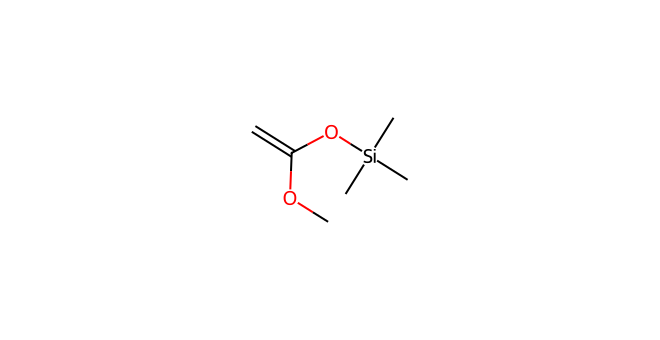
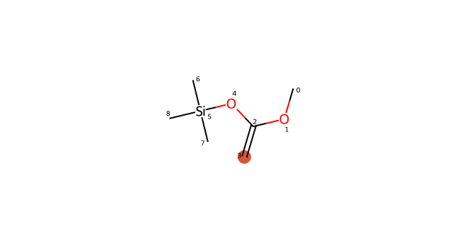
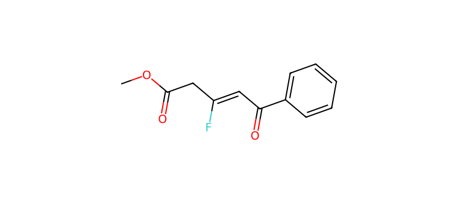

# C002 · Methyl acetate trimethylsilyl ketene acetal

[← C001](C001.md) · [100-molecule catalog](README.md) · [C003 →](C003.md)

| Input property | Value |
| --- | --- |
| Molecular formula | C6H14O2Si |
| Input SMILES | `C=C(OC)O[Si](C)(C)C` |
| Proposed bond-forming centre(s) | C |
| Allocation | working |
| Research role | unverified extrapolation |
| NP product-connectivity assessment | 2 / 2 |
| NR reaction-precedent assessment | 3 / 3 |
| Site/pathway hypotheses | 2 |
| Proposed product options | 2 |

NP/NR describe the proposed endpoints and the bounded literature comparison. They are separate ordinal labels; no overall success probability or numerical ranking is supplied. See [assessment definitions](README.md#assessment-labels).

## Chemical rationale and source description

Lewis-acid or silicon-directed activation can expose the terminal carbon nucleophile.

Tests a neutral ester-enolate equivalent; hydrolysis, desilylation and direct carbonyl addition compete.

Comparison literature: V20 ([L152](../literature/sources/L152.md) [59])

## Reactive sites, pathways and proposed endpoints

The highlighted atoms below use **zero-based indices in the exact hypothesis SMILES**. This ordering can differ from the input structure drawn above. Products are proposed connectivities; a depiction is not evidence of formation, isolation or stereochemical identity.

### H01 · C-centred pathway

**Hypothesis SMILES:** `COC(=C)O[Si](C)(C)C`. **Proposed reacting atom(s):** 3 (C). **Basis:** model hypothesis.

**Activation/pathway question:** Lewis-acid or silicon-directed activation can expose the terminal carbon nucleophile.

**Assessment:** NP 2; NR 3. **Research role:** unverified extrapolation. **Recorded qualitative confidence:** C.

#### Product option 002-H01-O01

`COC(=O)CC(F)=CC(=O)c1ccccc1`

NP **2**; NR **3**; formal charge **0**. Structure query: **no registry match** (`PC-682be9722ca63292c942`); PubChem CID(s): none returned. Comparison references: [V20 / L152](../literature/sources/L152.md).

### H02 · C-centred pathway

**Hypothesis SMILES:** `COC(=C)O[Si](C)(C)C`. **Proposed reacting atom(s):** 3 (C). **Basis:** model hypothesis.

**Activation/pathway question:** Lewis-acid or silicon-directed activation can expose the terminal carbon nucleophile.

**Assessment:** NP 2; NR 3. **Research role:** unverified extrapolation. **Recorded qualitative confidence:** C.

#### Product option 002-H02-O01

`COC(=O)CC(F)=CC(=O)c1ccccc1`

NP **2**; NR **3**; formal charge **0**. Structure query: **no registry match** (`PC-682be9722ca63292c942`); PubChem CID(s): none returned. Comparison references: [V20 / L152](../literature/sources/L152.md).

## Literature evidence and principle questions

**[L242](../literature/sources/L242.md)** — author observation, source PDF page 23.

For enolates, the site of electrophilic attack depends on enolate structure, electrophile, solvent, and counterion, so selectivity cannot be assigned from nucleophile identity alone.

Source context: Enolate anions; variables governing C/O selectivity.

- [RP1](../evidence/principles/RP1.md): Can the trifluoroethyl carbonyl substrate access an electrophilic state compatible with the proposed donor form and its activation conditions?

- [RP2](../evidence/principles/RP2.md): Which donor form and reacting site form the intended bond, and how do counterion, electronics and steric environment affect capture?

- [RP3](../evidence/principles/RP3.md): Does donor capture followed by fluoride elimination outcompete protonation, hydrogen-atom transfer and other termination pathways?

- [RP4](../evidence/principles/RP4.md): Does the proposed monofluoroalkene persist during reaction and workup, or undergo further conversion?

## Association with experimental inputs

No route-compatible association was assigned among the 108 recorded substrate–partner combinations. This does not establish that the molecule was experimentally rejected or found inactive.

The relations describe molecular identity, reactive form or donor-family similarity. They do not recover the original selection decision and do not assign experimental success to a suggested molecule.

## Download the scientific records

The [100-molecule JSON](data/candidates_100.json), [115-hypothesis JSON](data/hypotheses_115.json), [124-product JSON](product_options/product_options_124.json) and [108-input mapping JSON](experiment_mapping/mapping_108.json) retain this molecule’s linked records. The hypothesis JSON also includes the complete original-language proposal: reactive form, activation, route, rationale, competing outcomes and suggested discriminating experiment.
