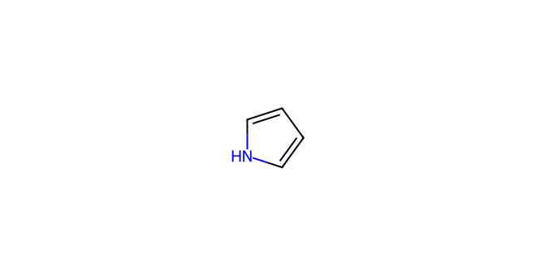
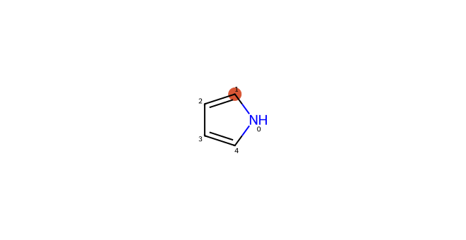
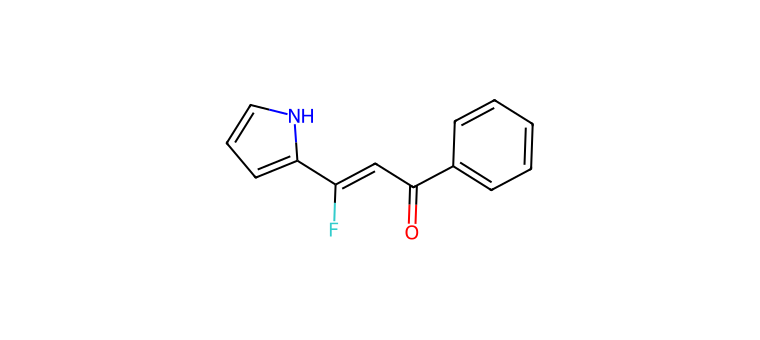
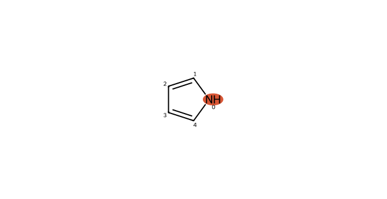
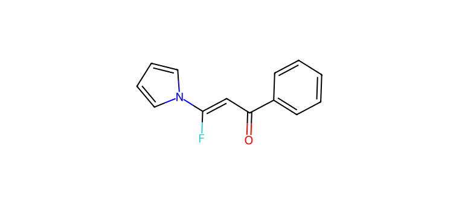

# C027 · Pyrrole

[← C026](C026.md) · [100-molecule catalog](README.md) · [C028 →](C028.md)

| Input property | Value |
| --- | --- |
| Molecular formula | C4H5N |
| Input SMILES | `c1cc[nH]c1` |
| Proposed bond-forming centre(s) | C, N |
| Allocation | reserve |
| Research role | unverified extrapolation / priority for exploration |
| NP product-connectivity assessment | 2 / 2 |
| NR reaction-precedent assessment | 3 / 2 |
| Site/pathway hypotheses | 2 |
| Proposed product options | 2 |

NP/NR describe the proposed endpoints and the bounded literature comparison. They are separate ordinal labels; no overall success probability or numerical ranking is supplied. See [assessment definitions](README.md#assessment-labels).

## Chemical rationale and source description

Distinct recorded hypotheses specify aromatic C attack and N-H-derived N attack.

Makes C/N site competition explicit rather than counting the same molecule as two reagents.

Comparison literature: V02 ([L203](../literature/sources/L203.md) [62]), V03 ([L348](../literature/sources/L348.md) [63]), V19 ([L240](../literature/sources/L240.md) [34]), V22 ([L361](../literature/sources/L361.md) [60])

## Reactive sites, pathways and proposed endpoints

The highlighted atoms below use **zero-based indices in the exact hypothesis SMILES**. This ordering can differ from the input structure drawn above. Products are proposed connectivities; a depiction is not evidence of formation, isolation or stereochemical identity.

### H01 · C-centred pathway

**Hypothesis SMILES:** `[nH]1cccc1`. **Proposed reacting atom(s):** 1 (C). **Basis:** model hypothesis.

**Activation/pathway question:** Distinct recorded hypotheses specify aromatic C attack and N-H-derived N attack.

**Assessment:** NP 2; NR 3. **Research role:** unverified extrapolation. **Recorded qualitative confidence:** C.

#### Product option 027-H01-O01

`O=C(C=C(F)c1ccc[nH]1)c1ccccc1`

NP **2**; NR **3**; formal charge **0**. Structure query: **no registry match** (`PC-1ed369b7a919d86ea1e4`); PubChem CID(s): none returned. Comparison references: [V19 / L240](../literature/sources/L240.md), [V22 / L361](../literature/sources/L361.md).

### H02 · N-centred pathway

**Hypothesis SMILES:** `[nH]1cccc1`. **Proposed reacting atom(s):** 0 (N). **Basis:** model hypothesis.

**Activation/pathway question:** Distinct recorded hypotheses specify aromatic C attack and N-H-derived N attack.

**Assessment:** NP 2; NR 2. **Research role:** priority for exploration. **Recorded qualitative confidence:** B.

#### Product option 027-H02-O01

`O=C(C=C(F)n1cccc1)c1ccccc1`

NP **2**; NR **2**; formal charge **0**. Structure query: **no registry match** (`PC-bb59844a6169407f9593`); PubChem CID(s): none returned. Comparison references: [V31 / L362](../literature/sources/L362.md), [V02 / L203](../literature/sources/L203.md), [V03 / L348](../literature/sources/L348.md).

## Literature evidence and principle questions

**[L042](../literature/sources/L042.md)** — author observation, source PDF page 4.

A base-promoted intramolecular nitrogen attack on a gem-difluoroalkene followed by beta-fluoride elimination generated N-substituted 2-fluoroindoles, but formation of the required amino-difluorovinyl precursor first used a Pd-catalyzed Buchwald-Hartwig coupling.

Source context: Heterocycle formation involving nitrogen attack on a gem-difluoroalkene

- [RP1](../evidence/principles/RP1.md): Can the trifluoroethyl carbonyl substrate access an electrophilic state compatible with the proposed donor form and its activation conditions?

- [RP2](../evidence/principles/RP2.md): Which donor form and reacting site form the intended bond, and how do counterion, electronics and steric environment affect capture?

- [RP3](../evidence/principles/RP3.md): Does donor capture followed by fluoride elimination outcompete protonation, hydrogen-atom transfer and other termination pathways?

- [RP4](../evidence/principles/RP4.md): Does the proposed monofluoroalkene persist during reaction and workup, or undergo further conversion?

## Association with experimental inputs

| Input pair | Relation | Chemical basis |
| --- | --- | --- |
| [AP004](experiment_mapping/pairs/AP004.md) | Structural Analogue | Pyrrolic N–H is retained, while benzannulation/substitution changes the ring and electronics; only the N-centred pyrrole hypothesis is route-compatible. |
| [AP005](experiment_mapping/pairs/AP005.md) | Structural Analogue | Pyrrolic N–H is retained, while benzannulation/substitution changes the ring and electronics; only the N-centred pyrrole hypothesis is route-compatible. |
| [AP006](experiment_mapping/pairs/AP006.md) | Structural Analogue | Pyrrolic N–H is retained, while benzannulation/substitution changes the ring and electronics; only the N-centred pyrrole hypothesis is route-compatible. |
| [AP009](experiment_mapping/pairs/AP009.md) | Structural Analogue | Pyrrolic N–H is retained, while benzannulation/substitution changes the ring and electronics; only the N-centred pyrrole hypothesis is route-compatible. |
| [AP012](experiment_mapping/pairs/AP012.md) | Structural Analogue | Pyrrolic N–H is retained, while benzannulation/substitution changes the ring and electronics; only the N-centred pyrrole hypothesis is route-compatible. |
| [AP017](experiment_mapping/pairs/AP017.md) | Structural Analogue | Pyrrolic N–H is retained, while benzannulation/substitution changes the ring and electronics; only the N-centred pyrrole hypothesis is route-compatible. |
| [AP018](experiment_mapping/pairs/AP018.md) | Structural Analogue | Pyrrolic N–H is retained, while benzannulation/substitution changes the ring and electronics; only the N-centred pyrrole hypothesis is route-compatible. |
| [AP019](experiment_mapping/pairs/AP019.md) | Structural Analogue | Pyrrolic N–H is retained, while benzannulation/substitution changes the ring and electronics; only the N-centred pyrrole hypothesis is route-compatible. |
| [AP020](experiment_mapping/pairs/AP020.md) | Structural Analogue | Pyrrolic N–H is retained, while benzannulation/substitution changes the ring and electronics; only the N-centred pyrrole hypothesis is route-compatible. |
| [AP022](experiment_mapping/pairs/AP022.md) | Structural Analogue | Pyrrolic N–H is retained, while benzannulation/substitution changes the ring and electronics; only the N-centred pyrrole hypothesis is route-compatible. |
| [AP023](experiment_mapping/pairs/AP023.md) | Structural Analogue | Pyrrolic N–H is retained, while benzannulation/substitution changes the ring and electronics; only the N-centred pyrrole hypothesis is route-compatible. |
| [AP024](experiment_mapping/pairs/AP024.md) | Structural Analogue | Pyrrolic N–H is retained, while benzannulation/substitution changes the ring and electronics; only the N-centred pyrrole hypothesis is route-compatible. |
| [AP025](experiment_mapping/pairs/AP025.md) | Structural Analogue | Pyrrolic N–H is retained, while benzannulation/substitution changes the ring and electronics; only the N-centred pyrrole hypothesis is route-compatible. |
| [AP026](experiment_mapping/pairs/AP026.md) | Structural Analogue | Pyrrolic N–H is retained, while benzannulation/substitution changes the ring and electronics; only the N-centred pyrrole hypothesis is route-compatible. |
| [AP027](experiment_mapping/pairs/AP027.md) | Structural Analogue | Pyrrolic N–H is retained, while benzannulation/substitution changes the ring and electronics; only the N-centred pyrrole hypothesis is route-compatible. |
| [AP032](experiment_mapping/pairs/AP032.md) | Structural Analogue | Pyrrolic N–H is retained, while benzannulation/substitution changes the ring and electronics; only the N-centred pyrrole hypothesis is route-compatible. |
| [AP036](experiment_mapping/pairs/AP036.md) | Structural Analogue | Pyrrolic N–H is retained, while benzannulation/substitution changes the ring and electronics; only the N-centred pyrrole hypothesis is route-compatible. |
| [AP041](experiment_mapping/pairs/AP041.md) | Structural Analogue | Pyrrolic N–H is retained, while benzannulation/substitution changes the ring and electronics; only the N-centred pyrrole hypothesis is route-compatible. |
| [AP042](experiment_mapping/pairs/AP042.md) | Structural Analogue | Pyrrolic N–H is retained, while benzannulation/substitution changes the ring and electronics; only the N-centred pyrrole hypothesis is route-compatible. |
| [AP043](experiment_mapping/pairs/AP043.md) | Structural Analogue | Pyrrolic N–H is retained, while benzannulation/substitution changes the ring and electronics; only the N-centred pyrrole hypothesis is route-compatible. |

The relations describe molecular identity, reactive form or donor-family similarity. They do not recover the original selection decision and do not assign experimental success to a suggested molecule.

## Download the scientific records

The [100-molecule JSON](data/candidates_100.json), [115-hypothesis JSON](data/hypotheses_115.json), [124-product JSON](product_options/product_options_124.json) and [108-input mapping JSON](experiment_mapping/mapping_108.json) retain this molecule’s linked records. The hypothesis JSON also includes the complete original-language proposal: reactive form, activation, route, rationale, competing outcomes and suggested discriminating experiment.
