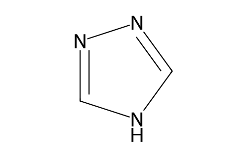
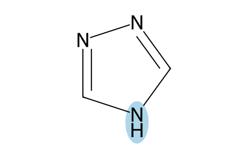
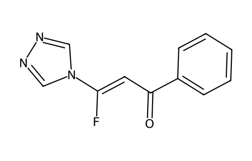
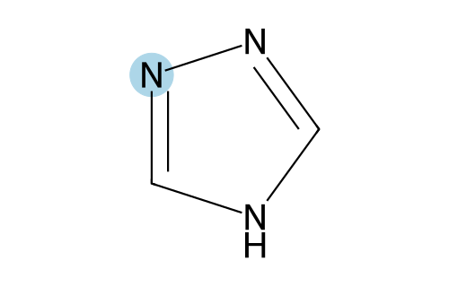
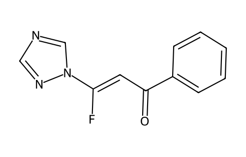

# C030 · 1,2,4-Triazole

[← C029](C029.md) · [100-molecule catalog](README.md) · [C031 →](C031.md)

| Recommended-input property | Value |
| --- | --- |
| Molecular formula | C2H3N3 |
| Canonical SMILES | `c1nnc[nH]1` |
| Proposed bond-forming centre | N |
| Precursor family | azole (RF03) |
| Feasibility class | B |
| Novelty review priority | 1 |
| NP labels | 2 / unresolved |
| NR labels | 2 / unresolved |
| Site/pathway hypotheses | 2 |
| Proposed product options | 2 |

## Recommendation rationale

This azole; neutral X-H donor belongs to the azole family and was retained as a N-centred recommendation. It is assigned feasibility class B and novelty review priority 1. These categories organize chemical review and do not state that the target reaction has already been demonstrated.

The machine-readable record retains the source-linked activation question, competing pathways, diagnostic observation and transfer limits used in the recommendation workflow.

## Reactive-site hypotheses and proposed endpoints

### C030-H01

Reacting-atom index: **4** (zero-based in `c1nnc[nH]1`).

Proposed route: N-centred substitution; carbonyl retained; one fluorine retained at the new alkene

Evidence basis: RP-guided chemical proposal. Full activation, competing-pathway and diagnostic fields are retained in the hypothesis JSON.

#### C030-H01-O01

`O=C(C=C(F)n1cnnc1)c1ccccc1`

NP **2**; NR **2**. This is a proposed connectivity, not an observed product assignment.

### C030-H02

Reacting-atom index: **2** (zero-based in `c1nnc[nH]1`).

Proposed route: Alternative neutral N-substituted regioisomer

Evidence basis: RP-guided chemical proposal. Full activation, competing-pathway and diagnostic fields are retained in the hypothesis JSON.

#### C030-H02-O01

`O=C(C=C(F)n1cncn1)c1ccccc1`

NP **unresolved**; NR **unresolved**. This is a proposed connectivity, not an observed product assignment.

## Relationship to the experimental collection

Best relationship: **Same donor family, different scaffold**.

| Experimental record | Relationship | Structural basis |
| --- | --- | --- |
| [AP028](experiment_mapping/pairs/AP028.md) | Same donor family, different scaffold | The local donor type is retained, but the molecular scaffold differs. |
| [AP001](experiment_mapping/pairs/AP001.md) | Same donor family, different scaffold | The local donor type is retained, but the molecular scaffold differs. |

## Evidence and data links

RP focus: [RP2](../evidence/principles/RP2.md), [RP4](../evidence/principles/RP4.md). Literature sources: [L348](../literature/sources/L348.md).

[Candidate JSON](data/candidates_100.json) · [103 hypotheses](data/hypotheses_103.json) · [103 product options](product_options/product_options_103.json) · [108 experimental pairs](experiment_mapping/mapping_108.json)
