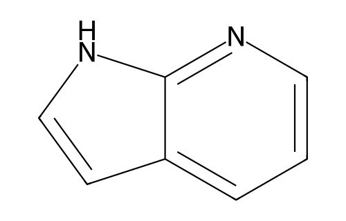
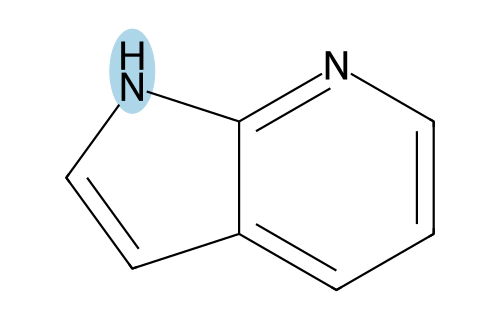
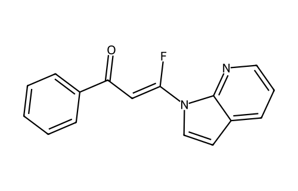

# C033 · 7-Azaindole

[← C032](C032.md) · [100-molecule catalog](README.md) · [C034 →](C034.md)

| Recommended-input property | Value |
| --- | --- |
| Molecular formula | C7H6N2 |
| Canonical SMILES | `c1cnc2[nH]ccc2c1` |
| Proposed bond-forming centre | N |
| Precursor family | pyrrolic_nh (RF11) |
| Feasibility class | B |
| Novelty review priority | 1 |
| NP labels | unresolved |
| NR labels | unresolved |
| Site/pathway hypotheses | 1 |
| Proposed product options | 1 |

## Recommendation rationale

This pyrrolic_nh; neutral X-H donor belongs to the pyrrolic_nh family and was retained as a N-centred recommendation. It is assigned feasibility class B and novelty review priority 1. These categories organize chemical review and do not state that the target reaction has already been demonstrated.

The machine-readable record retains the source-linked activation question, competing pathways, diagnostic observation and transfer limits used in the recommendation workflow.

## Reactive-site hypotheses and proposed endpoints

### C033-H01

Reacting-atom index: **4** (zero-based in `c1cnc2[nH]ccc2c1`).

Proposed route: N-centred substitution; carbonyl retained; one fluorine retained at the new alkene

Evidence basis: RP-guided chemical proposal. Full activation, competing-pathway and diagnostic fields are retained in the hypothesis JSON.

#### C033-H01-O01

`O=C(C=C(F)n1ccc2cccnc21)c1ccccc1`

NP **unresolved**; NR **unresolved**. This is a proposed connectivity, not an observed product assignment.

## Relationship to the experimental collection

Best relationship: **Same scaffold, substituent or positional variation**.

| Experimental record | Relationship | Structural basis |
| --- | --- | --- |
| [AP032](experiment_mapping/pairs/AP032.md) | Same scaffold, substituent or positional variation | The reacting-atom type and core scaffold are retained, while substitution or position differs. |
| [AP023](experiment_mapping/pairs/AP023.md) | Same donor family, different scaffold | The local donor type is retained, but the molecular scaffold differs. |
| [AP005](experiment_mapping/pairs/AP005.md) | Same donor family, different scaffold | The local donor type is retained, but the molecular scaffold differs. |

## Evidence and data links

RP focus: [RP2](../evidence/principles/RP2.md), [RP4](../evidence/principles/RP4.md). Literature sources: [L042](../literature/sources/L042.md), [L149](../literature/sources/L149.md), [L203](../literature/sources/L203.md), [L348](../literature/sources/L348.md).

[Candidate JSON](data/candidates_100.json) · [103 hypotheses](data/hypotheses_103.json) · [103 product options](product_options/product_options_103.json) · [108 experimental pairs](experiment_mapping/mapping_108.json)
