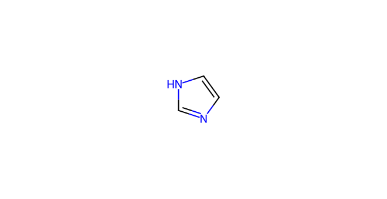
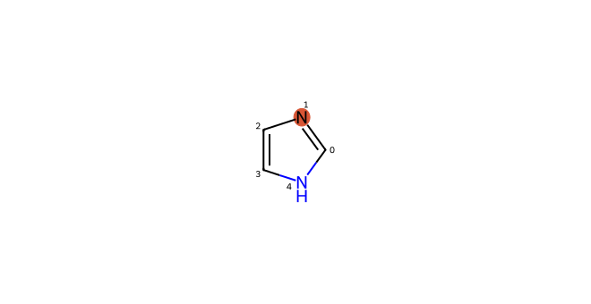
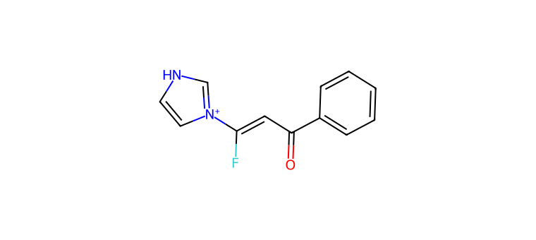
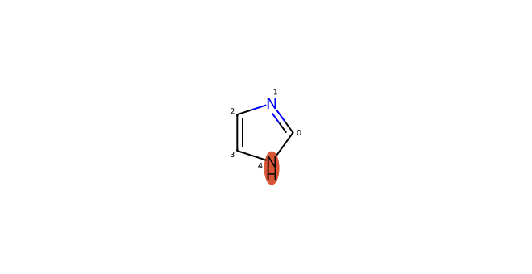
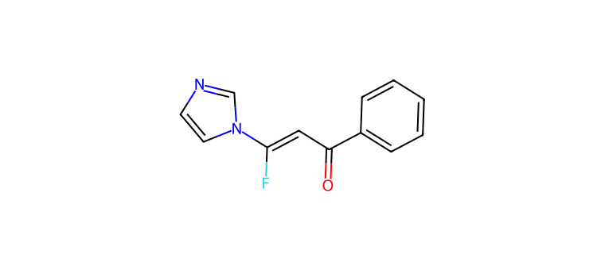

# C035 · Imidazole

[← C034](C034.md) · [100-molecule catalog](README.md) · [C036 →](C036.md)

| Input property | Value |
| --- | --- |
| Molecular formula | C3H4N2 |
| Input SMILES | `c1c[nH]cn1` |
| Proposed bond-forming centre(s) | N |
| Allocation | working |
| Research role | unverified extrapolation / priority for exploration |
| NP product-connectivity assessment | 2 / 2 |
| NR reaction-precedent assessment | 2 / 2 |
| Site/pathway hypotheses | 2 |
| Proposed product options | 2 |

NP/NR describe the proposed endpoints and the bounded literature comparison. They are separate ordinal labels; no overall success probability or numerical ranking is supplied. See [assessment definitions](README.md#assessment-labels).

## Chemical rationale and source description

Separate recorded hypotheses target the neutral pyridine-like N and the N-H-derived nitrogen.

Tests small heteroaromatic N capture while distinguishing proton transfer, competing N sites and catalyst binding.

Comparison literature: V01 ([L334](../literature/sources/L334.md) [64]), V02 ([L203](../literature/sources/L203.md) [62]), V03 ([L348](../literature/sources/L348.md) [63])

## Reactive sites, pathways and proposed endpoints

The highlighted atoms below use **zero-based indices in the exact hypothesis SMILES**. This ordering can differ from the input structure drawn above. Products are proposed connectivities; a depiction is not evidence of formation, isolation or stereochemical identity.

### H01 · N-centred pathway

**Hypothesis SMILES:** `c1ncc[nH]1`. **Proposed reacting atom(s):** 1 (N). **Basis:** model hypothesis.

**Activation/pathway question:** Separate recorded hypotheses target the neutral pyridine-like N and the N-H-derived nitrogen.

**Assessment:** NP 2; NR 2. **Research role:** unverified extrapolation. **Recorded qualitative confidence:** B.

#### Product option 035-H01-O01

`O=C(C=C(F)[n+]1cc[nH]c1)c1ccccc1`

NP **2**; NR **2**; formal charge **1**. Structure query: **no registry match** (`PC-98b087c19731a56f07b1`); PubChem CID(s): none returned. Comparison references: [V31 / L362](../literature/sources/L362.md), [V01 / L334](../literature/sources/L334.md), [V02 / L203](../literature/sources/L203.md), [V03 / L348](../literature/sources/L348.md).

### H02 · N-centred pathway

**Hypothesis SMILES:** `c1ncc[nH]1`. **Proposed reacting atom(s):** 4 (N). **Basis:** local analogy.

**Activation/pathway question:** Separate recorded hypotheses target the neutral pyridine-like N and the N-H-derived nitrogen.

**Assessment:** NP 2; NR 2. **Research role:** priority for exploration. **Recorded qualitative confidence:** B.

#### Product option 035-H02-O01

`O=C(C=C(F)n1ccnc1)c1ccccc1`

NP **2**; NR **2**; formal charge **0**. Structure query: **no registry match** (`PC-85addcb8d4bc3591a2b2`); PubChem CID(s): none returned. Comparison references: [V31 / L362](../literature/sources/L362.md), [V01 / L334](../literature/sources/L334.md), [V02 / L203](../literature/sources/L203.md), [V03 / L348](../literature/sources/L348.md).

## Literature evidence and principle questions

**[L149](../literature/sources/L149.md)** — author observation, source PDF page 45.

Nucleophilic addition to a vinylic gem-difluoroalkene followed by fluoride elimination is described as a common route to monofluoroalkenes, but the reviewed intermolecular examples used hydrides or carbon nucleophiles, while heteroatom nucleophiles were limited to intramolecular cyclizations forming five-membered heterocycles.

Source context: Literature review: addition-elimination of gem-difluoroalkenes

- [RP1](../evidence/principles/RP1.md): Can the trifluoroethyl carbonyl substrate access an electrophilic state compatible with the proposed donor form and its activation conditions?

- [RP2](../evidence/principles/RP2.md): Which donor form and reacting site form the intended bond, and how do counterion, electronics and steric environment affect capture?

- [RP3](../evidence/principles/RP3.md): Does donor capture followed by fluoride elimination outcompete protonation, hydrogen-atom transfer and other termination pathways?

- [RP4](../evidence/principles/RP4.md): Does the proposed monofluoroalkene persist during reaction and workup, or undergo further conversion?

## Association with experimental inputs

| Input pair | Relation | Chemical basis |
| --- | --- | --- |
| [AP001](experiment_mapping/pairs/AP001.md) | Structural Analogue | Imidazole-type N–H centre retained; ring fusion or substitution changes the molecular structure and acid/base environment. |
| [AP028](experiment_mapping/pairs/AP028.md) | Structural Analogue | Imidazole-type N–H centre retained; ring fusion or substitution changes the molecular structure and acid/base environment. |

The relations describe molecular identity, reactive form or donor-family similarity. They do not recover the original selection decision and do not assign experimental success to a suggested molecule.

## Download the scientific records

The [100-molecule JSON](data/candidates_100.json), [115-hypothesis JSON](data/hypotheses_115.json), [124-product JSON](product_options/product_options_124.json) and [108-input mapping JSON](experiment_mapping/mapping_108.json) retain this molecule’s linked records. The hypothesis JSON also includes the complete original-language proposal: reactive form, activation, route, rationale, competing outcomes and suggested discriminating experiment.
