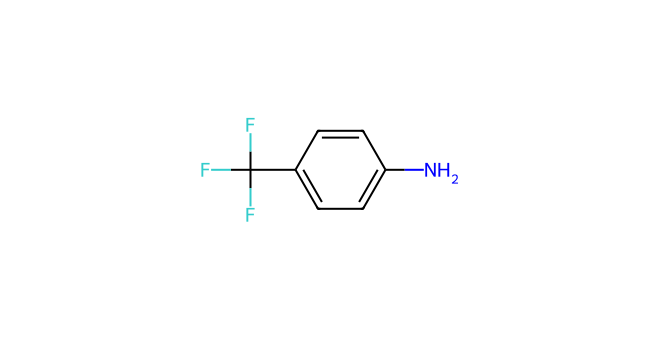
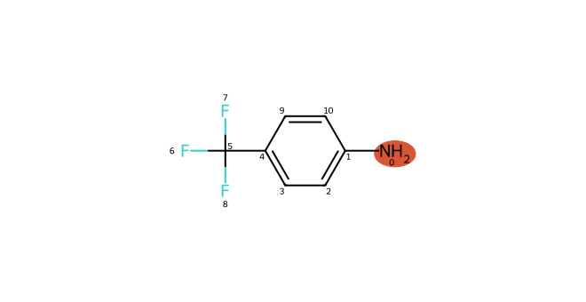
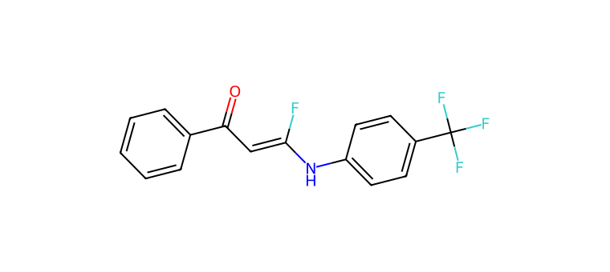

# C038 · 4-(Trifluoromethyl)aniline

[← C037](C037.md) · [100-molecule catalog](README.md) · [C039 →](C039.md)

| Input property | Value |
| --- | --- |
| Molecular formula | C7H6F3N |
| Input SMILES | `Nc1ccc(C(F)(F)F)cc1` |
| Proposed bond-forming centre(s) | N |
| Allocation | working |
| Research role | priority for exploration |
| NP product-connectivity assessment | 2 |
| NR reaction-precedent assessment | 2 |
| Site/pathway hypotheses | 1 |
| Proposed product options | 1 |

NP/NR describe the proposed endpoints and the bounded literature comparison. They are separate ordinal labels; no overall success probability or numerical ranking is supplied. See [assessment definitions](README.md#assessment-labels).

## Chemical rationale and source description

Neutral-amine capture is compared conceptually with controlled deprotonation.

Tests whether reduced N nucleophilicity limits coupling, without adding a second coordinating heteroatom.

Comparison literature: V04 ([L349](../literature/sources/L349.md) [66]), V05 ([L350](../literature/sources/L350.md) [10])

## Reactive sites, pathways and proposed endpoints

The highlighted atoms below use **zero-based indices in the exact hypothesis SMILES**. This ordering can differ from the input structure drawn above. Products are proposed connectivities; a depiction is not evidence of formation, isolation or stereochemical identity.

### H01 · N-centred pathway

**Hypothesis SMILES:** `Nc1ccc(C(F)(F)F)cc1`. **Proposed reacting atom(s):** 0 (N). **Basis:** model hypothesis.

**Activation/pathway question:** Neutral-amine capture is compared conceptually with controlled deprotonation.

**Assessment:** NP 2; NR 2. **Research role:** priority for exploration. **Recorded qualitative confidence:** B.

#### Product option 038-H01-O01

`O=C(C=C(F)Nc1ccc(C(F)(F)F)cc1)c1ccccc1`

NP **2**; NR **2**; formal charge **0**. Structure query: **no registry match** (`PC-fa48e3cfb4022e4696fb`); PubChem CID(s): none returned. Comparison references: [V05 / L350](../literature/sources/L350.md), [V04 / L349](../literature/sources/L349.md).

## Literature evidence and principle questions

The candidate proposal contains no molecule-linked source citation. Later comparison references listed above remain separate from the evidence used to propose the molecule.

- [RP1](../evidence/principles/RP1.md): Can the trifluoroethyl carbonyl substrate access an electrophilic state compatible with the proposed donor form and its activation conditions?

- [RP2](../evidence/principles/RP2.md): Which donor form and reacting site form the intended bond, and how do counterion, electronics and steric environment affect capture?

- [RP3](../evidence/principles/RP3.md): Does donor capture followed by fluoride elimination outcompete protonation, hydrogen-atom transfer and other termination pathways?

- [RP4](../evidence/principles/RP4.md): Does the proposed monofluoroalkene persist during reaction and workup, or undergo further conversion?

## Association with experimental inputs

| Input pair | Relation | Chemical basis |
| --- | --- | --- |
| [AP011](experiment_mapping/pairs/AP011.md) | Structural Analogue | Aryl-bound amine N–H is the local analogy; N substitution, ring identity and CF3 electronics differ. |
| [AP016](experiment_mapping/pairs/AP016.md) | Structural Analogue | Aryl-bound amine N–H is the local analogy; N substitution, ring identity and CF3 electronics differ. |
| [AP035](experiment_mapping/pairs/AP035.md) | Structural Analogue | Aryl-bound amine N–H is the local analogy; N substitution, ring identity and CF3 electronics differ. |
| [AP038](experiment_mapping/pairs/AP038.md) | Structural Analogue | Aryl-bound amine N–H is the local analogy; N substitution, ring identity and CF3 electronics differ. |

The relations describe molecular identity, reactive form or donor-family similarity. They do not recover the original selection decision and do not assign experimental success to a suggested molecule.

## Download the scientific records

The [100-molecule JSON](data/candidates_100.json), [115-hypothesis JSON](data/hypotheses_115.json), [124-product JSON](product_options/product_options_124.json) and [108-input mapping JSON](experiment_mapping/mapping_108.json) retain this molecule’s linked records. The hypothesis JSON also includes the complete original-language proposal: reactive form, activation, route, rationale, competing outcomes and suggested discriminating experiment.
