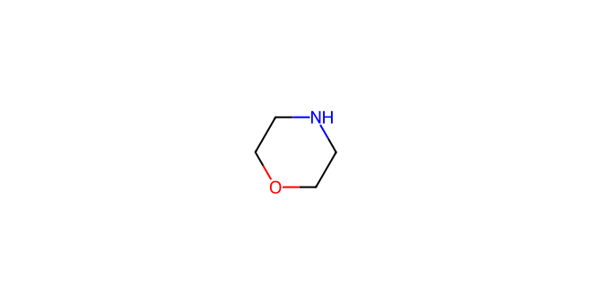
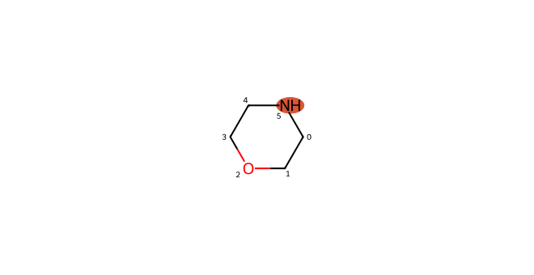
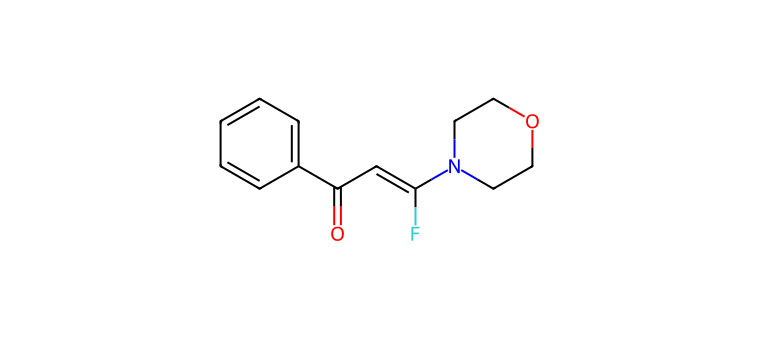
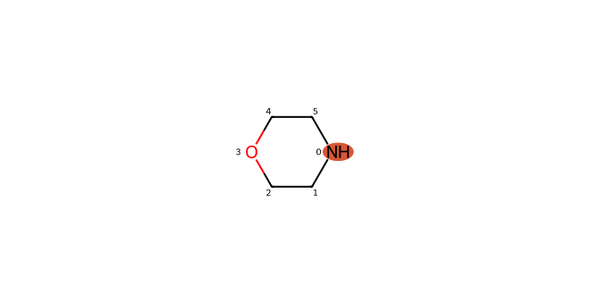

# C039 · Morpholine

[← C038](C038.md) · [100-molecule catalog](README.md) · [C040 →](C040.md)

| Input property | Value |
| --- | --- |
| Molecular formula | C4H9NO |
| Input SMILES | `C1COCCN1` |
| Proposed bond-forming centre(s) | N |
| Allocation | working |
| Research role | condition-limited challenge |
| NP product-connectivity assessment | 2 / 2 |
| NR reaction-precedent assessment | 1 / 1 |
| Site/pathway hypotheses | 2 |
| Proposed product options | 2 |

NP/NR describe the proposed endpoints and the bounded literature comparison. They are separate ordinal labels; no overall success probability or numerical ranking is supplied. See [assessment definitions](README.md#assessment-labels).

## Chemical rationale and source description

Neutral amine capture and condition-dependent proton transfer are proposed.

Tests an aliphatic N donor whose ring oxygen alters basicity and provides a competing coordination site.

Comparison literature: V04 ([L349](../literature/sources/L349.md) [66]), V08 ([L291](../literature/sources/L291.md) [39])

## Reactive sites, pathways and proposed endpoints

The highlighted atoms below use **zero-based indices in the exact hypothesis SMILES**. This ordering can differ from the input structure drawn above. Products are proposed connectivities; a depiction is not evidence of formation, isolation or stereochemical identity.

### H01 · N-centred pathway

**Hypothesis SMILES:** `C1COCCN1`. **Proposed reacting atom(s):** 5 (N). **Basis:** local analogy.

**Activation/pathway question:** Neutral amine capture and condition-dependent proton transfer are proposed.

**Assessment:** NP 2; NR 1. **Research role:** condition-limited challenge. **Recorded qualitative confidence:** B.

#### Product option 039-H01-O01

`O=C(C=C(F)N1CCOCC1)c1ccccc1`

NP **2**; NR **1**; formal charge **0**. Structure query: **no registry match** (`PC-92d8632c48e3f492d75d`); PubChem CID(s): none returned. Comparison references: [V08 / L291](../literature/sources/L291.md), [V04 / L349](../literature/sources/L349.md).

### H02 · N-centred pathway

**Hypothesis SMILES:** `N1CCOCC1`. **Proposed reacting atom(s):** 0 (N). **Basis:** local analogy.

**Activation/pathway question:** Neutral amine capture and condition-dependent proton transfer are proposed.

**Assessment:** NP 2; NR 1. **Research role:** condition-limited challenge. **Recorded qualitative confidence:** B.

#### Product option 039-H02-O01

`O=C(C=C(F)N1CCOCC1)c1ccccc1`

NP **2**; NR **1**; formal charge **0**. Structure query: **no registry match** (`PC-92d8632c48e3f492d75d`); PubChem CID(s): none returned. Comparison references: [V08 / L291](../literature/sources/L291.md), [V04 / L349](../literature/sources/L349.md).

## Literature evidence and principle questions

**[L042](../literature/sources/L042.md)** — author observation, source PDF page 4.

A base-promoted intramolecular nitrogen attack on a gem-difluoroalkene followed by beta-fluoride elimination generated N-substituted 2-fluoroindoles, but formation of the required amino-difluorovinyl precursor first used a Pd-catalyzed Buchwald-Hartwig coupling.

Source context: Heterocycle formation involving nitrogen attack on a gem-difluoroalkene

**[L291](../literature/sources/L291.md)** — author hypothesis, source PDF page 7.

The authors propose initial base-mediated nucleophilic addition–elimination of morpholine to form INT-1, followed either by an aminoalkyne cycloaddition pathway or by vinylic azide substitution, cyclization, and aromatization.

Source context: Results and Discussion; proposed mechanism

- [RP1](../evidence/principles/RP1.md): Can the trifluoroethyl carbonyl substrate access an electrophilic state compatible with the proposed donor form and its activation conditions?

- [RP2](../evidence/principles/RP2.md): Which donor form and reacting site form the intended bond, and how do counterion, electronics and steric environment affect capture?

- [RP3](../evidence/principles/RP3.md): Does donor capture followed by fluoride elimination outcompete protonation, hydrogen-atom transfer and other termination pathways?

- [RP4](../evidence/principles/RP4.md): Does the proposed monofluoroalkene persist during reaction and workup, or undergo further conversion?

## Association with experimental inputs

| Input pair | Relation | Chemical basis |
| --- | --- | --- |
| [AP010](experiment_mapping/pairs/AP010.md) | Structural Analogue | Secondary amine N–H is the local analogy; ring topology and/or O-to-C/N replacement change basicity, coordination and steric environment. |
| [AP014](experiment_mapping/pairs/AP014.md) | Structural Analogue | Secondary amine N–H is the local analogy; ring topology and/or O-to-C/N replacement change basicity, coordination and steric environment. |
| [AP015](experiment_mapping/pairs/AP015.md) | Structural Analogue | Secondary amine N–H is the local analogy; ring topology and/or O-to-C/N replacement change basicity, coordination and steric environment. |
| [AP033](experiment_mapping/pairs/AP033.md) | Structural Analogue | Secondary amine N–H is the local analogy; ring topology and/or O-to-C/N replacement change basicity, coordination and steric environment. |
| [AP034](experiment_mapping/pairs/AP034.md) | Structural Analogue | Secondary amine N–H is the local analogy; ring topology and/or O-to-C/N replacement change basicity, coordination and steric environment. |
| [AP037](experiment_mapping/pairs/AP037.md) | Structural Analogue | Secondary amine N–H is the local analogy; ring topology and/or O-to-C/N replacement change basicity, coordination and steric environment. |

The relations describe molecular identity, reactive form or donor-family similarity. They do not recover the original selection decision and do not assign experimental success to a suggested molecule.

## Download the scientific records

The [100-molecule JSON](data/candidates_100.json), [115-hypothesis JSON](data/hypotheses_115.json), [124-product JSON](product_options/product_options_124.json) and [108-input mapping JSON](experiment_mapping/mapping_108.json) retain this molecule’s linked records. The hypothesis JSON also includes the complete original-language proposal: reactive form, activation, route, rationale, competing outcomes and suggested discriminating experiment.
