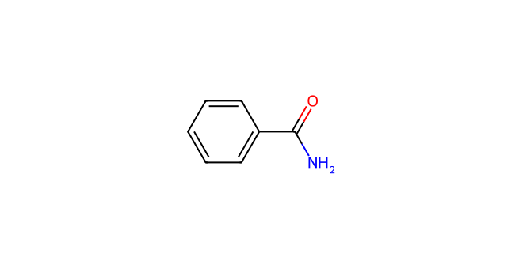
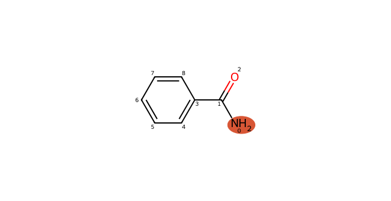
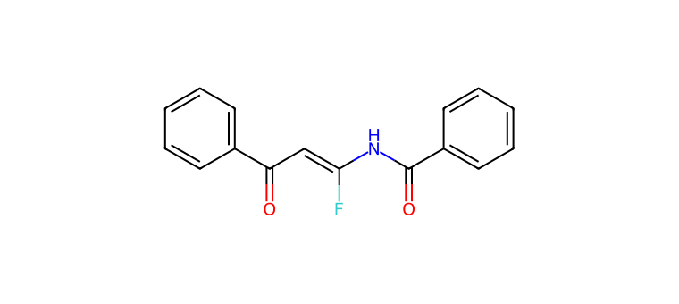

# C041 · Benzamide

[← C040](C040.md) · [100-molecule catalog](README.md) · [C042 →](C042.md)

| Input property | Value |
| --- | --- |
| Molecular formula | C7H7NO |
| Input SMILES | `NC(=O)c1ccccc1` |
| Proposed bond-forming centre(s) | N |
| Allocation | working |
| Research role | unverified extrapolation |
| NP product-connectivity assessment | 2 |
| NR reaction-precedent assessment | 3 |
| Site/pathway hypotheses | 1 |
| Proposed product options | 1 |

NP/NR describe the proposed endpoints and the bounded literature comparison. They are separate ordinal labels; no overall success probability or numerical ranking is supplied. See [assessment definitions](README.md#assessment-labels).

## Chemical rationale and source description

Base activation can access an amidate-like nucleophile.

Tests a resonance-deactivated N donor with C/O/N connectivity and coordination boundaries.

Comparison literature: V09 ([L351](../literature/sources/L351.md) [65])

## Reactive sites, pathways and proposed endpoints

The highlighted atoms below use **zero-based indices in the exact hypothesis SMILES**. This ordering can differ from the input structure drawn above. Products are proposed connectivities; a depiction is not evidence of formation, isolation or stereochemical identity.

### H01 · N-centred pathway

**Hypothesis SMILES:** `NC(=O)c1ccccc1`. **Proposed reacting atom(s):** 0 (N). **Basis:** model hypothesis.

**Activation/pathway question:** Base activation can access an amidate-like nucleophile.

**Assessment:** NP 2; NR 3. **Research role:** unverified extrapolation. **Recorded qualitative confidence:** C.

#### Product option 041-H01-O01

`O=C(C=C(F)NC(=O)c1ccccc1)c1ccccc1`

NP **2**; NR **3**; formal charge **0**. Structure query: **no registry match** (`PC-3492b3f5d7d99f23283e`); PubChem CID(s): none returned. Comparison references: [V09 / L351](../literature/sources/L351.md).

## Literature evidence and principle questions

The candidate proposal contains no molecule-linked source citation. Later comparison references listed above remain separate from the evidence used to propose the molecule.

- [RP1](../evidence/principles/RP1.md): Can the trifluoroethyl carbonyl substrate access an electrophilic state compatible with the proposed donor form and its activation conditions?

- [RP2](../evidence/principles/RP2.md): Which donor form and reacting site form the intended bond, and how do counterion, electronics and steric environment affect capture?

- [RP3](../evidence/principles/RP3.md): Does donor capture followed by fluoride elimination outcompete protonation, hydrogen-atom transfer and other termination pathways?

- [RP4](../evidence/principles/RP4.md): Does the proposed monofluoroalkene persist during reaction and workup, or undergo further conversion?

## Association with experimental inputs

| Input pair | Relation | Chemical basis |
| --- | --- | --- |
| [AP008](experiment_mapping/pairs/AP008.md) | Structural Analogue | Amide/lactam N–H is the local analogy; acyl substitution or ring closure changes acidity and resonance. It is not a molecular replacement record. |
| [AP013](experiment_mapping/pairs/AP013.md) | Structural Analogue | Amide/lactam N–H is the local analogy; acyl substitution or ring closure changes acidity and resonance. It is not a molecular replacement record. |
| [AP029](experiment_mapping/pairs/AP029.md) | Structural Analogue | Amide/lactam N–H is the local analogy; acyl substitution or ring closure changes acidity and resonance. It is not a molecular replacement record. |
| [AP031](experiment_mapping/pairs/AP031.md) | Structural Analogue | Amide/lactam N–H is the local analogy; acyl substitution or ring closure changes acidity and resonance. It is not a molecular replacement record. |

The relations describe molecular identity, reactive form or donor-family similarity. They do not recover the original selection decision and do not assign experimental success to a suggested molecule.

## Download the scientific records

The [100-molecule JSON](data/candidates_100.json), [115-hypothesis JSON](data/hypotheses_115.json), [124-product JSON](product_options/product_options_124.json) and [108-input mapping JSON](experiment_mapping/mapping_108.json) retain this molecule’s linked records. The hypothesis JSON also includes the complete original-language proposal: reactive form, activation, route, rationale, competing outcomes and suggested discriminating experiment.
