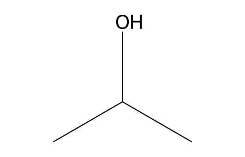
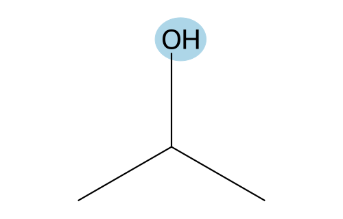
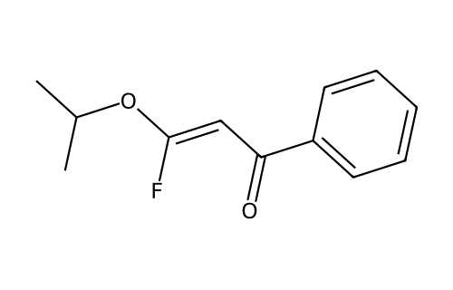

# C043 · Propan-2-ol

[← C042](C042.md) · [100-molecule catalog](README.md) · [C044 →](C044.md)

| Recommended-input property | Value |
| --- | --- |
| Molecular formula | C3H8O |
| Canonical SMILES | `CC(C)O` |
| Proposed bond-forming centre | O |
| Precursor family | secondary_alcohol (RF27) |
| Feasibility class | B |
| Novelty review priority | 1 |
| NP labels | unresolved |
| NR labels | unresolved |
| Site/pathway hypotheses | 1 |
| Proposed product options | 1 |

## Recommendation rationale

This secondary_alcohol; neutral X-H donor belongs to the secondary_alcohol family and was retained as a O-centred recommendation. It is assigned feasibility class B and novelty review priority 1. These categories organize chemical review and do not state that the target reaction has already been demonstrated.

The machine-readable record retains the source-linked activation question, competing pathways, diagnostic observation and transfer limits used in the recommendation workflow.

## Reactive-site hypotheses and proposed endpoints

### C043-H01

Reacting-atom index: **3** (zero-based in `CC(C)O`).

Proposed route: O-centred substitution; carbonyl retained; one fluorine retained at the new alkene

Evidence basis: RP-guided chemical proposal. Full activation, competing-pathway and diagnostic fields are retained in the hypothesis JSON.

#### C043-H01-O01

`CC(C)OC(F)=CC(=O)c1ccccc1`

NP **unresolved**; NR **unresolved**. This is a proposed connectivity, not an observed product assignment.

## Relationship to the experimental collection

Best relationship: **Same donor family, different scaffold**.

| Experimental record | Relationship | Structural basis |
| --- | --- | --- |
| [AP053](experiment_mapping/pairs/AP053.md) | Same donor family, different scaffold | The local donor type is retained, but the molecular scaffold differs. |
| [AP069](experiment_mapping/pairs/AP069.md) | Same donor family, different scaffold | The local donor type is retained, but the molecular scaffold differs. |
| [AP050](experiment_mapping/pairs/AP050.md) | Same donor family, different scaffold | The local donor type is retained, but the molecular scaffold differs. |

## Evidence and data links

RP focus: [RP2](../evidence/principles/RP2.md), [RP4](../evidence/principles/RP4.md). Literature sources: [L171](../literature/sources/L171.md), [L294](../literature/sources/L294.md), [L320](../literature/sources/L320.md).

[Candidate JSON](data/candidates_100.json) · [103 hypotheses](data/hypotheses_103.json) · [103 product options](product_options/product_options_103.json) · [108 experimental pairs](experiment_mapping/mapping_108.json)
