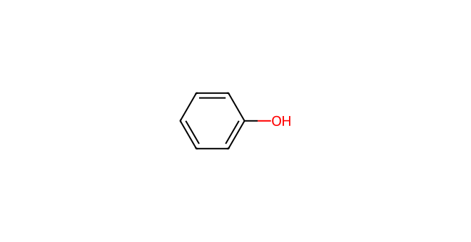
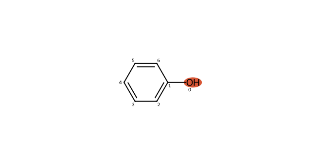
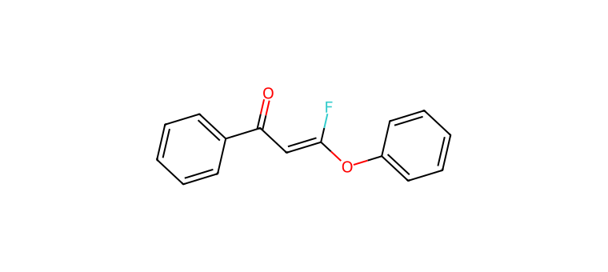

# C051 · Phenol

[← C050](C050.md) · [100-molecule catalog](README.md) · [C052 →](C052.md)

| Input property | Value |
| --- | --- |
| Molecular formula | C6H6O |
| Input SMILES | `Oc1ccccc1` |
| Proposed bond-forming centre(s) | O |
| Allocation | working |
| Research role | priority for exploration |
| NP product-connectivity assessment | 2 / 2 |
| NR reaction-precedent assessment | 2 / 2 |
| Site/pathway hypotheses | 2 |
| Proposed product options | 2 |

NP/NR describe the proposed endpoints and the bounded literature comparison. They are separate ordinal labels; no overall success probability or numerical ranking is supplied. See [assessment definitions](README.md#assessment-labels).

## Chemical rationale and source description

Neutral phenol and in situ phenoxide are separate proposed reactive states.

Pairs with sodium phenoxide to test precursor state, while aromatic C attack remains a competing site.

Comparison literature: V01 ([L334](../literature/sources/L334.md) [64]), V05 ([L350](../literature/sources/L350.md) [10]), V10 ([L352](../literature/sources/L352.md) [61])

## Reactive sites, pathways and proposed endpoints

The highlighted atoms below use **zero-based indices in the exact hypothesis SMILES**. This ordering can differ from the input structure drawn above. Products are proposed connectivities; a depiction is not evidence of formation, isolation or stereochemical identity.

### H01 · O-centred pathway

**Hypothesis SMILES:** `Oc1ccccc1`. **Proposed reacting atom(s):** 0 (O). **Basis:** local analogy.

**Activation/pathway question:** Neutral phenol and in situ phenoxide are separate proposed reactive states.

**Assessment:** NP 2; NR 2. **Research role:** priority for exploration. **Recorded qualitative confidence:** B.

#### Product option 051-H01-O01

`O=C(C=C(F)Oc1ccccc1)c1ccccc1`

NP **2**; NR **2**; formal charge **0**. Structure query: **no registry match** (`PC-6a583dc2c8d148d29ca2`); PubChem CID(s): none returned. Comparison references: [V10 / L352](../literature/sources/L352.md), [V05 / L350](../literature/sources/L350.md), [V01 / L334](../literature/sources/L334.md).

### H02 · O-centred pathway

**Hypothesis SMILES:** `Oc1ccccc1`. **Proposed reacting atom(s):** 0 (O). **Basis:** local analogy.

**Activation/pathway question:** Neutral phenol and in situ phenoxide are separate proposed reactive states.

**Assessment:** NP 2; NR 2. **Research role:** priority for exploration. **Recorded qualitative confidence:** B.

#### Product option 051-H02-O01

`O=C(C=C(F)Oc1ccccc1)c1ccccc1`

NP **2**; NR **2**; formal charge **0**. Structure query: **no registry match** (`PC-6a583dc2c8d148d29ca2`); PubChem CID(s): none returned. Comparison references: [V10 / L352](../literature/sources/L352.md), [V05 / L350](../literature/sources/L350.md), [V01 / L334](../literature/sources/L334.md).

## Literature evidence and principle questions

**[L339](../literature/sources/L339.md)** — author observation, source PDF page 3.

Thiols and selenols react under iron porphyrin catalysis to give gem-difluorovinyl sulfides and selenides in high yields, while copper-based systems enable analogous reactions of amines and alcohols to give gem-difluoroenamines and difluorovinyl ethers in moderate to good yields.

Source context: Formal insertion reactions; catalyst and nucleophile-class differentiation

**[L143](../literature/sources/L143.md)** — author observation, source PDF page 4.

Reaction of sodium ethoxide with aryl trifluorovinyl ether 1 gave the vinyl-substitution product 11 with a (Z)/(E) ratio of 2.45:1.

Source context: Mechanistic probe using an aliphatic oxygen nucleophile

- [RP1](../evidence/principles/RP1.md): Can the trifluoroethyl carbonyl substrate access an electrophilic state compatible with the proposed donor form and its activation conditions?

- [RP2](../evidence/principles/RP2.md): Which donor form and reacting site form the intended bond, and how do counterion, electronics and steric environment affect capture?

- [RP3](../evidence/principles/RP3.md): Does donor capture followed by fluoride elimination outcompete protonation, hydrogen-atom transfer and other termination pathways?

- [RP4](../evidence/principles/RP4.md): Does the proposed monofluoroalkene persist during reaction and workup, or undergo further conversion?

## Association with experimental inputs

| Input pair | Relation | Chemical basis |
| --- | --- | --- |
| [AP046](experiment_mapping/pairs/AP046.md) | Structural Analogue | Hydroxy O attached to an aromatic/conjugated framework provides the O-centre analogy; substituents, heteroaryl tautomerism and competing sites must be evaluated separately. |
| [AP047](experiment_mapping/pairs/AP047.md) | Structural Analogue | Hydroxy O attached to an aromatic/conjugated framework provides the O-centre analogy; substituents, heteroaryl tautomerism and competing sites must be evaluated separately. |
| [AP048](experiment_mapping/pairs/AP048.md) | Structural Analogue | Hydroxy O attached to an aromatic/conjugated framework provides the O-centre analogy; substituents, heteroaryl tautomerism and competing sites must be evaluated separately. |
| [AP049](experiment_mapping/pairs/AP049.md) | Structural Analogue | Hydroxy O attached to an aromatic/conjugated framework provides the O-centre analogy; substituents, heteroaryl tautomerism and competing sites must be evaluated separately. |
| [AP051](experiment_mapping/pairs/AP051.md) | Structural Analogue | Hydroxy O attached to an aromatic/conjugated framework provides the O-centre analogy; substituents, heteroaryl tautomerism and competing sites must be evaluated separately. |
| [AP056](experiment_mapping/pairs/AP056.md) | Structural Analogue | Hydroxy O attached to an aromatic/conjugated framework provides the O-centre analogy; substituents, heteroaryl tautomerism and competing sites must be evaluated separately. |
| [AP057](experiment_mapping/pairs/AP057.md) | Structural Analogue | Hydroxy O attached to an aromatic/conjugated framework provides the O-centre analogy; substituents, heteroaryl tautomerism and competing sites must be evaluated separately. |
| [AP060](experiment_mapping/pairs/AP060.md) | Structural Analogue | Hydroxy O attached to an aromatic/conjugated framework provides the O-centre analogy; substituents, heteroaryl tautomerism and competing sites must be evaluated separately. |
| [AP061](experiment_mapping/pairs/AP061.md) | Structural Analogue | Hydroxy O attached to an aromatic/conjugated framework provides the O-centre analogy; substituents, heteroaryl tautomerism and competing sites must be evaluated separately. |
| [AP062](experiment_mapping/pairs/AP062.md) | Structural Analogue | Hydroxy O attached to an aromatic/conjugated framework provides the O-centre analogy; substituents, heteroaryl tautomerism and competing sites must be evaluated separately. |
| [AP063](experiment_mapping/pairs/AP063.md) | Structural Analogue | Hydroxy O attached to an aromatic/conjugated framework provides the O-centre analogy; substituents, heteroaryl tautomerism and competing sites must be evaluated separately. |
| [AP064](experiment_mapping/pairs/AP064.md) | Structural Analogue | Hydroxy O attached to an aromatic/conjugated framework provides the O-centre analogy; substituents, heteroaryl tautomerism and competing sites must be evaluated separately. |
| [AP065](experiment_mapping/pairs/AP065.md) | Structural Analogue | Hydroxy O attached to an aromatic/conjugated framework provides the O-centre analogy; substituents, heteroaryl tautomerism and competing sites must be evaluated separately. |
| [AP066](experiment_mapping/pairs/AP066.md) | Structural Analogue | Hydroxy O attached to an aromatic/conjugated framework provides the O-centre analogy; substituents, heteroaryl tautomerism and competing sites must be evaluated separately. |
| [AP067](experiment_mapping/pairs/AP067.md) | Structural Analogue | Hydroxy O attached to an aromatic/conjugated framework provides the O-centre analogy; substituents, heteroaryl tautomerism and competing sites must be evaluated separately. |
| [AP068](experiment_mapping/pairs/AP068.md) | Structural Analogue | Hydroxy O attached to an aromatic/conjugated framework provides the O-centre analogy; substituents, heteroaryl tautomerism and competing sites must be evaluated separately. |
| [AP077](experiment_mapping/pairs/AP077.md) | Structural Analogue | Hydroxy O attached to an aromatic/conjugated framework provides the O-centre analogy; substituents, heteroaryl tautomerism and competing sites must be evaluated separately. |
| [AP078](experiment_mapping/pairs/AP078.md) | Structural Analogue | Hydroxy O attached to an aromatic/conjugated framework provides the O-centre analogy; substituents, heteroaryl tautomerism and competing sites must be evaluated separately. |
| [AP079](experiment_mapping/pairs/AP079.md) | Structural Analogue | Hydroxy O attached to an aromatic/conjugated framework provides the O-centre analogy; substituents, heteroaryl tautomerism and competing sites must be evaluated separately. |
| [AP080](experiment_mapping/pairs/AP080.md) | Structural Analogue | Hydroxy O attached to an aromatic/conjugated framework provides the O-centre analogy; substituents, heteroaryl tautomerism and competing sites must be evaluated separately. |
| [AP081](experiment_mapping/pairs/AP081.md) | Structural Analogue | Hydroxy O attached to an aromatic/conjugated framework provides the O-centre analogy; substituents, heteroaryl tautomerism and competing sites must be evaluated separately. |
| [AP082](experiment_mapping/pairs/AP082.md) | Structural Analogue | Hydroxy O attached to an aromatic/conjugated framework provides the O-centre analogy; substituents, heteroaryl tautomerism and competing sites must be evaluated separately. |
| [AP083](experiment_mapping/pairs/AP083.md) | Exact Molecular Match | Identical recorded donor molecular structure; no selection history is implied. |
| [AP084](experiment_mapping/pairs/AP084.md) | Structural Analogue | Hydroxy O attached to an aromatic/conjugated framework provides the O-centre analogy; substituents, heteroaryl tautomerism and competing sites must be evaluated separately. |
| [AP085](experiment_mapping/pairs/AP085.md) | Structural Analogue | Hydroxy O attached to an aromatic/conjugated framework provides the O-centre analogy; substituents, heteroaryl tautomerism and competing sites must be evaluated separately. |
| [AP086](experiment_mapping/pairs/AP086.md) | Structural Analogue | Hydroxy O attached to an aromatic/conjugated framework provides the O-centre analogy; substituents, heteroaryl tautomerism and competing sites must be evaluated separately. |

The relations describe molecular identity, reactive form or donor-family similarity. They do not recover the original selection decision and do not assign experimental success to a suggested molecule.

## Download the scientific records

The [100-molecule JSON](data/candidates_100.json), [115-hypothesis JSON](data/hypotheses_115.json), [124-product JSON](product_options/product_options_124.json) and [108-input mapping JSON](experiment_mapping/mapping_108.json) retain this molecule’s linked records. The hypothesis JSON also includes the complete original-language proposal: reactive form, activation, route, rationale, competing outcomes and suggested discriminating experiment.
