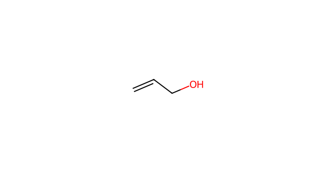
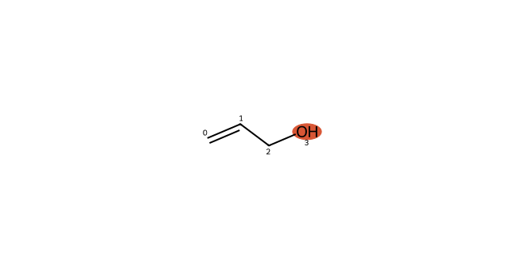
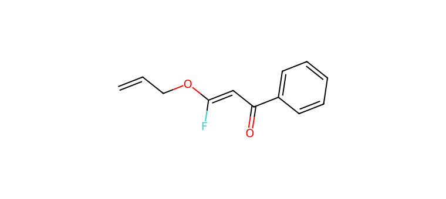

# C052 · Allyl alcohol

[← C051](C051.md) · [100-molecule catalog](README.md) · [C053 →](C053.md)

| Input property | Value |
| --- | --- |
| Molecular formula | C3H6O |
| Input SMILES | `C=CCO` |
| Proposed bond-forming centre(s) | O |
| Allocation | working |
| Research role | priority for exploration |
| NP product-connectivity assessment | 2 |
| NR reaction-precedent assessment | 2 |
| Site/pathway hypotheses | 1 |
| Proposed product options | 1 |

NP/NR describe the proposed endpoints and the bounded literature comparison. They are separate ordinal labels; no overall success probability or numerical ranking is supplied. See [assessment definitions](README.md#assessment-labels).

## Chemical rationale and source description

Neutral alcohol and in situ alkoxide capture are proposed.

Pairs with sodium allyloxide while retaining a potentially competing alkene or coordination site.

Comparison literature: V05 ([L350](../literature/sources/L350.md) [10])

## Reactive sites, pathways and proposed endpoints

The highlighted atoms below use **zero-based indices in the exact hypothesis SMILES**. This ordering can differ from the input structure drawn above. Products are proposed connectivities; a depiction is not evidence of formation, isolation or stereochemical identity.

### H01 · O-centred pathway

**Hypothesis SMILES:** `C=CCO`. **Proposed reacting atom(s):** 3 (O). **Basis:** local analogy.

**Activation/pathway question:** Neutral alcohol and in situ alkoxide capture are proposed.

**Assessment:** NP 2; NR 2. **Research role:** priority for exploration. **Recorded qualitative confidence:** B.

#### Product option 052-H01-O01

`C=CCOC(F)=CC(=O)c1ccccc1`

NP **2**; NR **2**; formal charge **0**. Structure query: **no registry match** (`PC-84e1b37994b0b582ebe3`); PubChem CID(s): none returned. Comparison references: [V05 / L350](../literature/sources/L350.md).

## Literature evidence and principle questions

**[L328](../literature/sources/L328.md)** — author observation, source PDF page 2.

The remaining fluorine substituents of intermediate 23 were replaced by allyloxy groups using an allyl-alcohol alkoxide in DMF at 60 °C for 3.5 h, giving intermediate 24 in 87% yield.

Source context: Results and discussion; multiple C–F substitutions by an O-nucleophile.

- [RP1](../evidence/principles/RP1.md): Can the trifluoroethyl carbonyl substrate access an electrophilic state compatible with the proposed donor form and its activation conditions?

- [RP2](../evidence/principles/RP2.md): Which donor form and reacting site form the intended bond, and how do counterion, electronics and steric environment affect capture?

- [RP3](../evidence/principles/RP3.md): Does donor capture followed by fluoride elimination outcompete protonation, hydrogen-atom transfer and other termination pathways?

- [RP4](../evidence/principles/RP4.md): Does the proposed monofluoroalkene persist during reaction and workup, or undergo further conversion?

## Association with experimental inputs

| Input pair | Relation | Chemical basis |
| --- | --- | --- |
| [AP050](experiment_mapping/pairs/AP050.md) | Structural Analogue | Alcohol O–H is retained but carbon substitution/saturation differs; a common O centre does not imply equal acidity or capture competence. |
| [AP052](experiment_mapping/pairs/AP052.md) | Structural Analogue | Alcohol O–H is retained but carbon substitution/saturation differs; a common O centre does not imply equal acidity or capture competence. |
| [AP053](experiment_mapping/pairs/AP053.md) | Structural Analogue | Alcohol O–H is retained but carbon substitution/saturation differs; a common O centre does not imply equal acidity or capture competence. |
| [AP054](experiment_mapping/pairs/AP054.md) | Structural Analogue | Alcohol O–H is retained but carbon substitution/saturation differs; a common O centre does not imply equal acidity or capture competence. |
| [AP055](experiment_mapping/pairs/AP055.md) | Structural Analogue | Alcohol O–H is retained but carbon substitution/saturation differs; a common O centre does not imply equal acidity or capture competence. |
| [AP059](experiment_mapping/pairs/AP059.md) | Structural Analogue | Alcohol O–H is retained but carbon substitution/saturation differs; a common O centre does not imply equal acidity or capture competence. |
| [AP066](experiment_mapping/pairs/AP066.md) | Structural Analogue | Alcohol O–H is retained but carbon substitution/saturation differs; a common O centre does not imply equal acidity or capture competence. |
| [AP069](experiment_mapping/pairs/AP069.md) | Structural Analogue | Alcohol O–H is retained but carbon substitution/saturation differs; a common O centre does not imply equal acidity or capture competence. |
| [AP070](experiment_mapping/pairs/AP070.md) | Structural Analogue | Alcohol O–H is retained but carbon substitution/saturation differs; a common O centre does not imply equal acidity or capture competence. |
| [AP071](experiment_mapping/pairs/AP071.md) | Structural Analogue | Alcohol O–H is retained but carbon substitution/saturation differs; a common O centre does not imply equal acidity or capture competence. |
| [AP072](experiment_mapping/pairs/AP072.md) | Structural Analogue | Alcohol O–H is retained but carbon substitution/saturation differs; a common O centre does not imply equal acidity or capture competence. |
| [AP073](experiment_mapping/pairs/AP073.md) | Structural Analogue | Alcohol O–H is retained but carbon substitution/saturation differs; a common O centre does not imply equal acidity or capture competence. |
| [AP074](experiment_mapping/pairs/AP074.md) | Structural Analogue | Alcohol O–H is retained but carbon substitution/saturation differs; a common O centre does not imply equal acidity or capture competence. |
| [AP075](experiment_mapping/pairs/AP075.md) | Structural Analogue | Alcohol O–H is retained but carbon substitution/saturation differs; a common O centre does not imply equal acidity or capture competence. |
| [AP076](experiment_mapping/pairs/AP076.md) | Structural Analogue | Alcohol O–H is retained but carbon substitution/saturation differs; a common O centre does not imply equal acidity or capture competence. |

The relations describe molecular identity, reactive form or donor-family similarity. They do not recover the original selection decision and do not assign experimental success to a suggested molecule.

## Download the scientific records

The [100-molecule JSON](data/candidates_100.json), [115-hypothesis JSON](data/hypotheses_115.json), [124-product JSON](product_options/product_options_124.json) and [108-input mapping JSON](experiment_mapping/mapping_108.json) retain this molecule’s linked records. The hypothesis JSON also includes the complete original-language proposal: reactive form, activation, route, rationale, competing outcomes and suggested discriminating experiment.
