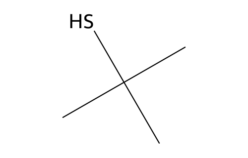
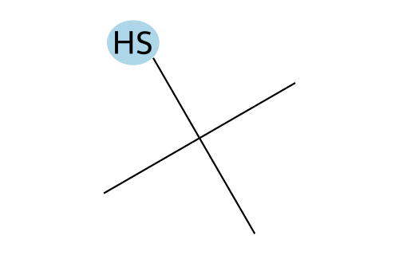
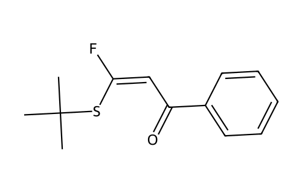

# C056 · 2-Methylpropane-2-thiol

[← C055](C055.md) · [100-molecule catalog](README.md) · [C057 →](C057.md)

| Recommended-input property | Value |
| --- | --- |
| Molecular formula | C4H10S |
| Canonical SMILES | `CC(C)(C)S` |
| Proposed bond-forming centre | S |
| Precursor family | tertiary_alkyl_thiol (RF43) |
| Feasibility class | B |
| Novelty review priority | 1 |
| NP labels | 2 |
| NR labels | 2 |
| Site/pathway hypotheses | 1 |
| Proposed product options | 1 |

## Recommendation rationale

This tertiary_alkyl_thiol; neutral X-H donor belongs to the tertiary_alkyl_thiol family and was retained as a S-centred recommendation. It is assigned feasibility class B and novelty review priority 1. These categories organize chemical review and do not state that the target reaction has already been demonstrated.

The machine-readable record retains the source-linked activation question, competing pathways, diagnostic observation and transfer limits used in the recommendation workflow.

## Reactive-site hypotheses and proposed endpoints

### C056-H01

Reacting-atom index: **4** (zero-based in `CC(C)(C)S`).

Proposed route: S-centred substitution; carbonyl retained; one fluorine retained at the new alkene

Evidence basis: RP-guided chemical proposal. Full activation, competing-pathway and diagnostic fields are retained in the hypothesis JSON.

#### C056-H01-O01

`CC(C)(C)SC(F)=CC(=O)c1ccccc1`

NP **2**; NR **2**. This is a proposed connectivity, not an observed product assignment.

## Relationship to the experimental collection

Best relationship: **Same donor family, different scaffold**.

| Experimental record | Relationship | Structural basis |
| --- | --- | --- |
| [AP091](experiment_mapping/pairs/AP091.md) | Same donor family, different scaffold | The local donor type is retained, but the molecular scaffold differs. |
| [AP107](experiment_mapping/pairs/AP107.md) | Same donor family, different scaffold | The local donor type is retained, but the molecular scaffold differs. |
| [AP092](experiment_mapping/pairs/AP092.md) | Same donor family, different scaffold | The local donor type is retained, but the molecular scaffold differs. |

## Evidence and data links

RP focus: [RP2](../evidence/principles/RP2.md), [RP3](../evidence/principles/RP3.md). Literature sources: [L353](../literature/sources/L353.md), [L354](../literature/sources/L354.md).

[Candidate JSON](data/candidates_100.json) · [103 hypotheses](data/hypotheses_103.json) · [103 product options](product_options/product_options_103.json) · [108 experimental pairs](experiment_mapping/mapping_108.json)
