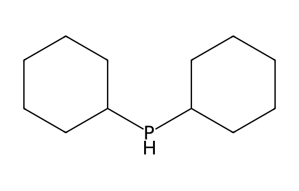
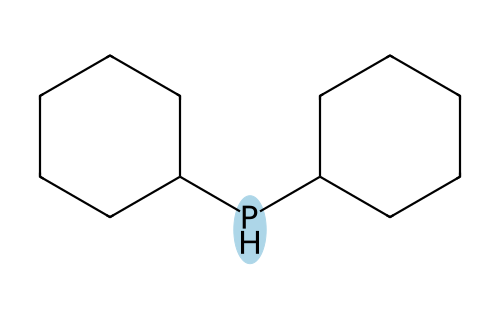
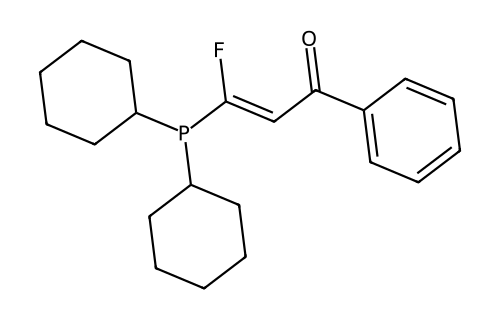

# C059 · Dicyclohexylphosphine

[← C058](C058.md) · [100-molecule catalog](README.md) · [C060 →](C060.md)

| Recommended-input property | Value |
| --- | --- |
| Molecular formula | C12H23P |
| Canonical SMILES | `C1CCC(PC2CCCCC2)CC1` |
| Proposed bond-forming centre | P |
| Precursor family | secondary_alkyl_phosphine (RF30) |
| Feasibility class | B |
| Novelty review priority | 1 |
| NP labels | 2 |
| NR labels | 2 |
| Site/pathway hypotheses | 1 |
| Proposed product options | 1 |

## Recommendation rationale

This secondary_alkyl_phosphine; neutral X-H donor belongs to the secondary_alkyl_phosphine family and was retained as a P-centred recommendation. It is assigned feasibility class B and novelty review priority 1. These categories organize chemical review and do not state that the target reaction has already been demonstrated.

The machine-readable record retains the source-linked activation question, competing pathways, diagnostic observation and transfer limits used in the recommendation workflow.

## Reactive-site hypotheses and proposed endpoints

### C059-H01

Reacting-atom index: **4** (zero-based in `C1CCC(PC2CCCCC2)CC1`).

Proposed route: P-centred substitution; carbonyl retained; one fluorine retained at the new alkene

Evidence basis: RP-guided chemical proposal. Full activation, competing-pathway and diagnostic fields are retained in the hypothesis JSON.

#### C059-H01-O01

`O=C(C=C(F)P(C1CCCCC1)C1CCCCC1)c1ccccc1`

NP **2**; NR **2**. This is a proposed connectivity, not an observed product assignment.

## Relationship to the experimental collection

Best relationship: **Same donor family, different scaffold**.

| Experimental record | Relationship | Structural basis |
| --- | --- | --- |
| [AP087](experiment_mapping/pairs/AP087.md) | Same donor family, different scaffold | The local donor type is retained, but the molecular scaffold differs. |
| [AP088](experiment_mapping/pairs/AP088.md) | Same donor family, different scaffold | The local donor type is retained, but the molecular scaffold differs. |

## Evidence and data links

RP focus: [RP2](../evidence/principles/RP2.md), [RP3](../evidence/principles/RP3.md). Literature sources: [L350](../literature/sources/L350.md).

[Candidate JSON](data/candidates_100.json) · [103 hypotheses](data/hypotheses_103.json) · [103 product options](product_options/product_options_103.json) · [112 experimental pairs](experiment_mapping/mapping_112.json)
