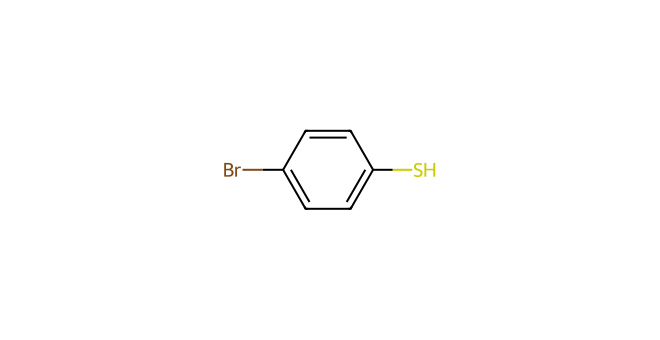
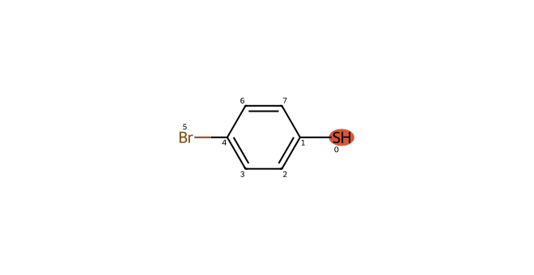
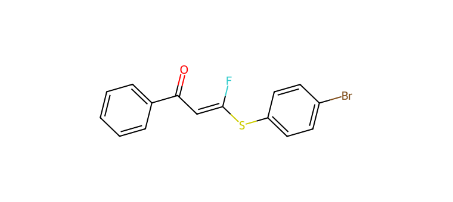

# C068 · 4-Bromobenzenethiol

[← C067](C067.md) · [100-molecule catalog](README.md) · [C069 →](C069.md)

| Input property | Value |
| --- | --- |
| Molecular formula | C6H5BrS |
| Input SMILES | `Sc1ccc(Br)cc1` |
| Proposed bond-forming centre(s) | S |
| Allocation | working |
| Research role | priority for exploration |
| NP product-connectivity assessment | 2 |
| NR reaction-precedent assessment | 2 |
| Site/pathway hypotheses | 1 |
| Proposed product options | 1 |

NP/NR describe the proposed endpoints and the bounded literature comparison. They are separate ordinal labels; no overall success probability or numerical ranking is supplied. See [assessment definitions](README.md#assessment-labels).

## Chemical rationale and source description

Neutral thiol or controlled thiolate formation supplies the proposed S donor.

Varies sulfur electronics and adds an aryl-bromide handle that may undergo competing metal-mediated chemistry.

Comparison literature: V01 ([L334](../literature/sources/L334.md) [64]), V12 ([L354](../literature/sources/L354.md) [68]), V14 ([L356](../literature/sources/L356.md) [70])

## Reactive sites, pathways and proposed endpoints

The highlighted atoms below use **zero-based indices in the exact hypothesis SMILES**. This ordering can differ from the input structure drawn above. Products are proposed connectivities; a depiction is not evidence of formation, isolation or stereochemical identity.

### H01 · S-centred pathway

**Hypothesis SMILES:** `Sc1ccc(Br)cc1`. **Proposed reacting atom(s):** 0 (S). **Basis:** local analogy.

**Activation/pathway question:** Neutral thiol or controlled thiolate formation supplies the proposed S donor.

**Assessment:** NP 2; NR 2. **Research role:** priority for exploration. **Recorded qualitative confidence:** B.

#### Product option 068-H01-O01

`O=C(C=C(F)Sc1ccc(Br)cc1)c1ccccc1`

NP **2**; NR **2**; formal charge **0**. Structure query: **no registry match** (`PC-5b75b04e9e7129f1dda1`); PubChem CID(s): none returned. Comparison references: [V01 / L334](../literature/sources/L334.md), [V12 / L354](../literature/sources/L354.md), [V14 / L356](../literature/sources/L356.md).

## Literature evidence and principle questions

**[L140](../literature/sources/L140.md)** — author observation, source PDF page 4.

The tertiary alkyl fluoride product 2h underwent downstream C-F substitution with 4-bromobenzenethiol under B(C6F5)3 catalysis to give sulfide 8 in 78% yield; a separate dehydrofluorination followed by palladium-catalyzed arylboronic-acid 1,4-addition gave arylated product 9 in 60% overall yield.

Source context: Product derivatization relevant to C-S and organoboron C-C bond formation

**[L010](../literature/sources/L010.md)** — author hypothesis, source PDF page 2.

The authors suggest that the low yield may result from poisoning of the palladium catalyst by the thiol.

Source context: Results and Discussion; interpretation of ligand effects and sulfur compatibility

- [RP1](../evidence/principles/RP1.md): Can the trifluoroethyl carbonyl substrate access an electrophilic state compatible with the proposed donor form and its activation conditions?

- [RP2](../evidence/principles/RP2.md): Which donor form and reacting site form the intended bond, and how do counterion, electronics and steric environment affect capture?

- [RP3](../evidence/principles/RP3.md): Does donor capture followed by fluoride elimination outcompete protonation, hydrogen-atom transfer and other termination pathways?

- [RP4](../evidence/principles/RP4.md): Does the proposed monofluoroalkene persist during reaction and workup, or undergo further conversion?

## Association with experimental inputs

| Input pair | Relation | Chemical basis |
| --- | --- | --- |
| [AP089](experiment_mapping/pairs/AP089.md) | Structural Analogue | Aryl S–H is retained; aryl substitution and steric/electronic environment differ. |
| [AP090](experiment_mapping/pairs/AP090.md) | Structural Analogue | Aryl S–H is retained; aryl substitution and steric/electronic environment differ. |
| [AP095](experiment_mapping/pairs/AP095.md) | Structural Analogue | Aryl S–H is retained; aryl substitution and steric/electronic environment differ. |
| [AP096](experiment_mapping/pairs/AP096.md) | Structural Analogue | Aryl S–H is retained; aryl substitution and steric/electronic environment differ. |
| [AP097](experiment_mapping/pairs/AP097.md) | Structural Analogue | Aryl S–H is retained; aryl substitution and steric/electronic environment differ. |
| [AP098](experiment_mapping/pairs/AP098.md) | Structural Analogue | Aryl S–H is retained; aryl substitution and steric/electronic environment differ. |
| [AP100](experiment_mapping/pairs/AP100.md) | Structural Analogue | Aryl S–H is retained; aryl substitution and steric/electronic environment differ. |
| [AP103](experiment_mapping/pairs/AP103.md) | Structural Analogue | Aryl S–H is retained; aryl substitution and steric/electronic environment differ. |
| [AP104](experiment_mapping/pairs/AP104.md) | Structural Analogue | Aryl S–H is retained; aryl substitution and steric/electronic environment differ. |
| [AP108](experiment_mapping/pairs/AP108.md) | Structural Analogue | Aryl S–H is retained; aryl substitution and steric/electronic environment differ. |

The relations describe molecular identity, reactive form or donor-family similarity. They do not recover the original selection decision and do not assign experimental success to a suggested molecule.

## Download the scientific records

The [100-molecule JSON](data/candidates_100.json), [115-hypothesis JSON](data/hypotheses_115.json), [124-product JSON](product_options/product_options_124.json) and [108-input mapping JSON](experiment_mapping/mapping_108.json) retain this molecule’s linked records. The hypothesis JSON also includes the complete original-language proposal: reactive form, activation, route, rationale, competing outcomes and suggested discriminating experiment.
