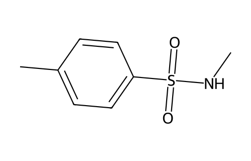
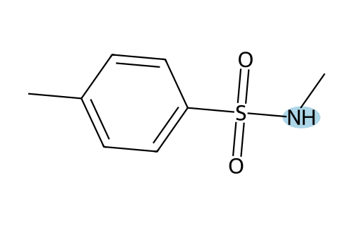
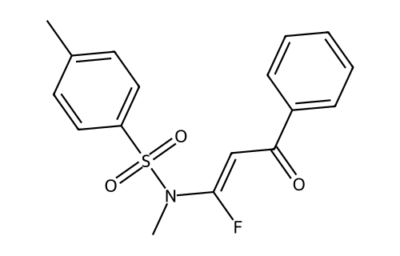

# C070 · N,4-Dimethylbenzenesulfonamide

[← C069](C069.md) · [100-molecule catalog](README.md) · [C071 →](C071.md)

| Recommended-input property | Value |
| --- | --- |
| Molecular formula | C8H11NO2S |
| Canonical SMILES | `CNS(=O)(=O)c1ccc(C)cc1` |
| Proposed bond-forming centre | N |
| Precursor family | sulfonamide (RF13) |
| Feasibility class | B |
| Novelty review priority | 2 |
| NP labels | unresolved |
| NR labels | unresolved |
| Site/pathway hypotheses | 1 |
| Proposed product options | 1 |

## Recommendation rationale

This sulfonamide; neutral X-H donor belongs to the sulfonamide family and was retained as a N-centred recommendation. It is assigned feasibility class B and novelty review priority 2. These categories organize chemical review and do not state that the target reaction has already been demonstrated.

The machine-readable record retains the source-linked activation question, competing pathways, diagnostic observation and transfer limits used in the recommendation workflow.

## Reactive-site hypotheses and proposed endpoints

### C070-H01

Reacting-atom index: **1** (zero-based in `CNS(=O)(=O)c1ccc(C)cc1`).

Proposed route: N-centred substitution; carbonyl retained; one fluorine retained at the new alkene

Evidence basis: RP-guided chemical proposal. Full activation, competing-pathway and diagnostic fields are retained in the hypothesis JSON.

#### C070-H01-O01

`Cc1ccc(S(=O)(=O)N(C)C(F)=CC(=O)c2ccccc2)cc1`

NP **unresolved**; NR **unresolved**. This is a proposed connectivity, not an observed product assignment.

## Relationship to the experimental collection

No reasonable counterpart was identified in the recorded experimental collection. The recommendation remains part of the RP-derived chemical space rather than being forced onto an unrelated tested reagent.

## Evidence and data links

RP focus: [RP2](../evidence/principles/RP2.md), [RP4](../evidence/principles/RP4.md). Literature sources: [L351](../literature/sources/L351.md).

[Candidate JSON](data/candidates_100.json) · [103 hypotheses](data/hypotheses_103.json) · [103 product options](product_options/product_options_103.json) · [112 experimental pairs](experiment_mapping/mapping_112.json)
