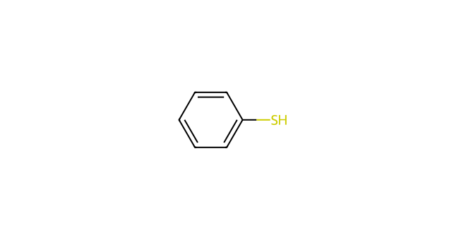
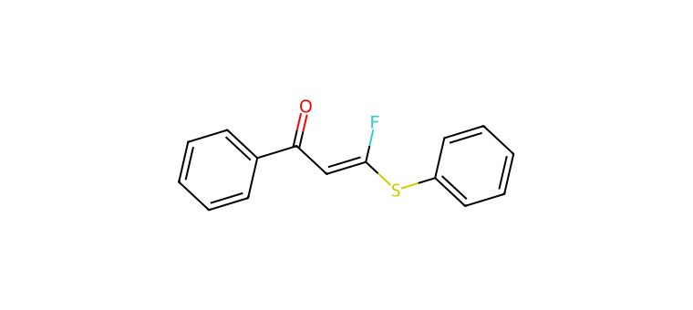
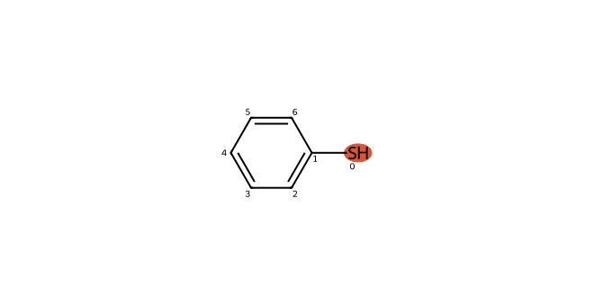

# C082 · Benzenethiol

[← C081](C081.md) · [100-molecule catalog](README.md) · [C083 →](C083.md)

| Input property | Value |
| --- | --- |
| Molecular formula | C6H6S |
| Input SMILES | `Sc1ccccc1` |
| Proposed bond-forming centre(s) | S |
| Allocation | reserve |
| Research role | priority for exploration |
| NP product-connectivity assessment | 2 / 2 / 2 |
| NR reaction-precedent assessment | 2 / 2 / 2 |
| Site/pathway hypotheses | 3 |
| Proposed product options | 3 |

NP/NR describe the proposed endpoints and the bounded literature comparison. They are separate ordinal labels; no overall success probability or numerical ranking is supplied. See [assessment definitions](README.md#assessment-labels).

## Chemical rationale and source description

Neutral, thiolate and separately activated thiyl forms are recorded alternatives.

Provides a parent aryl-sulfur probe without extra donor atoms; source-local reactivity does not prove the complete target sequence.

Comparison literature: V01 ([L334](../literature/sources/L334.md) [64]), V11 ([L353](../literature/sources/L353.md) [71]), V12 ([L354](../literature/sources/L354.md) [68]), V14 ([L356](../literature/sources/L356.md) [70])

## Reactive sites, pathways and proposed endpoints

The highlighted atoms below use **zero-based indices in the exact hypothesis SMILES**. This ordering can differ from the input structure drawn above. Products are proposed connectivities; a depiction is not evidence of formation, isolation or stereochemical identity.

### H01 · S-centred pathway

**Hypothesis SMILES:** `Sc1ccccc1`. **Proposed reacting atom(s):** 0 (S). **Basis:** local analogy.

**Activation/pathway question:** Neutral, thiolate and separately activated thiyl forms are recorded alternatives.

**Assessment:** NP 2; NR 2. **Research role:** priority for exploration. **Recorded qualitative confidence:** B.

#### Product option 082-H01-O01

`O=C(C=C(F)Sc1ccccc1)c1ccccc1`

NP **2**; NR **2**; formal charge **0**. Structure query: **no registry match** (`PC-ce296131651bf39065ef`); PubChem CID(s): none returned. Comparison references: [V01 / L334](../literature/sources/L334.md), [V12 / L354](../literature/sources/L354.md), [V14 / L356](../literature/sources/L356.md), [V11 / L353](../literature/sources/L353.md).

### H02 · S-centred pathway

**Hypothesis SMILES:** `[SH]c1ccccc1`. **Proposed reacting atom(s):** 0 (S). **Basis:** local analogy.

**Activation/pathway question:** Neutral, thiolate and separately activated thiyl forms are recorded alternatives.

**Assessment:** NP 2; NR 2. **Research role:** priority for exploration. **Recorded qualitative confidence:** B.

#### Product option 082-H02-O01

`O=C(C=C(F)Sc1ccccc1)c1ccccc1`

NP **2**; NR **2**; formal charge **0**. Structure query: **no registry match** (`PC-ce296131651bf39065ef`); PubChem CID(s): none returned. Comparison references: [V01 / L334](../literature/sources/L334.md), [V12 / L354](../literature/sources/L354.md), [V14 / L356](../literature/sources/L356.md), [V11 / L353](../literature/sources/L353.md).

### H03 · S-centred pathway

**Hypothesis SMILES:** `Sc1ccccc1`. **Proposed reacting atom(s):** 0 (S). **Basis:** local analogy.

**Activation/pathway question:** Neutral, thiolate and separately activated thiyl forms are recorded alternatives.

**Assessment:** NP 2; NR 2. **Research role:** priority for exploration. **Recorded qualitative confidence:** B.

#### Product option 082-H03-O01

`O=C(C=C(F)Sc1ccccc1)c1ccccc1`

NP **2**; NR **2**; formal charge **0**. Structure query: **no registry match** (`PC-ce296131651bf39065ef`); PubChem CID(s): none returned. Comparison references: [V01 / L334](../literature/sources/L334.md), [V12 / L354](../literature/sources/L354.md), [V14 / L356](../literature/sources/L356.md), [V11 / L353](../literature/sources/L353.md).

## Literature evidence and principle questions

**[L010](../literature/sources/L010.md)** — author hypothesis, source PDF page 2.

The authors suggest that the low yield may result from poisoning of the palladium catalyst by the thiol.

Source context: Results and Discussion; interpretation of ligand effects and sulfur compatibility

**[L339](../literature/sources/L339.md)** — author observation, source PDF page 3.

Thiols and selenols react under iron porphyrin catalysis to give gem-difluorovinyl sulfides and selenides in high yields, while copper-based systems enable analogous reactions of amines and alcohols to give gem-difluoroenamines and difluorovinyl ethers in moderate to good yields.

Source context: Formal insertion reactions; catalyst and nucleophile-class differentiation

- [RP1](../evidence/principles/RP1.md): Can the trifluoroethyl carbonyl substrate access an electrophilic state compatible with the proposed donor form and its activation conditions?

- [RP2](../evidence/principles/RP2.md): Which donor form and reacting site form the intended bond, and how do counterion, electronics and steric environment affect capture?

- [RP3](../evidence/principles/RP3.md): Does donor capture followed by fluoride elimination outcompete protonation, hydrogen-atom transfer and other termination pathways?

- [RP4](../evidence/principles/RP4.md): Does the proposed monofluoroalkene persist during reaction and workup, or undergo further conversion?

## Association with experimental inputs

| Input pair | Relation | Chemical basis |
| --- | --- | --- |
| [AP089](experiment_mapping/pairs/AP089.md) | Structural Analogue | Aryl S–H is retained; aryl substitution and possible competing groups differ. |
| [AP090](experiment_mapping/pairs/AP090.md) | Structural Analogue | Aryl S–H is retained; aryl substitution and possible competing groups differ. |
| [AP095](experiment_mapping/pairs/AP095.md) | Structural Analogue | Aryl S–H is retained; aryl substitution and possible competing groups differ. |
| [AP096](experiment_mapping/pairs/AP096.md) | Structural Analogue | Aryl S–H is retained; aryl substitution and possible competing groups differ. |
| [AP097](experiment_mapping/pairs/AP097.md) | Structural Analogue | Aryl S–H is retained; aryl substitution and possible competing groups differ. |
| [AP098](experiment_mapping/pairs/AP098.md) | Structural Analogue | Aryl S–H is retained; aryl substitution and possible competing groups differ. |
| [AP100](experiment_mapping/pairs/AP100.md) | Structural Analogue | Aryl S–H is retained; aryl substitution and possible competing groups differ. |
| [AP103](experiment_mapping/pairs/AP103.md) | Structural Analogue | Aryl S–H is retained; aryl substitution and possible competing groups differ. |
| [AP104](experiment_mapping/pairs/AP104.md) | Structural Analogue | Aryl S–H is retained; aryl substitution and possible competing groups differ. |
| [AP108](experiment_mapping/pairs/AP108.md) | Structural Analogue | Aryl S–H is retained; aryl substitution and possible competing groups differ. |

The relations describe molecular identity, reactive form or donor-family similarity. They do not recover the original selection decision and do not assign experimental success to a suggested molecule.

## Download the scientific records

The [100-molecule JSON](data/candidates_100.json), [115-hypothesis JSON](data/hypotheses_115.json), [124-product JSON](product_options/product_options_124.json) and [108-input mapping JSON](experiment_mapping/mapping_108.json) retain this molecule’s linked records. The hypothesis JSON also includes the complete original-language proposal: reactive form, activation, route, rationale, competing outcomes and suggested discriminating experiment.
