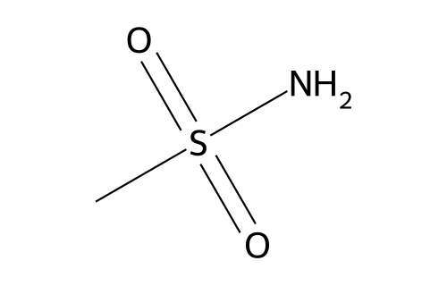
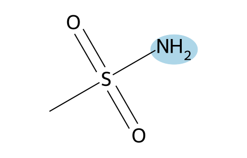
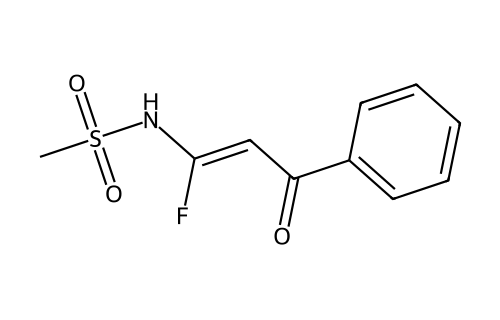

# C094 · Methanesulfonamide

[← C093](C093.md) · [100-molecule catalog](README.md) · [C095 →](C095.md)

| Recommended-input property | Value |
| --- | --- |
| Molecular formula | CH5NO2S |
| Canonical SMILES | `CS(N)(=O)=O` |
| Proposed bond-forming centre | N |
| Precursor family | sulfonamide (RF13) |
| Feasibility class | B |
| Novelty review priority | 3 |
| NP labels | 2 |
| NR labels | 3 |
| Site/pathway hypotheses | 1 |
| Proposed product options | 1 |

## Recommendation rationale

This sulfonamide; neutral X-H donor belongs to the sulfonamide family and was retained as a N-centred recommendation. It is assigned feasibility class B and novelty review priority 3. These categories organize chemical review and do not state that the target reaction has already been demonstrated.

The machine-readable record retains the source-linked activation question, competing pathways, diagnostic observation and transfer limits used in the recommendation workflow.

## Reactive-site hypotheses and proposed endpoints

### C094-H01

Reacting-atom index: **2** (zero-based in `CS(N)(=O)=O`).

Proposed route: N-centred substitution; carbonyl retained; one fluorine retained at the new alkene

Evidence basis: RP-guided chemical proposal. Full activation, competing-pathway and diagnostic fields are retained in the hypothesis JSON.

#### C094-H01-O01

`CS(=O)(=O)NC(F)=CC(=O)c1ccccc1`

NP **2**; NR **3**. This is a proposed connectivity, not an observed product assignment.

## Relationship to the experimental collection

No reasonable counterpart was identified in the recorded experimental collection. The recommendation remains part of the RP-derived chemical space rather than being forced onto an unrelated tested reagent.

## Evidence and data links

RP focus: [RP2](../evidence/principles/RP2.md), [RP4](../evidence/principles/RP4.md). Literature sources: [L351](../literature/sources/L351.md).

[Candidate JSON](data/candidates_100.json) · [103 hypotheses](data/hypotheses_103.json) · [103 product options](product_options/product_options_103.json) · [112 experimental pairs](experiment_mapping/mapping_112.json)
