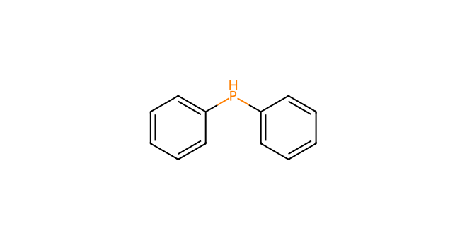
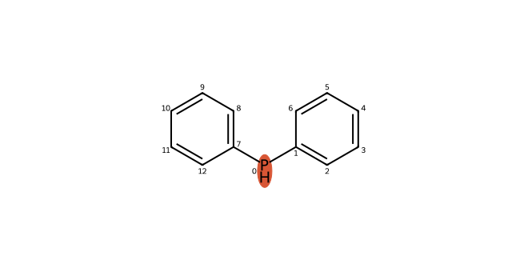
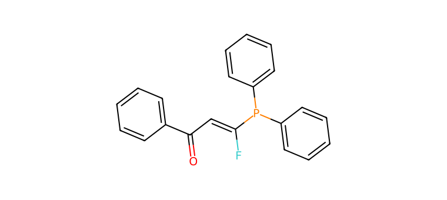

# C095 · Diphenylphosphine

[← C094](C094.md) · [100-molecule catalog](README.md) · [C096 →](C096.md)

| Input property | Value |
| --- | --- |
| Molecular formula | C12H11P |
| Input SMILES | `c1ccc(Pc2ccccc2)cc1` |
| Proposed bond-forming centre(s) | P |
| Allocation | reserve |
| Research role | condition-limited challenge |
| NP product-connectivity assessment | 2 |
| NR reaction-precedent assessment | 2 |
| Site/pathway hypotheses | 1 |
| Proposed product options | 1 |

NP/NR describe the proposed endpoints and the bounded literature comparison. They are separate ordinal labels; no overall success probability or numerical ranking is supplied. See [assessment definitions](README.md#assessment-labels).

## Chemical rationale and source description

Neutral, deprotonated or radical P-H-derived forms are alternatives.

Provides the exact donor in the two recoverable PH combinations; a positive neighbouring C-P precedent and project negative report have different scopes.

Comparison literature: V05 ([L350](../literature/sources/L350.md) [10]), V30 ([L274](../literature/sources/L274.md) [57])

## Reactive sites, pathways and proposed endpoints

The highlighted atoms below use **zero-based indices in the exact hypothesis SMILES**. This ordering can differ from the input structure drawn above. Products are proposed connectivities; a depiction is not evidence of formation, isolation or stereochemical identity.

### H01 · P-centred pathway

**Hypothesis SMILES:** `[PH](c1ccccc1)c1ccccc1`. **Proposed reacting atom(s):** 0 (P). **Basis:** local analogy.

**Activation/pathway question:** Neutral, deprotonated or radical P-H-derived forms are alternatives.

**Assessment:** NP 2; NR 2. **Research role:** condition-limited challenge. **Recorded qualitative confidence:** B.

#### Product option 095-H01-O01

`O=C(C=C(F)P(c1ccccc1)c1ccccc1)c1ccccc1`

NP **2**; NR **2**; formal charge **0**. Structure query: **no registry match** (`PC-967742a5056f7c26834d`); PubChem CID(s): none returned. Comparison references: [V05 / L350](../literature/sources/L350.md), [V30 / L274](../literature/sources/L274.md).

## Literature evidence and principle questions

**[L274](../literature/sources/L274.md)** — author observation, source PDF page 7.

A palladium-catalyzed asymmetric hydrophosphination used secondary phosphines as P(III)-H nucleophiles and was reported to overcome strong reagent inhibition or catalyst poisoning; a broad diarylphosphine scope gave disubstituted phosphines with good yields and excellent regio- and enantioselectivity.

Source context: Direct palladium-catalyzed C-P bond formation on DFA and catalyst-poisoning risk.

- [RP1](../evidence/principles/RP1.md): Can the trifluoroethyl carbonyl substrate access an electrophilic state compatible with the proposed donor form and its activation conditions?

- [RP2](../evidence/principles/RP2.md): Which donor form and reacting site form the intended bond, and how do counterion, electronics and steric environment affect capture?

- [RP3](../evidence/principles/RP3.md): Does donor capture followed by fluoride elimination outcompete protonation, hydrogen-atom transfer and other termination pathways?

- [RP4](../evidence/principles/RP4.md): Does the proposed monofluoroalkene persist during reaction and workup, or undergo further conversion?

## Association with experimental inputs

| Input pair | Relation | Chemical basis |
| --- | --- | --- |
| [AP087](experiment_mapping/pairs/AP087.md) | Exact Molecular Match | Identical recorded donor molecular structure; no selection history is implied. |
| [AP088](experiment_mapping/pairs/AP088.md) | Exact Molecular Match | Identical recorded donor molecular structure; no selection history is implied. |

The relations describe molecular identity, reactive form or donor-family similarity. They do not recover the original selection decision and do not assign experimental success to a suggested molecule.

## Download the scientific records

The [100-molecule JSON](data/candidates_100.json), [115-hypothesis JSON](data/hypotheses_115.json), [124-product JSON](product_options/product_options_124.json) and [108-input mapping JSON](experiment_mapping/mapping_108.json) retain this molecule’s linked records. The hypothesis JSON also includes the complete original-language proposal: reactive form, activation, route, rationale, competing outcomes and suggested discriminating experiment.
