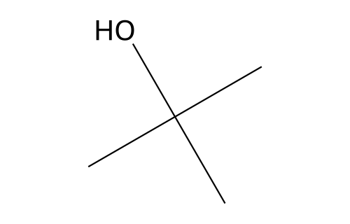
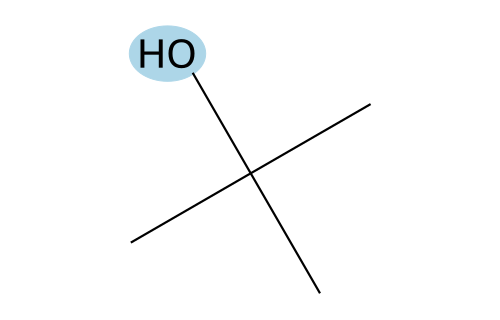
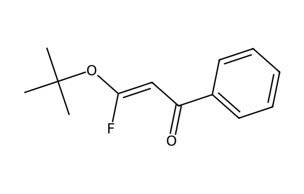

# C100 · tert-Butanol

[← C099](C099.md) · [100-molecule catalog](README.md)

| Recommended-input property | Value |
| --- | --- |
| Molecular formula | C4H10O |
| Canonical SMILES | `CC(C)(C)O` |
| Proposed bond-forming centre | O |
| Precursor family | tertiary_alcohol (RF28) |
| Feasibility class | C |
| Novelty review priority | 3 |
| NP labels | unresolved |
| NR labels | unresolved |
| Site/pathway hypotheses | 1 |
| Proposed product options | 1 |

## Recommendation rationale

This tertiary_alcohol; neutral X-H donor belongs to the tertiary_alcohol family and was retained as a O-centred recommendation. It is assigned feasibility class C and novelty review priority 3. These categories organize chemical review and do not state that the target reaction has already been demonstrated.

The machine-readable record retains the source-linked activation question, competing pathways, diagnostic observation and transfer limits used in the recommendation workflow.

## Reactive-site hypotheses and proposed endpoints

### C100-H01

Reacting-atom index: **4** (zero-based in `CC(C)(C)O`).

Proposed route: O-centred substitution; carbonyl retained; one fluorine retained at the new alkene

Evidence basis: RP-guided chemical proposal. Full activation, competing-pathway and diagnostic fields are retained in the hypothesis JSON.

#### C100-H01-O01

`CC(C)(C)OC(F)=CC(=O)c1ccccc1`

NP **unresolved**; NR **unresolved**. This is a proposed connectivity, not an observed product assignment.

## Relationship to the experimental collection

Best relationship: **Same donor family, different scaffold**.

| Experimental record | Relationship | Structural basis |
| --- | --- | --- |
| [AP052](experiment_mapping/pairs/AP052.md) | Same donor family, different scaffold | The local donor type is retained, but the molecular scaffold differs. |
| [AP054](experiment_mapping/pairs/AP054.md) | Same donor family, different scaffold | The local donor type is retained, but the molecular scaffold differs. |
| [AP055](experiment_mapping/pairs/AP055.md) | Same donor family, different scaffold | The local donor type is retained, but the molecular scaffold differs. |

## Evidence and data links

RP focus: [RP2](../evidence/principles/RP2.md), [RP4](../evidence/principles/RP4.md). Literature sources: [L294](../literature/sources/L294.md), [L320](../literature/sources/L320.md).

[Candidate JSON](data/candidates_100.json) · [103 hypotheses](data/hypotheses_103.json) · [103 product options](product_options/product_options_103.json) · [112 experimental pairs](experiment_mapping/mapping_112.json)
