# 100 recommended molecules for selective defluorinative coupling

This catalog connects each of the **100 molecular inputs (C001–C100)** to its chemical rationale, reacting-site hypotheses, proposed product connectivities, source evidence and relation to experimental inputs. The molecules span carbon, nitrogen, oxygen, sulfur, phosphorus and selenium donors. Open a molecule to see its structure and every associated site/pathway and endpoint; the table below is an index, not an experimental yield ranking.

The same collection contains **115 site/pathway hypotheses** and **124 product options**. Molecules retain their salts, charges and distinct precursor forms. One molecule can support more than one reacting site, and separate hypotheses can converge to the same product graph. All of those relationships remain explicit.

## How to read a recommendation

**Working (48) / reserve (52)** is the original allocation of the same 100 molecules. It reflects coverage and selection constraints, not a calibrated probability of reaction. Later chemical assessment assigns a **research role**: priority for exploration, condition-limited challenge, unverified extrapolation or known reference. A molecule can carry different roles for different pathways. These roles are separate from the working/reserve allocation.

**No numerical overall reactivity score or success probability was supplied.** All 115 proposal-level probability fields are unassigned. The actual reported assessments are the separate NP/NR labels below and recorded qualitative confidence grades B/C. These confidence grades are supplied as qualitative annotations; a calibrated probability interpretation or grade threshold was not supplied. The catalog does not invent a total score, convert unresolved labels to zero, or rank molecules by predicted yield.

## Assessment labels

| Label | Scientific meaning |
| --- | --- |
| NP 1R | The proposed product connectivity was registered or directly reported; registry registration alone does not establish a matching isolated product in a cited reaction. |
| NP 1T | A standardized tautomer relationship was registered; identical bond-order connectivity is not asserted. |
| NP 2 | No exact match was found in the bounded search; the key connectivity or a nearby scaffold has precedent. |
| NP 3 | No matching key connectivity/charge endpoint precedent was established within the searched scope. |
| NR 1 | The same substrate class, donor form and net transformation had precedent under the stated rubric. |
| NR 2 | Extension in substrate, donor or activation method. |
| NR 3 | No matching target substrate–partner sequence was established in the bounded search. |
| unresolved | Endpoint-specific evidence is insufficient; no numerical value is substituted. |
| not applicable | The input lacks the site needed for that proposed route; this is not an experimental failure. |
| alternative/range labels | Endpoint-dependent alternatives are retained separately rather than averaged. |

NP addresses **product connectivity**, NR addresses **reaction precedent**. Neither measures the novelty of the reagent itself or establishes worldwide first discovery, experimental success or stereochemical priority. The per-option registry result and comparison references must be read with the label. The molecule index shows each distinct label. The individual molecule pages retain the separate values for every pathway and product option.

## Structures, evidence and experimental associations

The main drawings depict the specified input SMILES. Each hypothesis has a second drawing with highlighted, zero-based reactive-atom indices in **that hypothesis’s original SMILES order**. Product drawings are proposed endpoints. Counterions, formal charges and alternative transfer fragments are retained.

Forty-six molecules carry original molecule-linked citations; 54 do not. A later novelty comparison or principle question does not retroactively supply a missing original citation. Literature links lead to full source descriptions, and quotation links lead to exact attributed passages. The four reaction principles are conditional questions about activation, donor form, pathway divergence and product persistence, not evidence that every recommended molecule reacts.

The [108 experimental-input associations](experiment_mapping/README.md) distinguish exact molecules, reactive forms and broader donor-family relations. These comparisons do not recover contemporaneous selection decisions. Missing evidence is explicit, and no observed yield is assigned through a family analogy.

## Structure, network and novelty guides

[Input structure atlas C1–C9](structure_atlas.md) · [Evidence network G1–G9](../knowledge_graph/) · [Novelty assessment, Figure N1 and Supplementary Figure 5](novelty_assessment.md) · [Model settings, original prompts and working constraints](../code/docs/model_workflow.md) · [Model donors and experimental record interpretation](experiment_mapping/model_donors.md)

## Downloadable scientific tables

- [100 molecules: CSV](data/candidates_100.csv) · [JSON with full English descriptions and source-linked evidence](data/candidates_100.json)
- [115 site/pathway hypotheses: CSV](data/hypotheses_115.csv) · [JSON with complete original-language proposal detail](data/hypotheses_115.json)
- [124 proposed product options](product_options/README.md), including exact structures, formal charge, registry queries, NP/NR labels and comparison references
- [108 experimental-input associations](experiment_mapping/README.md), with all original table rows, alternatives and sample/condition links
- [Full scientific description text for all 100 molecules](data/scientific_descriptions_100.json)

The original-language hypothesis fields retain reactive form, activation, proposed route, competing outcomes and diagnostic experiment. They supplement the English chemical description and explicit structures. `candidate_id`, `hypothesis_id`, `option_id` and `actual_pair_id` are stable join keys; C001–C100 are the reader-facing molecule identifiers. JSON null means unassigned, not zero.

## Molecule index

| Molecule | Input structure and name | Centre | NP | NR | Research role · allocation |
| --- | --- | --- | --- | --- | --- |
| [C001](C001.md) | 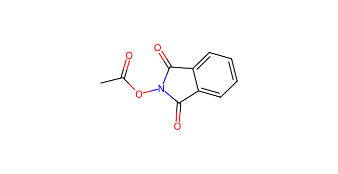 N-Hydroxyphthalimide acetate | C | 1R | 2 | condition-limited challenge (working) |
| [C002](C002.md) | 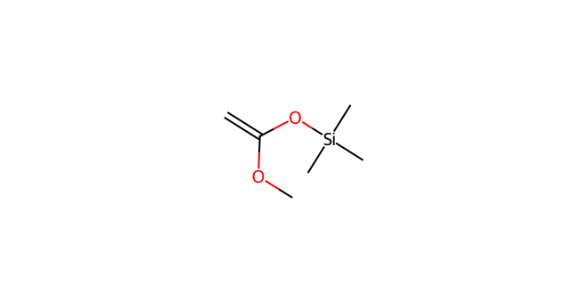 Methyl acetate trimethylsilyl ketene acetal | C | 2 | 3 | unverified extrapolation (working) |
| [C003](C003.md) | 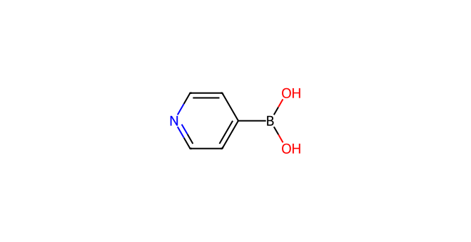 Pyridin-4-ylboronic acid | C | 2 | 1 | known reference (working) |
| [C004](C004.md) | 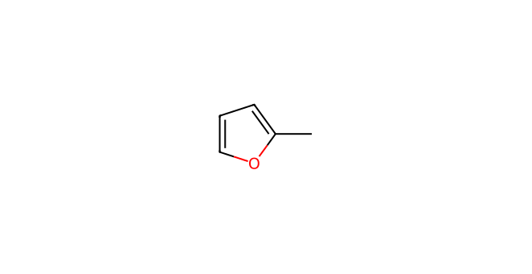 2-Methylfuran | C | 2 | 3 | unverified extrapolation (working) |
| [C005](C005.md) | 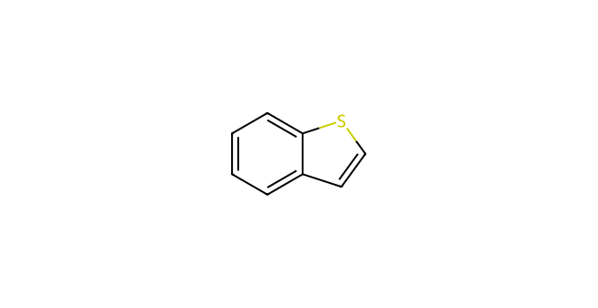 Benzo[b]thiophene | C | 2 | 3 | unverified extrapolation (working) |
| [C006](C006.md) | 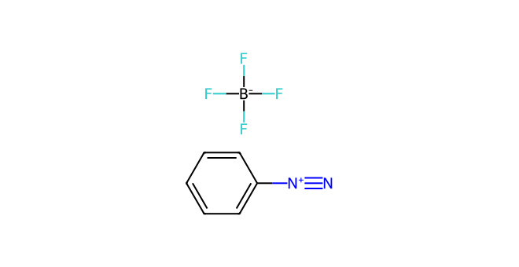 Benzenediazonium tetrafluoroborate | C | 1R | 2 | condition-limited challenge (working) |
| [C007](C007.md) | 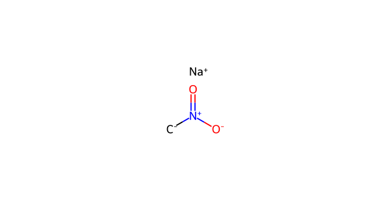 Sodium nitromethanide | C | 2 | 3 | unverified extrapolation (working) |
| [C008](C008.md) | 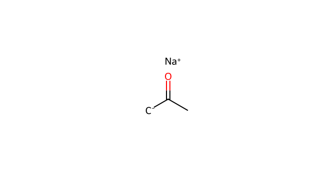 Sodium acetone enolate | C | 2 | 3 | unverified extrapolation (working) |
| [C009](C009.md) | 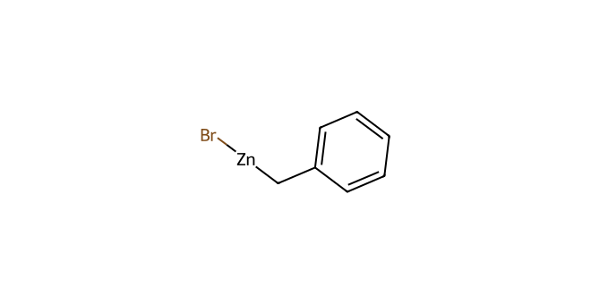 Benzylzinc bromide | C | 2 | 2 | condition-limited challenge (working) |
| [C010](C010.md) | 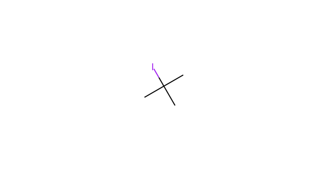 tert-Butyl iodide | C | 2 | 2 | condition-limited challenge (working) |
| [C011](C011.md) | 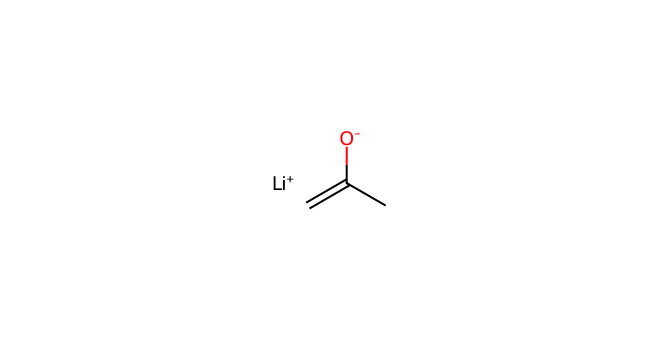 Lithium acetone enolate | C,O | 2 | 3 | unverified extrapolation (working) |
| [C012](C012.md) | 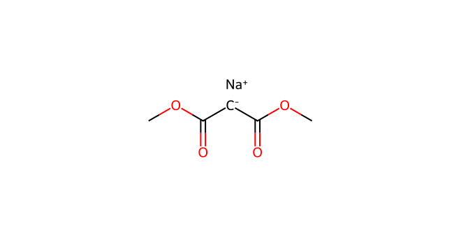 Sodium dimethyl malonate | C | 2 | 3 | unverified extrapolation (working) |
| [C013](C013.md) | 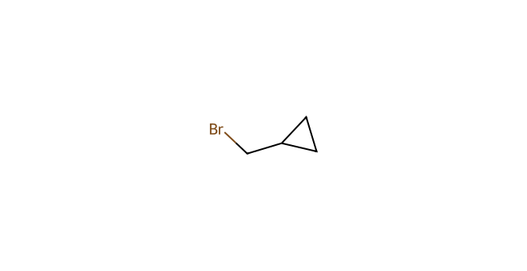 (Bromomethyl)cyclopropane | C | 2 | 2 | condition-limited challenge (working) |
| [C014](C014.md) | 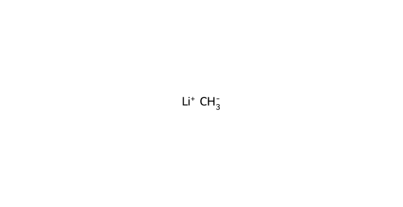 Methyllithium | C | 1R | 2 | condition-limited challenge (working) |
| [C015](C015.md) | 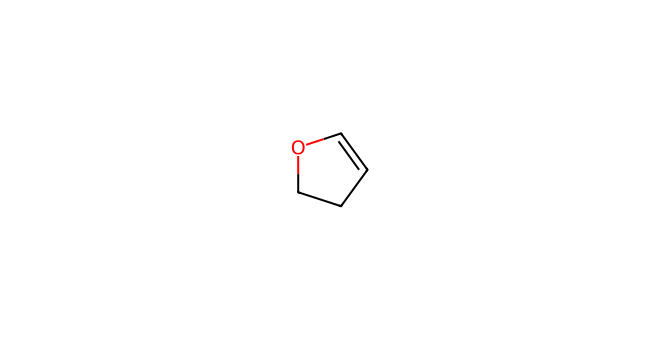 2,3-Dihydrofuran | C | 2 | 3 | unverified extrapolation (working) |
| [C016](C016.md) | 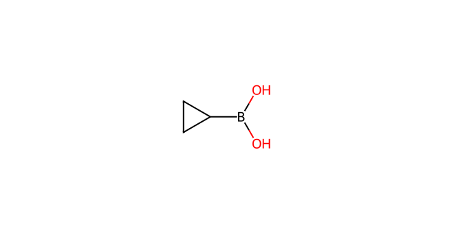 Cyclopropylboronic acid | C | 2 | 1 | known reference (working) |
| [C017](C017.md) | 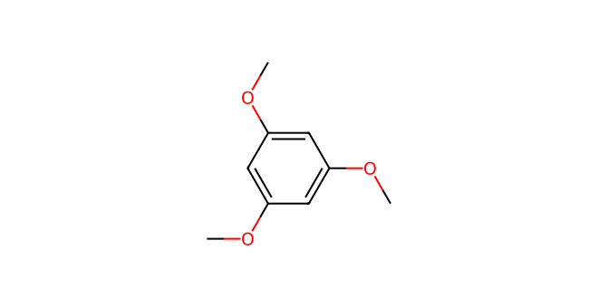 1,3,5-Trimethoxybenzene | C | 2 | 3 | unverified extrapolation (working) |
| [C018](C018.md) | 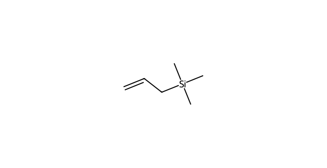 Allyltrimethylsilane | C | 2 | 3 | unverified extrapolation (reserve) |
| [C019](C019.md) | 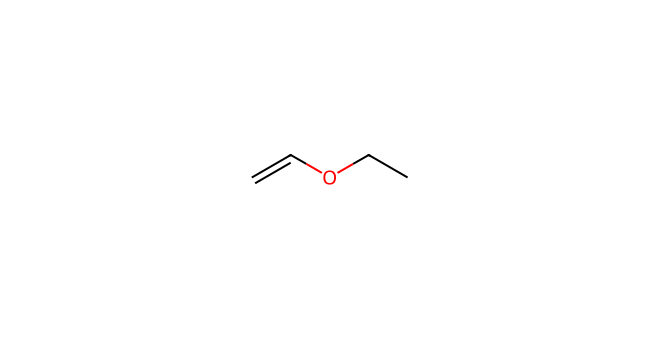 Ethyl vinyl ether | C | 2 | 3 | unverified extrapolation (reserve) |
| [C020](C020.md) | 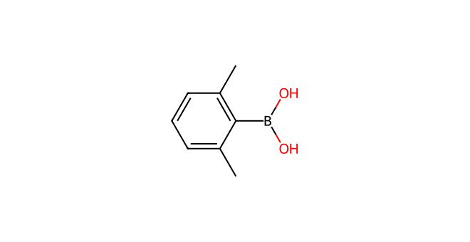 2,6-Dimethylphenylboronic acid | C | 2 | 1 | known reference (reserve) |
| [C021](C021.md) | 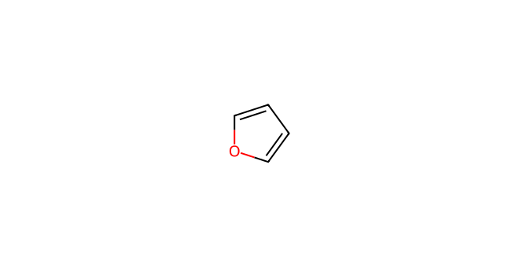 Furan | C | 2 | 3 | unverified extrapolation (reserve) |
| [C022](C022.md) | 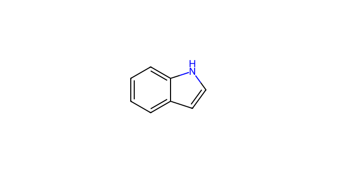 Indole | C | 2 | 3 | unverified extrapolation (reserve) |
| [C023](C023.md) | 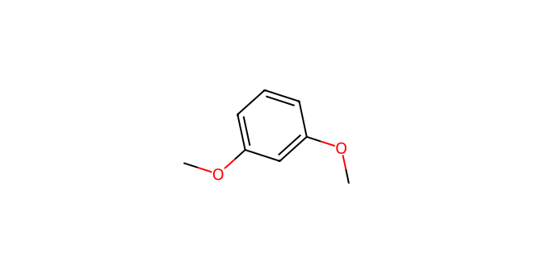 1,3-Dimethoxybenzene | C | 2 | 2 | condition-limited challenge (reserve) |
| [C024](C024.md) | 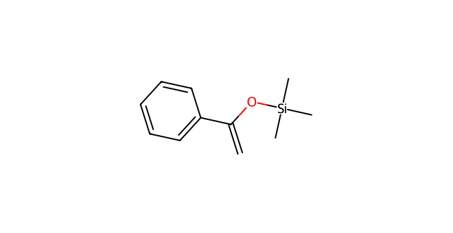 Acetophenone trimethylsilyl enol ether | C | 2 | 3 | unverified extrapolation (reserve) |
| [C025](C025.md) | 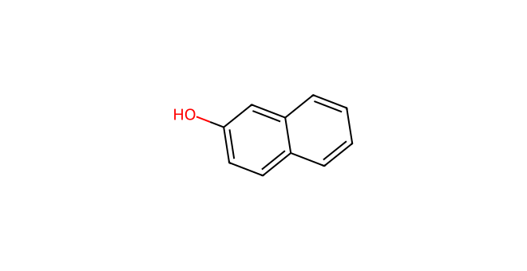 2-Naphthol | C | 2 | 3 | unverified extrapolation (reserve) |
| [C026](C026.md) | 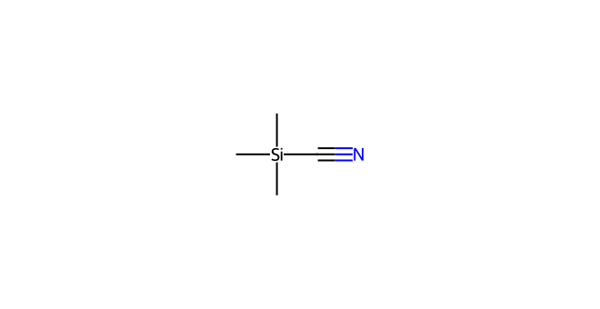 Trimethylsilyl cyanide | C | 2 | 2 | condition-limited challenge (reserve) |
| [C027](C027.md) | 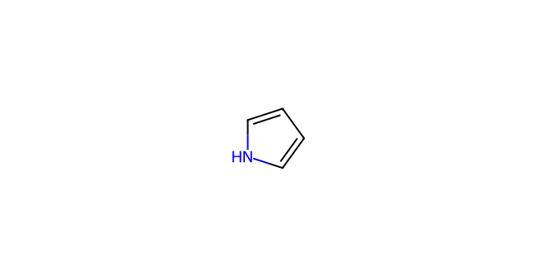 Pyrrole | C,N | 2 | 3 / 2 | unverified extrapolation / priority for exploration (reserve) |
| [C028](C028.md) | 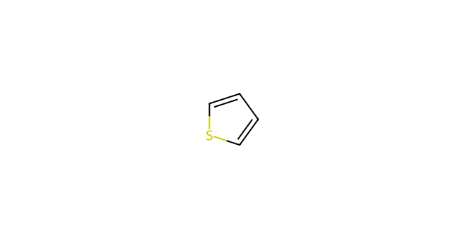 Thiophene | C | 2 | 3 | unverified extrapolation (reserve) |
| [C029](C029.md) | 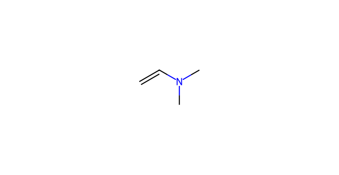 N,N-Dimethylvinylamine | C | 2 | 3 | unverified extrapolation (reserve) |
| [C030](C030.md) | 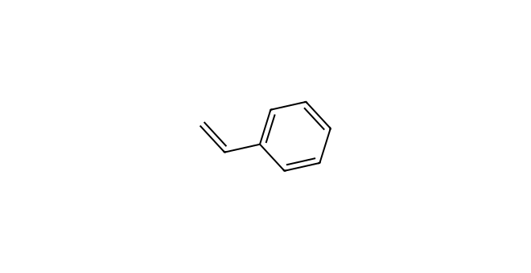 Styrene | C | 2 | 3 | unverified extrapolation (reserve) |
| [C031](C031.md) | 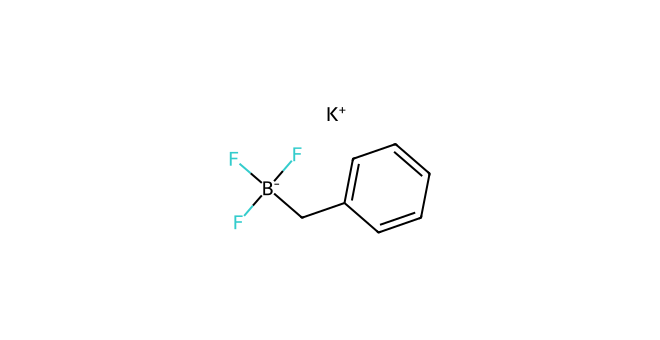 Potassium benzyltrifluoroborate | C | 2 | 2 | condition-limited challenge (reserve) |
| [C032](C032.md) | 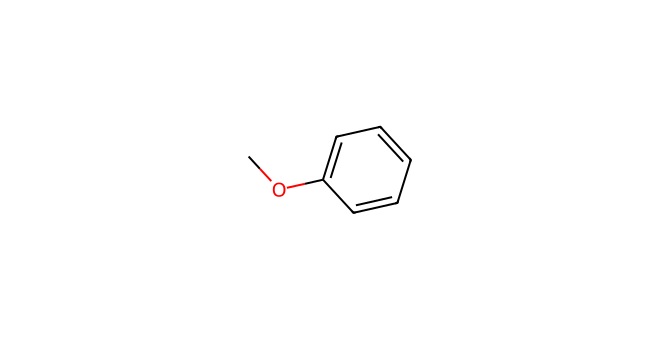 Anisole | C | 2 | 3 | condition-limited challenge (reserve) |
| [C033](C033.md) | 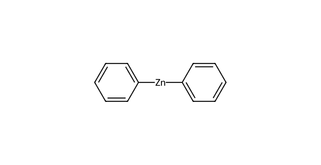 Diphenylzinc | C | 1R | 2 | condition-limited challenge (reserve) |
| [C034](C034.md) | 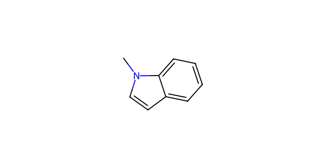 1-Methylindole | C | 2 | 3 | unverified extrapolation (reserve) |
| [C035](C035.md) | 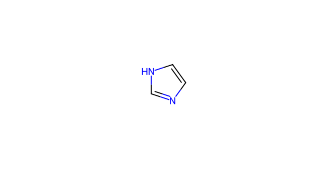 Imidazole | N | 2 | 2 | unverified extrapolation / priority for exploration (working) |
| [C036](C036.md) | 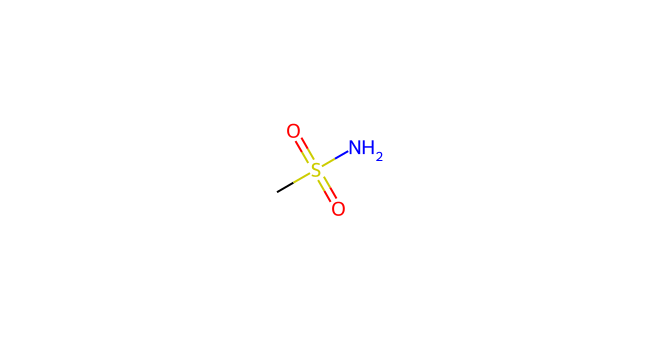 Methanesulfonamide | N | 2 | 3 | unverified extrapolation (working) |
| [C037](C037.md) | 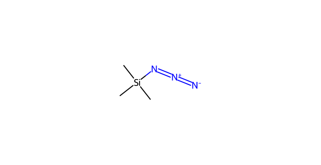 Trimethylsilyl azide | N | 3 | 3 | unverified extrapolation (working) |
| [C038](C038.md) | 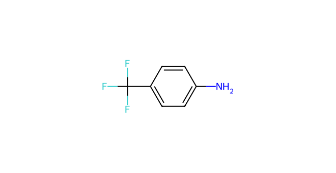 4-(Trifluoromethyl)aniline | N | 2 | 2 | priority for exploration (working) |
| [C039](C039.md) | 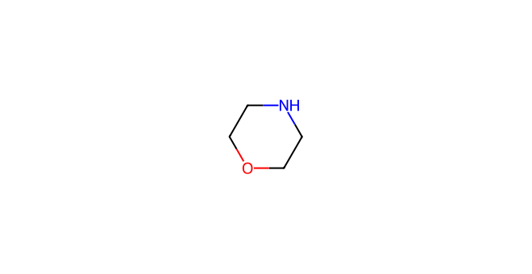 Morpholine | N | 2 | 1 | condition-limited challenge (working) |
| [C040](C040.md) | 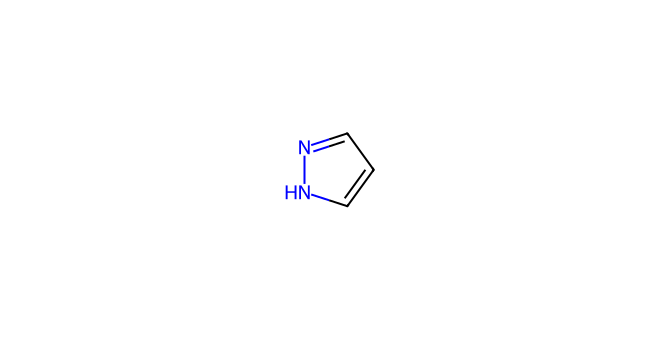 Pyrazole | N | 2 | 2 | priority for exploration (working) |
| [C041](C041.md) | 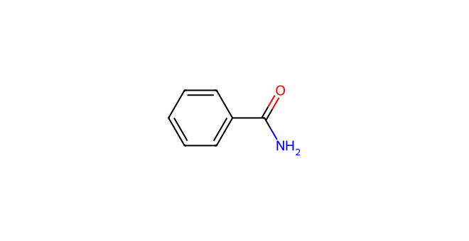 Benzamide | N | 2 | 3 | unverified extrapolation (working) |
| [C042](C042.md) | 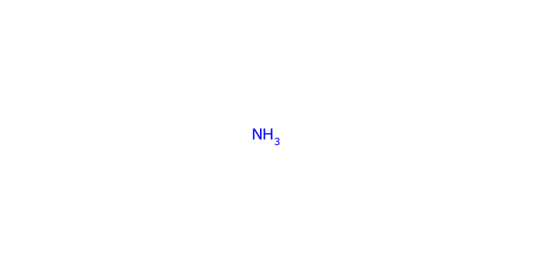 Ammonia | N | 2 | 3 | unverified extrapolation (working) |
| [C043](C043.md) | 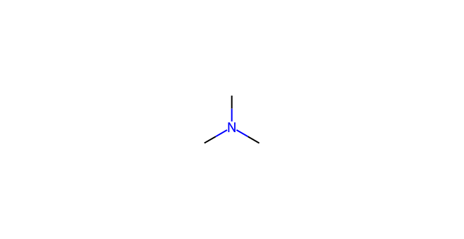 Trimethylamine | N | 3 | 3 | unverified extrapolation (working) |
| [C044](C044.md) | 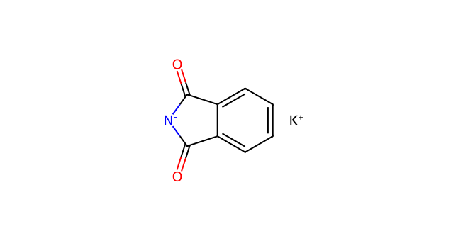 Potassium phthalimide | N | 2 | 3 | unverified extrapolation (reserve) |
| [C045](C045.md) | 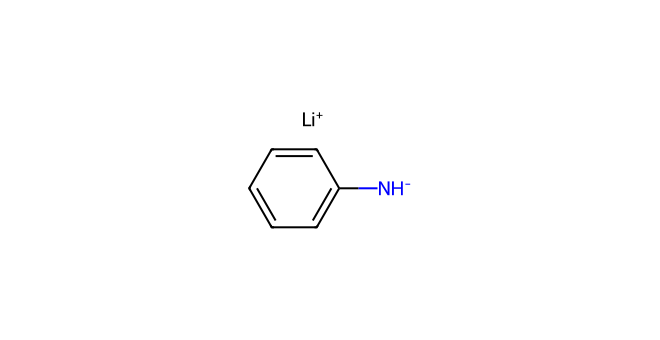 Lithium anilide | N | 2 | 2 | condition-limited challenge (reserve) |
| [C046](C046.md) | 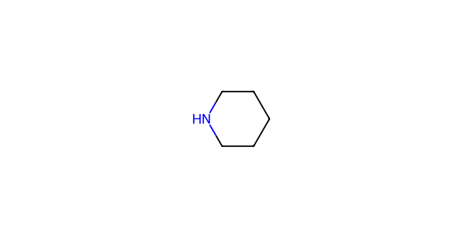 Piperidine | N | 2 | 1 | condition-limited challenge (reserve) |
| [C047](C047.md) | 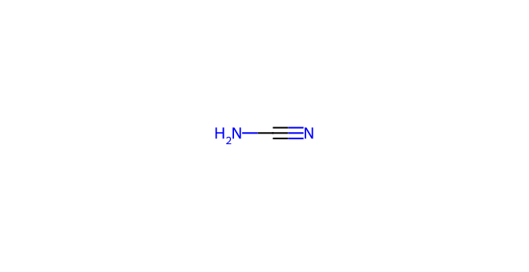 Cyanamide | N | 3 | 3 | unverified extrapolation (reserve) |
| [C048](C048.md) | 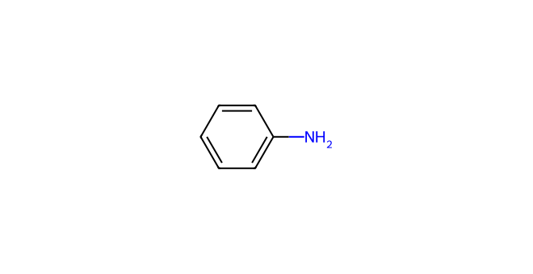 Aniline | N | 2 | 2 | priority for exploration (reserve) |
| [C049](C049.md) | 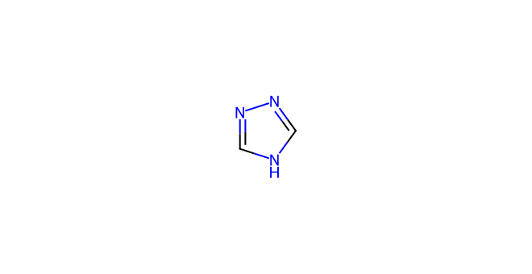 1,2,4-Triazole | N | 2 | 2 | priority for exploration (reserve) |
| [C050](C050.md) | 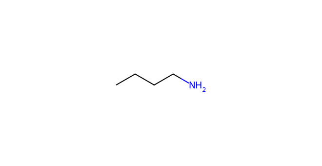 Butan-1-amine | N | 2 | 3 | condition-limited challenge (reserve) |
| [C051](C051.md) |  Phenol | O | 2 | 2 | priority for exploration (working) |
| [C052](C052.md) |  Allyl alcohol | O | 2 | 2 | priority for exploration (working) |
| [C053](C053.md) |  TEMPO | O | 3 | 3 | unverified extrapolation (working) |
| [C054](C054.md) |  Sodium hydroperoxide | O | 3 | 3 | unverified extrapolation (working) |
| [C055](C055.md) |  Water | O | 1T | 3 | unverified extrapolation (working) |
| [C056](C056.md) |  Pyridine N-oxide | O | 3 | 3 | unverified extrapolation (working) |
| [C057](C057.md) |  Sodium trimethylsilanolate | O | 3 | 3 | unverified extrapolation (reserve) |
| [C058](C058.md) |  Sodium 4-(trifluoromethyl)phenoxide | O | 2 | 2 | condition-limited challenge (reserve) |
| [C059](C059.md) |  Sodium tert-butoxide | O | 2 | 2 | condition-limited challenge (reserve) |
| [C060](C060.md) |  Sodium methoxide | O | 2 | 2 | condition-limited challenge (reserve) |
| [C061](C061.md) |  Methanol | O | 2 | 2 | priority for exploration (reserve) |
| [C062](C062.md) |  Sodium 2,2,2-trifluoroethoxide | O | 2 | 2 | condition-limited challenge (reserve) |
| [C063](C063.md) |  Lithium methoxide | O | 2 | 2 | condition-limited challenge (reserve) |
| [C064](C064.md) |  Sodium phenoxide | O | 2 | 2 | condition-limited challenge (reserve) |
| [C065](C065.md) |  Sodium allyloxide | O | 2 | 2 | condition-limited challenge (reserve) |
| [C066](C066.md) |  Potassium thiocyanate | S | 3 | 3 | unverified extrapolation (working) |
| [C067](C067.md) |  Thiourea | S | 3 | 3 | unverified extrapolation (working) |
| [C068](C068.md) |  4-Bromobenzenethiol | S | 2 | 2 | priority for exploration (working) |
| [C069](C069.md) |  Tetrahydrothiophene | S | 3 | 3 | unverified extrapolation (working) |
| [C070](C070.md) |  Sodium methanesulfinate | S | 2 | 2 | condition-limited challenge (working) |
| [C071](C071.md) |  Methyl phenyl disulfide | S | 2 | 2 | condition-limited challenge (working) |
| [C072](C072.md) |  Copper(I) methanethiolate | S | 2 | 2 | condition-limited challenge (working) |
| [C073](C073.md) |  Potassium ethyl xanthate | S | 3 | 3 | unverified extrapolation (working) |
| [C074](C074.md) |  Dimethyl sulfide | S | 3 | 3 | unverified extrapolation (working) |
| [C075](C075.md) |  Ethanethiol | S | 2 | 2 | priority for exploration (reserve) |
| [C076](C076.md) |  Sodium benzenesulfinate | S | 2 | 2 | condition-limited challenge (reserve) |
| [C077](C077.md) |  Potassium thioacetate | S | 3 | 3 | unverified extrapolation (reserve) |
| [C078](C078.md) |  Diphenyl disulfide | S | 2 | 2 | known reference (reserve) |
| [C079](C079.md) |  Sodium benzenethiolate | S | 2 | 2 | condition-limited challenge (reserve) |
| [C080](C080.md) |  tert-Butanethiol | S | 2 | 2 | priority for exploration (reserve) |
| [C081](C081.md) |  Thioanisole | S | 3 | 3 | unverified extrapolation (reserve) |
| [C082](C082.md) |  Benzenethiol | S | 2 | 2 | priority for exploration (reserve) |
| [C083](C083.md) |  Tris(2,2,2-trifluoroethyl) phosphite | P | 3/2 | 3 | unverified extrapolation (working) |
| [C084](C084.md) |  Tri-n-butylphosphine | P | 3 | 3 | unverified extrapolation (working) |
| [C085](C085.md) |  Dimethyl phosphite | P | 2 | 2 | condition-limited challenge (working) |
| [C086](C086.md) |  Tris(trimethylsilyl)phosphine | P | unresolved | 3 | unverified extrapolation (working) |
| [C087](C087.md) |  Diphenylphosphine sulfide | P | 2 | 3 | unverified extrapolation (working) |
| [C088](C088.md) |  Tricyclohexylphosphine | P | 3 | 3 | unverified extrapolation (working) |
| [C089](C089.md) |  Diethyl phosphite | P | 2 | 2 | condition-limited challenge (reserve) |
| [C090](C090.md) |  Diphenylphosphine oxide | P | 2 | 2 | condition-limited challenge (reserve) |
| [C091](C091.md) |  Tri-tert-butylphosphine | P | 3 | 3 | unverified extrapolation (reserve) |
| [C092](C092.md) |  Sodium hypophosphite | P | 2 | 3 | unverified extrapolation (reserve) |
| [C093](C093.md) |  Triphenylphosphine | P | 3 | 3 | unverified extrapolation (reserve) |
| [C094](C094.md) |  Dicyclohexylphosphine | P | 2 | 2 | condition-limited challenge (reserve) |
| [C095](C095.md) |  Diphenylphosphine | P | 2 | 2 | condition-limited challenge (reserve) |
| [C096](C096.md) |  Trimethyl phosphite | P | 3/2 | 3 | unverified extrapolation (reserve) |
| [C097](C097.md) |  Methoxydiphenylphosphine | P | 3/2 | 3 | unverified extrapolation (reserve) |
| [C098](C098.md) |  Trimethylphosphine | P | 3 | 3 | unverified extrapolation (reserve) |
| [C099](C099.md) |  Lithium diphenylphosphide | P | 2 | 2 | condition-limited challenge (reserve) |
| [C100](C100.md) |  Benzeneselenol | Se | 2 | 3 | condition-limited challenge (working) |
