# 100 RP-guided nucleophile recommendations

This catalog is the molecular output of the evidence-to-RP-to-recommendation workflow. The **100 unique neutral molecules** comprise **40 N-, 30 O-, 25 S- and 5 P-centred donors** distributed across 43 precursor families. The records retain **103 site/pathway hypotheses** and **103 proposed product connectivities**.

Recommendations were first grouped by chemical feasibility (A 22, B 75, C 3) and then ordered for review by novelty priority (1: 43, 2: 41, 3: 16), while preserving RP and literature provenance. These labels organize experimental review; they are not probabilities of reaction success or predicted yields.

## From recommendations to experimental reagents

Every recommendation was compared with the 108 recorded ordered substrate-partner pairs and the qualitative supplemental phosphorus records. The best candidate-level relationships are **25 exact identities, 31 same-scaffold/substituent or positional variations, 41 same-family/different-scaffold relationships and 3 recommendations without a reasonable counterpart**. Thus, 97 recommendations have a defensible exact, scaffold-level or donor-family correspondence to the experimental collection; the remaining three are retained as explicit unmatched recommendations.

The experimental-pair view is a different counting unit: the 108 ordered pairs comprise **26 exact, 37 scaffold/substituent, 41 donor-family and 4 unmatched records**. Structural correspondence explains how the RP-derived chemical space was translated into practical experiments; it does not transfer a measured response from one molecule to another.

## Reader guides and data

[Structure atlas C1-C9](structure_atlas.md) · [Recommendation-to-experiment relationships](reagent_selection.md) · [All 108 experimental pairs](experiment_mapping/) · [Product options](product_options/) · [NP/NR assessment](novelty_assessment.md)

- [100 candidates: JSON](data/candidates_100.json) · [CSV](data/candidates_100.csv)
- [103 hypotheses: JSON](data/hypotheses_103.json) · [CSV](data/hypotheses_103.csv)
- [103 product options: JSON](product_options/product_options_103.json) · [CSV](product_options/product_options_103.csv)
- [108 experimental pairs](experiment_mapping/mapping_108.json) and [209 selected candidate-pair relations](experiment_mapping/relations.csv)

## Molecule index

| Molecule | Structure and name | Centre | Family | Feasibility | Novelty priority | Best experimental correspondence |
| --- | --- | --- | --- | --- | --- | --- |
| [C001](C001.md) | 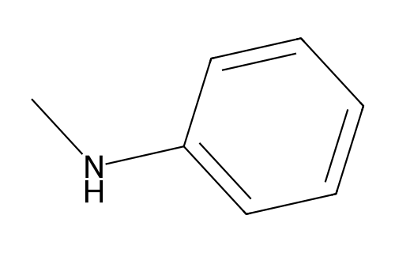 N-Methylaniline | N | arylamine | A | 1 | Same donor family, different scaffold |
| [C002](C002.md) | 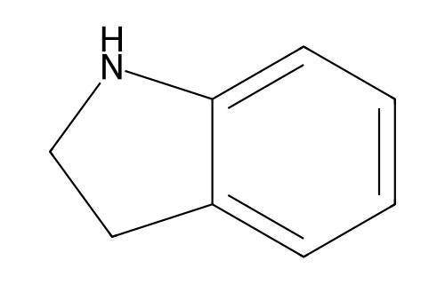 Indoline | N | fused_secondary_amine | A | 1 | Exact identity |
| [C003](C003.md) | 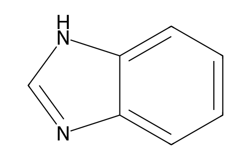 Benzimidazole | N | fused_azole | A | 1 | Same scaffold, substituent or positional variation |
| [C004](C004.md) | 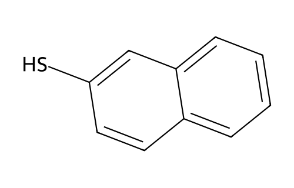 Naphthalene-2-thiol | S | fused_aryl_thiol | A | 1 | Same donor family, different scaffold |
| [C005](C005.md) | 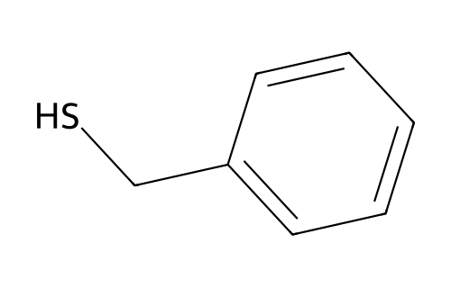 Phenylmethanethiol | S | benzylic_thiol | A | 1 | Same scaffold, substituent or positional variation |
| [C006](C006.md) | 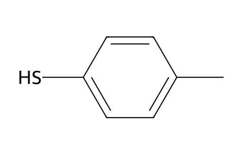 4-Methylbenzenethiol | S | aryl_thiol | A | 2 | Exact identity |
| [C007](C007.md) | 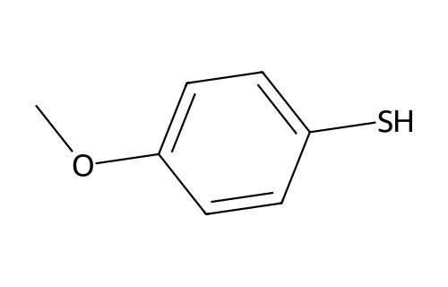 4-Methoxybenzenethiol | S | aryl_thiol | A | 2 | Exact identity |
| [C008](C008.md) | 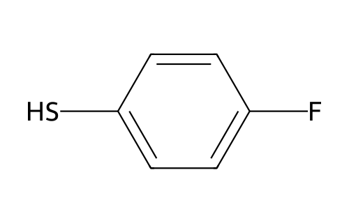 4-Fluorobenzenethiol | S | aryl_thiol | A | 2 | Same scaffold, substituent or positional variation |
| [C009](C009.md) | 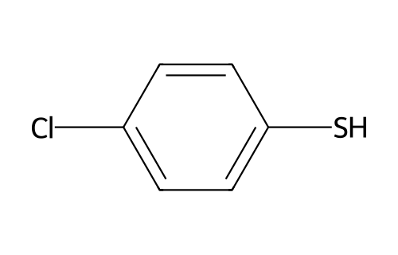 4-Chlorobenzenethiol | S | aryl_thiol | A | 2 | Same scaffold, substituent or positional variation |
| [C010](C010.md) | 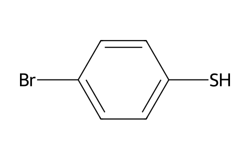 4-Bromobenzenethiol | S | aryl_thiol | A | 2 | Same scaffold, substituent or positional variation |
| [C011](C011.md) | 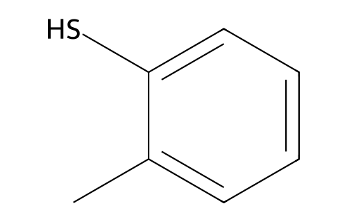 2-Methylbenzenethiol | S | aryl_thiol | A | 2 | Same scaffold, substituent or positional variation |
| [C012](C012.md) | 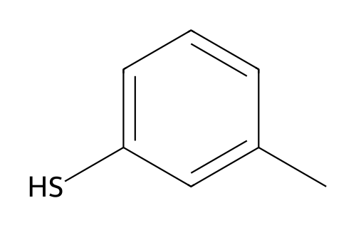 3-Methylbenzenethiol | S | aryl_thiol | A | 2 | Same scaffold, substituent or positional variation |
| [C013](C013.md) | 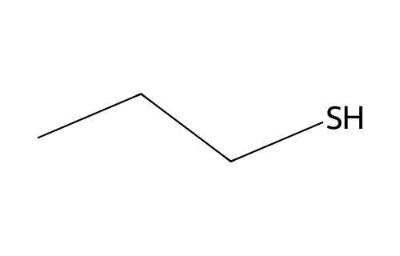 Propane-1-thiol | S | primary_alkyl_thiol | A | 2 | Same donor family, different scaffold |
| [C014](C014.md) | 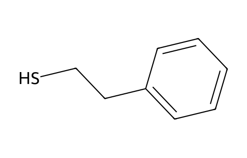 2-Phenylethane-1-thiol | S | arylalkyl_thiol | A | 2 | Same donor family, different scaffold |
| [C015](C015.md) | 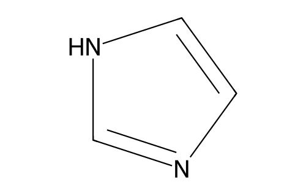 Imidazole | N | azole | A | 3 | Same scaffold, substituent or positional variation |
| [C016](C016.md) | 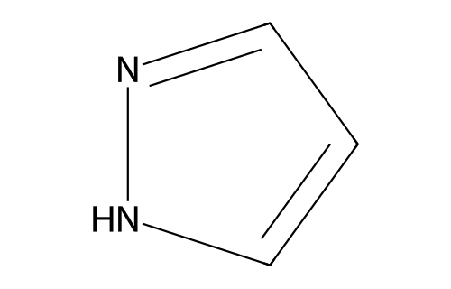 Pyrazole | N | azole | A | 3 | Same donor family, different scaffold |
| [C017](C017.md) | 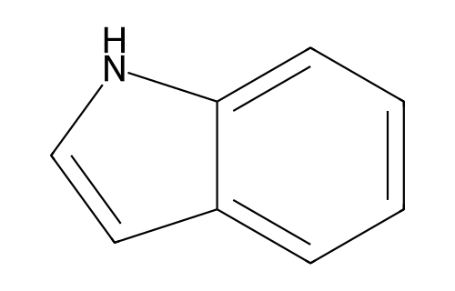 Indole | N | pyrrolic_nh | A | 3 | Same scaffold, substituent or positional variation |
| [C018](C018.md) | 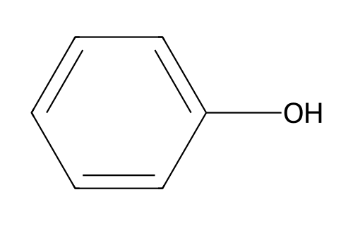 Phenol | O | phenol | A | 3 | Exact identity |
| [C019](C019.md) | 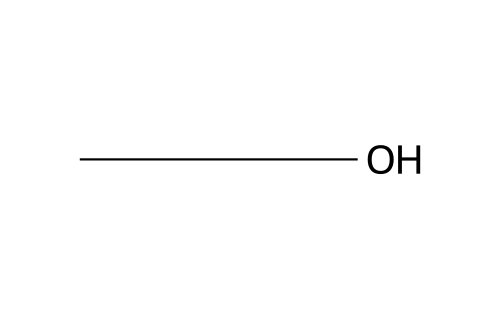 Methanol | O | primary_alcohol | A | 3 | Same donor family, different scaffold |
| [C020](C020.md) | 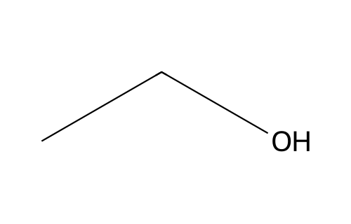 Ethanol | O | primary_alcohol | A | 3 | Same donor family, different scaffold |
| [C021](C021.md) | 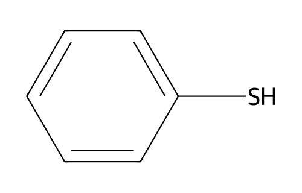 Benzenethiol | S | aryl_thiol | A | 3 | Same scaffold, substituent or positional variation |
| [C022](C022.md) | 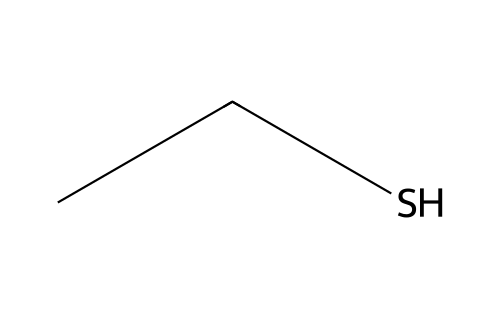 Ethanethiol | S | primary_alkyl_thiol | A | 3 | Same donor family, different scaffold |
| [C023](C023.md) | 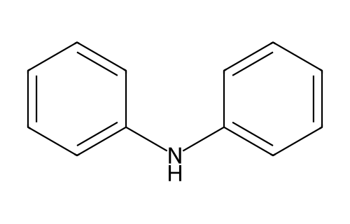 Diphenylamine | N | diarylamine | B | 1 | Exact identity |
| [C024](C024.md) | 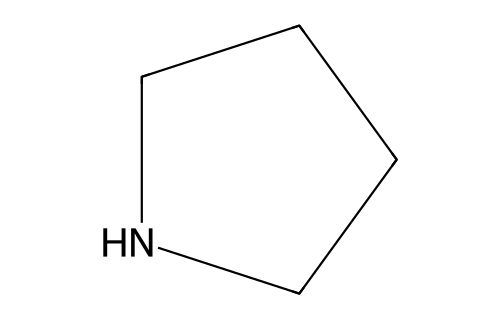 Pyrrolidine | N | cyclic_secondary_amine | B | 1 | Same donor family, different scaffold |
| [C025](C025.md) | 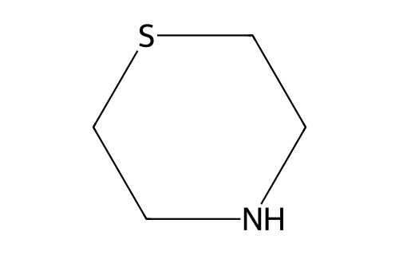 Thiomorpholine | N | cyclic_secondary_amine | B | 1 | Same donor family, different scaffold |
| [C026](C026.md) | 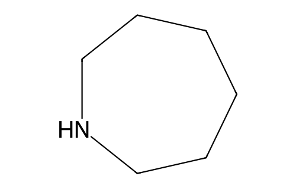 Azepane | N | cyclic_secondary_amine | B | 1 | Same donor family, different scaffold |
| [C027](C027.md) | 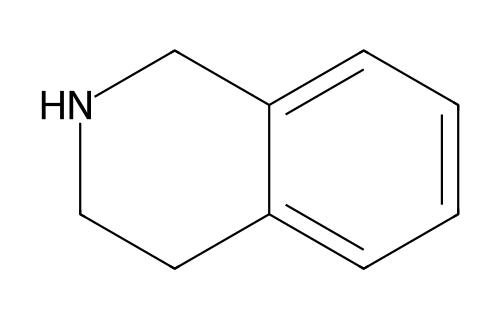 1,2,3,4-Tetrahydroisoquinoline | N | fused_secondary_amine | B | 1 | Same donor family, different scaffold |
| [C028](C028.md) | 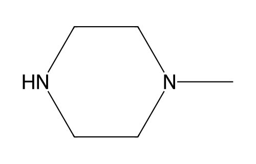 1-Methylpiperazine | N | cyclic_secondary_amine | B | 1 | Same scaffold, substituent or positional variation |
| [C029](C029.md) | 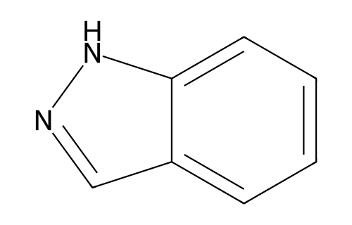 Indazole | N | fused_azole | B | 1 | Same donor family, different scaffold |
| [C030](C030.md) | 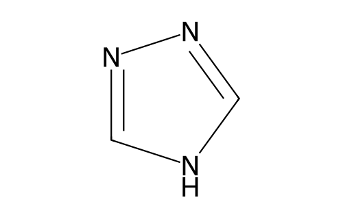 1,2,4-Triazole | N | azole | B | 1 | Same donor family, different scaffold |
| [C031](C031.md) | 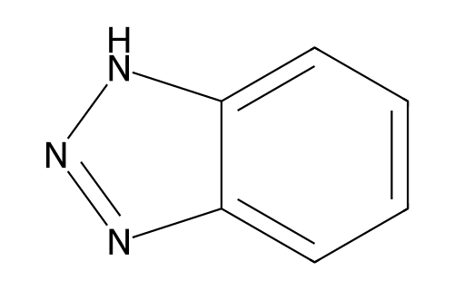 1H-Benzotriazole | N | fused_azole | B | 1 | Same donor family, different scaffold |
| [C032](C032.md) | 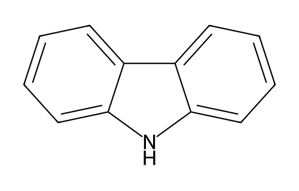 Carbazole | N | pyrrolic_nh | B | 1 | Same scaffold, substituent or positional variation |
| [C033](C033.md) | 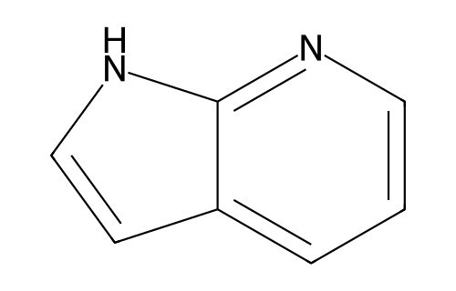 7-Azaindole | N | pyrrolic_nh | B | 1 | Same scaffold, substituent or positional variation |
| [C034](C034.md) | 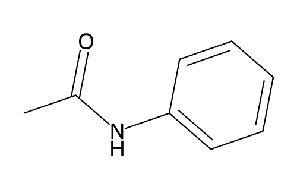 Acetanilide | N | amide | B | 1 | Exact identity |
| [C035](C035.md) | 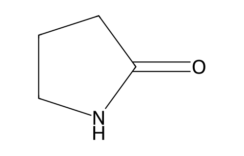 Pyrrolidin-2-one | N | lactam | B | 1 | Same donor family, different scaffold |
| [C036](C036.md) | 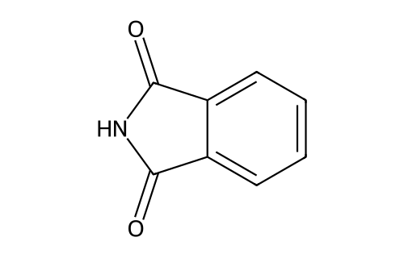 Phthalimide | N | imide | B | 1 | Same donor family, different scaffold |
| [C037](C037.md) | 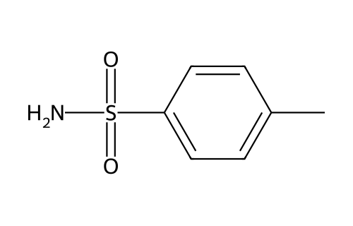 4-Methylbenzenesulfonamide | N | sulfonamide | B | 1 | No reasonable counterpart |
| [C038](C038.md) | 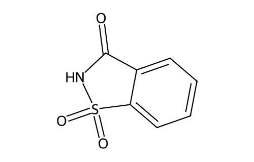 Saccharin | N | sulfonimide | B | 1 | Same donor family, different scaffold |
| [C039](C039.md) | 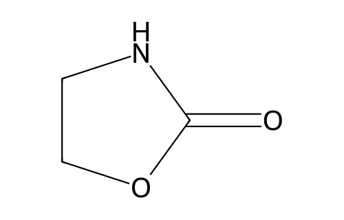 1,3-Oxazolidin-2-one | N | cyclic_carbamate | B | 1 | Same donor family, different scaffold |
| [C040](C040.md) | 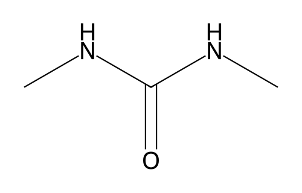 1,3-Dimethylurea | N | urea | B | 1 | Same donor family, different scaffold |
| [C041](C041.md) | 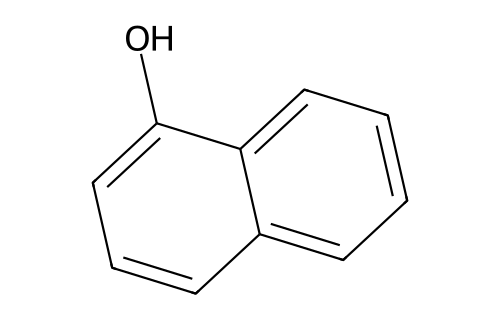 Naphthalen-1-ol | O | naphthol | B | 1 | Exact identity |
| [C042](C042.md) |  Naphthalen-2-ol | O | naphthol | B | 1 | Same scaffold, substituent or positional variation |
| [C043](C043.md) | 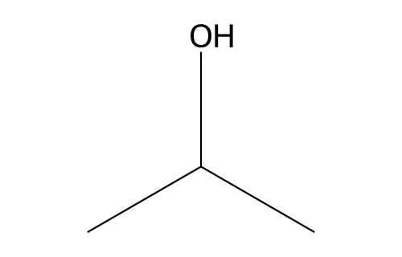 Propan-2-ol | O | secondary_alcohol | B | 1 | Same donor family, different scaffold |
| [C044](C044.md) | 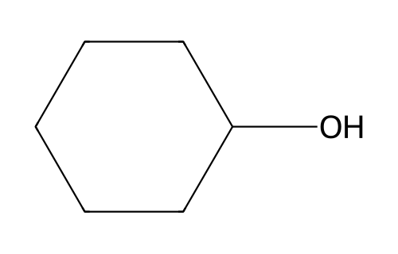 Cyclohexanol | O | secondary_alcohol | B | 1 | Same donor family, different scaffold |
| [C045](C045.md) | 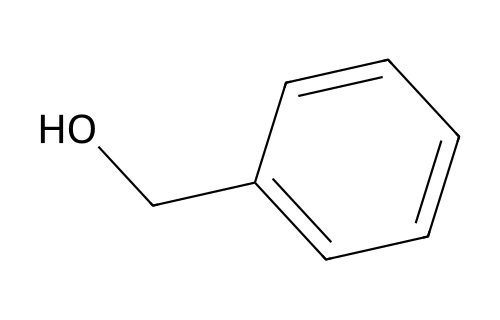 Benzyl alcohol | O | benzylic_alcohol | B | 1 | Exact identity |
| [C046](C046.md) | 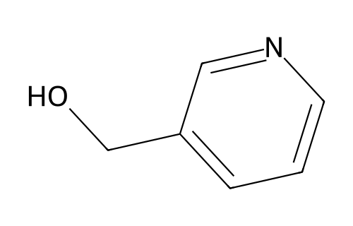 Pyridin-3-ylmethanol | O | heteroaryl_alcohol | B | 1 | Exact identity |
| [C047](C047.md) | 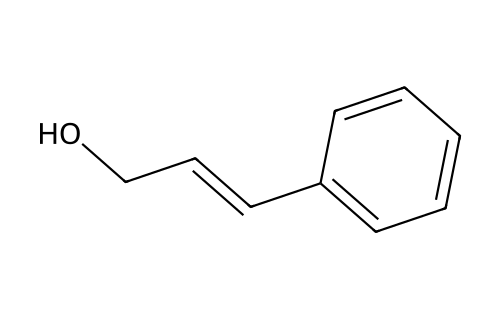 (E)-3-Phenylprop-2-en-1-ol | O | allylic_alcohol | B | 1 | Same donor family, different scaffold |
| [C048](C048.md) | 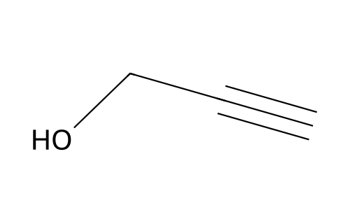 Prop-2-yn-1-ol | O | propargylic_alcohol | B | 1 | Same donor family, different scaffold |
| [C049](C049.md) | 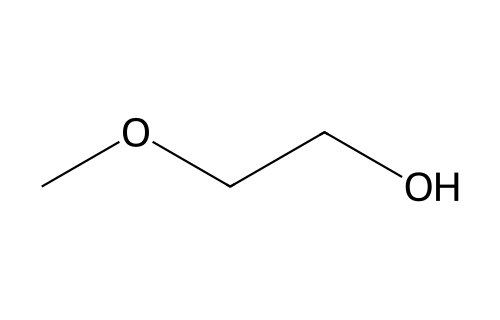 2-Methoxyethan-1-ol | O | ether_alcohol | B | 1 | Same donor family, different scaffold |
| [C050](C050.md) | 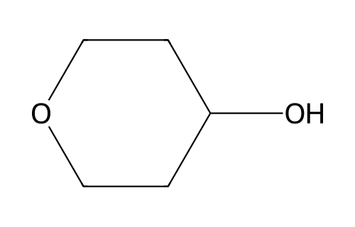 Oxan-4-ol | O | cyclic_ether_alcohol | B | 1 | Same donor family, different scaffold |
| [C051](C051.md) | 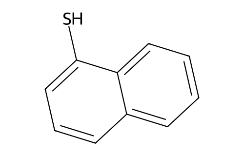 Naphthalene-1-thiol | S | fused_aryl_thiol | B | 1 | Same donor family, different scaffold |
| [C052](C052.md) |  Pyridine-3-thiol | S | heteroaryl_thiol | B | 1 | Same donor family, different scaffold |
| [C053](C053.md) |  Furan-2-ylmethanethiol | S | heteroarylmethyl_thiol | B | 1 | Same donor family, different scaffold |
| [C054](C054.md) |  Thiophen-2-ylmethanethiol | S | heteroarylmethyl_thiol | B | 1 | Same donor family, different scaffold |
| [C055](C055.md) |  Propane-2-thiol | S | secondary_alkyl_thiol | B | 1 | Same donor family, different scaffold |
| [C056](C056.md) |  2-Methylpropane-2-thiol | S | tertiary_alkyl_thiol | B | 1 | Same donor family, different scaffold |
| [C057](C057.md) |  Cyclohexanethiol | S | cyclic_alkyl_thiol | B | 1 | Same donor family, different scaffold |
| [C058](C058.md) |  2-Mercaptoethanol | S | hydroxyalkyl_thiol | B | 1 | Same donor family, different scaffold |
| [C059](C059.md) |  Dicyclohexylphosphine | P | secondary_alkyl_phosphine | B | 1 | Same donor family, different scaffold |
| [C060](C060.md) |  4-Methoxy-N-phenylaniline | N | diarylamine | B | 2 | Same scaffold, substituent or positional variation |
| [C061](C061.md) |  N-Methylpyridin-4-amine | N | arylamine | B | 2 | Exact identity |
| [C062](C062.md) |  N-Ethylpyridin-4-amine | N | arylamine | B | 2 | Same scaffold, substituent or positional variation |
| [C063](C063.md) |  2-Methyl-N-phenylaniline | N | diarylamine | B | 2 | Same scaffold, substituent or positional variation |
| [C064](C064.md) |  N-Methylnaphthalen-1-amine | N | arylamine | B | 2 | Same scaffold, substituent or positional variation |
| [C065](C065.md) |  1-Ethylpiperazine | N | cyclic_secondary_amine | B | 2 | Same scaffold, substituent or positional variation |
| [C066](C066.md) |  N-Methylbenzylamine | N | secondary_alkylamine | B | 2 | Exact identity |
| [C067](C067.md) |  4-Phenylpiperidine | N | cyclic_secondary_amine | B | 2 | Exact identity |
| [C068](C068.md) |  N-Ethylbenzamide | N | amide | B | 2 | Same scaffold, substituent or positional variation |
| [C069](C069.md) |  N-Methylbenzamide | N | amide | B | 2 | Exact identity |
| [C070](C070.md) |  N,4-Dimethylbenzenesulfonamide | N | sulfonamide | B | 2 | No reasonable counterpart |
| [C071](C071.md) |  N-Phenylpropanamide | N | amide | B | 2 | Same scaffold, substituent or positional variation |
| [C072](C072.md) |  4-Methylphenol | O | phenol | B | 2 | Same scaffold, substituent or positional variation |
| [C073](C073.md) |  4-Methoxyphenol | O | phenol | B | 2 | Same scaffold, substituent or positional variation |
| [C074](C074.md) |  4-Fluorophenol | O | phenol | B | 2 | Same scaffold, substituent or positional variation |
| [C075](C075.md) |  4-Bromophenol | O | phenol | B | 2 | Same scaffold, substituent or positional variation |
| [C076](C076.md) |  4-(Trifluoromethyl)phenol | O | phenol | B | 2 | Same scaffold, substituent or positional variation |
| [C077](C077.md) |  4-Hydroxybenzonitrile | O | phenol | B | 2 | Exact identity |
| [C078](C078.md) |  4-Phenylphenol | O | phenol | B | 2 | Exact identity |
| [C079](C079.md) |  3,5-Dimethoxyphenol | O | phenol | B | 2 | Exact identity |
| [C080](C080.md) |  Pentan-1-ol | O | primary_alcohol | B | 2 | Exact identity |
| [C081](C081.md) |  2-Phenylethan-1-ol | O | primary_alcohol | B | 2 | Same scaffold, substituent or positional variation |
| [C082](C082.md) |  (4-Methoxyphenyl)methanol | O | benzylic_alcohol | B | 2 | Same scaffold, substituent or positional variation |
| [C083](C083.md) |  (4-(Trifluoromethyl)phenyl)methanol | O | benzylic_alcohol | B | 2 | Same scaffold, substituent or positional variation |
| [C084](C084.md) |  2,2,2-Trifluoroethan-1-ol | O | fluoroalcohol | B | 2 | Same donor family, different scaffold |
| [C085](C085.md) |  4-(Trifluoromethyl)benzenethiol | S | aryl_thiol | B | 2 | Exact identity |
| [C086](C086.md) |  4-Mercaptobenzonitrile | S | aryl_thiol | B | 2 | Same scaffold, substituent or positional variation |
| [C087](C087.md) |  2-Methoxybenzenethiol | S | aryl_thiol | B | 2 | Same scaffold, substituent or positional variation |
| [C088](C088.md) |  2,6-Dimethylbenzenethiol | S | aryl_thiol | B | 2 | Exact identity |
| [C089](C089.md) |  Dimethyl phosphite | P | dialkyl_phosphite | B | 2 | Exact identity |
| [C090](C090.md) |  Diethyl phosphite | P | dialkyl_phosphite | B | 2 | Exact identity |
| [C091](C091.md) |  Piperidine | N | cyclic_secondary_amine | B | 3 | Same donor family, different scaffold |
| [C092](C092.md) |  Morpholine | N | cyclic_secondary_amine | B | 3 | Same donor family, different scaffold |
| [C093](C093.md) |  Pyrrole | N | pyrrolic_nh | B | 3 | Same donor family, different scaffold |
| [C094](C094.md) |  Methanesulfonamide | N | sulfonamide | B | 3 | No reasonable counterpart |
| [C095](C095.md) |  Prop-2-en-1-ol | O | allylic_alcohol | B | 3 | Same donor family, different scaffold |
| [C096](C096.md) |  Diphenylphosphine | P | secondary_aryl_phosphine | B | 3 | Exact identity |
| [C097](C097.md) |  Diphenylphosphine oxide | P | secondary_phosphine_oxide | B | 3 | Exact identity |
| [C098](C098.md) |  Quinolin-8-ol | O | heteroaryl_phenol | C | 1 | Exact identity |
| [C099](C099.md) |  2,6-Dimethylphenol | O | phenol | C | 2 | Exact identity |
| [C100](C100.md) |  tert-Butanol | O | tertiary_alcohol | C | 3 | Same donor family, different scaffold |
