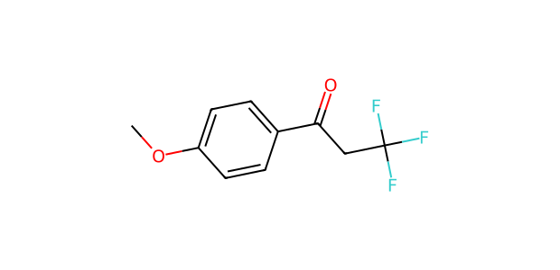
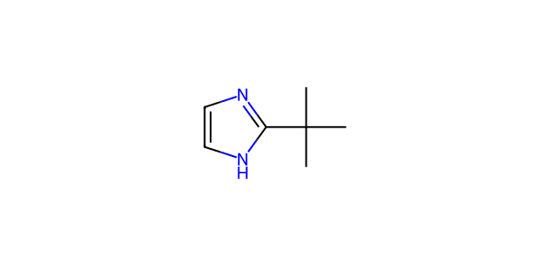

# AP001 · NH substrate–partner input

[All 108 inputs](../README.md) · [100 molecules](../../README.md)

**Electrophile:** `COc1ccc(C(=O)CC(F)(F)F)cc1`

**Donor:** `CC(C)(C)c1ncc[nH]1`

**Donor family:** imidazole/benzimidazole-type N-H donor. **Primary relation:** Structural Analogue. **NP:** 2; **NR:** 2.

## Candidate associations

| Candidate | Relation | Reason |
| --- | --- | --- |
| [C035: Imidazole](../../C035.md) | Structural Analogue | Imidazole-type N–H centre retained; ring fusion or substitution changes the molecular structure and acid/base environment. |

## Experimental record context

**Reported execution:** executed. **Source appearances:** 1; **distinct recorded condition recipes:** 1. Repeated workbook appearances are not independent replicates.

**Input-identity status:** structure transcribed from workbook; not independently verified. **Product-identity status:** not independently confirmed. **Quantitative-result status:** not independently calibrated or verified.

| Workbook | Worksheet | Row | Sample | Condition |
| --- | --- | --- | --- | --- |
| Reaction screening and scope workbook | NH-substrate scope | 44 | CFC124009-19-1-PL1-LC6-W1027 | AP001-C001 |

The candidate relation is a structural comparison. Contemporaneous inventory, cost, safety, procurement and candidate-replacement decisions are not recorded. A family relation does not establish that the corresponding proposed product was observed.

The [full input table](../mapping_108.json) retains sample IDs, alternatives, unresolved labels and all route-compatible candidate links.
