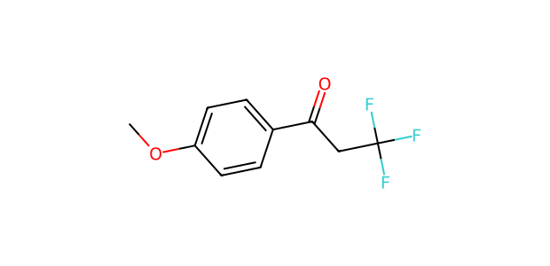
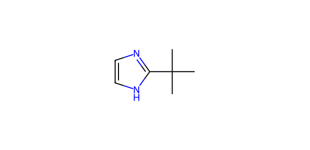

# AP001 · NH substrate-partner input

[All 112 inputs](../README.md) · [100 recommendations](../../README.md)

**Electrophile:** `COc1ccc(C(=O)CC(F)(F)F)cc1`

**Donor:** `CC(C)(C)c1ncc[nH]1`

**Donor family:** imidazole/benzimidazole-type N-H donor. **Primary relationship:** Same scaffold, substituent or positional variation. **NP:** 2; **NR:** 2.

## Recommendation relationships

| Recommendation | Relationship | Structural basis |
| --- | --- | --- |
| [C015](../../C015.md) | Same scaffold, substituent or positional variation | The reacting-atom type and core scaffold are retained, while substitution or position differs. |

These categories record how the RP-derived recommendation space was translated into actual reagents. They do not assign the response of this experiment to a related recommended molecule.

## Experimental record context

Reported execution: **executed**. Source appearances: **1**; distinct recorded condition recipes: **1**. Repeated workbook appearances are not independent replicates.

| Workbook | Worksheet | Row | Sample | Condition |
| --- | --- | --- | --- | --- |
| 实验结果/三氟乙基羰基+N\O\S\P数据总结.xlsx | NH-底物扩展 | 44 | CFC124009-19-1-PL1-LC6-W1027 | AP001-C001 |
