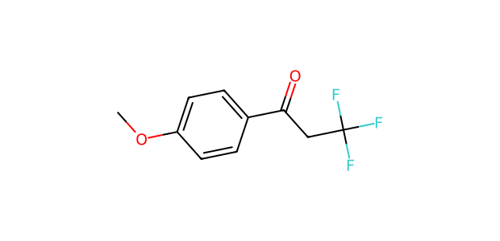
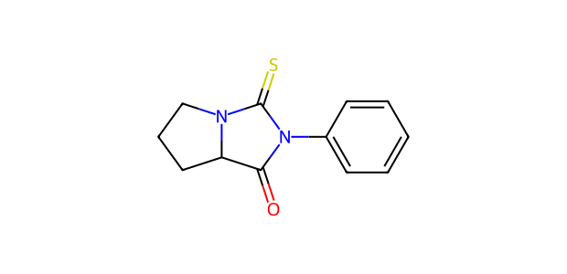

# AP002 · NH substrate-partner input

[All 108 inputs](../README.md) · [100 recommendations](../../README.md)

**Electrophile:** `COc1ccc(C(=O)CC(F)(F)F)cc1`

**Donor:** `O=C1C2CCCN2C(=S)N1c1ccccc1`

**Donor family:** recorded NH label but no matching N-H site. **Primary relationship:** No reasonable counterpart. **NP:** not applicable; **NR:** not applicable.

## Recommendation relationships

| Recommendation | Relationship | Structural basis |
| --- | --- | --- |
| - | No reasonable counterpart | 记录的分子结构没有该体系所需的X-H或阴离子位点。 |

These categories record how the RP-derived recommendation space was translated into actual reagents. They do not assign the response of this experiment to a related recommended molecule.

## Experimental record context

Reported execution: **executed**. Source appearances: **1**; distinct recorded condition recipes: **1**. Repeated workbook appearances are not independent replicates.

| Workbook | Worksheet | Row | Sample | Condition |
| --- | --- | --- | --- | --- |
| 实验结果/三氟乙基羰基+N\O\S\P数据总结.xlsx | NH-底物扩展 | 46 | CFC124009-19-2-PL2-LC1-W756 | AP002-C001 |
