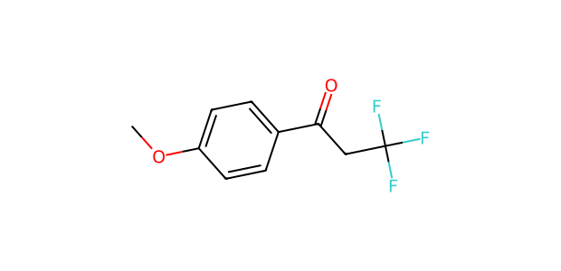
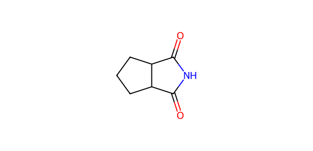

# AP003 · NH substrate-partner input

[All 112 inputs](../README.md) · [100 recommendations](../../README.md)

**Electrophile:** `COc1ccc(C(=O)CC(F)(F)F)cc1`

**Donor:** `O=C1NC(=O)C2CCCC12`

**Donor family:** imide N-H donor. **Primary relationship:** Same donor family, different scaffold. **NP:** 2; **NR:** 3.

## Recommendation relationships

| Recommendation | Relationship | Structural basis |
| --- | --- | --- |
| [C036](../../C036.md) | Same donor family, different scaffold | The local donor type is retained, but the molecular scaffold differs. |
| [C039](../../C039.md) | Same donor family, different scaffold | The local donor type is retained, but the molecular scaffold differs. |
| [C038](../../C038.md) | Same donor family, different scaffold | The local donor type is retained, but the molecular scaffold differs. |

These categories record how the RP-derived recommendation space was translated into actual reagents. They do not assign the response of this experiment to a related recommended molecule.

## Experimental record context

Reported execution: **executed**. Source appearances: **1**; distinct recorded condition recipes: **1**. Repeated workbook appearances are not independent replicates.

| Workbook | Worksheet | Row | Sample | Condition |
| --- | --- | --- | --- | --- |
| 实验结果/三氟乙基羰基+N\O\S\P数据总结.xlsx | NH-底物扩展 | 45 | CFC124009-19-1-PL1-LC6-W49 | AP003-C001 |
