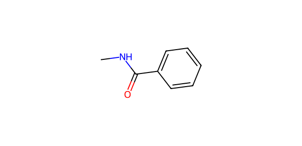

# AP013 · NH substrate-partner input

[All 112 inputs](../README.md) · [100 recommendations](../../README.md)

**Electrophile:** `Cc1ccc(C(=O)CC(F)(F)F)cc1`

**Donor:** `CNC(=O)c1ccccc1`

**Donor family:** amide/lactam N-H donor. **Primary relationship:** Exact identity. **NP:** 2; **NR:** 3.

## Recommendation relationships

| Recommendation | Relationship | Structural basis |
| --- | --- | --- |
| [C069](../../C069.md) | Exact identity | The recommended and experimental donor structures are identical. |

These categories record how the RP-derived recommendation space was translated into actual reagents. They do not assign the response of this experiment to a related recommended molecule.

## Experimental record context

Reported execution: **executed**. Source appearances: **2**; distinct recorded condition recipes: **1**. Repeated workbook appearances are not independent replicates.

| Workbook | Worksheet | Row | Sample | Condition |
| --- | --- | --- | --- | --- |
| 实验结果/副本条件筛选-底物扩展-response总-0911.xlsx | PL45-NH-底物扩展 | 26 | CFC124009-19-2-PL45-W25 | AP013-C001 |
| 实验结果/三氟乙基羰基+N\O\S\P数据总结.xlsx | NH-底物扩展 | 26 | CFC124009-19-2-PL45-W25 | AP013-C001 |
