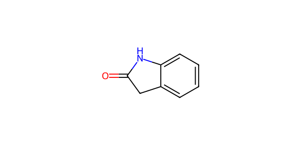

# AP029 · NH substrate–partner input

[All 108 inputs](../README.md) · [100 molecules](../../README.md)

**Electrophile:** `Cc1ccc(C(=O)CC(F)(F)F)cc1`

**Donor:** `O=C1Cc2ccccc2N1`

**Donor family:** amide/lactam N-H donor. **Primary relation:** Structural Analogue. **NP:** 2; **NR:** 3.

## Candidate associations

| Candidate | Relation | Reason |
| --- | --- | --- |
| [C041: Benzamide](../../C041.md) | Structural Analogue | Amide/lactam N–H is the local analogy; acyl substitution or ring closure changes acidity and resonance. It is not a molecular replacement record. |

## Experimental record context

**Reported execution:** executed. **Source appearances:** 2; **distinct recorded condition recipes:** 1. Repeated workbook appearances are not independent replicates.

**Input-identity status:** structure transcribed from workbook; not independently verified. **Product-identity status:** not independently confirmed. **Quantitative-result status:** not independently calibrated or verified.

| Workbook | Worksheet | Row | Sample | Condition |
| --- | --- | --- | --- | --- |
| Reaction screening and scope workbook | PL45-NH-substrate scope | 22 | CFC124009-19-2-PL45-W21 | AP029-C001 |
| Reaction screening and scope workbook | NH-substrate scope | 22 | CFC124009-19-2-PL45-W21 | AP029-C001 |

The candidate relation is a structural comparison. Contemporaneous inventory, cost, safety, procurement and candidate-replacement decisions are not recorded. A family relation does not establish that the corresponding proposed product was observed.

The [full input table](../mapping_108.json) retains sample IDs, alternatives, unresolved labels and all route-compatible candidate links.
