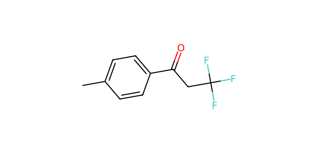
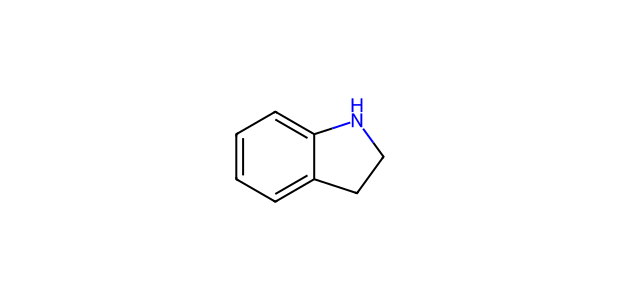

# AP039 · NH substrate-partner input

[All 108 inputs](../README.md) · [100 recommendations](../../README.md)

**Electrophile:** `Cc1ccc(C(=O)CC(F)(F)F)cc1`

**Donor:** `c1ccc2c(c1)CCN2`

**Donor family:** cyclic arylamine. **Primary relationship:** Exact identity. **NP:** 2; **NR:** 2.

## Recommendation relationships

| Recommendation | Relationship | Structural basis |
| --- | --- | --- |
| [C002](../../C002.md) | Exact identity | The recommended and experimental donor structures are identical. |

These categories record how the RP-derived recommendation space was translated into actual reagents. They do not assign the response of this experiment to a related recommended molecule.

## Experimental record context

Reported execution: **executed**. Source appearances: **487**; distinct recorded condition recipes: **245**. Repeated workbook appearances are not independent replicates.

| Workbook | Worksheet | Row | Sample | Condition |
| --- | --- | --- | --- | --- |
| 实验结果/副本条件筛选-底物扩展-response总-0911.xlsx | PL45-NH-底物扩展 | 33 | CFC124009-19-2-PL45-W32 | AP039-C001 |
| 实验结果/三氟乙基羰基+N\O\S\P数据总结.xlsx | NH-底物扩展 | 33 | CFC124009-19-2-PL45-W32 | AP039-C001 |
| 实验结果/副本条件筛选-底物扩展-response总-0911.xlsx | 4-Me-吲哚-response-条件筛选 | 2 | PL35-W1 | AP039-C002 |
| 实验结果/三氟乙基羰基+N\O\S\P数据总结.xlsx | 亲核试剂(NH)-条件筛选 | 2 | PL35-W1 | AP039-C002 |
| 实验结果/副本条件筛选-底物扩展-response总-0911.xlsx | 4-Me-吲哚-response-条件筛选 | 3 | PL35-W2 | AP039-C003 |
| 实验结果/三氟乙基羰基+N\O\S\P数据总结.xlsx | 亲核试剂(NH)-条件筛选 | 3 | PL35-W2 | AP039-C003 |
| 实验结果/副本条件筛选-底物扩展-response总-0911.xlsx | 4-Me-吲哚-response-条件筛选 | 4 | PL35-W3 | AP039-C004 |
| 实验结果/三氟乙基羰基+N\O\S\P数据总结.xlsx | 亲核试剂(NH)-条件筛选 | 4 | PL35-W3 | AP039-C004 |
| 实验结果/副本条件筛选-底物扩展-response总-0911.xlsx | 4-Me-吲哚-response-条件筛选 | 5 | PL35-W4 | AP039-C005 |
| 实验结果/三氟乙基羰基+N\O\S\P数据总结.xlsx | 亲核试剂(NH)-条件筛选 | 5 | PL35-W4 | AP039-C005 |
| 实验结果/副本条件筛选-底物扩展-response总-0911.xlsx | 4-Me-吲哚-response-条件筛选 | 6 | PL35-W5 | AP039-C006 |
| 实验结果/三氟乙基羰基+N\O\S\P数据总结.xlsx | 亲核试剂(NH)-条件筛选 | 6 | PL35-W5 | AP039-C006 |
| 实验结果/副本条件筛选-底物扩展-response总-0911.xlsx | 4-Me-吲哚-response-条件筛选 | 7 | PL35-W6 | AP039-C007 |
| 实验结果/三氟乙基羰基+N\O\S\P数据总结.xlsx | 亲核试剂(NH)-条件筛选 | 7 | PL35-W6 | AP039-C007 |
| 实验结果/副本条件筛选-底物扩展-response总-0911.xlsx | 4-Me-吲哚-response-条件筛选 | 8 | PL35-W7 | AP039-C008 |
| 实验结果/三氟乙基羰基+N\O\S\P数据总结.xlsx | 亲核试剂(NH)-条件筛选 | 8 | PL35-W7 | AP039-C008 |
| 实验结果/副本条件筛选-底物扩展-response总-0911.xlsx | 4-Me-吲哚-response-条件筛选 | 9 | PL35-W8 | AP039-C009 |
| 实验结果/三氟乙基羰基+N\O\S\P数据总结.xlsx | 亲核试剂(NH)-条件筛选 | 9 | PL35-W8 | AP039-C009 |
| 实验结果/副本条件筛选-底物扩展-response总-0911.xlsx | 4-Me-吲哚-response-条件筛选 | 10 | PL35-W9 | AP039-C010 |
| 实验结果/三氟乙基羰基+N\O\S\P数据总结.xlsx | 亲核试剂(NH)-条件筛选 | 10 | PL35-W9 | AP039-C010 |
| 实验结果/副本条件筛选-底物扩展-response总-0911.xlsx | 4-Me-吲哚-response-条件筛选 | 11 | PL35-W10 | AP039-C011 |
| 实验结果/三氟乙基羰基+N\O\S\P数据总结.xlsx | 亲核试剂(NH)-条件筛选 | 11 | PL35-W10 | AP039-C011 |
| 实验结果/副本条件筛选-底物扩展-response总-0911.xlsx | 4-Me-吲哚-response-条件筛选 | 12 | PL35-W11 | AP039-C012 |
| 实验结果/三氟乙基羰基+N\O\S\P数据总结.xlsx | 亲核试剂(NH)-条件筛选 | 12 | PL35-W11 | AP039-C012 |
| 实验结果/副本条件筛选-底物扩展-response总-0911.xlsx | 4-Me-吲哚-response-条件筛选 | 13 | PL35-W12 | AP039-C013 |
| 实验结果/三氟乙基羰基+N\O\S\P数据总结.xlsx | 亲核试剂(NH)-条件筛选 | 13 | PL35-W12 | AP039-C013 |
| 实验结果/副本条件筛选-底物扩展-response总-0911.xlsx | 4-Me-吲哚-response-条件筛选 | 14 | PL35-W13 | AP039-C014 |
| 实验结果/三氟乙基羰基+N\O\S\P数据总结.xlsx | 亲核试剂(NH)-条件筛选 | 14 | PL35-W13 | AP039-C014 |
| 实验结果/副本条件筛选-底物扩展-response总-0911.xlsx | 4-Me-吲哚-response-条件筛选 | 15 | PL35-W14 | AP039-C015 |
| 实验结果/三氟乙基羰基+N\O\S\P数据总结.xlsx | 亲核试剂(NH)-条件筛选 | 15 | PL35-W14 | AP039-C015 |
| 实验结果/副本条件筛选-底物扩展-response总-0911.xlsx | 4-Me-吲哚-response-条件筛选 | 16 | PL35-W15 | AP039-C016 |
| 实验结果/三氟乙基羰基+N\O\S\P数据总结.xlsx | 亲核试剂(NH)-条件筛选 | 16 | PL35-W15 | AP039-C016 |
| 实验结果/副本条件筛选-底物扩展-response总-0911.xlsx | 4-Me-吲哚-response-条件筛选 | 17 | PL35-W16 | AP039-C017 |
| 实验结果/三氟乙基羰基+N\O\S\P数据总结.xlsx | 亲核试剂(NH)-条件筛选 | 17 | PL35-W16 | AP039-C017 |
| 实验结果/副本条件筛选-底物扩展-response总-0911.xlsx | 4-Me-吲哚-response-条件筛选 | 18 | PL35-W17 | AP039-C018 |
| 实验结果/三氟乙基羰基+N\O\S\P数据总结.xlsx | 亲核试剂(NH)-条件筛选 | 18 | PL35-W17 | AP039-C018 |
| 实验结果/副本条件筛选-底物扩展-response总-0911.xlsx | 4-Me-吲哚-response-条件筛选 | 19 | PL35-W18 | AP039-C019 |
| 实验结果/三氟乙基羰基+N\O\S\P数据总结.xlsx | 亲核试剂(NH)-条件筛选 | 19 | PL35-W18 | AP039-C019 |
| 实验结果/副本条件筛选-底物扩展-response总-0911.xlsx | 4-Me-吲哚-response-条件筛选 | 20 | PL35-W19 | AP039-C020 |
| 实验结果/三氟乙基羰基+N\O\S\P数据总结.xlsx | 亲核试剂(NH)-条件筛选 | 20 | PL35-W19 | AP039-C020 |
| 实验结果/副本条件筛选-底物扩展-response总-0911.xlsx | 4-Me-吲哚-response-条件筛选 | 21 | PL35-W20 | AP039-C021 |
| 实验结果/三氟乙基羰基+N\O\S\P数据总结.xlsx | 亲核试剂(NH)-条件筛选 | 21 | PL35-W20 | AP039-C021 |
| 实验结果/副本条件筛选-底物扩展-response总-0911.xlsx | 4-Me-吲哚-response-条件筛选 | 22 | PL35-W21 | AP039-C022 |
| 实验结果/三氟乙基羰基+N\O\S\P数据总结.xlsx | 亲核试剂(NH)-条件筛选 | 22 | PL35-W21 | AP039-C022 |
| 实验结果/副本条件筛选-底物扩展-response总-0911.xlsx | 4-Me-吲哚-response-条件筛选 | 23 | PL35-W22 | AP039-C023 |
| 实验结果/三氟乙基羰基+N\O\S\P数据总结.xlsx | 亲核试剂(NH)-条件筛选 | 23 | PL35-W22 | AP039-C023 |
| 实验结果/副本条件筛选-底物扩展-response总-0911.xlsx | 4-Me-吲哚-response-条件筛选 | 24 | PL35-W23 | AP039-C024 |
| 实验结果/三氟乙基羰基+N\O\S\P数据总结.xlsx | 亲核试剂(NH)-条件筛选 | 24 | PL35-W23 | AP039-C024 |
| 实验结果/副本条件筛选-底物扩展-response总-0911.xlsx | 4-Me-吲哚-response-条件筛选 | 25 | PL35-W24 | AP039-C025 |
| 实验结果/三氟乙基羰基+N\O\S\P数据总结.xlsx | 亲核试剂(NH)-条件筛选 | 25 | PL35-W24 | AP039-C025 |
| 实验结果/副本条件筛选-底物扩展-response总-0911.xlsx | 4-Me-吲哚-response-条件筛选 | 26 | PL35-W25 | AP039-C026 |
| 实验结果/三氟乙基羰基+N\O\S\P数据总结.xlsx | 亲核试剂(NH)-条件筛选 | 26 | PL35-W25 | AP039-C026 |
| 实验结果/副本条件筛选-底物扩展-response总-0911.xlsx | 4-Me-吲哚-response-条件筛选 | 27 | PL35-W26 | AP039-C027 |
| 实验结果/三氟乙基羰基+N\O\S\P数据总结.xlsx | 亲核试剂(NH)-条件筛选 | 27 | PL35-W26 | AP039-C027 |
| 实验结果/副本条件筛选-底物扩展-response总-0911.xlsx | 4-Me-吲哚-response-条件筛选 | 28 | PL35-W27 | AP039-C028 |
| 实验结果/三氟乙基羰基+N\O\S\P数据总结.xlsx | 亲核试剂(NH)-条件筛选 | 28 | PL35-W27 | AP039-C028 |
| 实验结果/副本条件筛选-底物扩展-response总-0911.xlsx | 4-Me-吲哚-response-条件筛选 | 29 | PL35-W28 | AP039-C029 |
| 实验结果/三氟乙基羰基+N\O\S\P数据总结.xlsx | 亲核试剂(NH)-条件筛选 | 29 | PL35-W28 | AP039-C029 |
| 实验结果/副本条件筛选-底物扩展-response总-0911.xlsx | 4-Me-吲哚-response-条件筛选 | 30 | PL35-W29 | AP039-C030 |
| 实验结果/三氟乙基羰基+N\O\S\P数据总结.xlsx | 亲核试剂(NH)-条件筛选 | 30 | PL35-W29 | AP039-C030 |
| 实验结果/副本条件筛选-底物扩展-response总-0911.xlsx | 4-Me-吲哚-response-条件筛选 | 31 | PL35-W30 | AP039-C031 |
| 实验结果/三氟乙基羰基+N\O\S\P数据总结.xlsx | 亲核试剂(NH)-条件筛选 | 31 | PL35-W30 | AP039-C031 |
| 实验结果/副本条件筛选-底物扩展-response总-0911.xlsx | 4-Me-吲哚-response-条件筛选 | 32 | PL35-W31 | AP039-C032 |
| 实验结果/三氟乙基羰基+N\O\S\P数据总结.xlsx | 亲核试剂(NH)-条件筛选 | 32 | PL35-W31 | AP039-C032 |
| 实验结果/副本条件筛选-底物扩展-response总-0911.xlsx | 4-Me-吲哚-response-条件筛选 | 33 | PL35-W32 | AP039-C033 |
| 实验结果/三氟乙基羰基+N\O\S\P数据总结.xlsx | 亲核试剂(NH)-条件筛选 | 33 | PL35-W32 | AP039-C033 |
| 实验结果/副本条件筛选-底物扩展-response总-0911.xlsx | 4-Me-吲哚-response-条件筛选 | 34 | PL35-W33 | AP039-C034 |
| 实验结果/三氟乙基羰基+N\O\S\P数据总结.xlsx | 亲核试剂(NH)-条件筛选 | 34 | PL35-W33 | AP039-C034 |
| 实验结果/副本条件筛选-底物扩展-response总-0911.xlsx | 4-Me-吲哚-response-条件筛选 | 35 | PL35-W34 | AP039-C035 |
| 实验结果/三氟乙基羰基+N\O\S\P数据总结.xlsx | 亲核试剂(NH)-条件筛选 | 35 | PL35-W34 | AP039-C035 |
| 实验结果/副本条件筛选-底物扩展-response总-0911.xlsx | 4-Me-吲哚-response-条件筛选 | 36 | PL35-W35 | AP039-C036 |
| 实验结果/三氟乙基羰基+N\O\S\P数据总结.xlsx | 亲核试剂(NH)-条件筛选 | 36 | PL35-W35 | AP039-C036 |
| 实验结果/副本条件筛选-底物扩展-response总-0911.xlsx | 4-Me-吲哚-response-条件筛选 | 37 | PL35-W36 | AP039-C037 |
| 实验结果/三氟乙基羰基+N\O\S\P数据总结.xlsx | 亲核试剂(NH)-条件筛选 | 37 | PL35-W36 | AP039-C037 |
| 实验结果/副本条件筛选-底物扩展-response总-0911.xlsx | 4-Me-吲哚-response-条件筛选 | 38 | PL35-W37 | AP039-C038 |
| 实验结果/三氟乙基羰基+N\O\S\P数据总结.xlsx | 亲核试剂(NH)-条件筛选 | 38 | PL35-W37 | AP039-C038 |
| 实验结果/副本条件筛选-底物扩展-response总-0911.xlsx | 4-Me-吲哚-response-条件筛选 | 39 | PL35-W38 | AP039-C039 |
| 实验结果/三氟乙基羰基+N\O\S\P数据总结.xlsx | 亲核试剂(NH)-条件筛选 | 39 | PL35-W38 | AP039-C039 |
| 实验结果/副本条件筛选-底物扩展-response总-0911.xlsx | 4-Me-吲哚-response-条件筛选 | 40 | PL35-W39 | AP039-C040 |
| 实验结果/三氟乙基羰基+N\O\S\P数据总结.xlsx | 亲核试剂(NH)-条件筛选 | 40 | PL35-W39 | AP039-C040 |
| 实验结果/副本条件筛选-底物扩展-response总-0911.xlsx | 4-Me-吲哚-response-条件筛选 | 41 | PL35-W40 | AP039-C041 |
| 实验结果/三氟乙基羰基+N\O\S\P数据总结.xlsx | 亲核试剂(NH)-条件筛选 | 41 | PL35-W40 | AP039-C041 |
| 实验结果/副本条件筛选-底物扩展-response总-0911.xlsx | 4-Me-吲哚-response-条件筛选 | 42 | PL35-W41 | AP039-C042 |
| 实验结果/三氟乙基羰基+N\O\S\P数据总结.xlsx | 亲核试剂(NH)-条件筛选 | 42 | PL35-W41 | AP039-C042 |
| 实验结果/副本条件筛选-底物扩展-response总-0911.xlsx | 4-Me-吲哚-response-条件筛选 | 43 | PL35-W42 | AP039-C043 |
| 实验结果/三氟乙基羰基+N\O\S\P数据总结.xlsx | 亲核试剂(NH)-条件筛选 | 43 | PL35-W42 | AP039-C043 |
| 实验结果/副本条件筛选-底物扩展-response总-0911.xlsx | 4-Me-吲哚-response-条件筛选 | 44 | PL35-W43 | AP039-C044 |
| 实验结果/三氟乙基羰基+N\O\S\P数据总结.xlsx | 亲核试剂(NH)-条件筛选 | 44 | PL35-W43 | AP039-C044 |
| 实验结果/副本条件筛选-底物扩展-response总-0911.xlsx | 4-Me-吲哚-response-条件筛选 | 45 | PL35-W44 | AP039-C045 |
| 实验结果/三氟乙基羰基+N\O\S\P数据总结.xlsx | 亲核试剂(NH)-条件筛选 | 45 | PL35-W44 | AP039-C045 |
| 实验结果/副本条件筛选-底物扩展-response总-0911.xlsx | 4-Me-吲哚-response-条件筛选 | 46 | PL35-W45 | AP039-C046 |
| 实验结果/三氟乙基羰基+N\O\S\P数据总结.xlsx | 亲核试剂(NH)-条件筛选 | 46 | PL35-W45 | AP039-C046 |
| 实验结果/副本条件筛选-底物扩展-response总-0911.xlsx | 4-Me-吲哚-response-条件筛选 | 47 | PL35-W46 | AP039-C047 |
| 实验结果/三氟乙基羰基+N\O\S\P数据总结.xlsx | 亲核试剂(NH)-条件筛选 | 47 | PL35-W46 | AP039-C047 |
| 实验结果/副本条件筛选-底物扩展-response总-0911.xlsx | 4-Me-吲哚-response-条件筛选 | 48 | PL35-W47 | AP039-C048 |
| 实验结果/三氟乙基羰基+N\O\S\P数据总结.xlsx | 亲核试剂(NH)-条件筛选 | 48 | PL35-W47 | AP039-C048 |
| 实验结果/副本条件筛选-底物扩展-response总-0911.xlsx | 4-Me-吲哚-response-条件筛选 | 49 | PL35-W48 | AP039-C049 |
| 实验结果/三氟乙基羰基+N\O\S\P数据总结.xlsx | 亲核试剂(NH)-条件筛选 | 49 | PL35-W48 | AP039-C049 |
| 实验结果/副本条件筛选-底物扩展-response总-0911.xlsx | 4-Me-吲哚-response-条件筛选 | 50 | PL35-W49 | AP039-C050 |
| 实验结果/三氟乙基羰基+N\O\S\P数据总结.xlsx | 亲核试剂(NH)-条件筛选 | 50 | PL35-W49 | AP039-C050 |
| 实验结果/副本条件筛选-底物扩展-response总-0911.xlsx | 4-Me-吲哚-response-条件筛选 | 51 | PL35-W50 | AP039-C051 |
| 实验结果/三氟乙基羰基+N\O\S\P数据总结.xlsx | 亲核试剂(NH)-条件筛选 | 51 | PL35-W50 | AP039-C051 |
| 实验结果/副本条件筛选-底物扩展-response总-0911.xlsx | 4-Me-吲哚-response-条件筛选 | 52 | PL35-W51 | AP039-C052 |
| 实验结果/三氟乙基羰基+N\O\S\P数据总结.xlsx | 亲核试剂(NH)-条件筛选 | 52 | PL35-W51 | AP039-C052 |
| 实验结果/副本条件筛选-底物扩展-response总-0911.xlsx | 4-Me-吲哚-response-条件筛选 | 53 | PL35-W52 | AP039-C053 |
| 实验结果/三氟乙基羰基+N\O\S\P数据总结.xlsx | 亲核试剂(NH)-条件筛选 | 53 | PL35-W52 | AP039-C053 |
| 实验结果/副本条件筛选-底物扩展-response总-0911.xlsx | 4-Me-吲哚-response-条件筛选 | 54 | PL35-W53 | AP039-C054 |
| 实验结果/三氟乙基羰基+N\O\S\P数据总结.xlsx | 亲核试剂(NH)-条件筛选 | 54 | PL35-W53 | AP039-C054 |
| 实验结果/副本条件筛选-底物扩展-response总-0911.xlsx | 4-Me-吲哚-response-条件筛选 | 55 | PL35-W54 | AP039-C055 |
| 实验结果/三氟乙基羰基+N\O\S\P数据总结.xlsx | 亲核试剂(NH)-条件筛选 | 55 | PL35-W54 | AP039-C055 |
| 实验结果/副本条件筛选-底物扩展-response总-0911.xlsx | 4-Me-吲哚-response-条件筛选 | 56 | PL35-W55 | AP039-C056 |
| 实验结果/三氟乙基羰基+N\O\S\P数据总结.xlsx | 亲核试剂(NH)-条件筛选 | 56 | PL35-W55 | AP039-C056 |
| 实验结果/副本条件筛选-底物扩展-response总-0911.xlsx | 4-Me-吲哚-response-条件筛选 | 57 | PL35-W56 | AP039-C057 |
| 实验结果/三氟乙基羰基+N\O\S\P数据总结.xlsx | 亲核试剂(NH)-条件筛选 | 57 | PL35-W56 | AP039-C057 |
| 实验结果/副本条件筛选-底物扩展-response总-0911.xlsx | 4-Me-吲哚-response-条件筛选 | 58 | PL35-W57 | AP039-C058 |
| 实验结果/三氟乙基羰基+N\O\S\P数据总结.xlsx | 亲核试剂(NH)-条件筛选 | 58 | PL35-W57 | AP039-C058 |
| 实验结果/副本条件筛选-底物扩展-response总-0911.xlsx | 4-Me-吲哚-response-条件筛选 | 59 | PL35-W58 | AP039-C059 |
| 实验结果/三氟乙基羰基+N\O\S\P数据总结.xlsx | 亲核试剂(NH)-条件筛选 | 59 | PL35-W58 | AP039-C059 |
| 实验结果/副本条件筛选-底物扩展-response总-0911.xlsx | 4-Me-吲哚-response-条件筛选 | 60 | PL35-W59 | AP039-C060 |
| 实验结果/三氟乙基羰基+N\O\S\P数据总结.xlsx | 亲核试剂(NH)-条件筛选 | 60 | PL35-W59 | AP039-C060 |
| 实验结果/副本条件筛选-底物扩展-response总-0911.xlsx | 4-Me-吲哚-response-条件筛选 | 61 | PL35-W60 | AP039-C061 |
| 实验结果/三氟乙基羰基+N\O\S\P数据总结.xlsx | 亲核试剂(NH)-条件筛选 | 61 | PL35-W60 | AP039-C061 |
| 实验结果/副本条件筛选-底物扩展-response总-0911.xlsx | 4-Me-吲哚-response-条件筛选 | 62 | PL35-W61 | AP039-C062 |
| 实验结果/三氟乙基羰基+N\O\S\P数据总结.xlsx | 亲核试剂(NH)-条件筛选 | 62 | PL35-W61 | AP039-C062 |
| 实验结果/副本条件筛选-底物扩展-response总-0911.xlsx | 4-Me-吲哚-response-条件筛选 | 63 | PL35-W62 | AP039-C063 |
| 实验结果/三氟乙基羰基+N\O\S\P数据总结.xlsx | 亲核试剂(NH)-条件筛选 | 63 | PL35-W62 | AP039-C063 |
| 实验结果/副本条件筛选-底物扩展-response总-0911.xlsx | 4-Me-吲哚-response-条件筛选 | 64 | PL35-W63 | AP039-C064 |
| 实验结果/三氟乙基羰基+N\O\S\P数据总结.xlsx | 亲核试剂(NH)-条件筛选 | 64 | PL35-W63 | AP039-C064 |
| 实验结果/副本条件筛选-底物扩展-response总-0911.xlsx | 4-Me-吲哚-response-条件筛选 | 65 | PL35-W64 | AP039-C065 |
| 实验结果/三氟乙基羰基+N\O\S\P数据总结.xlsx | 亲核试剂(NH)-条件筛选 | 65 | PL35-W64 | AP039-C065 |
| 实验结果/副本条件筛选-底物扩展-response总-0911.xlsx | 4-Me-吲哚-response-条件筛选 | 66 | PL35-W65 | AP039-C066 |
| 实验结果/三氟乙基羰基+N\O\S\P数据总结.xlsx | 亲核试剂(NH)-条件筛选 | 66 | PL35-W65 | AP039-C066 |
| 实验结果/副本条件筛选-底物扩展-response总-0911.xlsx | 4-Me-吲哚-response-条件筛选 | 67 | PL35-W66 | AP039-C067 |
| 实验结果/三氟乙基羰基+N\O\S\P数据总结.xlsx | 亲核试剂(NH)-条件筛选 | 67 | PL35-W66 | AP039-C067 |
| 实验结果/副本条件筛选-底物扩展-response总-0911.xlsx | 4-Me-吲哚-response-条件筛选 | 68 | PL35-W67 | AP039-C068 |
| 实验结果/三氟乙基羰基+N\O\S\P数据总结.xlsx | 亲核试剂(NH)-条件筛选 | 68 | PL35-W67 | AP039-C068 |
| 实验结果/副本条件筛选-底物扩展-response总-0911.xlsx | 4-Me-吲哚-response-条件筛选 | 69 | PL35-W68 | AP039-C069 |
| 实验结果/三氟乙基羰基+N\O\S\P数据总结.xlsx | 亲核试剂(NH)-条件筛选 | 69 | PL35-W68 | AP039-C069 |
| 实验结果/副本条件筛选-底物扩展-response总-0911.xlsx | 4-Me-吲哚-response-条件筛选 | 70 | PL35-W69 | AP039-C070 |
| 实验结果/三氟乙基羰基+N\O\S\P数据总结.xlsx | 亲核试剂(NH)-条件筛选 | 70 | PL35-W69 | AP039-C070 |
| 实验结果/副本条件筛选-底物扩展-response总-0911.xlsx | 4-Me-吲哚-response-条件筛选 | 71 | PL35-W70 | AP039-C071 |
| 实验结果/三氟乙基羰基+N\O\S\P数据总结.xlsx | 亲核试剂(NH)-条件筛选 | 71 | PL35-W70 | AP039-C071 |
| 实验结果/副本条件筛选-底物扩展-response总-0911.xlsx | 4-Me-吲哚-response-条件筛选 | 72 | PL35-W71 | AP039-C072 |
| 实验结果/三氟乙基羰基+N\O\S\P数据总结.xlsx | 亲核试剂(NH)-条件筛选 | 72 | PL35-W71 | AP039-C072 |
| 实验结果/副本条件筛选-底物扩展-response总-0911.xlsx | 4-Me-吲哚-response-条件筛选 | 73 | PL35-W72 | AP039-C073 |
| 实验结果/三氟乙基羰基+N\O\S\P数据总结.xlsx | 亲核试剂(NH)-条件筛选 | 73 | PL35-W72 | AP039-C073 |
| 实验结果/副本条件筛选-底物扩展-response总-0911.xlsx | 4-Me-吲哚-response-条件筛选 | 74 | PL35-W73 | AP039-C074 |
| 实验结果/三氟乙基羰基+N\O\S\P数据总结.xlsx | 亲核试剂(NH)-条件筛选 | 74 | PL35-W73 | AP039-C074 |
| 实验结果/副本条件筛选-底物扩展-response总-0911.xlsx | 4-Me-吲哚-response-条件筛选 | 75 | PL35-W74 | AP039-C075 |
| 实验结果/三氟乙基羰基+N\O\S\P数据总结.xlsx | 亲核试剂(NH)-条件筛选 | 75 | PL35-W74 | AP039-C075 |
| 实验结果/副本条件筛选-底物扩展-response总-0911.xlsx | 4-Me-吲哚-response-条件筛选 | 76 | PL35-W75 | AP039-C076 |
| 实验结果/三氟乙基羰基+N\O\S\P数据总结.xlsx | 亲核试剂(NH)-条件筛选 | 76 | PL35-W75 | AP039-C076 |
| 实验结果/副本条件筛选-底物扩展-response总-0911.xlsx | 4-Me-吲哚-response-条件筛选 | 77 | PL35-W76 | AP039-C077 |
| 实验结果/三氟乙基羰基+N\O\S\P数据总结.xlsx | 亲核试剂(NH)-条件筛选 | 77 | PL35-W76 | AP039-C077 |
| 实验结果/副本条件筛选-底物扩展-response总-0911.xlsx | 4-Me-吲哚-response-条件筛选 | 78 | PL35-W77 | AP039-C078 |
| 实验结果/三氟乙基羰基+N\O\S\P数据总结.xlsx | 亲核试剂(NH)-条件筛选 | 78 | PL35-W77 | AP039-C078 |
| 实验结果/副本条件筛选-底物扩展-response总-0911.xlsx | 4-Me-吲哚-response-条件筛选 | 79 | PL35-W78 | AP039-C079 |
| 实验结果/三氟乙基羰基+N\O\S\P数据总结.xlsx | 亲核试剂(NH)-条件筛选 | 79 | PL35-W78 | AP039-C079 |
| 实验结果/副本条件筛选-底物扩展-response总-0911.xlsx | 4-Me-吲哚-response-条件筛选 | 80 | PL35-W79 | AP039-C080 |
| 实验结果/三氟乙基羰基+N\O\S\P数据总结.xlsx | 亲核试剂(NH)-条件筛选 | 80 | PL35-W79 | AP039-C080 |
| 实验结果/副本条件筛选-底物扩展-response总-0911.xlsx | 4-Me-吲哚-response-条件筛选 | 81 | PL35-W80 | AP039-C081 |
| 实验结果/三氟乙基羰基+N\O\S\P数据总结.xlsx | 亲核试剂(NH)-条件筛选 | 81 | PL35-W80 | AP039-C081 |
| 实验结果/副本条件筛选-底物扩展-response总-0911.xlsx | 4-Me-吲哚-response-条件筛选 | 82 | PL35-W81 | AP039-C082 |
| 实验结果/三氟乙基羰基+N\O\S\P数据总结.xlsx | 亲核试剂(NH)-条件筛选 | 82 | PL35-W81 | AP039-C082 |
| 实验结果/副本条件筛选-底物扩展-response总-0911.xlsx | 4-Me-吲哚-response-条件筛选 | 83 | PL35-W82 | AP039-C083 |
| 实验结果/三氟乙基羰基+N\O\S\P数据总结.xlsx | 亲核试剂(NH)-条件筛选 | 83 | PL35-W82 | AP039-C083 |
| 实验结果/副本条件筛选-底物扩展-response总-0911.xlsx | 4-Me-吲哚-response-条件筛选 | 84 | PL35-W83 | AP039-C084 |
| 实验结果/三氟乙基羰基+N\O\S\P数据总结.xlsx | 亲核试剂(NH)-条件筛选 | 84 | PL35-W83 | AP039-C084 |
| 实验结果/副本条件筛选-底物扩展-response总-0911.xlsx | 4-Me-吲哚-response-条件筛选 | 85 | PL35-W84 | AP039-C085 |
| 实验结果/三氟乙基羰基+N\O\S\P数据总结.xlsx | 亲核试剂(NH)-条件筛选 | 85 | PL35-W84 | AP039-C085 |
| 实验结果/副本条件筛选-底物扩展-response总-0911.xlsx | 4-Me-吲哚-response-条件筛选 | 86 | PL35-W85 | AP039-C086 |
| 实验结果/三氟乙基羰基+N\O\S\P数据总结.xlsx | 亲核试剂(NH)-条件筛选 | 86 | PL35-W85 | AP039-C086 |
| 实验结果/副本条件筛选-底物扩展-response总-0911.xlsx | 4-Me-吲哚-response-条件筛选 | 87 | PL35-W86 | AP039-C087 |
| 实验结果/三氟乙基羰基+N\O\S\P数据总结.xlsx | 亲核试剂(NH)-条件筛选 | 87 | PL35-W86 | AP039-C087 |
| 实验结果/副本条件筛选-底物扩展-response总-0911.xlsx | 4-Me-吲哚-response-条件筛选 | 88 | PL35-W87 | AP039-C088 |
| 实验结果/三氟乙基羰基+N\O\S\P数据总结.xlsx | 亲核试剂(NH)-条件筛选 | 88 | PL35-W87 | AP039-C088 |
| 实验结果/副本条件筛选-底物扩展-response总-0911.xlsx | 4-Me-吲哚-response-条件筛选 | 89 | PL35-W88 | AP039-C089 |
| 实验结果/三氟乙基羰基+N\O\S\P数据总结.xlsx | 亲核试剂(NH)-条件筛选 | 89 | PL35-W88 | AP039-C089 |
| 实验结果/副本条件筛选-底物扩展-response总-0911.xlsx | 4-Me-吲哚-response-条件筛选 | 90 | PL35-W89 | AP039-C090 |
| 实验结果/三氟乙基羰基+N\O\S\P数据总结.xlsx | 亲核试剂(NH)-条件筛选 | 90 | PL35-W89 | AP039-C090 |
| 实验结果/副本条件筛选-底物扩展-response总-0911.xlsx | 4-Me-吲哚-response-条件筛选 | 91 | PL35-W90 | AP039-C091 |
| 实验结果/三氟乙基羰基+N\O\S\P数据总结.xlsx | 亲核试剂(NH)-条件筛选 | 91 | PL35-W90 | AP039-C091 |
| 实验结果/副本条件筛选-底物扩展-response总-0911.xlsx | 4-Me-吲哚-response-条件筛选 | 92 | PL35-W91 | AP039-C092 |
| 实验结果/三氟乙基羰基+N\O\S\P数据总结.xlsx | 亲核试剂(NH)-条件筛选 | 92 | PL35-W91 | AP039-C092 |
| 实验结果/副本条件筛选-底物扩展-response总-0911.xlsx | 4-Me-吲哚-response-条件筛选 | 93 | PL35-W92 | AP039-C093 |
| 实验结果/三氟乙基羰基+N\O\S\P数据总结.xlsx | 亲核试剂(NH)-条件筛选 | 93 | PL35-W92 | AP039-C093 |
| 实验结果/副本条件筛选-底物扩展-response总-0911.xlsx | 4-Me-吲哚-response-条件筛选 | 94 | PL35-W93 | AP039-C094 |
| 实验结果/三氟乙基羰基+N\O\S\P数据总结.xlsx | 亲核试剂(NH)-条件筛选 | 94 | PL35-W93 | AP039-C094 |
| 实验结果/副本条件筛选-底物扩展-response总-0911.xlsx | 4-Me-吲哚-response-条件筛选 | 95 | PL35-W94 | AP039-C095 |
| 实验结果/三氟乙基羰基+N\O\S\P数据总结.xlsx | 亲核试剂(NH)-条件筛选 | 95 | PL35-W94 | AP039-C095 |
| 实验结果/副本条件筛选-底物扩展-response总-0911.xlsx | 4-Me-吲哚-response-条件筛选 | 96 | PL35-W95 | AP039-C096 |
| 实验结果/三氟乙基羰基+N\O\S\P数据总结.xlsx | 亲核试剂(NH)-条件筛选 | 96 | PL35-W95 | AP039-C096 |
| 实验结果/副本条件筛选-底物扩展-response总-0911.xlsx | 4-Me-吲哚-response-条件筛选 | 97 | PL35-W96 | AP039-C097 |
| 实验结果/三氟乙基羰基+N\O\S\P数据总结.xlsx | 亲核试剂(NH)-条件筛选 | 97 | PL35-W96 | AP039-C097 |
| 实验结果/副本条件筛选-底物扩展-response总-0911.xlsx | 4-Me-吲哚-response-条件筛选 | 98 | PL35-W97 | AP039-C098 |
| 实验结果/三氟乙基羰基+N\O\S\P数据总结.xlsx | 亲核试剂(NH)-条件筛选 | 98 | PL35-W97 | AP039-C098 |
| 实验结果/副本条件筛选-底物扩展-response总-0911.xlsx | 4-Me-吲哚-response-条件筛选 | 99 | PL35-W98 | AP039-C099 |
| 实验结果/三氟乙基羰基+N\O\S\P数据总结.xlsx | 亲核试剂(NH)-条件筛选 | 99 | PL35-W98 | AP039-C099 |
| 实验结果/副本条件筛选-底物扩展-response总-0911.xlsx | 4-Me-吲哚-response-条件筛选 | 100 | PL35-W99 | AP039-C100 |
| 实验结果/三氟乙基羰基+N\O\S\P数据总结.xlsx | 亲核试剂(NH)-条件筛选 | 100 | PL35-W99 | AP039-C100 |
| 实验结果/副本条件筛选-底物扩展-response总-0911.xlsx | 4-Me-吲哚-response-条件筛选 | 101 | PL35-W100 | AP039-C101 |
| 实验结果/三氟乙基羰基+N\O\S\P数据总结.xlsx | 亲核试剂(NH)-条件筛选 | 101 | PL35-W100 | AP039-C101 |
| 实验结果/副本条件筛选-底物扩展-response总-0911.xlsx | 4-Me-吲哚-response-条件筛选 | 102 | PL35-W101 | AP039-C102 |
| 实验结果/三氟乙基羰基+N\O\S\P数据总结.xlsx | 亲核试剂(NH)-条件筛选 | 102 | PL35-W101 | AP039-C102 |
| 实验结果/副本条件筛选-底物扩展-response总-0911.xlsx | 4-Me-吲哚-response-条件筛选 | 103 | PL35-W102 | AP039-C103 |
| 实验结果/三氟乙基羰基+N\O\S\P数据总结.xlsx | 亲核试剂(NH)-条件筛选 | 103 | PL35-W102 | AP039-C103 |
| 实验结果/副本条件筛选-底物扩展-response总-0911.xlsx | 4-Me-吲哚-response-条件筛选 | 104 | PL35-W103 | AP039-C104 |
| 实验结果/三氟乙基羰基+N\O\S\P数据总结.xlsx | 亲核试剂(NH)-条件筛选 | 104 | PL35-W103 | AP039-C104 |
| 实验结果/副本条件筛选-底物扩展-response总-0911.xlsx | 4-Me-吲哚-response-条件筛选 | 105 | PL35-W104 | AP039-C105 |
| 实验结果/三氟乙基羰基+N\O\S\P数据总结.xlsx | 亲核试剂(NH)-条件筛选 | 105 | PL35-W104 | AP039-C105 |
| 实验结果/副本条件筛选-底物扩展-response总-0911.xlsx | 4-Me-吲哚-response-条件筛选 | 106 | PL35-W105 | AP039-C106 |
| 实验结果/三氟乙基羰基+N\O\S\P数据总结.xlsx | 亲核试剂(NH)-条件筛选 | 106 | PL35-W105 | AP039-C106 |
| 实验结果/副本条件筛选-底物扩展-response总-0911.xlsx | 4-Me-吲哚-response-条件筛选 | 107 | PL35-W106 | AP039-C107 |
| 实验结果/三氟乙基羰基+N\O\S\P数据总结.xlsx | 亲核试剂(NH)-条件筛选 | 107 | PL35-W106 | AP039-C107 |
| 实验结果/副本条件筛选-底物扩展-response总-0911.xlsx | 4-Me-吲哚-response-条件筛选 | 108 | PL35-W107 | AP039-C108 |
| 实验结果/三氟乙基羰基+N\O\S\P数据总结.xlsx | 亲核试剂(NH)-条件筛选 | 108 | PL35-W107 | AP039-C108 |
| 实验结果/副本条件筛选-底物扩展-response总-0911.xlsx | 4-Me-吲哚-response-条件筛选 | 109 | PL35-W108 | AP039-C109 |
| 实验结果/三氟乙基羰基+N\O\S\P数据总结.xlsx | 亲核试剂(NH)-条件筛选 | 109 | PL35-W108 | AP039-C109 |
| 实验结果/副本条件筛选-底物扩展-response总-0911.xlsx | 4-Me-吲哚-response-条件筛选 | 110 | PL35-W109 | AP039-C110 |
| 实验结果/三氟乙基羰基+N\O\S\P数据总结.xlsx | 亲核试剂(NH)-条件筛选 | 110 | PL35-W109 | AP039-C110 |
| 实验结果/副本条件筛选-底物扩展-response总-0911.xlsx | 4-Me-吲哚-response-条件筛选 | 111 | PL35-W110 | AP039-C111 |
| 实验结果/三氟乙基羰基+N\O\S\P数据总结.xlsx | 亲核试剂(NH)-条件筛选 | 111 | PL35-W110 | AP039-C111 |
| 实验结果/副本条件筛选-底物扩展-response总-0911.xlsx | 4-Me-吲哚-response-条件筛选 | 112 | PL35-W111 | AP039-C112 |
| 实验结果/三氟乙基羰基+N\O\S\P数据总结.xlsx | 亲核试剂(NH)-条件筛选 | 112 | PL35-W111 | AP039-C112 |
| 实验结果/副本条件筛选-底物扩展-response总-0911.xlsx | 4-Me-吲哚-response-条件筛选 | 113 | PL35-W112 | AP039-C113 |
| 实验结果/三氟乙基羰基+N\O\S\P数据总结.xlsx | 亲核试剂(NH)-条件筛选 | 113 | PL35-W112 | AP039-C113 |
| 实验结果/副本条件筛选-底物扩展-response总-0911.xlsx | 4-Me-吲哚-response-条件筛选 | 114 | PL35-W113 | AP039-C114 |
| 实验结果/三氟乙基羰基+N\O\S\P数据总结.xlsx | 亲核试剂(NH)-条件筛选 | 114 | PL35-W113 | AP039-C114 |
| 实验结果/副本条件筛选-底物扩展-response总-0911.xlsx | 4-Me-吲哚-response-条件筛选 | 115 | PL35-W114 | AP039-C115 |
| 实验结果/三氟乙基羰基+N\O\S\P数据总结.xlsx | 亲核试剂(NH)-条件筛选 | 115 | PL35-W114 | AP039-C115 |
| 实验结果/副本条件筛选-底物扩展-response总-0911.xlsx | 4-Me-吲哚-response-条件筛选 | 116 | PL35-W115 | AP039-C116 |
| 实验结果/三氟乙基羰基+N\O\S\P数据总结.xlsx | 亲核试剂(NH)-条件筛选 | 116 | PL35-W115 | AP039-C116 |
| 实验结果/副本条件筛选-底物扩展-response总-0911.xlsx | 4-Me-吲哚-response-条件筛选 | 117 | PL35-W116 | AP039-C117 |
| 实验结果/三氟乙基羰基+N\O\S\P数据总结.xlsx | 亲核试剂(NH)-条件筛选 | 117 | PL35-W116 | AP039-C117 |
| 实验结果/副本条件筛选-底物扩展-response总-0911.xlsx | 4-Me-吲哚-response-条件筛选 | 118 | PL35-W117 | AP039-C118 |
| 实验结果/三氟乙基羰基+N\O\S\P数据总结.xlsx | 亲核试剂(NH)-条件筛选 | 118 | PL35-W117 | AP039-C118 |
| 实验结果/副本条件筛选-底物扩展-response总-0911.xlsx | 4-Me-吲哚-response-条件筛选 | 119 | PL35-W118 | AP039-C119 |
| 实验结果/三氟乙基羰基+N\O\S\P数据总结.xlsx | 亲核试剂(NH)-条件筛选 | 119 | PL35-W118 | AP039-C119 |
| 实验结果/副本条件筛选-底物扩展-response总-0911.xlsx | 4-Me-吲哚-response-条件筛选 | 120 | PL35-W119 | AP039-C120 |
| 实验结果/三氟乙基羰基+N\O\S\P数据总结.xlsx | 亲核试剂(NH)-条件筛选 | 120 | PL35-W119 | AP039-C120 |
| 实验结果/副本条件筛选-底物扩展-response总-0911.xlsx | 4-Me-吲哚-response-条件筛选 | 121 | PL35-W120 | AP039-C121 |
| 实验结果/三氟乙基羰基+N\O\S\P数据总结.xlsx | 亲核试剂(NH)-条件筛选 | 121 | PL35-W120 | AP039-C121 |
| 实验结果/副本条件筛选-底物扩展-response总-0911.xlsx | 4-Me-吲哚-response-条件筛选 | 122 | PL35-W121 | AP039-C122 |
| 实验结果/三氟乙基羰基+N\O\S\P数据总结.xlsx | 亲核试剂(NH)-条件筛选 | 122 | PL35-W121 | AP039-C122 |
| 实验结果/副本条件筛选-底物扩展-response总-0911.xlsx | 4-Me-吲哚-response-条件筛选 | 123 | PL35-W122 | AP039-C123 |
| 实验结果/三氟乙基羰基+N\O\S\P数据总结.xlsx | 亲核试剂(NH)-条件筛选 | 123 | PL35-W122 | AP039-C123 |
| 实验结果/副本条件筛选-底物扩展-response总-0911.xlsx | 4-Me-吲哚-response-条件筛选 | 124 | PL35-W123 | AP039-C124 |
| 实验结果/三氟乙基羰基+N\O\S\P数据总结.xlsx | 亲核试剂(NH)-条件筛选 | 124 | PL35-W123 | AP039-C124 |
| 实验结果/副本条件筛选-底物扩展-response总-0911.xlsx | 4-Me-吲哚-response-条件筛选 | 125 | PL35-W124 | AP039-C125 |
| 实验结果/三氟乙基羰基+N\O\S\P数据总结.xlsx | 亲核试剂(NH)-条件筛选 | 125 | PL35-W124 | AP039-C125 |
| 实验结果/副本条件筛选-底物扩展-response总-0911.xlsx | 4-Me-吲哚-response-条件筛选 | 126 | PL35-W125 | AP039-C126 |
| 实验结果/三氟乙基羰基+N\O\S\P数据总结.xlsx | 亲核试剂(NH)-条件筛选 | 126 | PL35-W125 | AP039-C126 |
| 实验结果/副本条件筛选-底物扩展-response总-0911.xlsx | 4-Me-吲哚-response-条件筛选 | 127 | PL35-W126 | AP039-C127 |
| 实验结果/三氟乙基羰基+N\O\S\P数据总结.xlsx | 亲核试剂(NH)-条件筛选 | 127 | PL35-W126 | AP039-C127 |
| 实验结果/副本条件筛选-底物扩展-response总-0911.xlsx | 4-Me-吲哚-response-条件筛选 | 128 | PL35-W127 | AP039-C128 |
| 实验结果/三氟乙基羰基+N\O\S\P数据总结.xlsx | 亲核试剂(NH)-条件筛选 | 128 | PL35-W127 | AP039-C128 |
| 实验结果/副本条件筛选-底物扩展-response总-0911.xlsx | 4-Me-吲哚-response-条件筛选 | 129 | PL35-W128 | AP039-C129 |
| 实验结果/三氟乙基羰基+N\O\S\P数据总结.xlsx | 亲核试剂(NH)-条件筛选 | 129 | PL35-W128 | AP039-C129 |
| 实验结果/副本条件筛选-底物扩展-response总-0911.xlsx | 4-Me-吲哚-response-条件筛选 | 130 | PL35-W129 | AP039-C130 |
| 实验结果/三氟乙基羰基+N\O\S\P数据总结.xlsx | 亲核试剂(NH)-条件筛选 | 130 | PL35-W129 | AP039-C130 |
| 实验结果/副本条件筛选-底物扩展-response总-0911.xlsx | 4-Me-吲哚-response-条件筛选 | 131 | PL35-W130 | AP039-C131 |
| 实验结果/三氟乙基羰基+N\O\S\P数据总结.xlsx | 亲核试剂(NH)-条件筛选 | 131 | PL35-W130 | AP039-C131 |
| 实验结果/副本条件筛选-底物扩展-response总-0911.xlsx | 4-Me-吲哚-response-条件筛选 | 132 | PL35-W131 | AP039-C132 |
| 实验结果/三氟乙基羰基+N\O\S\P数据总结.xlsx | 亲核试剂(NH)-条件筛选 | 132 | PL35-W131 | AP039-C132 |
| 实验结果/副本条件筛选-底物扩展-response总-0911.xlsx | 4-Me-吲哚-response-条件筛选 | 133 | PL35-W132 | AP039-C133 |
| 实验结果/三氟乙基羰基+N\O\S\P数据总结.xlsx | 亲核试剂(NH)-条件筛选 | 133 | PL35-W132 | AP039-C133 |
| 实验结果/副本条件筛选-底物扩展-response总-0911.xlsx | 4-Me-吲哚-response-条件筛选 | 134 | PL35-W133 | AP039-C134 |
| 实验结果/三氟乙基羰基+N\O\S\P数据总结.xlsx | 亲核试剂(NH)-条件筛选 | 134 | PL35-W133 | AP039-C134 |
| 实验结果/副本条件筛选-底物扩展-response总-0911.xlsx | 4-Me-吲哚-response-条件筛选 | 135 | PL35-W134 | AP039-C135 |
| 实验结果/三氟乙基羰基+N\O\S\P数据总结.xlsx | 亲核试剂(NH)-条件筛选 | 135 | PL35-W134 | AP039-C135 |
| 实验结果/副本条件筛选-底物扩展-response总-0911.xlsx | 4-Me-吲哚-response-条件筛选 | 136 | PL35-W135 | AP039-C136 |
| 实验结果/三氟乙基羰基+N\O\S\P数据总结.xlsx | 亲核试剂(NH)-条件筛选 | 136 | PL35-W135 | AP039-C136 |
| 实验结果/副本条件筛选-底物扩展-response总-0911.xlsx | 4-Me-吲哚-response-条件筛选 | 137 | PL35-W136 | AP039-C137 |
| 实验结果/三氟乙基羰基+N\O\S\P数据总结.xlsx | 亲核试剂(NH)-条件筛选 | 137 | PL35-W136 | AP039-C137 |
| 实验结果/副本条件筛选-底物扩展-response总-0911.xlsx | 4-Me-吲哚-response-条件筛选 | 138 | PL35-W137 | AP039-C138 |
| 实验结果/三氟乙基羰基+N\O\S\P数据总结.xlsx | 亲核试剂(NH)-条件筛选 | 138 | PL35-W137 | AP039-C138 |
| 实验结果/副本条件筛选-底物扩展-response总-0911.xlsx | 4-Me-吲哚-response-条件筛选 | 139 | PL35-W138 | AP039-C139 |
| 实验结果/三氟乙基羰基+N\O\S\P数据总结.xlsx | 亲核试剂(NH)-条件筛选 | 139 | PL35-W138 | AP039-C139 |
| 实验结果/副本条件筛选-底物扩展-response总-0911.xlsx | 4-Me-吲哚-response-条件筛选 | 140 | PL35-W139 | AP039-C140 |
| 实验结果/三氟乙基羰基+N\O\S\P数据总结.xlsx | 亲核试剂(NH)-条件筛选 | 140 | PL35-W139 | AP039-C140 |
| 实验结果/副本条件筛选-底物扩展-response总-0911.xlsx | 4-Me-吲哚-response-条件筛选 | 141 | PL35-W140 | AP039-C141 |
| 实验结果/三氟乙基羰基+N\O\S\P数据总结.xlsx | 亲核试剂(NH)-条件筛选 | 141 | PL35-W140 | AP039-C141 |
| 实验结果/副本条件筛选-底物扩展-response总-0911.xlsx | 4-Me-吲哚-response-条件筛选 | 142 | PL35-W141 | AP039-C142 |
| 实验结果/三氟乙基羰基+N\O\S\P数据总结.xlsx | 亲核试剂(NH)-条件筛选 | 142 | PL35-W141 | AP039-C142 |
| 实验结果/副本条件筛选-底物扩展-response总-0911.xlsx | 4-Me-吲哚-response-条件筛选 | 143 | PL35-W142 | AP039-C143 |
| 实验结果/三氟乙基羰基+N\O\S\P数据总结.xlsx | 亲核试剂(NH)-条件筛选 | 143 | PL35-W142 | AP039-C143 |
| 实验结果/副本条件筛选-底物扩展-response总-0911.xlsx | 4-Me-吲哚-response-条件筛选 | 144 | PL35-W143 | AP039-C144 |
| 实验结果/三氟乙基羰基+N\O\S\P数据总结.xlsx | 亲核试剂(NH)-条件筛选 | 144 | PL35-W143 | AP039-C144 |
| 实验结果/副本条件筛选-底物扩展-response总-0911.xlsx | 4-Me-吲哚-response-条件筛选 | 145 | PL35-W144 | AP039-C145 |
| 实验结果/三氟乙基羰基+N\O\S\P数据总结.xlsx | 亲核试剂(NH)-条件筛选 | 145 | PL35-W144 | AP039-C145 |
| 实验结果/副本条件筛选-底物扩展-response总-0911.xlsx | 4-Me-吲哚-response-条件筛选 | 146 | PL35-W145 | AP039-C146 |
| 实验结果/三氟乙基羰基+N\O\S\P数据总结.xlsx | 亲核试剂(NH)-条件筛选 | 146 | PL35-W145 | AP039-C146 |
| 实验结果/副本条件筛选-底物扩展-response总-0911.xlsx | 4-Me-吲哚-response-条件筛选 | 147 | CFC124009-19-PL36-W1 | AP039-C147 |
| 实验结果/三氟乙基羰基+N\O\S\P数据总结.xlsx | 亲核试剂(NH)-条件筛选 | 147 | CFC124009-19-PL36-W1 | AP039-C147 |
| 实验结果/副本条件筛选-底物扩展-response总-0911.xlsx | 4-Me-吲哚-response-条件筛选 | 148 | CFC124009-19-PL36-W2 | AP039-C148 |
| 实验结果/三氟乙基羰基+N\O\S\P数据总结.xlsx | 亲核试剂(NH)-条件筛选 | 148 | CFC124009-19-PL36-W2 | AP039-C148 |
| 实验结果/副本条件筛选-底物扩展-response总-0911.xlsx | 4-Me-吲哚-response-条件筛选 | 149 | CFC124009-19-PL36-W3 | AP039-C149 |
| 实验结果/三氟乙基羰基+N\O\S\P数据总结.xlsx | 亲核试剂(NH)-条件筛选 | 149 | CFC124009-19-PL36-W3 | AP039-C149 |
| 实验结果/副本条件筛选-底物扩展-response总-0911.xlsx | 4-Me-吲哚-response-条件筛选 | 150 | CFC124009-19-PL36-W4 | AP039-C150 |
| 实验结果/三氟乙基羰基+N\O\S\P数据总结.xlsx | 亲核试剂(NH)-条件筛选 | 150 | CFC124009-19-PL36-W4 | AP039-C150 |
| 实验结果/副本条件筛选-底物扩展-response总-0911.xlsx | 4-Me-吲哚-response-条件筛选 | 151 | CFC124009-19-PL36-W5 | AP039-C151 |
| 实验结果/三氟乙基羰基+N\O\S\P数据总结.xlsx | 亲核试剂(NH)-条件筛选 | 151 | CFC124009-19-PL36-W5 | AP039-C151 |
| 实验结果/副本条件筛选-底物扩展-response总-0911.xlsx | 4-Me-吲哚-response-条件筛选 | 152 | CFC124009-19-PL36-W6 | AP039-C152 |
| 实验结果/三氟乙基羰基+N\O\S\P数据总结.xlsx | 亲核试剂(NH)-条件筛选 | 152 | CFC124009-19-PL36-W6 | AP039-C152 |
| 实验结果/副本条件筛选-底物扩展-response总-0911.xlsx | 4-Me-吲哚-response-条件筛选 | 153 | CFC124009-19-PL36-W7 | AP039-C153 |
| 实验结果/三氟乙基羰基+N\O\S\P数据总结.xlsx | 亲核试剂(NH)-条件筛选 | 153 | CFC124009-19-PL36-W7 | AP039-C153 |
| 实验结果/副本条件筛选-底物扩展-response总-0911.xlsx | 4-Me-吲哚-response-条件筛选 | 154 | CFC124009-19-PL36-W8 | AP039-C154 |
| 实验结果/三氟乙基羰基+N\O\S\P数据总结.xlsx | 亲核试剂(NH)-条件筛选 | 154 | CFC124009-19-PL36-W8 | AP039-C154 |
| 实验结果/副本条件筛选-底物扩展-response总-0911.xlsx | 4-Me-吲哚-response-条件筛选 | 155 | CFC124009-19-PL36-W9 | AP039-C155 |
| 实验结果/三氟乙基羰基+N\O\S\P数据总结.xlsx | 亲核试剂(NH)-条件筛选 | 155 | CFC124009-19-PL36-W9 | AP039-C155 |
| 实验结果/副本条件筛选-底物扩展-response总-0911.xlsx | 4-Me-吲哚-response-条件筛选 | 156 | CFC124009-19-PL36-W10 | AP039-C156 |
| 实验结果/三氟乙基羰基+N\O\S\P数据总结.xlsx | 亲核试剂(NH)-条件筛选 | 156 | CFC124009-19-PL36-W10 | AP039-C156 |
| 实验结果/副本条件筛选-底物扩展-response总-0911.xlsx | 4-Me-吲哚-response-条件筛选 | 157 | CFC124009-19-PL36-W11 | AP039-C157 |
| 实验结果/三氟乙基羰基+N\O\S\P数据总结.xlsx | 亲核试剂(NH)-条件筛选 | 157 | CFC124009-19-PL36-W11 | AP039-C157 |
| 实验结果/副本条件筛选-底物扩展-response总-0911.xlsx | 4-Me-吲哚-response-条件筛选 | 158 | CFC124009-19-PL36-W12 | AP039-C158 |
| 实验结果/三氟乙基羰基+N\O\S\P数据总结.xlsx | 亲核试剂(NH)-条件筛选 | 158 | CFC124009-19-PL36-W12 | AP039-C158 |
| 实验结果/副本条件筛选-底物扩展-response总-0911.xlsx | 4-Me-吲哚-response-条件筛选 | 159 | CFC124009-19-PL36-W13 | AP039-C159 |
| 实验结果/三氟乙基羰基+N\O\S\P数据总结.xlsx | 亲核试剂(NH)-条件筛选 | 159 | CFC124009-19-PL36-W13 | AP039-C159 |
| 实验结果/副本条件筛选-底物扩展-response总-0911.xlsx | 4-Me-吲哚-response-条件筛选 | 160 | CFC124009-19-PL36-W14 | AP039-C160 |
| 实验结果/三氟乙基羰基+N\O\S\P数据总结.xlsx | 亲核试剂(NH)-条件筛选 | 160 | CFC124009-19-PL36-W14 | AP039-C160 |
| 实验结果/副本条件筛选-底物扩展-response总-0911.xlsx | 4-Me-吲哚-response-条件筛选 | 161 | CFC124009-19-PL36-W15 | AP039-C161 |
| 实验结果/三氟乙基羰基+N\O\S\P数据总结.xlsx | 亲核试剂(NH)-条件筛选 | 161 | CFC124009-19-PL36-W15 | AP039-C161 |
| 实验结果/副本条件筛选-底物扩展-response总-0911.xlsx | 4-Me-吲哚-response-条件筛选 | 162 | CFC124009-19-PL36-W16 | AP039-C162 |
| 实验结果/三氟乙基羰基+N\O\S\P数据总结.xlsx | 亲核试剂(NH)-条件筛选 | 162 | CFC124009-19-PL36-W16 | AP039-C162 |
| 实验结果/副本条件筛选-底物扩展-response总-0911.xlsx | 4-Me-吲哚-response-条件筛选 | 163 | CFC124009-19-PL36-W17 | AP039-C163 |
| 实验结果/三氟乙基羰基+N\O\S\P数据总结.xlsx | 亲核试剂(NH)-条件筛选 | 163 | CFC124009-19-PL36-W17 | AP039-C163 |
| 实验结果/副本条件筛选-底物扩展-response总-0911.xlsx | 4-Me-吲哚-response-条件筛选 | 164 | CFC124009-19-PL36-W18 | AP039-C164 |
| 实验结果/三氟乙基羰基+N\O\S\P数据总结.xlsx | 亲核试剂(NH)-条件筛选 | 164 | CFC124009-19-PL36-W18 | AP039-C164 |
| 实验结果/副本条件筛选-底物扩展-response总-0911.xlsx | 4-Me-吲哚-response-条件筛选 | 165 | CFC124009-19-PL36-W19 | AP039-C165 |
| 实验结果/三氟乙基羰基+N\O\S\P数据总结.xlsx | 亲核试剂(NH)-条件筛选 | 165 | CFC124009-19-PL36-W19 | AP039-C165 |
| 实验结果/副本条件筛选-底物扩展-response总-0911.xlsx | 4-Me-吲哚-response-条件筛选 | 166 | CFC124009-19-PL36-W20 | AP039-C166 |
| 实验结果/三氟乙基羰基+N\O\S\P数据总结.xlsx | 亲核试剂(NH)-条件筛选 | 166 | CFC124009-19-PL36-W20 | AP039-C166 |
| 实验结果/副本条件筛选-底物扩展-response总-0911.xlsx | 4-Me-吲哚-response-条件筛选 | 167 | CFC124009-19-PL36-W21 | AP039-C167 |
| 实验结果/三氟乙基羰基+N\O\S\P数据总结.xlsx | 亲核试剂(NH)-条件筛选 | 167 | CFC124009-19-PL36-W21 | AP039-C167 |
| 实验结果/副本条件筛选-底物扩展-response总-0911.xlsx | 4-Me-吲哚-response-条件筛选 | 168 | CFC124009-19-PL36-W22 | AP039-C168 |
| 实验结果/三氟乙基羰基+N\O\S\P数据总结.xlsx | 亲核试剂(NH)-条件筛选 | 168 | CFC124009-19-PL36-W22 | AP039-C168 |
| 实验结果/副本条件筛选-底物扩展-response总-0911.xlsx | 4-Me-吲哚-response-条件筛选 | 169 | CFC124009-19-PL36-W23 | AP039-C169 |
| 实验结果/三氟乙基羰基+N\O\S\P数据总结.xlsx | 亲核试剂(NH)-条件筛选 | 169 | CFC124009-19-PL36-W23 | AP039-C169 |
| 实验结果/副本条件筛选-底物扩展-response总-0911.xlsx | 4-Me-吲哚-response-条件筛选 | 170 | CFC124009-19-PL36-W24 | AP039-C170 |
| 实验结果/三氟乙基羰基+N\O\S\P数据总结.xlsx | 亲核试剂(NH)-条件筛选 | 170 | CFC124009-19-PL36-W24 | AP039-C170 |
| 实验结果/副本条件筛选-底物扩展-response总-0911.xlsx | 4-Me-吲哚-response-条件筛选 | 171 | CFC124009-19-PL36-W25 | AP039-C171 |
| 实验结果/三氟乙基羰基+N\O\S\P数据总结.xlsx | 亲核试剂(NH)-条件筛选 | 171 | CFC124009-19-PL36-W25 | AP039-C171 |
| 实验结果/副本条件筛选-底物扩展-response总-0911.xlsx | 4-Me-吲哚-response-条件筛选 | 172 | CFC124009-19-PL36-W26 | AP039-C172 |
| 实验结果/三氟乙基羰基+N\O\S\P数据总结.xlsx | 亲核试剂(NH)-条件筛选 | 172 | CFC124009-19-PL36-W26 | AP039-C172 |
| 实验结果/副本条件筛选-底物扩展-response总-0911.xlsx | 4-Me-吲哚-response-条件筛选 | 173 | CFC124009-19-PL36-W27 | AP039-C173 |
| 实验结果/三氟乙基羰基+N\O\S\P数据总结.xlsx | 亲核试剂(NH)-条件筛选 | 173 | CFC124009-19-PL36-W27 | AP039-C173 |
| 实验结果/副本条件筛选-底物扩展-response总-0911.xlsx | 4-Me-吲哚-response-条件筛选 | 174 | CFC124009-19-PL36-W28 | AP039-C174 |
| 实验结果/三氟乙基羰基+N\O\S\P数据总结.xlsx | 亲核试剂(NH)-条件筛选 | 174 | CFC124009-19-PL36-W28 | AP039-C174 |
| 实验结果/副本条件筛选-底物扩展-response总-0911.xlsx | 4-Me-吲哚-response-条件筛选 | 175 | CFC124009-19-PL36-W29 | AP039-C175 |
| 实验结果/三氟乙基羰基+N\O\S\P数据总结.xlsx | 亲核试剂(NH)-条件筛选 | 175 | CFC124009-19-PL36-W29 | AP039-C175 |
| 实验结果/副本条件筛选-底物扩展-response总-0911.xlsx | 4-Me-吲哚-response-条件筛选 | 176 | CFC124009-19-PL36-W30 | AP039-C176 |
| 实验结果/三氟乙基羰基+N\O\S\P数据总结.xlsx | 亲核试剂(NH)-条件筛选 | 176 | CFC124009-19-PL36-W30 | AP039-C176 |
| 实验结果/副本条件筛选-底物扩展-response总-0911.xlsx | 4-Me-吲哚-response-条件筛选 | 177 | CFC124009-19-PL36-W31 | AP039-C177 |
| 实验结果/三氟乙基羰基+N\O\S\P数据总结.xlsx | 亲核试剂(NH)-条件筛选 | 177 | CFC124009-19-PL36-W31 | AP039-C177 |
| 实验结果/副本条件筛选-底物扩展-response总-0911.xlsx | 4-Me-吲哚-response-条件筛选 | 178 | CFC124009-19-PL36-W32 | AP039-C178 |
| 实验结果/三氟乙基羰基+N\O\S\P数据总结.xlsx | 亲核试剂(NH)-条件筛选 | 178 | CFC124009-19-PL36-W32 | AP039-C178 |
| 实验结果/副本条件筛选-底物扩展-response总-0911.xlsx | 4-Me-吲哚-response-条件筛选 | 179 | CFC124009-19-PL36-W33 | AP039-C179 |
| 实验结果/三氟乙基羰基+N\O\S\P数据总结.xlsx | 亲核试剂(NH)-条件筛选 | 179 | CFC124009-19-PL36-W33 | AP039-C179 |
| 实验结果/副本条件筛选-底物扩展-response总-0911.xlsx | 4-Me-吲哚-response-条件筛选 | 180 | CFC124009-19-PL36-W34 | AP039-C180 |
| 实验结果/三氟乙基羰基+N\O\S\P数据总结.xlsx | 亲核试剂(NH)-条件筛选 | 180 | CFC124009-19-PL36-W34 | AP039-C180 |
| 实验结果/副本条件筛选-底物扩展-response总-0911.xlsx | 4-Me-吲哚-response-条件筛选 | 181 | CFC124009-19-PL36-W35 | AP039-C181 |
| 实验结果/三氟乙基羰基+N\O\S\P数据总结.xlsx | 亲核试剂(NH)-条件筛选 | 181 | CFC124009-19-PL36-W35 | AP039-C181 |
| 实验结果/副本条件筛选-底物扩展-response总-0911.xlsx | 4-Me-吲哚-response-条件筛选 | 182 | CFC124009-19-PL36-W36 | AP039-C182 |
| 实验结果/三氟乙基羰基+N\O\S\P数据总结.xlsx | 亲核试剂(NH)-条件筛选 | 182 | CFC124009-19-PL36-W36 | AP039-C182 |
| 实验结果/副本条件筛选-底物扩展-response总-0911.xlsx | 4-Me-吲哚-response-条件筛选 | 183 | CFC124009-19-PL36-W37 | AP039-C183 |
| 实验结果/三氟乙基羰基+N\O\S\P数据总结.xlsx | 亲核试剂(NH)-条件筛选 | 183 | CFC124009-19-PL36-W37 | AP039-C183 |
| 实验结果/副本条件筛选-底物扩展-response总-0911.xlsx | 4-Me-吲哚-response-条件筛选 | 184 | CFC124009-19-PL36-W38 | AP039-C184 |
| 实验结果/三氟乙基羰基+N\O\S\P数据总结.xlsx | 亲核试剂(NH)-条件筛选 | 184 | CFC124009-19-PL36-W38 | AP039-C184 |
| 实验结果/副本条件筛选-底物扩展-response总-0911.xlsx | 4-Me-吲哚-response-条件筛选 | 185 | CFC124009-19-PL36-W39 | AP039-C185 |
| 实验结果/三氟乙基羰基+N\O\S\P数据总结.xlsx | 亲核试剂(NH)-条件筛选 | 185 | CFC124009-19-PL36-W39 | AP039-C185 |
| 实验结果/副本条件筛选-底物扩展-response总-0911.xlsx | 4-Me-吲哚-response-条件筛选 | 186 | CFC124009-19-PL36-W40 | AP039-C186 |
| 实验结果/三氟乙基羰基+N\O\S\P数据总结.xlsx | 亲核试剂(NH)-条件筛选 | 186 | CFC124009-19-PL36-W40 | AP039-C186 |
| 实验结果/副本条件筛选-底物扩展-response总-0911.xlsx | 4-Me-吲哚-response-条件筛选 | 187 | CFC124009-19-PL36-W41 | AP039-C187 |
| 实验结果/三氟乙基羰基+N\O\S\P数据总结.xlsx | 亲核试剂(NH)-条件筛选 | 187 | CFC124009-19-PL36-W41 | AP039-C187 |
| 实验结果/副本条件筛选-底物扩展-response总-0911.xlsx | 4-Me-吲哚-response-条件筛选 | 188 | CFC124009-19-PL36-W42 | AP039-C188 |
| 实验结果/三氟乙基羰基+N\O\S\P数据总结.xlsx | 亲核试剂(NH)-条件筛选 | 188 | CFC124009-19-PL36-W42 | AP039-C188 |
| 实验结果/副本条件筛选-底物扩展-response总-0911.xlsx | 4-Me-吲哚-response-条件筛选 | 189 | CFC124009-19-PL36-W43 | AP039-C189 |
| 实验结果/三氟乙基羰基+N\O\S\P数据总结.xlsx | 亲核试剂(NH)-条件筛选 | 189 | CFC124009-19-PL36-W43 | AP039-C189 |
| 实验结果/副本条件筛选-底物扩展-response总-0911.xlsx | 4-Me-吲哚-response-条件筛选 | 190 | CFC124009-19-PL36-W44 | AP039-C190 |
| 实验结果/三氟乙基羰基+N\O\S\P数据总结.xlsx | 亲核试剂(NH)-条件筛选 | 190 | CFC124009-19-PL36-W44 | AP039-C190 |
| 实验结果/副本条件筛选-底物扩展-response总-0911.xlsx | 4-Me-吲哚-response-条件筛选 | 191 | CFC124009-19-PL36-W45 | AP039-C191 |
| 实验结果/三氟乙基羰基+N\O\S\P数据总结.xlsx | 亲核试剂(NH)-条件筛选 | 191 | CFC124009-19-PL36-W45 | AP039-C191 |
| 实验结果/副本条件筛选-底物扩展-response总-0911.xlsx | 4-Me-吲哚-response-条件筛选 | 192 | CFC124009-19-PL36-W46 | AP039-C192 |
| 实验结果/三氟乙基羰基+N\O\S\P数据总结.xlsx | 亲核试剂(NH)-条件筛选 | 192 | CFC124009-19-PL36-W46 | AP039-C192 |
| 实验结果/副本条件筛选-底物扩展-response总-0911.xlsx | 4-Me-吲哚-response-条件筛选 | 193 | CFC124009-19-PL36-W47 | AP039-C193 |
| 实验结果/三氟乙基羰基+N\O\S\P数据总结.xlsx | 亲核试剂(NH)-条件筛选 | 193 | CFC124009-19-PL36-W47 | AP039-C193 |
| 实验结果/副本条件筛选-底物扩展-response总-0911.xlsx | 4-Me-吲哚-response-条件筛选 | 194 | CFC124009-19-PL36-W48 | AP039-C194 |
| 实验结果/三氟乙基羰基+N\O\S\P数据总结.xlsx | 亲核试剂(NH)-条件筛选 | 194 | CFC124009-19-PL36-W48 | AP039-C194 |
| 实验结果/副本条件筛选-底物扩展-response总-0911.xlsx | 4-Me-吲哚-response-条件筛选 | 195 | CFC124009-19-PL36-W49 | AP039-C195 |
| 实验结果/三氟乙基羰基+N\O\S\P数据总结.xlsx | 亲核试剂(NH)-条件筛选 | 195 | CFC124009-19-PL36-W49 | AP039-C195 |
| 实验结果/副本条件筛选-底物扩展-response总-0911.xlsx | 4-Me-吲哚-response-条件筛选 | 196 | CFC124009-19-PL36-W50 | AP039-C196 |
| 实验结果/三氟乙基羰基+N\O\S\P数据总结.xlsx | 亲核试剂(NH)-条件筛选 | 196 | CFC124009-19-PL36-W50 | AP039-C196 |
| 实验结果/副本条件筛选-底物扩展-response总-0911.xlsx | 4-Me-吲哚-response-条件筛选 | 197 | CFC124009-19-PL36-W51 | AP039-C197 |
| 实验结果/三氟乙基羰基+N\O\S\P数据总结.xlsx | 亲核试剂(NH)-条件筛选 | 197 | CFC124009-19-PL36-W51 | AP039-C197 |
| 实验结果/副本条件筛选-底物扩展-response总-0911.xlsx | 4-Me-吲哚-response-条件筛选 | 198 | CFC124009-19-PL36-W52 | AP039-C198 |
| 实验结果/三氟乙基羰基+N\O\S\P数据总结.xlsx | 亲核试剂(NH)-条件筛选 | 198 | CFC124009-19-PL36-W52 | AP039-C198 |
| 实验结果/副本条件筛选-底物扩展-response总-0911.xlsx | 4-Me-吲哚-response-条件筛选 | 199 | CFC124009-19-PL36-W53 | AP039-C199 |
| 实验结果/三氟乙基羰基+N\O\S\P数据总结.xlsx | 亲核试剂(NH)-条件筛选 | 199 | CFC124009-19-PL36-W53 | AP039-C199 |
| 实验结果/副本条件筛选-底物扩展-response总-0911.xlsx | 4-Me-吲哚-response-条件筛选 | 200 | CFC124009-19-PL36-W54 | AP039-C200 |
| 实验结果/三氟乙基羰基+N\O\S\P数据总结.xlsx | 亲核试剂(NH)-条件筛选 | 200 | CFC124009-19-PL36-W54 | AP039-C200 |
| 实验结果/副本条件筛选-底物扩展-response总-0911.xlsx | 4-Me-吲哚-response-条件筛选 | 201 | CFC124009-19-PL36-W55 | AP039-C201 |
| 实验结果/三氟乙基羰基+N\O\S\P数据总结.xlsx | 亲核试剂(NH)-条件筛选 | 201 | CFC124009-19-PL36-W55 | AP039-C201 |
| 实验结果/副本条件筛选-底物扩展-response总-0911.xlsx | 4-Me-吲哚-response-条件筛选 | 202 | CFC124009-19-PL36-W56 | AP039-C202 |
| 实验结果/三氟乙基羰基+N\O\S\P数据总结.xlsx | 亲核试剂(NH)-条件筛选 | 202 | CFC124009-19-PL36-W56 | AP039-C202 |
| 实验结果/副本条件筛选-底物扩展-response总-0911.xlsx | 4-Me-吲哚-response-条件筛选 | 203 | CFC124009-19-PL36-W57 | AP039-C203 |
| 实验结果/三氟乙基羰基+N\O\S\P数据总结.xlsx | 亲核试剂(NH)-条件筛选 | 203 | CFC124009-19-PL36-W57 | AP039-C203 |
| 实验结果/副本条件筛选-底物扩展-response总-0911.xlsx | 4-Me-吲哚-response-条件筛选 | 204 | CFC124009-19-PL36-W58 | AP039-C204 |
| 实验结果/三氟乙基羰基+N\O\S\P数据总结.xlsx | 亲核试剂(NH)-条件筛选 | 204 | CFC124009-19-PL36-W58 | AP039-C204 |
| 实验结果/副本条件筛选-底物扩展-response总-0911.xlsx | 4-Me-吲哚-response-条件筛选 | 205 | CFC124009-19-PL36-W59 | AP039-C205 |
| 实验结果/三氟乙基羰基+N\O\S\P数据总结.xlsx | 亲核试剂(NH)-条件筛选 | 205 | CFC124009-19-PL36-W59 | AP039-C205 |
| 实验结果/副本条件筛选-底物扩展-response总-0911.xlsx | 4-Me-吲哚-response-条件筛选 | 206 | CFC124009-19-PL36-W60 | AP039-C206 |
| 实验结果/三氟乙基羰基+N\O\S\P数据总结.xlsx | 亲核试剂(NH)-条件筛选 | 206 | CFC124009-19-PL36-W60 | AP039-C206 |
| 实验结果/副本条件筛选-底物扩展-response总-0911.xlsx | 4-Me-吲哚-response-条件筛选 | 207 | CFC124009-19-PL36-W61 | AP039-C207 |
| 实验结果/三氟乙基羰基+N\O\S\P数据总结.xlsx | 亲核试剂(NH)-条件筛选 | 207 | CFC124009-19-PL36-W61 | AP039-C207 |
| 实验结果/副本条件筛选-底物扩展-response总-0911.xlsx | 4-Me-吲哚-response-条件筛选 | 208 | CFC124009-19-PL36-W62 | AP039-C208 |
| 实验结果/三氟乙基羰基+N\O\S\P数据总结.xlsx | 亲核试剂(NH)-条件筛选 | 208 | CFC124009-19-PL36-W62 | AP039-C208 |
| 实验结果/副本条件筛选-底物扩展-response总-0911.xlsx | 4-Me-吲哚-response-条件筛选 | 209 | CFC124009-19-PL36-W63 | AP039-C209 |
| 实验结果/三氟乙基羰基+N\O\S\P数据总结.xlsx | 亲核试剂(NH)-条件筛选 | 209 | CFC124009-19-PL36-W63 | AP039-C209 |
| 实验结果/副本条件筛选-底物扩展-response总-0911.xlsx | 4-Me-吲哚-response-条件筛选 | 210 | CFC124009-19-PL36-W64 | AP039-C210 |
| 实验结果/三氟乙基羰基+N\O\S\P数据总结.xlsx | 亲核试剂(NH)-条件筛选 | 210 | CFC124009-19-PL36-W64 | AP039-C210 |
| 实验结果/副本条件筛选-底物扩展-response总-0911.xlsx | 4-Me-吲哚-response-条件筛选 | 211 | CFC124009-19-PL36-W65 | AP039-C211 |
| 实验结果/三氟乙基羰基+N\O\S\P数据总结.xlsx | 亲核试剂(NH)-条件筛选 | 211 | CFC124009-19-PL36-W65 | AP039-C211 |
| 实验结果/副本条件筛选-底物扩展-response总-0911.xlsx | 4-Me-吲哚-response-条件筛选 | 212 | CFC124009-19-PL36-W66 | AP039-C212 |
| 实验结果/三氟乙基羰基+N\O\S\P数据总结.xlsx | 亲核试剂(NH)-条件筛选 | 212 | CFC124009-19-PL36-W66 | AP039-C212 |
| 实验结果/副本条件筛选-底物扩展-response总-0911.xlsx | 4-Me-吲哚-response-条件筛选 | 213 | CFC124009-19-PL36-W67 | AP039-C213 |
| 实验结果/三氟乙基羰基+N\O\S\P数据总结.xlsx | 亲核试剂(NH)-条件筛选 | 213 | CFC124009-19-PL36-W67 | AP039-C213 |
| 实验结果/副本条件筛选-底物扩展-response总-0911.xlsx | 4-Me-吲哚-response-条件筛选 | 214 | CFC124009-19-PL36-W68 | AP039-C214 |
| 实验结果/三氟乙基羰基+N\O\S\P数据总结.xlsx | 亲核试剂(NH)-条件筛选 | 214 | CFC124009-19-PL36-W68 | AP039-C214 |
| 实验结果/副本条件筛选-底物扩展-response总-0911.xlsx | 4-Me-吲哚-response-条件筛选 | 215 | CFC124009-19-PL36-W69 | AP039-C215 |
| 实验结果/三氟乙基羰基+N\O\S\P数据总结.xlsx | 亲核试剂(NH)-条件筛选 | 215 | CFC124009-19-PL36-W69 | AP039-C215 |
| 实验结果/副本条件筛选-底物扩展-response总-0911.xlsx | 4-Me-吲哚-response-条件筛选 | 216 | CFC124009-19-PL36-W70 | AP039-C216 |
| 实验结果/三氟乙基羰基+N\O\S\P数据总结.xlsx | 亲核试剂(NH)-条件筛选 | 216 | CFC124009-19-PL36-W70 | AP039-C216 |
| 实验结果/副本条件筛选-底物扩展-response总-0911.xlsx | 4-Me-吲哚-response-条件筛选 | 217 | CFC124009-19-PL36-W71 | AP039-C217 |
| 实验结果/三氟乙基羰基+N\O\S\P数据总结.xlsx | 亲核试剂(NH)-条件筛选 | 217 | CFC124009-19-PL36-W71 | AP039-C217 |
| 实验结果/副本条件筛选-底物扩展-response总-0911.xlsx | 4-Me-吲哚-response-条件筛选 | 218 | CFC124009-19-PL36-W72 | AP039-C218 |
| 实验结果/三氟乙基羰基+N\O\S\P数据总结.xlsx | 亲核试剂(NH)-条件筛选 | 218 | CFC124009-19-PL36-W72 | AP039-C218 |
| 实验结果/副本条件筛选-底物扩展-response总-0911.xlsx | 4-Me-吲哚-response-条件筛选 | 219 | CFC124009-19-PL36-W73 | AP039-C219 |
| 实验结果/三氟乙基羰基+N\O\S\P数据总结.xlsx | 亲核试剂(NH)-条件筛选 | 219 | CFC124009-19-PL36-W73 | AP039-C219 |
| 实验结果/副本条件筛选-底物扩展-response总-0911.xlsx | 4-Me-吲哚-response-条件筛选 | 220 | CFC124009-19-PL36-W74 | AP039-C220 |
| 实验结果/三氟乙基羰基+N\O\S\P数据总结.xlsx | 亲核试剂(NH)-条件筛选 | 220 | CFC124009-19-PL36-W74 | AP039-C220 |
| 实验结果/副本条件筛选-底物扩展-response总-0911.xlsx | 4-Me-吲哚-response-条件筛选 | 221 | CFC124009-19-PL36-W75 | AP039-C221 |
| 实验结果/三氟乙基羰基+N\O\S\P数据总结.xlsx | 亲核试剂(NH)-条件筛选 | 221 | CFC124009-19-PL36-W75 | AP039-C221 |
| 实验结果/副本条件筛选-底物扩展-response总-0911.xlsx | 4-Me-吲哚-response-条件筛选 | 222 | CFC124009-19-PL36-W76 | AP039-C222 |
| 实验结果/三氟乙基羰基+N\O\S\P数据总结.xlsx | 亲核试剂(NH)-条件筛选 | 222 | CFC124009-19-PL36-W76 | AP039-C222 |
| 实验结果/副本条件筛选-底物扩展-response总-0911.xlsx | 4-Me-吲哚-response-条件筛选 | 223 | CFC124009-19-PL36-W77 | AP039-C223 |
| 实验结果/三氟乙基羰基+N\O\S\P数据总结.xlsx | 亲核试剂(NH)-条件筛选 | 223 | CFC124009-19-PL36-W77 | AP039-C223 |
| 实验结果/副本条件筛选-底物扩展-response总-0911.xlsx | 4-Me-吲哚-response-条件筛选 | 224 | CFC124009-19-PL36-W78 | AP039-C224 |
| 实验结果/三氟乙基羰基+N\O\S\P数据总结.xlsx | 亲核试剂(NH)-条件筛选 | 224 | CFC124009-19-PL36-W78 | AP039-C224 |
| 实验结果/副本条件筛选-底物扩展-response总-0911.xlsx | 4-Me-吲哚-response-条件筛选 | 225 | CFC124009-19-PL36-W79 | AP039-C225 |
| 实验结果/三氟乙基羰基+N\O\S\P数据总结.xlsx | 亲核试剂(NH)-条件筛选 | 225 | CFC124009-19-PL36-W79 | AP039-C225 |
| 实验结果/副本条件筛选-底物扩展-response总-0911.xlsx | 4-Me-吲哚-response-条件筛选 | 226 | CFC124009-19-PL36-W80 | AP039-C226 |
| 实验结果/三氟乙基羰基+N\O\S\P数据总结.xlsx | 亲核试剂(NH)-条件筛选 | 226 | CFC124009-19-PL36-W80 | AP039-C226 |
| 实验结果/副本条件筛选-底物扩展-response总-0911.xlsx | 4-Me-吲哚-response-条件筛选 | 227 | CFC124009-19-PL36-W81 | AP039-C227 |
| 实验结果/三氟乙基羰基+N\O\S\P数据总结.xlsx | 亲核试剂(NH)-条件筛选 | 227 | CFC124009-19-PL36-W81 | AP039-C227 |
| 实验结果/副本条件筛选-底物扩展-response总-0911.xlsx | 4-Me-吲哚-response-条件筛选 | 228 | CFC124009-19-PL36-W82 | AP039-C228 |
| 实验结果/三氟乙基羰基+N\O\S\P数据总结.xlsx | 亲核试剂(NH)-条件筛选 | 228 | CFC124009-19-PL36-W82 | AP039-C228 |
| 实验结果/副本条件筛选-底物扩展-response总-0911.xlsx | 4-Me-吲哚-response-条件筛选 | 229 | CFC124009-19-PL36-W83 | AP039-C229 |
| 实验结果/三氟乙基羰基+N\O\S\P数据总结.xlsx | 亲核试剂(NH)-条件筛选 | 229 | CFC124009-19-PL36-W83 | AP039-C229 |
| 实验结果/副本条件筛选-底物扩展-response总-0911.xlsx | 4-Me-吲哚-response-条件筛选 | 230 | CFC124009-19-PL36-W84 | AP039-C230 |
| 实验结果/三氟乙基羰基+N\O\S\P数据总结.xlsx | 亲核试剂(NH)-条件筛选 | 230 | CFC124009-19-PL36-W84 | AP039-C230 |
| 实验结果/副本条件筛选-底物扩展-response总-0911.xlsx | 4-Me-吲哚-response-条件筛选 | 231 | CFC124009-19-PL36-W85 | AP039-C231 |
| 实验结果/三氟乙基羰基+N\O\S\P数据总结.xlsx | 亲核试剂(NH)-条件筛选 | 231 | CFC124009-19-PL36-W85 | AP039-C231 |
| 实验结果/副本条件筛选-底物扩展-response总-0911.xlsx | 4-Me-吲哚-response-条件筛选 | 232 | CFC124009-19-PL36-W86 | AP039-C232 |
| 实验结果/三氟乙基羰基+N\O\S\P数据总结.xlsx | 亲核试剂(NH)-条件筛选 | 232 | CFC124009-19-PL36-W86 | AP039-C232 |
| 实验结果/副本条件筛选-底物扩展-response总-0911.xlsx | 4-Me-吲哚-response-条件筛选 | 233 | CFC124009-19-PL36-W87 | AP039-C233 |
| 实验结果/三氟乙基羰基+N\O\S\P数据总结.xlsx | 亲核试剂(NH)-条件筛选 | 233 | CFC124009-19-PL36-W87 | AP039-C233 |
| 实验结果/副本条件筛选-底物扩展-response总-0911.xlsx | 4-Me-吲哚-response-条件筛选 | 234 | CFC124009-19-PL36-W88 | AP039-C234 |
| 实验结果/三氟乙基羰基+N\O\S\P数据总结.xlsx | 亲核试剂(NH)-条件筛选 | 234 | CFC124009-19-PL36-W88 | AP039-C234 |
| 实验结果/副本条件筛选-底物扩展-response总-0911.xlsx | 4-Me-吲哚-response-条件筛选 | 235 | CFC124009-19-PL36-W89 | AP039-C235 |
| 实验结果/三氟乙基羰基+N\O\S\P数据总结.xlsx | 亲核试剂(NH)-条件筛选 | 235 | CFC124009-19-PL36-W89 | AP039-C235 |
| 实验结果/副本条件筛选-底物扩展-response总-0911.xlsx | 4-Me-吲哚-response-条件筛选 | 236 | CFC124009-19-PL36-W90 | AP039-C236 |
| 实验结果/三氟乙基羰基+N\O\S\P数据总结.xlsx | 亲核试剂(NH)-条件筛选 | 236 | CFC124009-19-PL36-W90 | AP039-C236 |
| 实验结果/副本条件筛选-底物扩展-response总-0911.xlsx | 4-Me-吲哚-response-条件筛选 | 237 | CFC124009-19-PL36-W91 | AP039-C237 |
| 实验结果/三氟乙基羰基+N\O\S\P数据总结.xlsx | 亲核试剂(NH)-条件筛选 | 237 | CFC124009-19-PL36-W91 | AP039-C237 |
| 实验结果/副本条件筛选-底物扩展-response总-0911.xlsx | 4-Me-吲哚-response-条件筛选 | 238 | CFC124009-19-PL36-W92 | AP039-C238 |
| 实验结果/三氟乙基羰基+N\O\S\P数据总结.xlsx | 亲核试剂(NH)-条件筛选 | 238 | CFC124009-19-PL36-W92 | AP039-C238 |
| 实验结果/副本条件筛选-底物扩展-response总-0911.xlsx | 4-Me-吲哚-response-条件筛选 | 239 | CFC124009-19-PL36-W93 | AP039-C239 |
| 实验结果/三氟乙基羰基+N\O\S\P数据总结.xlsx | 亲核试剂(NH)-条件筛选 | 239 | CFC124009-19-PL36-W93 | AP039-C239 |
| 实验结果/副本条件筛选-底物扩展-response总-0911.xlsx | 4-Me-吲哚-response-条件筛选 | 240 | CFC124009-19-PL36-W94 | AP039-C240 |
| 实验结果/三氟乙基羰基+N\O\S\P数据总结.xlsx | 亲核试剂(NH)-条件筛选 | 240 | CFC124009-19-PL36-W94 | AP039-C240 |
| 实验结果/副本条件筛选-底物扩展-response总-0911.xlsx | 4-Me-吲哚-response-条件筛选 | 241 | CFC124009-19-PL36-W95 | AP039-C241 |
| 实验结果/三氟乙基羰基+N\O\S\P数据总结.xlsx | 亲核试剂(NH)-条件筛选 | 241 | CFC124009-19-PL36-W95 | AP039-C241 |
| 实验结果/副本条件筛选-底物扩展-response总-0911.xlsx | 4-Me-吲哚-response-条件筛选 | 242 | CFC124009-19-PL36-W96 | AP039-C242 |
| 实验结果/三氟乙基羰基+N\O\S\P数据总结.xlsx | 亲核试剂(NH)-条件筛选 | 242 | CFC124009-19-PL36-W96 | AP039-C242 |
| 实验结果/三氟乙基羰基+N\O\S\P数据总结.xlsx | 亲核试剂(NH)-条件筛选 | 243 | PL30-W66 | AP039-C243 |
| 实验结果/三氟乙基羰基+N\O\S\P数据总结.xlsx | 亲核试剂(NH)-条件筛选 | 244 | PL30-W67 | AP039-C244 |
| 实验结果/三氟乙基羰基+N\O\S\P数据总结.xlsx | NH-底物扩展 | 40 | 放大量 | AP039-C245 |
