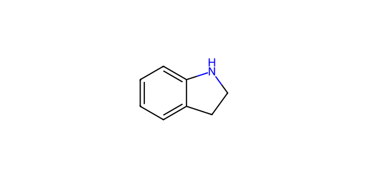

# AP044 · NH substrate-partner input

[All 108 inputs](../README.md) · [100 recommendations](../../README.md)

**Electrophile:** `O=C(CC(F)(F)F)Nc1ccccc1`

**Donor:** `c1ccc2c(c1)CCN2`

**Donor family:** cyclic arylamine. **Primary relationship:** Exact identity. **NP:** 2; **NR:** 2.

## Recommendation relationships

| Recommendation | Relationship | Structural basis |
| --- | --- | --- |
| [C002](../../C002.md) | Exact identity | The recommended and experimental donor structures are identical. |

These categories record how the RP-derived recommendation space was translated into actual reagents. They do not assign the response of this experiment to a related recommended molecule.

## Experimental record context

Reported execution: **executed**. Source appearances: **1**; distinct recorded condition recipes: **1**. Repeated workbook appearances are not independent replicates.

| Workbook | Worksheet | Row | Sample | Condition |
| --- | --- | --- | --- | --- |
| 实验结果/三氟乙基羰基+N\O\S\P数据总结.xlsx | NH-底物扩展 | 43 | 放大量 | AP044-C001 |

Input identity: workbook_structure_not_independently_verified. Product identity: not_independently_confirmed. Quantitative result: not_independently_calibrated_or_verified.
