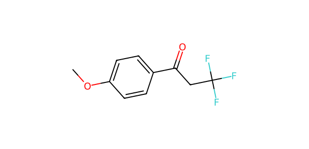
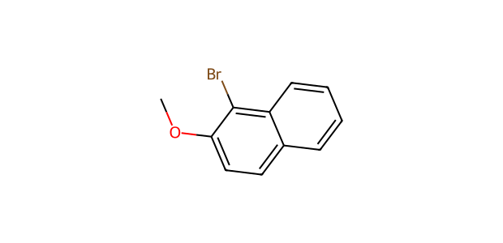

# AP045 · OH substrate–partner input

[All 108 inputs](../README.md) · [100 molecules](../../README.md)

**Electrophile:** `COc1ccc(C(=O)CC(F)(F)F)cc1`

**Donor:** `COc1ccc2ccccc2c1Br`

**Donor family:** recorded OH label but no matching O-H site. **Primary relation:** Unmatched. **NP:** not applicable; **NR:** not applicable.

## Candidate associations

No route-compatible candidate relation was assigned. Recorded OH-route partner is a methoxy/bromo naphthalene without O–H; it cannot be mapped as naphthol.

## Experimental record context

**Reported execution:** executed. **Source appearances:** 1; **distinct recorded condition recipes:** 1. Repeated workbook appearances are not independent replicates.

**Input-identity status:** structure transcribed from workbook; not independently verified. **Product-identity status:** not independently confirmed. **Quantitative-result status:** not independently calibrated or verified.

| Workbook | Worksheet | Row | Sample | Condition |
| --- | --- | --- | --- | --- |
| Reaction screening and scope workbook | OH-substrate scope | 79 | scale-up run (source label) | AP045-C001 |

The candidate relation is a structural comparison. Contemporaneous inventory, cost, safety, procurement and candidate-replacement decisions are not recorded. A family relation does not establish that the corresponding proposed product was observed.

The [full input table](../mapping_108.json) retains sample IDs, alternatives, unresolved labels and all route-compatible candidate links.
