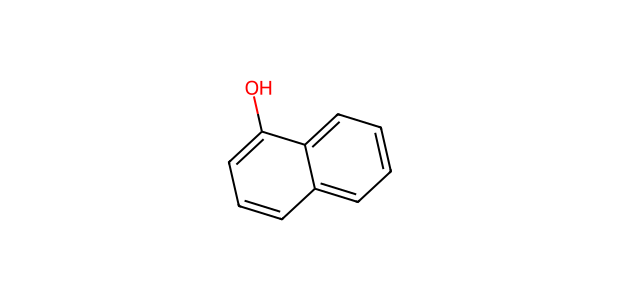

# AP048 · OH substrate–partner input

[All 108 inputs](../README.md) · [100 molecules](../../README.md)

**Electrophile:** `Cc1ccc(C(=O)CC(F)(F)F)cc1`

**Donor:** `Oc1cccc2ccccc12`

**Donor family:** phenol/heteroaryl hydroxyl donor with possible competing sites. **Primary relation:** Structural Analogue. **NP:** 2; **NR:** 2.

## Candidate associations

| Candidate | Relation | Reason |
| --- | --- | --- |
| [C051: Phenol](../../C051.md) | Structural Analogue | Hydroxy O attached to an aromatic/conjugated framework provides the O-centre analogy; substituents, heteroaryl tautomerism and competing sites must be evaluated separately. |
| [C064: Sodium phenoxide](../../C064.md) | Structural Analogue | Both framework/substitution and neutral phenol versus sodium phenoxide state can differ; this broad structural analogy does not demonstrate the actual phenoxide population. |

## Experimental record context

**Reported execution:** executed. **Source appearances:** 676; **distinct recorded condition recipes:** 339. Repeated workbook appearances are not independent replicates.

**Input-identity status:** structure transcribed from workbook; not independently verified. **Product-identity status:** not independently confirmed. **Quantitative-result status:** not independently calibrated or verified.

| Workbook | Worksheet | Row | Sample | Condition |
| --- | --- | --- | --- | --- |
| Reaction screening and scope workbook | 4-methylnaphthol response / condition screening | 2 | PL34-W1 | AP048-C001 |
| Reaction screening and scope workbook | O-H nucleophile condition screening | 2 | PL34-W1 | AP048-C001 |
| Reaction screening and scope workbook | 4-methylnaphthol response / condition screening | 3 | PL34-W2 | AP048-C002 |
| Reaction screening and scope workbook | O-H nucleophile condition screening | 3 | PL34-W2 | AP048-C002 |
| Reaction screening and scope workbook | 4-methylnaphthol response / condition screening | 4 | PL34-W3 | AP048-C003 |
| Reaction screening and scope workbook | O-H nucleophile condition screening | 4 | PL34-W3 | AP048-C003 |
| Reaction screening and scope workbook | 4-methylnaphthol response / condition screening | 5 | PL34-W4 | AP048-C004 |
| Reaction screening and scope workbook | O-H nucleophile condition screening | 5 | PL34-W4 | AP048-C004 |
| Reaction screening and scope workbook | 4-methylnaphthol response / condition screening | 6 | PL34-W5 | AP048-C005 |
| Reaction screening and scope workbook | O-H nucleophile condition screening | 6 | PL34-W5 | AP048-C005 |
| Reaction screening and scope workbook | 4-methylnaphthol response / condition screening | 7 | PL34-W6 | AP048-C006 |
| Reaction screening and scope workbook | O-H nucleophile condition screening | 7 | PL34-W6 | AP048-C006 |
| Reaction screening and scope workbook | 4-methylnaphthol response / condition screening | 8 | PL34-W7 | AP048-C007 |
| Reaction screening and scope workbook | O-H nucleophile condition screening | 8 | PL34-W7 | AP048-C007 |
| Reaction screening and scope workbook | 4-methylnaphthol response / condition screening | 9 | PL34-W8 | AP048-C008 |
| Reaction screening and scope workbook | O-H nucleophile condition screening | 9 | PL34-W8 | AP048-C008 |
| Reaction screening and scope workbook | 4-methylnaphthol response / condition screening | 10 | PL34-W9 | AP048-C009 |
| Reaction screening and scope workbook | O-H nucleophile condition screening | 10 | PL34-W9 | AP048-C009 |
| Reaction screening and scope workbook | 4-methylnaphthol response / condition screening | 11 | PL34-W10 | AP048-C010 |
| Reaction screening and scope workbook | O-H nucleophile condition screening | 11 | PL34-W10 | AP048-C010 |
| Reaction screening and scope workbook | 4-methylnaphthol response / condition screening | 12 | PL34-W11 | AP048-C011 |
| Reaction screening and scope workbook | O-H nucleophile condition screening | 12 | PL34-W11 | AP048-C011 |
| Reaction screening and scope workbook | 4-methylnaphthol response / condition screening | 13 | PL34-W12 | AP048-C012 |
| Reaction screening and scope workbook | O-H nucleophile condition screening | 13 | PL34-W12 | AP048-C012 |
| Reaction screening and scope workbook | 4-methylnaphthol response / condition screening | 14 | PL34-W13 | AP048-C013 |
| Reaction screening and scope workbook | O-H nucleophile condition screening | 14 | PL34-W13 | AP048-C013 |
| Reaction screening and scope workbook | 4-methylnaphthol response / condition screening | 15 | PL34-W14 | AP048-C014 |
| Reaction screening and scope workbook | O-H nucleophile condition screening | 15 | PL34-W14 | AP048-C014 |
| Reaction screening and scope workbook | 4-methylnaphthol response / condition screening | 16 | PL34-W15 | AP048-C015 |
| Reaction screening and scope workbook | O-H nucleophile condition screening | 16 | PL34-W15 | AP048-C015 |
| Reaction screening and scope workbook | 4-methylnaphthol response / condition screening | 17 | PL34-W16 | AP048-C016 |
| Reaction screening and scope workbook | O-H nucleophile condition screening | 17 | PL34-W16 | AP048-C016 |
| Reaction screening and scope workbook | 4-methylnaphthol response / condition screening | 18 | PL34-W17 | AP048-C017 |
| Reaction screening and scope workbook | O-H nucleophile condition screening | 18 | PL34-W17 | AP048-C017 |
| Reaction screening and scope workbook | 4-methylnaphthol response / condition screening | 19 | PL34-W18 | AP048-C018 |
| Reaction screening and scope workbook | O-H nucleophile condition screening | 19 | PL34-W18 | AP048-C018 |
| Reaction screening and scope workbook | 4-methylnaphthol response / condition screening | 20 | PL34-W19 | AP048-C019 |
| Reaction screening and scope workbook | O-H nucleophile condition screening | 20 | PL34-W19 | AP048-C019 |
| Reaction screening and scope workbook | 4-methylnaphthol response / condition screening | 21 | PL34-W20 | AP048-C020 |
| Reaction screening and scope workbook | O-H nucleophile condition screening | 21 | PL34-W20 | AP048-C020 |
| Reaction screening and scope workbook | 4-methylnaphthol response / condition screening | 22 | PL34-W21 | AP048-C021 |
| Reaction screening and scope workbook | O-H nucleophile condition screening | 22 | PL34-W21 | AP048-C021 |
| Reaction screening and scope workbook | 4-methylnaphthol response / condition screening | 23 | PL34-W22 | AP048-C022 |
| Reaction screening and scope workbook | O-H nucleophile condition screening | 23 | PL34-W22 | AP048-C022 |
| Reaction screening and scope workbook | 4-methylnaphthol response / condition screening | 24 | PL34-W23 | AP048-C023 |
| Reaction screening and scope workbook | O-H nucleophile condition screening | 24 | PL34-W23 | AP048-C023 |
| Reaction screening and scope workbook | 4-methylnaphthol response / condition screening | 25 | PL34-W24 | AP048-C024 |
| Reaction screening and scope workbook | O-H nucleophile condition screening | 25 | PL34-W24 | AP048-C024 |
| Reaction screening and scope workbook | 4-methylnaphthol response / condition screening | 26 | PL34-W25 | AP048-C025 |
| Reaction screening and scope workbook | O-H nucleophile condition screening | 26 | PL34-W25 | AP048-C025 |
| Reaction screening and scope workbook | 4-methylnaphthol response / condition screening | 27 | PL34-W26 | AP048-C026 |
| Reaction screening and scope workbook | O-H nucleophile condition screening | 27 | PL34-W26 | AP048-C026 |
| Reaction screening and scope workbook | 4-methylnaphthol response / condition screening | 28 | PL34-W27 | AP048-C027 |
| Reaction screening and scope workbook | O-H nucleophile condition screening | 28 | PL34-W27 | AP048-C027 |
| Reaction screening and scope workbook | 4-methylnaphthol response / condition screening | 29 | PL34-W28 | AP048-C028 |
| Reaction screening and scope workbook | O-H nucleophile condition screening | 29 | PL34-W28 | AP048-C028 |
| Reaction screening and scope workbook | 4-methylnaphthol response / condition screening | 30 | PL34-W29 | AP048-C029 |
| Reaction screening and scope workbook | O-H nucleophile condition screening | 30 | PL34-W29 | AP048-C029 |
| Reaction screening and scope workbook | 4-methylnaphthol response / condition screening | 31 | PL34-W30 | AP048-C030 |
| Reaction screening and scope workbook | O-H nucleophile condition screening | 31 | PL34-W30 | AP048-C030 |
| Reaction screening and scope workbook | 4-methylnaphthol response / condition screening | 32 | PL34-W31 | AP048-C031 |
| Reaction screening and scope workbook | O-H nucleophile condition screening | 32 | PL34-W31 | AP048-C031 |
| Reaction screening and scope workbook | 4-methylnaphthol response / condition screening | 33 | PL34-W32 | AP048-C032 |
| Reaction screening and scope workbook | O-H nucleophile condition screening | 33 | PL34-W32 | AP048-C032 |
| Reaction screening and scope workbook | 4-methylnaphthol response / condition screening | 34 | PL34-W33 | AP048-C033 |
| Reaction screening and scope workbook | O-H nucleophile condition screening | 34 | PL34-W33 | AP048-C033 |
| Reaction screening and scope workbook | 4-methylnaphthol response / condition screening | 35 | PL34-W34 | AP048-C034 |
| Reaction screening and scope workbook | O-H nucleophile condition screening | 35 | PL34-W34 | AP048-C034 |
| Reaction screening and scope workbook | 4-methylnaphthol response / condition screening | 36 | PL34-W35 | AP048-C035 |
| Reaction screening and scope workbook | O-H nucleophile condition screening | 36 | PL34-W35 | AP048-C035 |
| Reaction screening and scope workbook | 4-methylnaphthol response / condition screening | 37 | PL34-W36 | AP048-C036 |
| Reaction screening and scope workbook | O-H nucleophile condition screening | 37 | PL34-W36 | AP048-C036 |
| Reaction screening and scope workbook | 4-methylnaphthol response / condition screening | 38 | PL34-W37 | AP048-C037 |
| Reaction screening and scope workbook | O-H nucleophile condition screening | 38 | PL34-W37 | AP048-C037 |
| Reaction screening and scope workbook | 4-methylnaphthol response / condition screening | 39 | PL34-W38 | AP048-C038 |
| Reaction screening and scope workbook | O-H nucleophile condition screening | 39 | PL34-W38 | AP048-C038 |
| Reaction screening and scope workbook | 4-methylnaphthol response / condition screening | 40 | PL34-W39 | AP048-C039 |
| Reaction screening and scope workbook | O-H nucleophile condition screening | 40 | PL34-W39 | AP048-C039 |
| Reaction screening and scope workbook | 4-methylnaphthol response / condition screening | 41 | PL34-W40 | AP048-C040 |
| Reaction screening and scope workbook | O-H nucleophile condition screening | 41 | PL34-W40 | AP048-C040 |
| Reaction screening and scope workbook | 4-methylnaphthol response / condition screening | 42 | PL34-W41 | AP048-C041 |
| Reaction screening and scope workbook | O-H nucleophile condition screening | 42 | PL34-W41 | AP048-C041 |
| Reaction screening and scope workbook | 4-methylnaphthol response / condition screening | 43 | PL34-W42 | AP048-C042 |
| Reaction screening and scope workbook | O-H nucleophile condition screening | 43 | PL34-W42 | AP048-C042 |
| Reaction screening and scope workbook | 4-methylnaphthol response / condition screening | 44 | PL34-W43 | AP048-C043 |
| Reaction screening and scope workbook | O-H nucleophile condition screening | 44 | PL34-W43 | AP048-C043 |
| Reaction screening and scope workbook | 4-methylnaphthol response / condition screening | 45 | PL34-W44 | AP048-C044 |
| Reaction screening and scope workbook | O-H nucleophile condition screening | 45 | PL34-W44 | AP048-C044 |
| Reaction screening and scope workbook | 4-methylnaphthol response / condition screening | 46 | PL34-W45 | AP048-C045 |
| Reaction screening and scope workbook | O-H nucleophile condition screening | 46 | PL34-W45 | AP048-C045 |
| Reaction screening and scope workbook | 4-methylnaphthol response / condition screening | 47 | PL34-W46 | AP048-C046 |
| Reaction screening and scope workbook | O-H nucleophile condition screening | 47 | PL34-W46 | AP048-C046 |
| Reaction screening and scope workbook | 4-methylnaphthol response / condition screening | 48 | PL34-W47 | AP048-C047 |
| Reaction screening and scope workbook | O-H nucleophile condition screening | 48 | PL34-W47 | AP048-C047 |
| Reaction screening and scope workbook | 4-methylnaphthol response / condition screening | 49 | PL34-W48 | AP048-C048 |
| Reaction screening and scope workbook | O-H nucleophile condition screening | 49 | PL34-W48 | AP048-C048 |
| Reaction screening and scope workbook | 4-methylnaphthol response / condition screening | 50 | PL34-W49 | AP048-C049 |
| Reaction screening and scope workbook | O-H nucleophile condition screening | 50 | PL34-W49 | AP048-C049 |
| Reaction screening and scope workbook | 4-methylnaphthol response / condition screening | 51 | PL34-W50 | AP048-C050 |
| Reaction screening and scope workbook | O-H nucleophile condition screening | 51 | PL34-W50 | AP048-C050 |
| Reaction screening and scope workbook | 4-methylnaphthol response / condition screening | 52 | PL34-W51 | AP048-C051 |
| Reaction screening and scope workbook | O-H nucleophile condition screening | 52 | PL34-W51 | AP048-C051 |
| Reaction screening and scope workbook | 4-methylnaphthol response / condition screening | 53 | PL34-W52 | AP048-C052 |
| Reaction screening and scope workbook | O-H nucleophile condition screening | 53 | PL34-W52 | AP048-C052 |
| Reaction screening and scope workbook | 4-methylnaphthol response / condition screening | 54 | PL34-W53 | AP048-C053 |
| Reaction screening and scope workbook | O-H nucleophile condition screening | 54 | PL34-W53 | AP048-C053 |
| Reaction screening and scope workbook | 4-methylnaphthol response / condition screening | 55 | PL34-W54 | AP048-C054 |
| Reaction screening and scope workbook | O-H nucleophile condition screening | 55 | PL34-W54 | AP048-C054 |
| Reaction screening and scope workbook | 4-methylnaphthol response / condition screening | 56 | PL34-W55 | AP048-C055 |
| Reaction screening and scope workbook | O-H nucleophile condition screening | 56 | PL34-W55 | AP048-C055 |
| Reaction screening and scope workbook | 4-methylnaphthol response / condition screening | 57 | PL34-W56 | AP048-C056 |
| Reaction screening and scope workbook | O-H nucleophile condition screening | 57 | PL34-W56 | AP048-C056 |
| Reaction screening and scope workbook | 4-methylnaphthol response / condition screening | 58 | PL34-W57 | AP048-C057 |
| Reaction screening and scope workbook | O-H nucleophile condition screening | 58 | PL34-W57 | AP048-C057 |
| Reaction screening and scope workbook | 4-methylnaphthol response / condition screening | 59 | PL34-W58 | AP048-C058 |
| Reaction screening and scope workbook | O-H nucleophile condition screening | 59 | PL34-W58 | AP048-C058 |
| Reaction screening and scope workbook | 4-methylnaphthol response / condition screening | 60 | PL34-W59 | AP048-C059 |
| Reaction screening and scope workbook | O-H nucleophile condition screening | 60 | PL34-W59 | AP048-C059 |
| Reaction screening and scope workbook | 4-methylnaphthol response / condition screening | 61 | PL34-W60 | AP048-C060 |
| Reaction screening and scope workbook | O-H nucleophile condition screening | 61 | PL34-W60 | AP048-C060 |
| Reaction screening and scope workbook | 4-methylnaphthol response / condition screening | 62 | PL34-W61 | AP048-C061 |
| Reaction screening and scope workbook | O-H nucleophile condition screening | 62 | PL34-W61 | AP048-C061 |
| Reaction screening and scope workbook | 4-methylnaphthol response / condition screening | 63 | PL34-W62 | AP048-C062 |
| Reaction screening and scope workbook | O-H nucleophile condition screening | 63 | PL34-W62 | AP048-C062 |
| Reaction screening and scope workbook | 4-methylnaphthol response / condition screening | 64 | PL34-W63 | AP048-C063 |
| Reaction screening and scope workbook | O-H nucleophile condition screening | 64 | PL34-W63 | AP048-C063 |
| Reaction screening and scope workbook | 4-methylnaphthol response / condition screening | 65 | PL34-W64 | AP048-C064 |
| Reaction screening and scope workbook | O-H nucleophile condition screening | 65 | PL34-W64 | AP048-C064 |
| Reaction screening and scope workbook | 4-methylnaphthol response / condition screening | 66 | PL34-W65 | AP048-C065 |
| Reaction screening and scope workbook | O-H nucleophile condition screening | 66 | PL34-W65 | AP048-C065 |
| Reaction screening and scope workbook | 4-methylnaphthol response / condition screening | 67 | PL34-W66 | AP048-C066 |
| Reaction screening and scope workbook | O-H nucleophile condition screening | 67 | PL34-W66 | AP048-C066 |
| Reaction screening and scope workbook | 4-methylnaphthol response / condition screening | 68 | PL34-W67 | AP048-C067 |
| Reaction screening and scope workbook | O-H nucleophile condition screening | 68 | PL34-W67 | AP048-C067 |
| Reaction screening and scope workbook | 4-methylnaphthol response / condition screening | 69 | PL34-W68 | AP048-C068 |
| Reaction screening and scope workbook | O-H nucleophile condition screening | 69 | PL34-W68 | AP048-C068 |
| Reaction screening and scope workbook | 4-methylnaphthol response / condition screening | 70 | PL34-W69 | AP048-C069 |
| Reaction screening and scope workbook | O-H nucleophile condition screening | 70 | PL34-W69 | AP048-C069 |
| Reaction screening and scope workbook | 4-methylnaphthol response / condition screening | 71 | PL34-W70 | AP048-C070 |
| Reaction screening and scope workbook | O-H nucleophile condition screening | 71 | PL34-W70 | AP048-C070 |
| Reaction screening and scope workbook | 4-methylnaphthol response / condition screening | 72 | PL34-W71 | AP048-C071 |
| Reaction screening and scope workbook | O-H nucleophile condition screening | 72 | PL34-W71 | AP048-C071 |
| Reaction screening and scope workbook | 4-methylnaphthol response / condition screening | 73 | PL34-W72 | AP048-C072 |
| Reaction screening and scope workbook | O-H nucleophile condition screening | 73 | PL34-W72 | AP048-C072 |
| Reaction screening and scope workbook | 4-methylnaphthol response / condition screening | 74 | PL34-W73 | AP048-C073 |
| Reaction screening and scope workbook | O-H nucleophile condition screening | 74 | PL34-W73 | AP048-C073 |
| Reaction screening and scope workbook | 4-methylnaphthol response / condition screening | 75 | PL34-W74 | AP048-C074 |
| Reaction screening and scope workbook | O-H nucleophile condition screening | 75 | PL34-W74 | AP048-C074 |
| Reaction screening and scope workbook | 4-methylnaphthol response / condition screening | 76 | PL34-W75 | AP048-C075 |
| Reaction screening and scope workbook | O-H nucleophile condition screening | 76 | PL34-W75 | AP048-C075 |
| Reaction screening and scope workbook | 4-methylnaphthol response / condition screening | 77 | PL34-W76 | AP048-C076 |
| Reaction screening and scope workbook | O-H nucleophile condition screening | 77 | PL34-W76 | AP048-C076 |
| Reaction screening and scope workbook | 4-methylnaphthol response / condition screening | 78 | PL34-W77 | AP048-C077 |
| Reaction screening and scope workbook | O-H nucleophile condition screening | 78 | PL34-W77 | AP048-C077 |
| Reaction screening and scope workbook | 4-methylnaphthol response / condition screening | 79 | PL34-W78 | AP048-C078 |
| Reaction screening and scope workbook | O-H nucleophile condition screening | 79 | PL34-W78 | AP048-C078 |
| Reaction screening and scope workbook | 4-methylnaphthol response / condition screening | 80 | PL34-W79 | AP048-C079 |
| Reaction screening and scope workbook | O-H nucleophile condition screening | 80 | PL34-W79 | AP048-C079 |
| Reaction screening and scope workbook | 4-methylnaphthol response / condition screening | 81 | PL34-W80 | AP048-C080 |
| Reaction screening and scope workbook | O-H nucleophile condition screening | 81 | PL34-W80 | AP048-C080 |
| Reaction screening and scope workbook | 4-methylnaphthol response / condition screening | 82 | PL34-W81 | AP048-C081 |
| Reaction screening and scope workbook | O-H nucleophile condition screening | 82 | PL34-W81 | AP048-C081 |
| Reaction screening and scope workbook | 4-methylnaphthol response / condition screening | 83 | PL34-W82 | AP048-C082 |
| Reaction screening and scope workbook | O-H nucleophile condition screening | 83 | PL34-W82 | AP048-C082 |
| Reaction screening and scope workbook | 4-methylnaphthol response / condition screening | 84 | PL34-W83 | AP048-C083 |
| Reaction screening and scope workbook | O-H nucleophile condition screening | 84 | PL34-W83 | AP048-C083 |
| Reaction screening and scope workbook | 4-methylnaphthol response / condition screening | 85 | PL34-W84 | AP048-C084 |
| Reaction screening and scope workbook | O-H nucleophile condition screening | 85 | PL34-W84 | AP048-C084 |
| Reaction screening and scope workbook | 4-methylnaphthol response / condition screening | 86 | PL34-W85 | AP048-C085 |
| Reaction screening and scope workbook | O-H nucleophile condition screening | 86 | PL34-W85 | AP048-C085 |
| Reaction screening and scope workbook | 4-methylnaphthol response / condition screening | 87 | PL34-W86 | AP048-C086 |
| Reaction screening and scope workbook | O-H nucleophile condition screening | 87 | PL34-W86 | AP048-C086 |
| Reaction screening and scope workbook | 4-methylnaphthol response / condition screening | 88 | PL34-W87 | AP048-C087 |
| Reaction screening and scope workbook | O-H nucleophile condition screening | 88 | PL34-W87 | AP048-C087 |
| Reaction screening and scope workbook | 4-methylnaphthol response / condition screening | 89 | PL34-W88 | AP048-C088 |
| Reaction screening and scope workbook | O-H nucleophile condition screening | 89 | PL34-W88 | AP048-C088 |
| Reaction screening and scope workbook | 4-methylnaphthol response / condition screening | 90 | PL34-W89 | AP048-C089 |
| Reaction screening and scope workbook | O-H nucleophile condition screening | 90 | PL34-W89 | AP048-C089 |
| Reaction screening and scope workbook | 4-methylnaphthol response / condition screening | 91 | PL34-W90 | AP048-C090 |
| Reaction screening and scope workbook | O-H nucleophile condition screening | 91 | PL34-W90 | AP048-C090 |
| Reaction screening and scope workbook | 4-methylnaphthol response / condition screening | 92 | PL34-W91 | AP048-C091 |
| Reaction screening and scope workbook | O-H nucleophile condition screening | 92 | PL34-W91 | AP048-C091 |
| Reaction screening and scope workbook | 4-methylnaphthol response / condition screening | 93 | PL34-W92 | AP048-C092 |
| Reaction screening and scope workbook | O-H nucleophile condition screening | 93 | PL34-W92 | AP048-C092 |
| Reaction screening and scope workbook | 4-methylnaphthol response / condition screening | 94 | PL34-W93 | AP048-C093 |
| Reaction screening and scope workbook | O-H nucleophile condition screening | 94 | PL34-W93 | AP048-C093 |
| Reaction screening and scope workbook | 4-methylnaphthol response / condition screening | 95 | PL34-W94 | AP048-C094 |
| Reaction screening and scope workbook | O-H nucleophile condition screening | 95 | PL34-W94 | AP048-C094 |
| Reaction screening and scope workbook | 4-methylnaphthol response / condition screening | 96 | PL34-W95 | AP048-C095 |
| Reaction screening and scope workbook | O-H nucleophile condition screening | 96 | PL34-W95 | AP048-C095 |
| Reaction screening and scope workbook | 4-methylnaphthol response / condition screening | 97 | PL34-W96 | AP048-C096 |
| Reaction screening and scope workbook | O-H nucleophile condition screening | 97 | PL34-W96 | AP048-C096 |
| Reaction screening and scope workbook | 4-methylnaphthol response / condition screening | 98 | PL34-W97 | AP048-C097 |
| Reaction screening and scope workbook | O-H nucleophile condition screening | 98 | PL34-W97 | AP048-C097 |
| Reaction screening and scope workbook | 4-methylnaphthol response / condition screening | 99 | PL34-W98 | AP048-C098 |
| Reaction screening and scope workbook | O-H nucleophile condition screening | 99 | PL34-W98 | AP048-C098 |
| Reaction screening and scope workbook | 4-methylnaphthol response / condition screening | 100 | PL34-W99 | AP048-C099 |
| Reaction screening and scope workbook | O-H nucleophile condition screening | 100 | PL34-W99 | AP048-C099 |
| Reaction screening and scope workbook | 4-methylnaphthol response / condition screening | 101 | PL34-W100 | AP048-C100 |
| Reaction screening and scope workbook | O-H nucleophile condition screening | 101 | PL34-W100 | AP048-C100 |
| Reaction screening and scope workbook | 4-methylnaphthol response / condition screening | 102 | PL34-W101 | AP048-C101 |
| Reaction screening and scope workbook | O-H nucleophile condition screening | 102 | PL34-W101 | AP048-C101 |
| Reaction screening and scope workbook | 4-methylnaphthol response / condition screening | 103 | PL34-W102 | AP048-C102 |
| Reaction screening and scope workbook | O-H nucleophile condition screening | 103 | PL34-W102 | AP048-C102 |
| Reaction screening and scope workbook | 4-methylnaphthol response / condition screening | 104 | PL34-W103 | AP048-C103 |
| Reaction screening and scope workbook | O-H nucleophile condition screening | 104 | PL34-W103 | AP048-C103 |
| Reaction screening and scope workbook | 4-methylnaphthol response / condition screening | 105 | PL34-W104 | AP048-C104 |
| Reaction screening and scope workbook | O-H nucleophile condition screening | 105 | PL34-W104 | AP048-C104 |
| Reaction screening and scope workbook | 4-methylnaphthol response / condition screening | 106 | PL34-W105 | AP048-C105 |
| Reaction screening and scope workbook | O-H nucleophile condition screening | 106 | PL34-W105 | AP048-C105 |
| Reaction screening and scope workbook | 4-methylnaphthol response / condition screening | 107 | PL34-W106 | AP048-C106 |
| Reaction screening and scope workbook | O-H nucleophile condition screening | 107 | PL34-W106 | AP048-C106 |
| Reaction screening and scope workbook | 4-methylnaphthol response / condition screening | 108 | PL34-W107 | AP048-C107 |
| Reaction screening and scope workbook | O-H nucleophile condition screening | 108 | PL34-W107 | AP048-C107 |
| Reaction screening and scope workbook | 4-methylnaphthol response / condition screening | 109 | PL34-W108 | AP048-C108 |
| Reaction screening and scope workbook | O-H nucleophile condition screening | 109 | PL34-W108 | AP048-C108 |
| Reaction screening and scope workbook | 4-methylnaphthol response / condition screening | 110 | PL34-W109 | AP048-C109 |
| Reaction screening and scope workbook | O-H nucleophile condition screening | 110 | PL34-W109 | AP048-C109 |
| Reaction screening and scope workbook | 4-methylnaphthol response / condition screening | 111 | PL34-W110 | AP048-C110 |
| Reaction screening and scope workbook | O-H nucleophile condition screening | 111 | PL34-W110 | AP048-C110 |
| Reaction screening and scope workbook | 4-methylnaphthol response / condition screening | 112 | PL34-W111 | AP048-C111 |
| Reaction screening and scope workbook | O-H nucleophile condition screening | 112 | PL34-W111 | AP048-C111 |
| Reaction screening and scope workbook | 4-methylnaphthol response / condition screening | 113 | PL34-W112 | AP048-C112 |
| Reaction screening and scope workbook | O-H nucleophile condition screening | 113 | PL34-W112 | AP048-C112 |
| Reaction screening and scope workbook | 4-methylnaphthol response / condition screening | 114 | PL34-W113 | AP048-C113 |
| Reaction screening and scope workbook | O-H nucleophile condition screening | 114 | PL34-W113 | AP048-C113 |
| Reaction screening and scope workbook | 4-methylnaphthol response / condition screening | 115 | PL34-W114 | AP048-C114 |
| Reaction screening and scope workbook | O-H nucleophile condition screening | 115 | PL34-W114 | AP048-C114 |
| Reaction screening and scope workbook | 4-methylnaphthol response / condition screening | 116 | PL34-W115 | AP048-C115 |
| Reaction screening and scope workbook | O-H nucleophile condition screening | 116 | PL34-W115 | AP048-C115 |
| Reaction screening and scope workbook | 4-methylnaphthol response / condition screening | 117 | PL34-W116 | AP048-C116 |
| Reaction screening and scope workbook | O-H nucleophile condition screening | 117 | PL34-W116 | AP048-C116 |
| Reaction screening and scope workbook | 4-methylnaphthol response / condition screening | 118 | PL34-W117 | AP048-C117 |
| Reaction screening and scope workbook | O-H nucleophile condition screening | 118 | PL34-W117 | AP048-C117 |
| Reaction screening and scope workbook | 4-methylnaphthol response / condition screening | 119 | PL34-W118 | AP048-C118 |
| Reaction screening and scope workbook | O-H nucleophile condition screening | 119 | PL34-W118 | AP048-C118 |
| Reaction screening and scope workbook | 4-methylnaphthol response / condition screening | 120 | PL34-W119 | AP048-C119 |
| Reaction screening and scope workbook | O-H nucleophile condition screening | 120 | PL34-W119 | AP048-C119 |
| Reaction screening and scope workbook | 4-methylnaphthol response / condition screening | 121 | PL34-W120 | AP048-C120 |
| Reaction screening and scope workbook | O-H nucleophile condition screening | 121 | PL34-W120 | AP048-C120 |
| Reaction screening and scope workbook | 4-methylnaphthol response / condition screening | 122 | PL34-W121 | AP048-C121 |
| Reaction screening and scope workbook | O-H nucleophile condition screening | 122 | PL34-W121 | AP048-C121 |
| Reaction screening and scope workbook | 4-methylnaphthol response / condition screening | 123 | PL34-W122 | AP048-C122 |
| Reaction screening and scope workbook | O-H nucleophile condition screening | 123 | PL34-W122 | AP048-C122 |
| Reaction screening and scope workbook | 4-methylnaphthol response / condition screening | 124 | PL34-W123 | AP048-C123 |
| Reaction screening and scope workbook | O-H nucleophile condition screening | 124 | PL34-W123 | AP048-C123 |
| Reaction screening and scope workbook | 4-methylnaphthol response / condition screening | 125 | PL34-W124 | AP048-C124 |
| Reaction screening and scope workbook | O-H nucleophile condition screening | 125 | PL34-W124 | AP048-C124 |
| Reaction screening and scope workbook | 4-methylnaphthol response / condition screening | 126 | PL34-W125 | AP048-C125 |
| Reaction screening and scope workbook | O-H nucleophile condition screening | 126 | PL34-W125 | AP048-C125 |
| Reaction screening and scope workbook | 4-methylnaphthol response / condition screening | 127 | PL34-W126 | AP048-C126 |
| Reaction screening and scope workbook | O-H nucleophile condition screening | 127 | PL34-W126 | AP048-C126 |
| Reaction screening and scope workbook | 4-methylnaphthol response / condition screening | 128 | PL34-W127 | AP048-C127 |
| Reaction screening and scope workbook | O-H nucleophile condition screening | 128 | PL34-W127 | AP048-C127 |
| Reaction screening and scope workbook | 4-methylnaphthol response / condition screening | 129 | PL34-W128 | AP048-C128 |
| Reaction screening and scope workbook | O-H nucleophile condition screening | 129 | PL34-W128 | AP048-C128 |
| Reaction screening and scope workbook | 4-methylnaphthol response / condition screening | 130 | PL34-W129 | AP048-C129 |
| Reaction screening and scope workbook | O-H nucleophile condition screening | 130 | PL34-W129 | AP048-C129 |
| Reaction screening and scope workbook | 4-methylnaphthol response / condition screening | 131 | PL34-W130 | AP048-C130 |
| Reaction screening and scope workbook | O-H nucleophile condition screening | 131 | PL34-W130 | AP048-C130 |
| Reaction screening and scope workbook | 4-methylnaphthol response / condition screening | 132 | PL34-W131 | AP048-C131 |
| Reaction screening and scope workbook | O-H nucleophile condition screening | 132 | PL34-W131 | AP048-C131 |
| Reaction screening and scope workbook | 4-methylnaphthol response / condition screening | 133 | PL34-W132 | AP048-C132 |
| Reaction screening and scope workbook | O-H nucleophile condition screening | 133 | PL34-W132 | AP048-C132 |
| Reaction screening and scope workbook | 4-methylnaphthol response / condition screening | 134 | PL34-W133 | AP048-C133 |
| Reaction screening and scope workbook | O-H nucleophile condition screening | 134 | PL34-W133 | AP048-C133 |
| Reaction screening and scope workbook | 4-methylnaphthol response / condition screening | 135 | PL34-W134 | AP048-C134 |
| Reaction screening and scope workbook | O-H nucleophile condition screening | 135 | PL34-W134 | AP048-C134 |
| Reaction screening and scope workbook | 4-methylnaphthol response / condition screening | 136 | PL34-W135 | AP048-C135 |
| Reaction screening and scope workbook | O-H nucleophile condition screening | 136 | PL34-W135 | AP048-C135 |
| Reaction screening and scope workbook | 4-methylnaphthol response / condition screening | 137 | PL34-W136 | AP048-C136 |
| Reaction screening and scope workbook | O-H nucleophile condition screening | 137 | PL34-W136 | AP048-C136 |
| Reaction screening and scope workbook | 4-methylnaphthol response / condition screening | 138 | PL34-W137 | AP048-C137 |
| Reaction screening and scope workbook | O-H nucleophile condition screening | 138 | PL34-W137 | AP048-C137 |
| Reaction screening and scope workbook | 4-methylnaphthol response / condition screening | 139 | PL34-W138 | AP048-C138 |
| Reaction screening and scope workbook | O-H nucleophile condition screening | 139 | PL34-W138 | AP048-C138 |
| Reaction screening and scope workbook | 4-methylnaphthol response / condition screening | 140 | PL34-W139 | AP048-C139 |
| Reaction screening and scope workbook | O-H nucleophile condition screening | 140 | PL34-W139 | AP048-C139 |
| Reaction screening and scope workbook | 4-methylnaphthol response / condition screening | 141 | PL34-W140 | AP048-C140 |
| Reaction screening and scope workbook | O-H nucleophile condition screening | 141 | PL34-W140 | AP048-C140 |
| Reaction screening and scope workbook | 4-methylnaphthol response / condition screening | 142 | PL34-W141 | AP048-C141 |
| Reaction screening and scope workbook | O-H nucleophile condition screening | 142 | PL34-W141 | AP048-C141 |
| Reaction screening and scope workbook | 4-methylnaphthol response / condition screening | 143 | PL34-W142 | AP048-C142 |
| Reaction screening and scope workbook | O-H nucleophile condition screening | 143 | PL34-W142 | AP048-C142 |
| Reaction screening and scope workbook | 4-methylnaphthol response / condition screening | 144 | PL34-W143 | AP048-C143 |
| Reaction screening and scope workbook | O-H nucleophile condition screening | 144 | PL34-W143 | AP048-C143 |
| Reaction screening and scope workbook | 4-methylnaphthol response / condition screening | 145 | PL34-W144 | AP048-C144 |
| Reaction screening and scope workbook | O-H nucleophile condition screening | 145 | PL34-W144 | AP048-C144 |
| Reaction screening and scope workbook | 4-methylnaphthol response / condition screening | 146 | PL34-W145 | AP048-C145 |
| Reaction screening and scope workbook | O-H nucleophile condition screening | 146 | PL34-W145 | AP048-C145 |
| Reaction screening and scope workbook | 4-methylnaphthol response / condition screening | 147 | CFC124009-19-PL37-W1 | AP048-C146 |
| Reaction screening and scope workbook | O-H nucleophile condition screening | 147 | CFC124009-19-PL37-W1 | AP048-C146 |
| Reaction screening and scope workbook | 4-methylnaphthol response / condition screening | 148 | CFC124009-19-PL37-W2 | AP048-C147 |
| Reaction screening and scope workbook | O-H nucleophile condition screening | 148 | CFC124009-19-PL37-W2 | AP048-C147 |
| Reaction screening and scope workbook | 4-methylnaphthol response / condition screening | 149 | CFC124009-19-PL37-W3 | AP048-C148 |
| Reaction screening and scope workbook | O-H nucleophile condition screening | 149 | CFC124009-19-PL37-W3 | AP048-C148 |
| Reaction screening and scope workbook | 4-methylnaphthol response / condition screening | 150 | CFC124009-19-PL37-W4 | AP048-C149 |
| Reaction screening and scope workbook | O-H nucleophile condition screening | 150 | CFC124009-19-PL37-W4 | AP048-C149 |
| Reaction screening and scope workbook | 4-methylnaphthol response / condition screening | 151 | CFC124009-19-PL37-W5 | AP048-C150 |
| Reaction screening and scope workbook | O-H nucleophile condition screening | 151 | CFC124009-19-PL37-W5 | AP048-C150 |
| Reaction screening and scope workbook | 4-methylnaphthol response / condition screening | 152 | CFC124009-19-PL37-W6 | AP048-C151 |
| Reaction screening and scope workbook | O-H nucleophile condition screening | 152 | CFC124009-19-PL37-W6 | AP048-C151 |
| Reaction screening and scope workbook | 4-methylnaphthol response / condition screening | 153 | CFC124009-19-PL37-W7 | AP048-C152 |
| Reaction screening and scope workbook | O-H nucleophile condition screening | 153 | CFC124009-19-PL37-W7 | AP048-C152 |
| Reaction screening and scope workbook | 4-methylnaphthol response / condition screening | 154 | CFC124009-19-PL37-W8 | AP048-C153 |
| Reaction screening and scope workbook | O-H nucleophile condition screening | 154 | CFC124009-19-PL37-W8 | AP048-C153 |
| Reaction screening and scope workbook | 4-methylnaphthol response / condition screening | 155 | CFC124009-19-PL37-W9 | AP048-C154 |
| Reaction screening and scope workbook | O-H nucleophile condition screening | 155 | CFC124009-19-PL37-W9 | AP048-C154 |
| Reaction screening and scope workbook | 4-methylnaphthol response / condition screening | 156 | CFC124009-19-PL37-W10 | AP048-C155 |
| Reaction screening and scope workbook | O-H nucleophile condition screening | 156 | CFC124009-19-PL37-W10 | AP048-C155 |
| Reaction screening and scope workbook | 4-methylnaphthol response / condition screening | 157 | CFC124009-19-PL37-W11 | AP048-C156 |
| Reaction screening and scope workbook | O-H nucleophile condition screening | 157 | CFC124009-19-PL37-W11 | AP048-C156 |
| Reaction screening and scope workbook | 4-methylnaphthol response / condition screening | 158 | CFC124009-19-PL37-W12 | AP048-C157 |
| Reaction screening and scope workbook | O-H nucleophile condition screening | 158 | CFC124009-19-PL37-W12 | AP048-C157 |
| Reaction screening and scope workbook | 4-methylnaphthol response / condition screening | 159 | CFC124009-19-PL37-W13 | AP048-C158 |
| Reaction screening and scope workbook | O-H nucleophile condition screening | 159 | CFC124009-19-PL37-W13 | AP048-C158 |
| Reaction screening and scope workbook | 4-methylnaphthol response / condition screening | 160 | CFC124009-19-PL37-W14 | AP048-C159 |
| Reaction screening and scope workbook | O-H nucleophile condition screening | 160 | CFC124009-19-PL37-W14 | AP048-C159 |
| Reaction screening and scope workbook | 4-methylnaphthol response / condition screening | 161 | CFC124009-19-PL37-W15 | AP048-C160 |
| Reaction screening and scope workbook | O-H nucleophile condition screening | 161 | CFC124009-19-PL37-W15 | AP048-C160 |
| Reaction screening and scope workbook | 4-methylnaphthol response / condition screening | 162 | CFC124009-19-PL37-W16 | AP048-C161 |
| Reaction screening and scope workbook | O-H nucleophile condition screening | 162 | CFC124009-19-PL37-W16 | AP048-C161 |
| Reaction screening and scope workbook | 4-methylnaphthol response / condition screening | 163 | CFC124009-19-PL37-W17 | AP048-C162 |
| Reaction screening and scope workbook | O-H nucleophile condition screening | 163 | CFC124009-19-PL37-W17 | AP048-C162 |
| Reaction screening and scope workbook | 4-methylnaphthol response / condition screening | 164 | CFC124009-19-PL37-W18 | AP048-C163 |
| Reaction screening and scope workbook | O-H nucleophile condition screening | 164 | CFC124009-19-PL37-W18 | AP048-C163 |
| Reaction screening and scope workbook | 4-methylnaphthol response / condition screening | 165 | CFC124009-19-PL37-W19 | AP048-C164 |
| Reaction screening and scope workbook | O-H nucleophile condition screening | 165 | CFC124009-19-PL37-W19 | AP048-C164 |
| Reaction screening and scope workbook | 4-methylnaphthol response / condition screening | 166 | CFC124009-19-PL37-W20 | AP048-C165 |
| Reaction screening and scope workbook | O-H nucleophile condition screening | 166 | CFC124009-19-PL37-W20 | AP048-C165 |
| Reaction screening and scope workbook | 4-methylnaphthol response / condition screening | 167 | CFC124009-19-PL37-W21 | AP048-C166 |
| Reaction screening and scope workbook | O-H nucleophile condition screening | 167 | CFC124009-19-PL37-W21 | AP048-C166 |
| Reaction screening and scope workbook | 4-methylnaphthol response / condition screening | 168 | CFC124009-19-PL37-W22 | AP048-C167 |
| Reaction screening and scope workbook | O-H nucleophile condition screening | 168 | CFC124009-19-PL37-W22 | AP048-C167 |
| Reaction screening and scope workbook | 4-methylnaphthol response / condition screening | 169 | CFC124009-19-PL37-W23 | AP048-C168 |
| Reaction screening and scope workbook | O-H nucleophile condition screening | 169 | CFC124009-19-PL37-W23 | AP048-C168 |
| Reaction screening and scope workbook | 4-methylnaphthol response / condition screening | 170 | CFC124009-19-PL37-W24 | AP048-C169 |
| Reaction screening and scope workbook | O-H nucleophile condition screening | 170 | CFC124009-19-PL37-W24 | AP048-C169 |
| Reaction screening and scope workbook | 4-methylnaphthol response / condition screening | 171 | CFC124009-19-PL37-W25 | AP048-C170 |
| Reaction screening and scope workbook | O-H nucleophile condition screening | 171 | CFC124009-19-PL37-W25 | AP048-C170 |
| Reaction screening and scope workbook | 4-methylnaphthol response / condition screening | 172 | CFC124009-19-PL37-W26 | AP048-C171 |
| Reaction screening and scope workbook | O-H nucleophile condition screening | 172 | CFC124009-19-PL37-W26 | AP048-C171 |
| Reaction screening and scope workbook | 4-methylnaphthol response / condition screening | 173 | CFC124009-19-PL37-W27 | AP048-C172 |
| Reaction screening and scope workbook | O-H nucleophile condition screening | 173 | CFC124009-19-PL37-W27 | AP048-C172 |
| Reaction screening and scope workbook | 4-methylnaphthol response / condition screening | 174 | CFC124009-19-PL37-W28 | AP048-C173 |
| Reaction screening and scope workbook | O-H nucleophile condition screening | 174 | CFC124009-19-PL37-W28 | AP048-C173 |
| Reaction screening and scope workbook | 4-methylnaphthol response / condition screening | 175 | CFC124009-19-PL37-W29 | AP048-C174 |
| Reaction screening and scope workbook | O-H nucleophile condition screening | 175 | CFC124009-19-PL37-W29 | AP048-C174 |
| Reaction screening and scope workbook | 4-methylnaphthol response / condition screening | 176 | CFC124009-19-PL37-W30 | AP048-C175 |
| Reaction screening and scope workbook | O-H nucleophile condition screening | 176 | CFC124009-19-PL37-W30 | AP048-C175 |
| Reaction screening and scope workbook | 4-methylnaphthol response / condition screening | 177 | CFC124009-19-PL37-W31 | AP048-C176 |
| Reaction screening and scope workbook | O-H nucleophile condition screening | 177 | CFC124009-19-PL37-W31 | AP048-C176 |
| Reaction screening and scope workbook | 4-methylnaphthol response / condition screening | 178 | CFC124009-19-PL37-W32 | AP048-C177 |
| Reaction screening and scope workbook | O-H nucleophile condition screening | 178 | CFC124009-19-PL37-W32 | AP048-C177 |
| Reaction screening and scope workbook | 4-methylnaphthol response / condition screening | 179 | CFC124009-19-PL37-W33 | AP048-C178 |
| Reaction screening and scope workbook | O-H nucleophile condition screening | 179 | CFC124009-19-PL37-W33 | AP048-C178 |
| Reaction screening and scope workbook | 4-methylnaphthol response / condition screening | 180 | CFC124009-19-PL37-W34 | AP048-C179 |
| Reaction screening and scope workbook | O-H nucleophile condition screening | 180 | CFC124009-19-PL37-W34 | AP048-C179 |
| Reaction screening and scope workbook | 4-methylnaphthol response / condition screening | 181 | CFC124009-19-PL37-W35 | AP048-C180 |
| Reaction screening and scope workbook | O-H nucleophile condition screening | 181 | CFC124009-19-PL37-W35 | AP048-C180 |
| Reaction screening and scope workbook | 4-methylnaphthol response / condition screening | 182 | CFC124009-19-PL37-W36 | AP048-C181 |
| Reaction screening and scope workbook | O-H nucleophile condition screening | 182 | CFC124009-19-PL37-W36 | AP048-C181 |
| Reaction screening and scope workbook | 4-methylnaphthol response / condition screening | 183 | CFC124009-19-PL37-W37 | AP048-C182 |
| Reaction screening and scope workbook | O-H nucleophile condition screening | 183 | CFC124009-19-PL37-W37 | AP048-C182 |
| Reaction screening and scope workbook | 4-methylnaphthol response / condition screening | 184 | CFC124009-19-PL37-W38 | AP048-C183 |
| Reaction screening and scope workbook | O-H nucleophile condition screening | 184 | CFC124009-19-PL37-W38 | AP048-C183 |
| Reaction screening and scope workbook | 4-methylnaphthol response / condition screening | 185 | CFC124009-19-PL37-W39 | AP048-C184 |
| Reaction screening and scope workbook | O-H nucleophile condition screening | 185 | CFC124009-19-PL37-W39 | AP048-C184 |
| Reaction screening and scope workbook | 4-methylnaphthol response / condition screening | 186 | CFC124009-19-PL37-W40 | AP048-C185 |
| Reaction screening and scope workbook | O-H nucleophile condition screening | 186 | CFC124009-19-PL37-W40 | AP048-C185 |
| Reaction screening and scope workbook | 4-methylnaphthol response / condition screening | 187 | CFC124009-19-PL37-W41 | AP048-C186 |
| Reaction screening and scope workbook | O-H nucleophile condition screening | 187 | CFC124009-19-PL37-W41 | AP048-C186 |
| Reaction screening and scope workbook | 4-methylnaphthol response / condition screening | 188 | CFC124009-19-PL37-W42 | AP048-C187 |
| Reaction screening and scope workbook | O-H nucleophile condition screening | 188 | CFC124009-19-PL37-W42 | AP048-C187 |
| Reaction screening and scope workbook | 4-methylnaphthol response / condition screening | 189 | CFC124009-19-PL37-W43 | AP048-C188 |
| Reaction screening and scope workbook | O-H nucleophile condition screening | 189 | CFC124009-19-PL37-W43 | AP048-C188 |
| Reaction screening and scope workbook | 4-methylnaphthol response / condition screening | 190 | CFC124009-19-PL37-W44 | AP048-C189 |
| Reaction screening and scope workbook | O-H nucleophile condition screening | 190 | CFC124009-19-PL37-W44 | AP048-C189 |
| Reaction screening and scope workbook | 4-methylnaphthol response / condition screening | 191 | CFC124009-19-PL37-W45 | AP048-C190 |
| Reaction screening and scope workbook | O-H nucleophile condition screening | 191 | CFC124009-19-PL37-W45 | AP048-C190 |
| Reaction screening and scope workbook | 4-methylnaphthol response / condition screening | 192 | CFC124009-19-PL37-W46 | AP048-C191 |
| Reaction screening and scope workbook | O-H nucleophile condition screening | 192 | CFC124009-19-PL37-W46 | AP048-C191 |
| Reaction screening and scope workbook | 4-methylnaphthol response / condition screening | 193 | CFC124009-19-PL37-W47 | AP048-C192 |
| Reaction screening and scope workbook | O-H nucleophile condition screening | 193 | CFC124009-19-PL37-W47 | AP048-C192 |
| Reaction screening and scope workbook | 4-methylnaphthol response / condition screening | 194 | CFC124009-19-PL37-W48 | AP048-C193 |
| Reaction screening and scope workbook | O-H nucleophile condition screening | 194 | CFC124009-19-PL37-W48 | AP048-C193 |
| Reaction screening and scope workbook | 4-methylnaphthol response / condition screening | 195 | CFC124009-19-PL37-W49 | AP048-C194 |
| Reaction screening and scope workbook | O-H nucleophile condition screening | 195 | CFC124009-19-PL37-W49 | AP048-C194 |
| Reaction screening and scope workbook | 4-methylnaphthol response / condition screening | 196 | CFC124009-19-PL37-W50 | AP048-C195 |
| Reaction screening and scope workbook | O-H nucleophile condition screening | 196 | CFC124009-19-PL37-W50 | AP048-C195 |
| Reaction screening and scope workbook | 4-methylnaphthol response / condition screening | 197 | CFC124009-19-PL37-W51 | AP048-C196 |
| Reaction screening and scope workbook | O-H nucleophile condition screening | 197 | CFC124009-19-PL37-W51 | AP048-C196 |
| Reaction screening and scope workbook | 4-methylnaphthol response / condition screening | 198 | CFC124009-19-PL37-W52 | AP048-C197 |
| Reaction screening and scope workbook | O-H nucleophile condition screening | 198 | CFC124009-19-PL37-W52 | AP048-C197 |
| Reaction screening and scope workbook | 4-methylnaphthol response / condition screening | 199 | CFC124009-19-PL37-W53 | AP048-C198 |
| Reaction screening and scope workbook | O-H nucleophile condition screening | 199 | CFC124009-19-PL37-W53 | AP048-C198 |
| Reaction screening and scope workbook | 4-methylnaphthol response / condition screening | 200 | CFC124009-19-PL37-W54 | AP048-C199 |
| Reaction screening and scope workbook | O-H nucleophile condition screening | 200 | CFC124009-19-PL37-W54 | AP048-C199 |
| Reaction screening and scope workbook | 4-methylnaphthol response / condition screening | 201 | CFC124009-19-PL37-W55 | AP048-C200 |
| Reaction screening and scope workbook | O-H nucleophile condition screening | 201 | CFC124009-19-PL37-W55 | AP048-C200 |
| Reaction screening and scope workbook | 4-methylnaphthol response / condition screening | 202 | CFC124009-19-PL37-W56 | AP048-C201 |
| Reaction screening and scope workbook | O-H nucleophile condition screening | 202 | CFC124009-19-PL37-W56 | AP048-C201 |
| Reaction screening and scope workbook | 4-methylnaphthol response / condition screening | 203 | CFC124009-19-PL37-W57 | AP048-C202 |
| Reaction screening and scope workbook | O-H nucleophile condition screening | 203 | CFC124009-19-PL37-W57 | AP048-C202 |
| Reaction screening and scope workbook | 4-methylnaphthol response / condition screening | 204 | CFC124009-19-PL37-W58 | AP048-C203 |
| Reaction screening and scope workbook | O-H nucleophile condition screening | 204 | CFC124009-19-PL37-W58 | AP048-C203 |
| Reaction screening and scope workbook | 4-methylnaphthol response / condition screening | 205 | CFC124009-19-PL37-W59 | AP048-C204 |
| Reaction screening and scope workbook | O-H nucleophile condition screening | 205 | CFC124009-19-PL37-W59 | AP048-C204 |
| Reaction screening and scope workbook | 4-methylnaphthol response / condition screening | 206 | CFC124009-19-PL37-W60 | AP048-C205 |
| Reaction screening and scope workbook | O-H nucleophile condition screening | 206 | CFC124009-19-PL37-W60 | AP048-C205 |
| Reaction screening and scope workbook | 4-methylnaphthol response / condition screening | 207 | CFC124009-19-PL37-W61 | AP048-C206 |
| Reaction screening and scope workbook | O-H nucleophile condition screening | 207 | CFC124009-19-PL37-W61 | AP048-C206 |
| Reaction screening and scope workbook | 4-methylnaphthol response / condition screening | 208 | CFC124009-19-PL37-W62 | AP048-C207 |
| Reaction screening and scope workbook | O-H nucleophile condition screening | 208 | CFC124009-19-PL37-W62 | AP048-C207 |
| Reaction screening and scope workbook | 4-methylnaphthol response / condition screening | 209 | CFC124009-19-PL37-W63 | AP048-C208 |
| Reaction screening and scope workbook | O-H nucleophile condition screening | 209 | CFC124009-19-PL37-W63 | AP048-C208 |
| Reaction screening and scope workbook | 4-methylnaphthol response / condition screening | 210 | CFC124009-19-PL37-W64 | AP048-C209 |
| Reaction screening and scope workbook | O-H nucleophile condition screening | 210 | CFC124009-19-PL37-W64 | AP048-C209 |
| Reaction screening and scope workbook | 4-methylnaphthol response / condition screening | 211 | CFC124009-19-PL37-W65 | AP048-C210 |
| Reaction screening and scope workbook | O-H nucleophile condition screening | 211 | CFC124009-19-PL37-W65 | AP048-C210 |
| Reaction screening and scope workbook | 4-methylnaphthol response / condition screening | 212 | CFC124009-19-PL37-W66 | AP048-C211 |
| Reaction screening and scope workbook | O-H nucleophile condition screening | 212 | CFC124009-19-PL37-W66 | AP048-C211 |
| Reaction screening and scope workbook | 4-methylnaphthol response / condition screening | 213 | CFC124009-19-PL37-W67 | AP048-C212 |
| Reaction screening and scope workbook | O-H nucleophile condition screening | 213 | CFC124009-19-PL37-W67 | AP048-C212 |
| Reaction screening and scope workbook | 4-methylnaphthol response / condition screening | 214 | CFC124009-19-PL37-W68 | AP048-C213 |
| Reaction screening and scope workbook | O-H nucleophile condition screening | 214 | CFC124009-19-PL37-W68 | AP048-C213 |
| Reaction screening and scope workbook | 4-methylnaphthol response / condition screening | 215 | CFC124009-19-PL37-W69 | AP048-C214 |
| Reaction screening and scope workbook | O-H nucleophile condition screening | 215 | CFC124009-19-PL37-W69 | AP048-C214 |
| Reaction screening and scope workbook | 4-methylnaphthol response / condition screening | 216 | CFC124009-19-PL37-W70 | AP048-C215 |
| Reaction screening and scope workbook | O-H nucleophile condition screening | 216 | CFC124009-19-PL37-W70 | AP048-C215 |
| Reaction screening and scope workbook | 4-methylnaphthol response / condition screening | 217 | CFC124009-19-PL37-W71 | AP048-C216 |
| Reaction screening and scope workbook | O-H nucleophile condition screening | 217 | CFC124009-19-PL37-W71 | AP048-C216 |
| Reaction screening and scope workbook | 4-methylnaphthol response / condition screening | 218 | CFC124009-19-PL37-W72 | AP048-C217 |
| Reaction screening and scope workbook | O-H nucleophile condition screening | 218 | CFC124009-19-PL37-W72 | AP048-C217 |
| Reaction screening and scope workbook | 4-methylnaphthol response / condition screening | 219 | CFC124009-19-PL37-W73 | AP048-C218 |
| Reaction screening and scope workbook | O-H nucleophile condition screening | 219 | CFC124009-19-PL37-W73 | AP048-C218 |
| Reaction screening and scope workbook | 4-methylnaphthol response / condition screening | 220 | CFC124009-19-PL37-W74 | AP048-C219 |
| Reaction screening and scope workbook | O-H nucleophile condition screening | 220 | CFC124009-19-PL37-W74 | AP048-C219 |
| Reaction screening and scope workbook | 4-methylnaphthol response / condition screening | 221 | CFC124009-19-PL37-W75 | AP048-C220 |
| Reaction screening and scope workbook | O-H nucleophile condition screening | 221 | CFC124009-19-PL37-W75 | AP048-C220 |
| Reaction screening and scope workbook | 4-methylnaphthol response / condition screening | 222 | CFC124009-19-PL37-W76 | AP048-C221 |
| Reaction screening and scope workbook | O-H nucleophile condition screening | 222 | CFC124009-19-PL37-W76 | AP048-C221 |
| Reaction screening and scope workbook | 4-methylnaphthol response / condition screening | 223 | CFC124009-19-PL37-W77 | AP048-C222 |
| Reaction screening and scope workbook | O-H nucleophile condition screening | 223 | CFC124009-19-PL37-W77 | AP048-C222 |
| Reaction screening and scope workbook | 4-methylnaphthol response / condition screening | 224 | CFC124009-19-PL37-W78 | AP048-C223 |
| Reaction screening and scope workbook | O-H nucleophile condition screening | 224 | CFC124009-19-PL37-W78 | AP048-C223 |
| Reaction screening and scope workbook | 4-methylnaphthol response / condition screening | 225 | CFC124009-19-PL37-W79 | AP048-C224 |
| Reaction screening and scope workbook | O-H nucleophile condition screening | 225 | CFC124009-19-PL37-W79 | AP048-C224 |
| Reaction screening and scope workbook | 4-methylnaphthol response / condition screening | 226 | CFC124009-19-PL37-W80 | AP048-C225 |
| Reaction screening and scope workbook | O-H nucleophile condition screening | 226 | CFC124009-19-PL37-W80 | AP048-C225 |
| Reaction screening and scope workbook | 4-methylnaphthol response / condition screening | 227 | CFC124009-19-PL37-W81 | AP048-C226 |
| Reaction screening and scope workbook | O-H nucleophile condition screening | 227 | CFC124009-19-PL37-W81 | AP048-C226 |
| Reaction screening and scope workbook | 4-methylnaphthol response / condition screening | 228 | CFC124009-19-PL37-W82 | AP048-C227 |
| Reaction screening and scope workbook | O-H nucleophile condition screening | 228 | CFC124009-19-PL37-W82 | AP048-C227 |
| Reaction screening and scope workbook | 4-methylnaphthol response / condition screening | 229 | CFC124009-19-PL37-W83 | AP048-C228 |
| Reaction screening and scope workbook | O-H nucleophile condition screening | 229 | CFC124009-19-PL37-W83 | AP048-C228 |
| Reaction screening and scope workbook | 4-methylnaphthol response / condition screening | 230 | CFC124009-19-PL37-W84 | AP048-C229 |
| Reaction screening and scope workbook | O-H nucleophile condition screening | 230 | CFC124009-19-PL37-W84 | AP048-C229 |
| Reaction screening and scope workbook | 4-methylnaphthol response / condition screening | 231 | CFC124009-19-PL37-W85 | AP048-C230 |
| Reaction screening and scope workbook | O-H nucleophile condition screening | 231 | CFC124009-19-PL37-W85 | AP048-C230 |
| Reaction screening and scope workbook | 4-methylnaphthol response / condition screening | 232 | CFC124009-19-PL37-W86 | AP048-C231 |
| Reaction screening and scope workbook | O-H nucleophile condition screening | 232 | CFC124009-19-PL37-W86 | AP048-C231 |
| Reaction screening and scope workbook | 4-methylnaphthol response / condition screening | 233 | CFC124009-19-PL37-W87 | AP048-C232 |
| Reaction screening and scope workbook | O-H nucleophile condition screening | 233 | CFC124009-19-PL37-W87 | AP048-C232 |
| Reaction screening and scope workbook | 4-methylnaphthol response / condition screening | 234 | CFC124009-19-PL37-W88 | AP048-C233 |
| Reaction screening and scope workbook | O-H nucleophile condition screening | 234 | CFC124009-19-PL37-W88 | AP048-C233 |
| Reaction screening and scope workbook | 4-methylnaphthol response / condition screening | 235 | CFC124009-19-PL37-W89 | AP048-C234 |
| Reaction screening and scope workbook | O-H nucleophile condition screening | 235 | CFC124009-19-PL37-W89 | AP048-C234 |
| Reaction screening and scope workbook | 4-methylnaphthol response / condition screening | 236 | CFC124009-19-PL37-W90 | AP048-C235 |
| Reaction screening and scope workbook | O-H nucleophile condition screening | 236 | CFC124009-19-PL37-W90 | AP048-C235 |
| Reaction screening and scope workbook | 4-methylnaphthol response / condition screening | 237 | CFC124009-19-PL37-W91 | AP048-C236 |
| Reaction screening and scope workbook | O-H nucleophile condition screening | 237 | CFC124009-19-PL37-W91 | AP048-C236 |
| Reaction screening and scope workbook | 4-methylnaphthol response / condition screening | 238 | CFC124009-19-PL37-W92 | AP048-C237 |
| Reaction screening and scope workbook | O-H nucleophile condition screening | 238 | CFC124009-19-PL37-W92 | AP048-C237 |
| Reaction screening and scope workbook | 4-methylnaphthol response / condition screening | 239 | CFC124009-19-PL37-W93 | AP048-C238 |
| Reaction screening and scope workbook | O-H nucleophile condition screening | 239 | CFC124009-19-PL37-W93 | AP048-C238 |
| Reaction screening and scope workbook | 4-methylnaphthol response / condition screening | 240 | CFC124009-19-PL37-W94 | AP048-C239 |
| Reaction screening and scope workbook | O-H nucleophile condition screening | 240 | CFC124009-19-PL37-W94 | AP048-C239 |
| Reaction screening and scope workbook | 4-methylnaphthol response / condition screening | 241 | CFC124009-19-PL37-W95 | AP048-C240 |
| Reaction screening and scope workbook | O-H nucleophile condition screening | 241 | CFC124009-19-PL37-W95 | AP048-C240 |
| Reaction screening and scope workbook | 4-methylnaphthol response / condition screening | 242 | CFC124009-19-PL37-W96 | AP048-C241 |
| Reaction screening and scope workbook | O-H nucleophile condition screening | 242 | CFC124009-19-PL37-W96 | AP048-C241 |
| Reaction screening and scope workbook | 4-methylnaphthol response / condition screening | 243 | CFC124009-19-PL38-W1 | AP048-C242 |
| Reaction screening and scope workbook | O-H nucleophile condition screening | 243 | CFC124009-19-PL38-W1 | AP048-C242 |
| Reaction screening and scope workbook | 4-methylnaphthol response / condition screening | 244 | CFC124009-19-PL38-W2 | AP048-C243 |
| Reaction screening and scope workbook | O-H nucleophile condition screening | 244 | CFC124009-19-PL38-W2 | AP048-C243 |
| Reaction screening and scope workbook | 4-methylnaphthol response / condition screening | 245 | CFC124009-19-PL38-W3 | AP048-C244 |
| Reaction screening and scope workbook | O-H nucleophile condition screening | 245 | CFC124009-19-PL38-W3 | AP048-C244 |
| Reaction screening and scope workbook | 4-methylnaphthol response / condition screening | 246 | CFC124009-19-PL38-W4 | AP048-C245 |
| Reaction screening and scope workbook | O-H nucleophile condition screening | 246 | CFC124009-19-PL38-W4 | AP048-C245 |
| Reaction screening and scope workbook | 4-methylnaphthol response / condition screening | 247 | CFC124009-19-PL38-W5 | AP048-C246 |
| Reaction screening and scope workbook | O-H nucleophile condition screening | 247 | CFC124009-19-PL38-W5 | AP048-C246 |
| Reaction screening and scope workbook | 4-methylnaphthol response / condition screening | 248 | CFC124009-19-PL38-W6 | AP048-C247 |
| Reaction screening and scope workbook | O-H nucleophile condition screening | 248 | CFC124009-19-PL38-W6 | AP048-C247 |
| Reaction screening and scope workbook | 4-methylnaphthol response / condition screening | 249 | CFC124009-19-PL38-W7 | AP048-C248 |
| Reaction screening and scope workbook | O-H nucleophile condition screening | 249 | CFC124009-19-PL38-W7 | AP048-C248 |
| Reaction screening and scope workbook | 4-methylnaphthol response / condition screening | 250 | CFC124009-19-PL38-W8 | AP048-C249 |
| Reaction screening and scope workbook | O-H nucleophile condition screening | 250 | CFC124009-19-PL38-W8 | AP048-C249 |
| Reaction screening and scope workbook | 4-methylnaphthol response / condition screening | 251 | CFC124009-19-PL38-W9 | AP048-C250 |
| Reaction screening and scope workbook | O-H nucleophile condition screening | 251 | CFC124009-19-PL38-W9 | AP048-C250 |
| Reaction screening and scope workbook | 4-methylnaphthol response / condition screening | 252 | CFC124009-19-PL38-W10 | AP048-C251 |
| Reaction screening and scope workbook | O-H nucleophile condition screening | 252 | CFC124009-19-PL38-W10 | AP048-C251 |
| Reaction screening and scope workbook | 4-methylnaphthol response / condition screening | 253 | CFC124009-19-PL38-W11 | AP048-C252 |
| Reaction screening and scope workbook | O-H nucleophile condition screening | 253 | CFC124009-19-PL38-W11 | AP048-C252 |
| Reaction screening and scope workbook | 4-methylnaphthol response / condition screening | 254 | CFC124009-19-PL38-W12 | AP048-C253 |
| Reaction screening and scope workbook | O-H nucleophile condition screening | 254 | CFC124009-19-PL38-W12 | AP048-C253 |
| Reaction screening and scope workbook | 4-methylnaphthol response / condition screening | 255 | CFC124009-19-PL38-W13 | AP048-C254 |
| Reaction screening and scope workbook | O-H nucleophile condition screening | 255 | CFC124009-19-PL38-W13 | AP048-C254 |
| Reaction screening and scope workbook | 4-methylnaphthol response / condition screening | 256 | CFC124009-19-PL38-W14 | AP048-C255 |
| Reaction screening and scope workbook | O-H nucleophile condition screening | 256 | CFC124009-19-PL38-W14 | AP048-C255 |
| Reaction screening and scope workbook | 4-methylnaphthol response / condition screening | 257 | CFC124009-19-PL38-W15 | AP048-C256 |
| Reaction screening and scope workbook | O-H nucleophile condition screening | 257 | CFC124009-19-PL38-W15 | AP048-C256 |
| Reaction screening and scope workbook | 4-methylnaphthol response / condition screening | 258 | CFC124009-19-PL38-W16 | AP048-C257 |
| Reaction screening and scope workbook | O-H nucleophile condition screening | 258 | CFC124009-19-PL38-W16 | AP048-C257 |
| Reaction screening and scope workbook | 4-methylnaphthol response / condition screening | 259 | CFC124009-19-PL38-W17 | AP048-C258 |
| Reaction screening and scope workbook | O-H nucleophile condition screening | 259 | CFC124009-19-PL38-W17 | AP048-C258 |
| Reaction screening and scope workbook | 4-methylnaphthol response / condition screening | 260 | CFC124009-19-PL38-W18 | AP048-C259 |
| Reaction screening and scope workbook | O-H nucleophile condition screening | 260 | CFC124009-19-PL38-W18 | AP048-C259 |
| Reaction screening and scope workbook | 4-methylnaphthol response / condition screening | 261 | CFC124009-19-PL38-W19 | AP048-C260 |
| Reaction screening and scope workbook | O-H nucleophile condition screening | 261 | CFC124009-19-PL38-W19 | AP048-C260 |
| Reaction screening and scope workbook | 4-methylnaphthol response / condition screening | 262 | CFC124009-19-PL38-W20 | AP048-C261 |
| Reaction screening and scope workbook | O-H nucleophile condition screening | 262 | CFC124009-19-PL38-W20 | AP048-C261 |
| Reaction screening and scope workbook | 4-methylnaphthol response / condition screening | 263 | CFC124009-19-PL38-W21 | AP048-C262 |
| Reaction screening and scope workbook | O-H nucleophile condition screening | 263 | CFC124009-19-PL38-W21 | AP048-C262 |
| Reaction screening and scope workbook | 4-methylnaphthol response / condition screening | 264 | CFC124009-19-PL38-W22 | AP048-C263 |
| Reaction screening and scope workbook | O-H nucleophile condition screening | 264 | CFC124009-19-PL38-W22 | AP048-C263 |
| Reaction screening and scope workbook | 4-methylnaphthol response / condition screening | 265 | CFC124009-19-PL38-W23 | AP048-C264 |
| Reaction screening and scope workbook | O-H nucleophile condition screening | 265 | CFC124009-19-PL38-W23 | AP048-C264 |
| Reaction screening and scope workbook | 4-methylnaphthol response / condition screening | 266 | CFC124009-19-PL38-W24 | AP048-C265 |
| Reaction screening and scope workbook | O-H nucleophile condition screening | 266 | CFC124009-19-PL38-W24 | AP048-C265 |
| Reaction screening and scope workbook | 4-methylnaphthol response / condition screening | 267 | CFC124009-19-PL38-W25 | AP048-C266 |
| Reaction screening and scope workbook | O-H nucleophile condition screening | 267 | CFC124009-19-PL38-W25 | AP048-C266 |
| Reaction screening and scope workbook | 4-methylnaphthol response / condition screening | 268 | CFC124009-19-PL38-W26 | AP048-C267 |
| Reaction screening and scope workbook | O-H nucleophile condition screening | 268 | CFC124009-19-PL38-W26 | AP048-C267 |
| Reaction screening and scope workbook | 4-methylnaphthol response / condition screening | 269 | CFC124009-19-PL38-W27 | AP048-C268 |
| Reaction screening and scope workbook | O-H nucleophile condition screening | 269 | CFC124009-19-PL38-W27 | AP048-C268 |
| Reaction screening and scope workbook | 4-methylnaphthol response / condition screening | 270 | CFC124009-19-PL38-W28 | AP048-C269 |
| Reaction screening and scope workbook | O-H nucleophile condition screening | 270 | CFC124009-19-PL38-W28 | AP048-C269 |
| Reaction screening and scope workbook | 4-methylnaphthol response / condition screening | 271 | CFC124009-19-PL38-W29 | AP048-C270 |
| Reaction screening and scope workbook | O-H nucleophile condition screening | 271 | CFC124009-19-PL38-W29 | AP048-C270 |
| Reaction screening and scope workbook | 4-methylnaphthol response / condition screening | 272 | CFC124009-19-PL38-W30 | AP048-C271 |
| Reaction screening and scope workbook | O-H nucleophile condition screening | 272 | CFC124009-19-PL38-W30 | AP048-C271 |
| Reaction screening and scope workbook | 4-methylnaphthol response / condition screening | 273 | CFC124009-19-PL38-W31 | AP048-C272 |
| Reaction screening and scope workbook | O-H nucleophile condition screening | 273 | CFC124009-19-PL38-W31 | AP048-C272 |
| Reaction screening and scope workbook | 4-methylnaphthol response / condition screening | 274 | CFC124009-19-PL38-W32 | AP048-C273 |
| Reaction screening and scope workbook | O-H nucleophile condition screening | 274 | CFC124009-19-PL38-W32 | AP048-C273 |
| Reaction screening and scope workbook | 4-methylnaphthol response / condition screening | 275 | CFC124009-19-PL38-W33 | AP048-C274 |
| Reaction screening and scope workbook | O-H nucleophile condition screening | 275 | CFC124009-19-PL38-W33 | AP048-C274 |
| Reaction screening and scope workbook | 4-methylnaphthol response / condition screening | 276 | CFC124009-19-PL38-W34 | AP048-C275 |
| Reaction screening and scope workbook | O-H nucleophile condition screening | 276 | CFC124009-19-PL38-W34 | AP048-C275 |
| Reaction screening and scope workbook | 4-methylnaphthol response / condition screening | 277 | CFC124009-19-PL38-W35 | AP048-C276 |
| Reaction screening and scope workbook | O-H nucleophile condition screening | 277 | CFC124009-19-PL38-W35 | AP048-C276 |
| Reaction screening and scope workbook | 4-methylnaphthol response / condition screening | 278 | CFC124009-19-PL38-W36 | AP048-C277 |
| Reaction screening and scope workbook | O-H nucleophile condition screening | 278 | CFC124009-19-PL38-W36 | AP048-C277 |
| Reaction screening and scope workbook | 4-methylnaphthol response / condition screening | 279 | CFC124009-19-PL38-W37 | AP048-C278 |
| Reaction screening and scope workbook | O-H nucleophile condition screening | 279 | CFC124009-19-PL38-W37 | AP048-C278 |
| Reaction screening and scope workbook | 4-methylnaphthol response / condition screening | 280 | CFC124009-19-PL38-W38 | AP048-C279 |
| Reaction screening and scope workbook | O-H nucleophile condition screening | 280 | CFC124009-19-PL38-W38 | AP048-C279 |
| Reaction screening and scope workbook | 4-methylnaphthol response / condition screening | 281 | CFC124009-19-PL38-W39 | AP048-C280 |
| Reaction screening and scope workbook | O-H nucleophile condition screening | 281 | CFC124009-19-PL38-W39 | AP048-C280 |
| Reaction screening and scope workbook | 4-methylnaphthol response / condition screening | 282 | CFC124009-19-PL38-W40 | AP048-C281 |
| Reaction screening and scope workbook | O-H nucleophile condition screening | 282 | CFC124009-19-PL38-W40 | AP048-C281 |
| Reaction screening and scope workbook | 4-methylnaphthol response / condition screening | 283 | CFC124009-19-PL38-W41 | AP048-C282 |
| Reaction screening and scope workbook | O-H nucleophile condition screening | 283 | CFC124009-19-PL38-W41 | AP048-C282 |
| Reaction screening and scope workbook | 4-methylnaphthol response / condition screening | 284 | CFC124009-19-PL38-W42 | AP048-C283 |
| Reaction screening and scope workbook | O-H nucleophile condition screening | 284 | CFC124009-19-PL38-W42 | AP048-C283 |
| Reaction screening and scope workbook | 4-methylnaphthol response / condition screening | 285 | CFC124009-19-PL38-W43 | AP048-C284 |
| Reaction screening and scope workbook | O-H nucleophile condition screening | 285 | CFC124009-19-PL38-W43 | AP048-C284 |
| Reaction screening and scope workbook | 4-methylnaphthol response / condition screening | 286 | CFC124009-19-PL38-W44 | AP048-C285 |
| Reaction screening and scope workbook | O-H nucleophile condition screening | 286 | CFC124009-19-PL38-W44 | AP048-C285 |
| Reaction screening and scope workbook | 4-methylnaphthol response / condition screening | 287 | CFC124009-19-PL38-W45 | AP048-C286 |
| Reaction screening and scope workbook | O-H nucleophile condition screening | 287 | CFC124009-19-PL38-W45 | AP048-C286 |
| Reaction screening and scope workbook | 4-methylnaphthol response / condition screening | 288 | CFC124009-19-PL38-W46 | AP048-C287 |
| Reaction screening and scope workbook | O-H nucleophile condition screening | 288 | CFC124009-19-PL38-W46 | AP048-C287 |
| Reaction screening and scope workbook | 4-methylnaphthol response / condition screening | 289 | CFC124009-19-PL38-W47 | AP048-C288 |
| Reaction screening and scope workbook | O-H nucleophile condition screening | 289 | CFC124009-19-PL38-W47 | AP048-C288 |
| Reaction screening and scope workbook | 4-methylnaphthol response / condition screening | 290 | CFC124009-19-PL38-W48 | AP048-C289 |
| Reaction screening and scope workbook | O-H nucleophile condition screening | 290 | CFC124009-19-PL38-W48 | AP048-C289 |
| Reaction screening and scope workbook | 4-methylnaphthol response / condition screening | 291 | CFC124009-19-PL38-W49 | AP048-C290 |
| Reaction screening and scope workbook | O-H nucleophile condition screening | 291 | CFC124009-19-PL38-W49 | AP048-C290 |
| Reaction screening and scope workbook | 4-methylnaphthol response / condition screening | 292 | CFC124009-19-PL38-W50 | AP048-C291 |
| Reaction screening and scope workbook | O-H nucleophile condition screening | 292 | CFC124009-19-PL38-W50 | AP048-C291 |
| Reaction screening and scope workbook | 4-methylnaphthol response / condition screening | 293 | CFC124009-19-PL38-W51 | AP048-C292 |
| Reaction screening and scope workbook | O-H nucleophile condition screening | 293 | CFC124009-19-PL38-W51 | AP048-C292 |
| Reaction screening and scope workbook | 4-methylnaphthol response / condition screening | 294 | CFC124009-19-PL38-W52 | AP048-C293 |
| Reaction screening and scope workbook | O-H nucleophile condition screening | 294 | CFC124009-19-PL38-W52 | AP048-C293 |
| Reaction screening and scope workbook | 4-methylnaphthol response / condition screening | 295 | CFC124009-19-PL38-W53 | AP048-C294 |
| Reaction screening and scope workbook | O-H nucleophile condition screening | 295 | CFC124009-19-PL38-W53 | AP048-C294 |
| Reaction screening and scope workbook | 4-methylnaphthol response / condition screening | 296 | CFC124009-19-PL38-W54 | AP048-C295 |
| Reaction screening and scope workbook | O-H nucleophile condition screening | 296 | CFC124009-19-PL38-W54 | AP048-C295 |
| Reaction screening and scope workbook | 4-methylnaphthol response / condition screening | 297 | CFC124009-19-PL38-W55 | AP048-C296 |
| Reaction screening and scope workbook | O-H nucleophile condition screening | 297 | CFC124009-19-PL38-W55 | AP048-C296 |
| Reaction screening and scope workbook | 4-methylnaphthol response / condition screening | 298 | CFC124009-19-PL38-W56 | AP048-C297 |
| Reaction screening and scope workbook | O-H nucleophile condition screening | 298 | CFC124009-19-PL38-W56 | AP048-C297 |
| Reaction screening and scope workbook | 4-methylnaphthol response / condition screening | 299 | CFC124009-19-PL38-W57 | AP048-C298 |
| Reaction screening and scope workbook | O-H nucleophile condition screening | 299 | CFC124009-19-PL38-W57 | AP048-C298 |
| Reaction screening and scope workbook | 4-methylnaphthol response / condition screening | 300 | CFC124009-19-PL38-W58 | AP048-C299 |
| Reaction screening and scope workbook | O-H nucleophile condition screening | 300 | CFC124009-19-PL38-W58 | AP048-C299 |
| Reaction screening and scope workbook | 4-methylnaphthol response / condition screening | 301 | CFC124009-19-PL38-W59 | AP048-C300 |
| Reaction screening and scope workbook | O-H nucleophile condition screening | 301 | CFC124009-19-PL38-W59 | AP048-C300 |
| Reaction screening and scope workbook | 4-methylnaphthol response / condition screening | 302 | CFC124009-19-PL38-W60 | AP048-C301 |
| Reaction screening and scope workbook | O-H nucleophile condition screening | 302 | CFC124009-19-PL38-W60 | AP048-C301 |
| Reaction screening and scope workbook | 4-methylnaphthol response / condition screening | 303 | CFC124009-19-PL38-W61 | AP048-C302 |
| Reaction screening and scope workbook | O-H nucleophile condition screening | 303 | CFC124009-19-PL38-W61 | AP048-C302 |
| Reaction screening and scope workbook | 4-methylnaphthol response / condition screening | 304 | CFC124009-19-PL38-W62 | AP048-C303 |
| Reaction screening and scope workbook | O-H nucleophile condition screening | 304 | CFC124009-19-PL38-W62 | AP048-C303 |
| Reaction screening and scope workbook | 4-methylnaphthol response / condition screening | 305 | CFC124009-19-PL38-W63 | AP048-C304 |
| Reaction screening and scope workbook | O-H nucleophile condition screening | 305 | CFC124009-19-PL38-W63 | AP048-C304 |
| Reaction screening and scope workbook | 4-methylnaphthol response / condition screening | 306 | CFC124009-19-PL38-W64 | AP048-C305 |
| Reaction screening and scope workbook | O-H nucleophile condition screening | 306 | CFC124009-19-PL38-W64 | AP048-C305 |
| Reaction screening and scope workbook | 4-methylnaphthol response / condition screening | 307 | CFC124009-19-PL38-W65 | AP048-C306 |
| Reaction screening and scope workbook | O-H nucleophile condition screening | 307 | CFC124009-19-PL38-W65 | AP048-C306 |
| Reaction screening and scope workbook | 4-methylnaphthol response / condition screening | 308 | CFC124009-19-PL38-W66 | AP048-C307 |
| Reaction screening and scope workbook | O-H nucleophile condition screening | 308 | CFC124009-19-PL38-W66 | AP048-C307 |
| Reaction screening and scope workbook | 4-methylnaphthol response / condition screening | 309 | CFC124009-19-PL38-W67 | AP048-C308 |
| Reaction screening and scope workbook | O-H nucleophile condition screening | 309 | CFC124009-19-PL38-W67 | AP048-C308 |
| Reaction screening and scope workbook | 4-methylnaphthol response / condition screening | 310 | CFC124009-19-PL38-W68 | AP048-C309 |
| Reaction screening and scope workbook | O-H nucleophile condition screening | 310 | CFC124009-19-PL38-W68 | AP048-C309 |
| Reaction screening and scope workbook | 4-methylnaphthol response / condition screening | 311 | CFC124009-19-PL38-W69 | AP048-C310 |
| Reaction screening and scope workbook | O-H nucleophile condition screening | 311 | CFC124009-19-PL38-W69 | AP048-C310 |
| Reaction screening and scope workbook | 4-methylnaphthol response / condition screening | 312 | CFC124009-19-PL38-W70 | AP048-C311 |
| Reaction screening and scope workbook | O-H nucleophile condition screening | 312 | CFC124009-19-PL38-W70 | AP048-C311 |
| Reaction screening and scope workbook | 4-methylnaphthol response / condition screening | 313 | CFC124009-19-PL38-W71 | AP048-C312 |
| Reaction screening and scope workbook | O-H nucleophile condition screening | 313 | CFC124009-19-PL38-W71 | AP048-C312 |
| Reaction screening and scope workbook | 4-methylnaphthol response / condition screening | 314 | CFC124009-19-PL38-W72 | AP048-C313 |
| Reaction screening and scope workbook | O-H nucleophile condition screening | 314 | CFC124009-19-PL38-W72 | AP048-C313 |
| Reaction screening and scope workbook | 4-methylnaphthol response / condition screening | 315 | CFC124009-19-PL38-W73 | AP048-C314 |
| Reaction screening and scope workbook | O-H nucleophile condition screening | 315 | CFC124009-19-PL38-W73 | AP048-C314 |
| Reaction screening and scope workbook | 4-methylnaphthol response / condition screening | 316 | CFC124009-19-PL38-W74 | AP048-C315 |
| Reaction screening and scope workbook | O-H nucleophile condition screening | 316 | CFC124009-19-PL38-W74 | AP048-C315 |
| Reaction screening and scope workbook | 4-methylnaphthol response / condition screening | 317 | CFC124009-19-PL38-W75 | AP048-C316 |
| Reaction screening and scope workbook | O-H nucleophile condition screening | 317 | CFC124009-19-PL38-W75 | AP048-C316 |
| Reaction screening and scope workbook | 4-methylnaphthol response / condition screening | 318 | CFC124009-19-PL38-W76 | AP048-C317 |
| Reaction screening and scope workbook | O-H nucleophile condition screening | 318 | CFC124009-19-PL38-W76 | AP048-C317 |
| Reaction screening and scope workbook | 4-methylnaphthol response / condition screening | 319 | CFC124009-19-PL38-W77 | AP048-C318 |
| Reaction screening and scope workbook | O-H nucleophile condition screening | 319 | CFC124009-19-PL38-W77 | AP048-C318 |
| Reaction screening and scope workbook | 4-methylnaphthol response / condition screening | 320 | CFC124009-19-PL38-W78 | AP048-C319 |
| Reaction screening and scope workbook | O-H nucleophile condition screening | 320 | CFC124009-19-PL38-W78 | AP048-C319 |
| Reaction screening and scope workbook | 4-methylnaphthol response / condition screening | 321 | CFC124009-19-PL38-W79 | AP048-C320 |
| Reaction screening and scope workbook | O-H nucleophile condition screening | 321 | CFC124009-19-PL38-W79 | AP048-C320 |
| Reaction screening and scope workbook | 4-methylnaphthol response / condition screening | 322 | CFC124009-19-PL38-W80 | AP048-C321 |
| Reaction screening and scope workbook | O-H nucleophile condition screening | 322 | CFC124009-19-PL38-W80 | AP048-C321 |
| Reaction screening and scope workbook | 4-methylnaphthol response / condition screening | 323 | CFC124009-19-PL38-W81 | AP048-C322 |
| Reaction screening and scope workbook | O-H nucleophile condition screening | 323 | CFC124009-19-PL38-W81 | AP048-C322 |
| Reaction screening and scope workbook | 4-methylnaphthol response / condition screening | 324 | CFC124009-19-PL38-W82 | AP048-C323 |
| Reaction screening and scope workbook | O-H nucleophile condition screening | 324 | CFC124009-19-PL38-W82 | AP048-C323 |
| Reaction screening and scope workbook | 4-methylnaphthol response / condition screening | 325 | CFC124009-19-PL38-W83 | AP048-C324 |
| Reaction screening and scope workbook | O-H nucleophile condition screening | 325 | CFC124009-19-PL38-W83 | AP048-C324 |
| Reaction screening and scope workbook | 4-methylnaphthol response / condition screening | 326 | CFC124009-19-PL38-W84 | AP048-C325 |
| Reaction screening and scope workbook | O-H nucleophile condition screening | 326 | CFC124009-19-PL38-W84 | AP048-C325 |
| Reaction screening and scope workbook | 4-methylnaphthol response / condition screening | 327 | CFC124009-19-PL38-W85 | AP048-C326 |
| Reaction screening and scope workbook | O-H nucleophile condition screening | 327 | CFC124009-19-PL38-W85 | AP048-C326 |
| Reaction screening and scope workbook | 4-methylnaphthol response / condition screening | 328 | CFC124009-19-PL38-W86 | AP048-C327 |
| Reaction screening and scope workbook | O-H nucleophile condition screening | 328 | CFC124009-19-PL38-W86 | AP048-C327 |
| Reaction screening and scope workbook | 4-methylnaphthol response / condition screening | 329 | CFC124009-19-PL38-W87 | AP048-C328 |
| Reaction screening and scope workbook | O-H nucleophile condition screening | 329 | CFC124009-19-PL38-W87 | AP048-C328 |
| Reaction screening and scope workbook | 4-methylnaphthol response / condition screening | 330 | CFC124009-19-PL38-W88 | AP048-C329 |
| Reaction screening and scope workbook | O-H nucleophile condition screening | 330 | CFC124009-19-PL38-W88 | AP048-C329 |
| Reaction screening and scope workbook | 4-methylnaphthol response / condition screening | 331 | CFC124009-19-PL38-W89 | AP048-C330 |
| Reaction screening and scope workbook | O-H nucleophile condition screening | 331 | CFC124009-19-PL38-W89 | AP048-C330 |
| Reaction screening and scope workbook | 4-methylnaphthol response / condition screening | 332 | CFC124009-19-PL38-W90 | AP048-C331 |
| Reaction screening and scope workbook | O-H nucleophile condition screening | 332 | CFC124009-19-PL38-W90 | AP048-C331 |
| Reaction screening and scope workbook | 4-methylnaphthol response / condition screening | 333 | CFC124009-19-PL38-W91 | AP048-C332 |
| Reaction screening and scope workbook | O-H nucleophile condition screening | 333 | CFC124009-19-PL38-W91 | AP048-C332 |
| Reaction screening and scope workbook | 4-methylnaphthol response / condition screening | 334 | CFC124009-19-PL38-W92 | AP048-C333 |
| Reaction screening and scope workbook | O-H nucleophile condition screening | 334 | CFC124009-19-PL38-W92 | AP048-C333 |
| Reaction screening and scope workbook | 4-methylnaphthol response / condition screening | 335 | CFC124009-19-PL38-W93 | AP048-C334 |
| Reaction screening and scope workbook | O-H nucleophile condition screening | 335 | CFC124009-19-PL38-W93 | AP048-C334 |
| Reaction screening and scope workbook | 4-methylnaphthol response / condition screening | 336 | CFC124009-19-PL38-W94 | AP048-C335 |
| Reaction screening and scope workbook | O-H nucleophile condition screening | 336 | CFC124009-19-PL38-W94 | AP048-C335 |
| Reaction screening and scope workbook | 4-methylnaphthol response / condition screening | 337 | CFC124009-19-PL38-W95 | AP048-C336 |
| Reaction screening and scope workbook | O-H nucleophile condition screening | 337 | CFC124009-19-PL38-W95 | AP048-C336 |
| Reaction screening and scope workbook | 4-methylnaphthol response / condition screening | 338 | CFC124009-19-PL38-W96 | AP048-C337 |
| Reaction screening and scope workbook | O-H nucleophile condition screening | 338 | CFC124009-19-PL38-W96 | AP048-C337 |
| Reaction screening and scope workbook | O-H nucleophile condition screening | 339 | PL30-W56 | AP048-C338 |
| Reaction screening and scope workbook | O-H nucleophile condition screening | 340 | PL30-W52 | AP048-C339 |

The candidate relation is a structural comparison. Contemporaneous inventory, cost, safety, procurement and candidate-replacement decisions are not recorded. A family relation does not establish that the corresponding proposed product was observed.

The [full input table](../mapping_108.json) retains sample IDs, alternatives, unresolved labels and all route-compatible candidate links.
