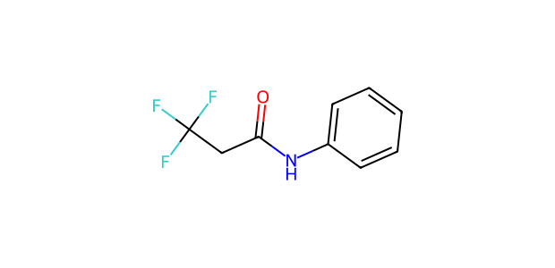
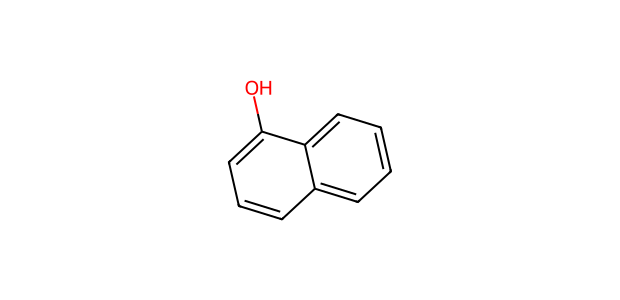

# AP049 · OH substrate-partner input

[All 112 inputs](../README.md) · [100 recommendations](../../README.md)

**Electrophile:** `O=C(CC(F)(F)F)Nc1ccccc1`

**Donor:** `Oc1cccc2ccccc12`

**Donor family:** phenol/heteroaryl hydroxyl donor with possible competing sites. **Primary relationship:** Exact identity. **NP:** 2; **NR:** 2.

## Recommendation relationships

| Recommendation | Relationship | Structural basis |
| --- | --- | --- |
| [C041](../../C041.md) | Exact identity | The recommended and experimental donor structures are identical. |

These categories record how the RP-derived recommendation space was translated into actual reagents. They do not assign the response of this experiment to a related recommended molecule.

## Experimental record context

Reported execution: **executed**. Source appearances: **1**; distinct recorded condition recipes: **1**. Repeated workbook appearances are not independent replicates.

| Workbook | Worksheet | Row | Sample | Condition |
| --- | --- | --- | --- | --- |
| 实验结果/三氟乙基羰基+N\O\S\P数据总结.xlsx | OH-底物扩展 | 80 | 放大量 | AP049-C001 |
