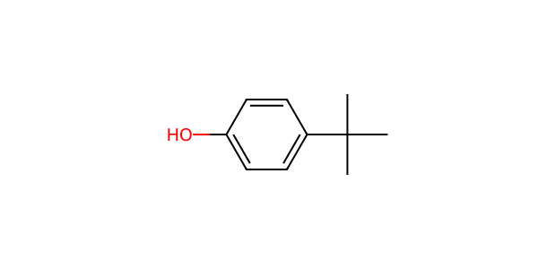

# AP051 · OH substrate-partner input

[All 108 inputs](../README.md) · [100 recommendations](../../README.md)

**Electrophile:** `O=C(CC(F)(F)F)c1ccccc1`

**Donor:** `CC(C)(C)c1ccc(O)cc1`

**Donor family:** phenol/heteroaryl hydroxyl donor with possible competing sites. **Primary relationship:** Same scaffold, substituent or positional variation. **NP:** 2; **NR:** 2.

## Recommendation relationships

| Recommendation | Relationship | Structural basis |
| --- | --- | --- |
| [C076](../../C076.md) | Same scaffold, substituent or positional variation | The reacting-atom type and core scaffold are retained, while substitution or position differs. |
| [C072](../../C072.md) | Same scaffold, substituent or positional variation | The reacting-atom type and core scaffold are retained, while substitution or position differs. |
| [C073](../../C073.md) | Same scaffold, substituent or positional variation | The reacting-atom type and core scaffold are retained, while substitution or position differs. |

These categories record how the RP-derived recommendation space was translated into actual reagents. They do not assign the response of this experiment to a related recommended molecule.

## Experimental record context

Reported execution: **executed**. Source appearances: **4**; distinct recorded condition recipes: **2**. Repeated workbook appearances are not independent replicates.

| Workbook | Worksheet | Row | Sample | Condition |
| --- | --- | --- | --- | --- |
| 实验结果/副本条件筛选-底物扩展-response总-0911.xlsx | PL46-OH-底物扩展 | 27 | CFC124009-19-1-PL46-W28 | AP051-C001 |
| 实验结果/三氟乙基羰基+N\O\S\P数据总结.xlsx | OH-底物扩展 | 27 | CFC124009-19-1-PL46-W28 | AP051-C001 |
| 实验结果/副本条件筛选-底物扩展-response总-0911.xlsx | PL46-OH-底物扩展 | 65 | CFC124009-19-1-PL46-W68 | AP051-C002 |
| 实验结果/三氟乙基羰基+N\O\S\P数据总结.xlsx | OH-底物扩展 | 65 | CFC124009-19-1-PL46-W68 | AP051-C002 |

Input identity: workbook_structure_not_independently_verified. Product identity: not_independently_confirmed. Quantitative result: not_independently_calibrated_or_verified.
