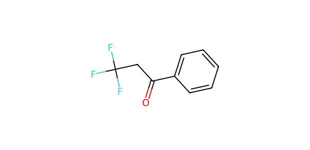
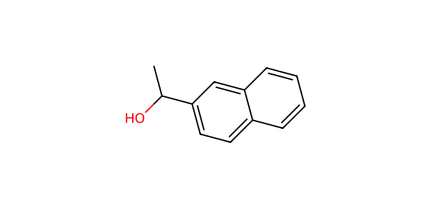

# AP053 · OH substrate–partner input

[All 108 inputs](../README.md) · [100 molecules](../../README.md)

**Electrophile:** `O=C(CC(F)(F)F)c1ccccc1`

**Donor:** `CC(O)c1ccc2ccccc2c1`

**Donor family:** alcohol. **Primary relation:** Structural Analogue. **NP:** 2; **NR:** 2.

## Candidate associations

| Candidate | Relation | Reason |
| --- | --- | --- |
| [C052: Allyl alcohol](../../C052.md) | Structural Analogue | Alcohol O–H is retained but carbon substitution/saturation differs; a common O centre does not imply equal acidity or capture competence. |
| [C061: Methanol](../../C061.md) | Structural Analogue | Alcohol O–H is the local family analogy; chain length, substitution and competing functional groups differ. |

## Experimental record context

**Reported execution:** executed. **Source appearances:** 4; **distinct recorded condition recipes:** 2. Repeated workbook appearances are not independent replicates.

**Input-identity status:** structure transcribed from workbook; not independently verified. **Product-identity status:** not independently confirmed. **Quantitative-result status:** not independently calibrated or verified.

| Workbook | Worksheet | Row | Sample | Condition |
| --- | --- | --- | --- | --- |
| Reaction screening and scope workbook | PL46-OH-substrate scope | 12 | CFC124009-19-1-PL46-W12 | AP053-C001 |
| Reaction screening and scope workbook | OH-substrate scope | 12 | CFC124009-19-1-PL46-W12 | AP053-C001 |
| Reaction screening and scope workbook | PL46-OH-substrate scope | 49 | CFC124009-19-1-PL46-W52 | AP053-C002 |
| Reaction screening and scope workbook | OH-substrate scope | 49 | CFC124009-19-1-PL46-W52 | AP053-C002 |

The candidate relation is a structural comparison. Contemporaneous inventory, cost, safety, procurement and candidate-replacement decisions are not recorded. A family relation does not establish that the corresponding proposed product was observed.

The [full input table](../mapping_108.json) retains sample IDs, alternatives, unresolved labels and all route-compatible candidate links.
