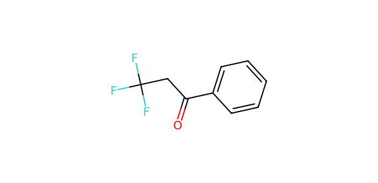
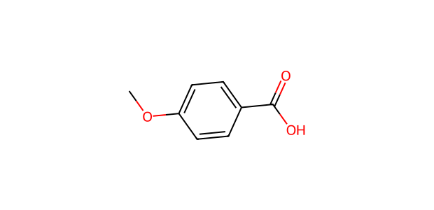

# AP058 · OH substrate–partner input

[All 108 inputs](../README.md) · [100 molecules](../../README.md)

**Electrophile:** `O=C(CC(F)(F)F)c1ccccc1`

**Donor:** `COc1ccc(C(=O)O)cc1`

**Donor family:** carboxylic-acid O-H donor. **Primary relation:** Unmatched. **NP:** 3; **NR:** 3.

## Candidate associations

No route-compatible candidate relation was assigned. The proposed bonding site is carboxylic-acid O; the retained 100-candidate mapping contains no corresponding carboxylic-acid O donor. Alcohol/phenol analogy would erase the site distinction.

## Experimental record context

**Reported execution:** executed. **Source appearances:** 4; **distinct recorded condition recipes:** 2. Repeated workbook appearances are not independent replicates.

**Input-identity status:** structure transcribed from workbook; not independently verified. **Product-identity status:** not independently confirmed. **Quantitative-result status:** not independently calibrated or verified.

| Workbook | Worksheet | Row | Sample | Condition |
| --- | --- | --- | --- | --- |
| Reaction screening and scope workbook | PL46-OH-substrate scope | 28 | CFC124009-19-1-PL46-W29 | AP058-C001 |
| Reaction screening and scope workbook | OH-substrate scope | 28 | CFC124009-19-1-PL46-W29 | AP058-C001 |
| Reaction screening and scope workbook | PL46-OH-substrate scope | 66 | CFC124009-19-1-PL46-W69 | AP058-C002 |
| Reaction screening and scope workbook | OH-substrate scope | 66 | CFC124009-19-1-PL46-W69 | AP058-C002 |

The candidate relation is a structural comparison. Contemporaneous inventory, cost, safety, procurement and candidate-replacement decisions are not recorded. A family relation does not establish that the corresponding proposed product was observed.

The [full input table](../mapping_108.json) retains sample IDs, alternatives, unresolved labels and all route-compatible candidate links.
