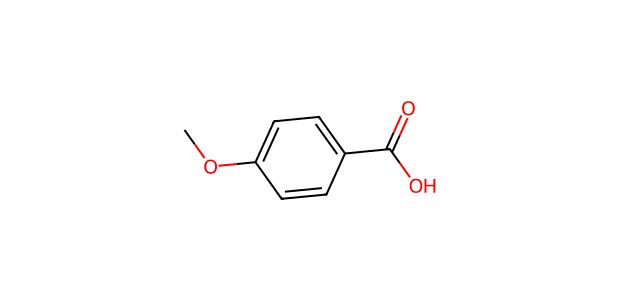

# AP058 · OH substrate-partner input

[All 108 inputs](../README.md) · [100 recommendations](../../README.md)

**Electrophile:** `O=C(CC(F)(F)F)c1ccccc1`

**Donor:** `COc1ccc(C(=O)O)cc1`

**Donor family:** carboxylic-acid O-H donor. **Primary relationship:** No reasonable counterpart. **NP:** 3; **NR:** 3.

## Recommendation relationships

| Recommendation | Relationship | Structural basis |
| --- | --- | --- |
| - | No reasonable counterpart | 新候选集中无同局部供体类型的合理对应；不强行跨类型匹配。 |

These categories record how the RP-derived recommendation space was translated into actual reagents. They do not assign the response of this experiment to a related recommended molecule.

## Experimental record context

Reported execution: **executed**. Source appearances: **4**; distinct recorded condition recipes: **2**. Repeated workbook appearances are not independent replicates.

| Workbook | Worksheet | Row | Sample | Condition |
| --- | --- | --- | --- | --- |
| 实验结果/副本条件筛选-底物扩展-response总-0911.xlsx | PL46-OH-底物扩展 | 28 | CFC124009-19-1-PL46-W29 | AP058-C001 |
| 实验结果/三氟乙基羰基+N\O\S\P数据总结.xlsx | OH-底物扩展 | 28 | CFC124009-19-1-PL46-W29 | AP058-C001 |
| 实验结果/副本条件筛选-底物扩展-response总-0911.xlsx | PL46-OH-底物扩展 | 66 | CFC124009-19-1-PL46-W69 | AP058-C002 |
| 实验结果/三氟乙基羰基+N\O\S\P数据总结.xlsx | OH-底物扩展 | 66 | CFC124009-19-1-PL46-W69 | AP058-C002 |
