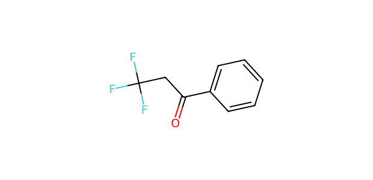
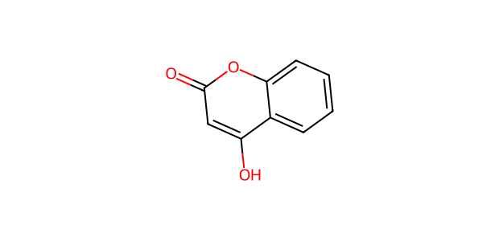

# AP068 · OH substrate–partner input

[All 108 inputs](../README.md) · [100 molecules](../../README.md)

**Electrophile:** `O=C(CC(F)(F)F)c1ccccc1`

**Donor:** `O=c1cc(O)c2ccccc2o1`

**Donor family:** phenol/heteroaryl hydroxyl donor with possible competing sites. **Primary relation:** Structural Analogue. **NP:** 2; **NR:** 2.

## Candidate associations

| Candidate | Relation | Reason |
| --- | --- | --- |
| [C051: Phenol](../../C051.md) | Structural Analogue | Hydroxy O attached to an aromatic/conjugated framework provides the O-centre analogy; substituents, heteroaryl tautomerism and competing sites must be evaluated separately. |
| [C064: Sodium phenoxide](../../C064.md) | Structural Analogue | Both framework/substitution and neutral phenol versus sodium phenoxide state can differ; this broad structural analogy does not demonstrate the actual phenoxide population. |

## Experimental record context

**Reported execution:** executed. **Source appearances:** 4; **distinct recorded condition recipes:** 2. Repeated workbook appearances are not independent replicates.

**Input-identity status:** structure transcribed from workbook; not independently verified. **Product-identity status:** not independently confirmed. **Quantitative-result status:** not independently calibrated or verified.

| Workbook | Worksheet | Row | Sample | Condition |
| --- | --- | --- | --- | --- |
| Reaction screening and scope workbook | PL46-OH-substrate scope | 3 | CFC124009-19-1-PL46-W2 | AP068-C001 |
| Reaction screening and scope workbook | OH-substrate scope | 3 | CFC124009-19-1-PL46-W2 | AP068-C001 |
| Reaction screening and scope workbook | PL46-OH-substrate scope | 40 | CFC124009-19-1-PL46-W42 | AP068-C002 |
| Reaction screening and scope workbook | OH-substrate scope | 40 | CFC124009-19-1-PL46-W42 | AP068-C002 |

The candidate relation is a structural comparison. Contemporaneous inventory, cost, safety, procurement and candidate-replacement decisions are not recorded. A family relation does not establish that the corresponding proposed product was observed.

The [full input table](../mapping_108.json) retains sample IDs, alternatives, unresolved labels and all route-compatible candidate links.
