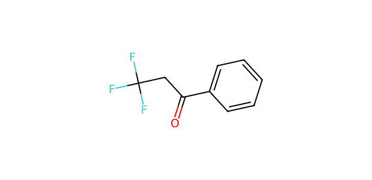
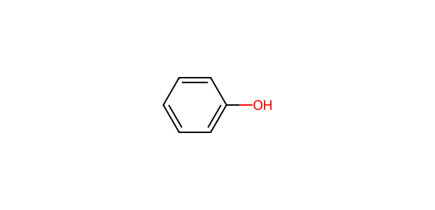

# AP083 · OH substrate–partner input

[All 108 inputs](../README.md) · [100 molecules](../../README.md)

**Electrophile:** `O=C(CC(F)(F)F)c1ccccc1`

**Donor:** `Oc1ccccc1`

**Donor family:** phenol/heteroaryl hydroxyl donor with possible competing sites. **Primary relation:** Exact Molecular Match. **NP:** 2; **NR:** 2.

## Candidate associations

| Candidate | Relation | Reason |
| --- | --- | --- |
| [C051: Phenol](../../C051.md) | Exact Molecular Match | Identical recorded donor molecular structure; no selection history is implied. |
| [C064: Sodium phenoxide](../../C064.md) | Reactive-form Analogue | Neutral covalent skeleton is identical after protonation/counterion normalization; reactive population under the experimental conditions is unmeasured. |

## Experimental record context

**Reported execution:** executed. **Source appearances:** 4; **distinct recorded condition recipes:** 2. Repeated workbook appearances are not independent replicates.

**Input-identity status:** structure transcribed from workbook; not independently verified. **Product-identity status:** not independently confirmed. **Quantitative-result status:** not independently calibrated or verified.

| Workbook | Worksheet | Row | Sample | Condition |
| --- | --- | --- | --- | --- |
| Reaction screening and scope workbook | PL46-OH-substrate scope | 14 | CFC124009-19-1-PL46-W15 | AP083-C001 |
| Reaction screening and scope workbook | OH-substrate scope | 14 | CFC124009-19-1-PL46-W15 | AP083-C001 |
| Reaction screening and scope workbook | PL46-OH-substrate scope | 52 | CFC124009-19-1-PL46-W55 | AP083-C002 |
| Reaction screening and scope workbook | OH-substrate scope | 52 | CFC124009-19-1-PL46-W55 | AP083-C002 |

The candidate relation is a structural comparison. Contemporaneous inventory, cost, safety, procurement and candidate-replacement decisions are not recorded. A family relation does not establish that the corresponding proposed product was observed.

The [full input table](../mapping_108.json) retains sample IDs, alternatives, unresolved labels and all route-compatible candidate links.
