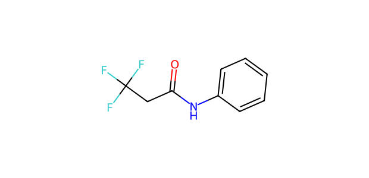
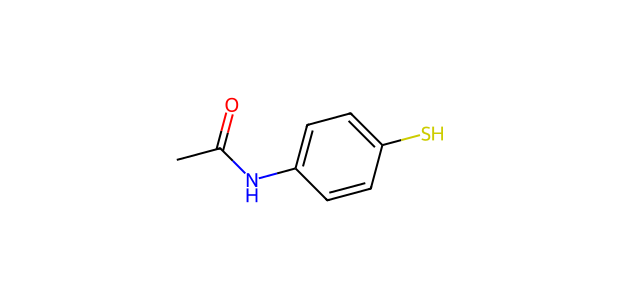

# AP089 · SH substrate–partner input

[All 108 inputs](../README.md) · [100 molecules](../../README.md)

**Electrophile:** `O=C(CC(F)(F)F)Nc1ccccc1`

**Donor:** `CC(=O)Nc1ccc(S)cc1`

**Donor family:** aryl thiol. **Primary relation:** Structural Analogue. **NP:** 2; **NR:** 2.

## Candidate associations

| Candidate | Relation | Reason |
| --- | --- | --- |
| [C068: 4-Bromobenzenethiol](../../C068.md) | Structural Analogue | Aryl S–H is retained; aryl substitution and steric/electronic environment differ. |
| [C082: Benzenethiol](../../C082.md) | Structural Analogue | Aryl S–H is retained; aryl substitution and possible competing groups differ. |

## Experimental record context

**Reported execution:** executed. **Source appearances:** 2; **distinct recorded condition recipes:** 1. Repeated workbook appearances are not independent replicates.

**Input-identity status:** structure transcribed from workbook; not independently verified. **Product-identity status:** not independently confirmed. **Quantitative-result status:** not independently calibrated or verified.

| Workbook | Worksheet | Row | Sample | Condition |
| --- | --- | --- | --- | --- |
| Reaction screening and scope workbook | PL43-SH-substrate scope | 4 | CFC124009-19-3-PL43-W3 | AP089-C001 |
| Reaction screening and scope workbook | SHsubstrate scope | 4 | CFC124009-19-3-PL43-W3 | AP089-C001 |

The candidate relation is a structural comparison. Contemporaneous inventory, cost, safety, procurement and candidate-replacement decisions are not recorded. A family relation does not establish that the corresponding proposed product was observed.

The [full input table](../mapping_108.json) retains sample IDs, alternatives, unresolved labels and all route-compatible candidate links.
