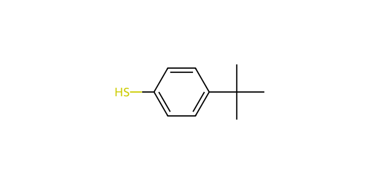

# AP090 · SH substrate-partner input

[All 108 inputs](../README.md) · [100 recommendations](../../README.md)

**Electrophile:** `O=C(CC(F)(F)F)Nc1ccccc1`

**Donor:** `CC(C)(C)c1ccc(S)cc1`

**Donor family:** aryl thiol. **Primary relationship:** Same scaffold, substituent or positional variation. **NP:** 2; **NR:** 2.

## Recommendation relationships

| Recommendation | Relationship | Structural basis |
| --- | --- | --- |
| [C085](../../C085.md) | Same scaffold, substituent or positional variation | The reacting-atom type and core scaffold are retained, while substitution or position differs. |
| [C006](../../C006.md) | Same scaffold, substituent or positional variation | The reacting-atom type and core scaffold are retained, while substitution or position differs. |
| [C007](../../C007.md) | Same scaffold, substituent or positional variation | The reacting-atom type and core scaffold are retained, while substitution or position differs. |

These categories record how the RP-derived recommendation space was translated into actual reagents. They do not assign the response of this experiment to a related recommended molecule.

## Experimental record context

Reported execution: **executed**. Source appearances: **677**; distinct recorded condition recipes: **339**. Repeated workbook appearances are not independent replicates.

| Workbook | Worksheet | Row | Sample | Condition |
| --- | --- | --- | --- | --- |
| 实验结果/副本条件筛选-底物扩展-response总-0911.xlsx | PL43-SH-底物扩展 | 21 | CFC124009-19-3-PL43-W20 | AP090-C001 |
| 实验结果/三氟乙基羰基+N\O\S\P数据总结.xlsx | SH底物扩展 | 21 | CFC124009-19-3-PL43-W20 | AP090-C001 |
| 实验结果/副本条件筛选-底物扩展-response总-0911.xlsx | Ac-SH-yield-条件筛选 | 2 | PL33-W1 | AP090-C002 |
| 实验结果/三氟乙基羰基+N\O\S\P数据总结.xlsx | 亲核试剂(SH)-条件筛选 | 2 | PL33-W1 | AP090-C002 |
| 实验结果/副本条件筛选-底物扩展-response总-0911.xlsx | Ac-SH-yield-条件筛选 | 3 | PL33-W2 | AP090-C003 |
| 实验结果/三氟乙基羰基+N\O\S\P数据总结.xlsx | 亲核试剂(SH)-条件筛选 | 3 | PL33-W2 | AP090-C003 |
| 实验结果/副本条件筛选-底物扩展-response总-0911.xlsx | Ac-SH-yield-条件筛选 | 4 | PL33-W3 | AP090-C004 |
| 实验结果/三氟乙基羰基+N\O\S\P数据总结.xlsx | 亲核试剂(SH)-条件筛选 | 4 | PL33-W3 | AP090-C004 |
| 实验结果/副本条件筛选-底物扩展-response总-0911.xlsx | Ac-SH-yield-条件筛选 | 5 | PL33-W4 | AP090-C005 |
| 实验结果/三氟乙基羰基+N\O\S\P数据总结.xlsx | 亲核试剂(SH)-条件筛选 | 5 | PL33-W4 | AP090-C005 |
| 实验结果/副本条件筛选-底物扩展-response总-0911.xlsx | Ac-SH-yield-条件筛选 | 6 | PL33-W5 | AP090-C006 |
| 实验结果/三氟乙基羰基+N\O\S\P数据总结.xlsx | 亲核试剂(SH)-条件筛选 | 6 | PL33-W5 | AP090-C006 |
| 实验结果/副本条件筛选-底物扩展-response总-0911.xlsx | Ac-SH-yield-条件筛选 | 7 | PL33-W6 | AP090-C007 |
| 实验结果/三氟乙基羰基+N\O\S\P数据总结.xlsx | 亲核试剂(SH)-条件筛选 | 7 | PL33-W6 | AP090-C007 |
| 实验结果/副本条件筛选-底物扩展-response总-0911.xlsx | Ac-SH-yield-条件筛选 | 8 | PL33-W7 | AP090-C008 |
| 实验结果/三氟乙基羰基+N\O\S\P数据总结.xlsx | 亲核试剂(SH)-条件筛选 | 8 | PL33-W7 | AP090-C008 |
| 实验结果/副本条件筛选-底物扩展-response总-0911.xlsx | Ac-SH-yield-条件筛选 | 9 | PL33-W8 | AP090-C009 |
| 实验结果/三氟乙基羰基+N\O\S\P数据总结.xlsx | 亲核试剂(SH)-条件筛选 | 9 | PL33-W8 | AP090-C009 |
| 实验结果/副本条件筛选-底物扩展-response总-0911.xlsx | Ac-SH-yield-条件筛选 | 10 | PL33-W9 | AP090-C010 |
| 实验结果/三氟乙基羰基+N\O\S\P数据总结.xlsx | 亲核试剂(SH)-条件筛选 | 10 | PL33-W9 | AP090-C010 |
| 实验结果/副本条件筛选-底物扩展-response总-0911.xlsx | Ac-SH-yield-条件筛选 | 11 | PL33-W10 | AP090-C011 |
| 实验结果/三氟乙基羰基+N\O\S\P数据总结.xlsx | 亲核试剂(SH)-条件筛选 | 11 | PL33-W10 | AP090-C011 |
| 实验结果/副本条件筛选-底物扩展-response总-0911.xlsx | Ac-SH-yield-条件筛选 | 12 | PL33-W11 | AP090-C012 |
| 实验结果/三氟乙基羰基+N\O\S\P数据总结.xlsx | 亲核试剂(SH)-条件筛选 | 12 | PL33-W11 | AP090-C012 |
| 实验结果/副本条件筛选-底物扩展-response总-0911.xlsx | Ac-SH-yield-条件筛选 | 13 | PL33-W12 | AP090-C013 |
| 实验结果/三氟乙基羰基+N\O\S\P数据总结.xlsx | 亲核试剂(SH)-条件筛选 | 13 | PL33-W12 | AP090-C013 |
| 实验结果/副本条件筛选-底物扩展-response总-0911.xlsx | Ac-SH-yield-条件筛选 | 14 | PL33-W13 | AP090-C014 |
| 实验结果/三氟乙基羰基+N\O\S\P数据总结.xlsx | 亲核试剂(SH)-条件筛选 | 14 | PL33-W13 | AP090-C014 |
| 实验结果/副本条件筛选-底物扩展-response总-0911.xlsx | Ac-SH-yield-条件筛选 | 15 | PL33-W14 | AP090-C015 |
| 实验结果/三氟乙基羰基+N\O\S\P数据总结.xlsx | 亲核试剂(SH)-条件筛选 | 15 | PL33-W14 | AP090-C015 |
| 实验结果/副本条件筛选-底物扩展-response总-0911.xlsx | Ac-SH-yield-条件筛选 | 16 | PL33-W15 | AP090-C016 |
| 实验结果/三氟乙基羰基+N\O\S\P数据总结.xlsx | 亲核试剂(SH)-条件筛选 | 16 | PL33-W15 | AP090-C016 |
| 实验结果/副本条件筛选-底物扩展-response总-0911.xlsx | Ac-SH-yield-条件筛选 | 17 | PL33-W16 | AP090-C017 |
| 实验结果/三氟乙基羰基+N\O\S\P数据总结.xlsx | 亲核试剂(SH)-条件筛选 | 17 | PL33-W16 | AP090-C017 |
| 实验结果/副本条件筛选-底物扩展-response总-0911.xlsx | Ac-SH-yield-条件筛选 | 18 | PL33-W17 | AP090-C018 |
| 实验结果/三氟乙基羰基+N\O\S\P数据总结.xlsx | 亲核试剂(SH)-条件筛选 | 18 | PL33-W17 | AP090-C018 |
| 实验结果/副本条件筛选-底物扩展-response总-0911.xlsx | Ac-SH-yield-条件筛选 | 19 | PL33-W18 | AP090-C019 |
| 实验结果/三氟乙基羰基+N\O\S\P数据总结.xlsx | 亲核试剂(SH)-条件筛选 | 19 | PL33-W18 | AP090-C019 |
| 实验结果/副本条件筛选-底物扩展-response总-0911.xlsx | Ac-SH-yield-条件筛选 | 20 | PL33-W19 | AP090-C020 |
| 实验结果/三氟乙基羰基+N\O\S\P数据总结.xlsx | 亲核试剂(SH)-条件筛选 | 20 | PL33-W19 | AP090-C020 |
| 实验结果/副本条件筛选-底物扩展-response总-0911.xlsx | Ac-SH-yield-条件筛选 | 21 | PL33-W20 | AP090-C021 |
| 实验结果/三氟乙基羰基+N\O\S\P数据总结.xlsx | 亲核试剂(SH)-条件筛选 | 21 | PL33-W20 | AP090-C021 |
| 实验结果/副本条件筛选-底物扩展-response总-0911.xlsx | Ac-SH-yield-条件筛选 | 22 | PL33-W21 | AP090-C022 |
| 实验结果/三氟乙基羰基+N\O\S\P数据总结.xlsx | 亲核试剂(SH)-条件筛选 | 22 | PL33-W21 | AP090-C022 |
| 实验结果/副本条件筛选-底物扩展-response总-0911.xlsx | Ac-SH-yield-条件筛选 | 23 | PL33-W22 | AP090-C023 |
| 实验结果/三氟乙基羰基+N\O\S\P数据总结.xlsx | 亲核试剂(SH)-条件筛选 | 23 | PL33-W22 | AP090-C023 |
| 实验结果/副本条件筛选-底物扩展-response总-0911.xlsx | Ac-SH-yield-条件筛选 | 24 | PL33-W23 | AP090-C024 |
| 实验结果/三氟乙基羰基+N\O\S\P数据总结.xlsx | 亲核试剂(SH)-条件筛选 | 24 | PL33-W23 | AP090-C024 |
| 实验结果/副本条件筛选-底物扩展-response总-0911.xlsx | Ac-SH-yield-条件筛选 | 25 | PL33-W24 | AP090-C025 |
| 实验结果/三氟乙基羰基+N\O\S\P数据总结.xlsx | 亲核试剂(SH)-条件筛选 | 25 | PL33-W24 | AP090-C025 |
| 实验结果/副本条件筛选-底物扩展-response总-0911.xlsx | Ac-SH-yield-条件筛选 | 26 | PL33-W25 | AP090-C026 |
| 实验结果/三氟乙基羰基+N\O\S\P数据总结.xlsx | 亲核试剂(SH)-条件筛选 | 26 | PL33-W25 | AP090-C026 |
| 实验结果/副本条件筛选-底物扩展-response总-0911.xlsx | Ac-SH-yield-条件筛选 | 27 | PL33-W26 | AP090-C027 |
| 实验结果/三氟乙基羰基+N\O\S\P数据总结.xlsx | 亲核试剂(SH)-条件筛选 | 27 | PL33-W26 | AP090-C027 |
| 实验结果/副本条件筛选-底物扩展-response总-0911.xlsx | Ac-SH-yield-条件筛选 | 28 | PL33-W27 | AP090-C028 |
| 实验结果/三氟乙基羰基+N\O\S\P数据总结.xlsx | 亲核试剂(SH)-条件筛选 | 28 | PL33-W27 | AP090-C028 |
| 实验结果/副本条件筛选-底物扩展-response总-0911.xlsx | Ac-SH-yield-条件筛选 | 29 | PL33-W28 | AP090-C029 |
| 实验结果/三氟乙基羰基+N\O\S\P数据总结.xlsx | 亲核试剂(SH)-条件筛选 | 29 | PL33-W28 | AP090-C029 |
| 实验结果/副本条件筛选-底物扩展-response总-0911.xlsx | Ac-SH-yield-条件筛选 | 30 | PL33-W29 | AP090-C030 |
| 实验结果/三氟乙基羰基+N\O\S\P数据总结.xlsx | 亲核试剂(SH)-条件筛选 | 30 | PL33-W29 | AP090-C030 |
| 实验结果/副本条件筛选-底物扩展-response总-0911.xlsx | Ac-SH-yield-条件筛选 | 31 | PL33-W30 | AP090-C031 |
| 实验结果/三氟乙基羰基+N\O\S\P数据总结.xlsx | 亲核试剂(SH)-条件筛选 | 31 | PL33-W30 | AP090-C031 |
| 实验结果/副本条件筛选-底物扩展-response总-0911.xlsx | Ac-SH-yield-条件筛选 | 32 | PL33-W31 | AP090-C032 |
| 实验结果/三氟乙基羰基+N\O\S\P数据总结.xlsx | 亲核试剂(SH)-条件筛选 | 32 | PL33-W31 | AP090-C032 |
| 实验结果/副本条件筛选-底物扩展-response总-0911.xlsx | Ac-SH-yield-条件筛选 | 33 | PL33-W32 | AP090-C033 |
| 实验结果/三氟乙基羰基+N\O\S\P数据总结.xlsx | 亲核试剂(SH)-条件筛选 | 33 | PL33-W32 | AP090-C033 |
| 实验结果/副本条件筛选-底物扩展-response总-0911.xlsx | Ac-SH-yield-条件筛选 | 34 | PL33-W33 | AP090-C034 |
| 实验结果/三氟乙基羰基+N\O\S\P数据总结.xlsx | 亲核试剂(SH)-条件筛选 | 34 | PL33-W33 | AP090-C034 |
| 实验结果/副本条件筛选-底物扩展-response总-0911.xlsx | Ac-SH-yield-条件筛选 | 35 | PL33-W34 | AP090-C035 |
| 实验结果/三氟乙基羰基+N\O\S\P数据总结.xlsx | 亲核试剂(SH)-条件筛选 | 35 | PL33-W34 | AP090-C035 |
| 实验结果/副本条件筛选-底物扩展-response总-0911.xlsx | Ac-SH-yield-条件筛选 | 36 | PL33-W35 | AP090-C036 |
| 实验结果/三氟乙基羰基+N\O\S\P数据总结.xlsx | 亲核试剂(SH)-条件筛选 | 36 | PL33-W35 | AP090-C036 |
| 实验结果/副本条件筛选-底物扩展-response总-0911.xlsx | Ac-SH-yield-条件筛选 | 37 | PL33-W36 | AP090-C037 |
| 实验结果/三氟乙基羰基+N\O\S\P数据总结.xlsx | 亲核试剂(SH)-条件筛选 | 37 | PL33-W36 | AP090-C037 |
| 实验结果/副本条件筛选-底物扩展-response总-0911.xlsx | Ac-SH-yield-条件筛选 | 38 | PL33-W37 | AP090-C038 |
| 实验结果/三氟乙基羰基+N\O\S\P数据总结.xlsx | 亲核试剂(SH)-条件筛选 | 38 | PL33-W37 | AP090-C038 |
| 实验结果/副本条件筛选-底物扩展-response总-0911.xlsx | Ac-SH-yield-条件筛选 | 39 | PL33-W38 | AP090-C039 |
| 实验结果/三氟乙基羰基+N\O\S\P数据总结.xlsx | 亲核试剂(SH)-条件筛选 | 39 | PL33-W38 | AP090-C039 |
| 实验结果/副本条件筛选-底物扩展-response总-0911.xlsx | Ac-SH-yield-条件筛选 | 40 | PL33-W39 | AP090-C040 |
| 实验结果/三氟乙基羰基+N\O\S\P数据总结.xlsx | 亲核试剂(SH)-条件筛选 | 40 | PL33-W39 | AP090-C040 |
| 实验结果/副本条件筛选-底物扩展-response总-0911.xlsx | Ac-SH-yield-条件筛选 | 41 | PL33-W40 | AP090-C041 |
| 实验结果/三氟乙基羰基+N\O\S\P数据总结.xlsx | 亲核试剂(SH)-条件筛选 | 41 | PL33-W40 | AP090-C041 |
| 实验结果/副本条件筛选-底物扩展-response总-0911.xlsx | Ac-SH-yield-条件筛选 | 42 | PL33-W41 | AP090-C042 |
| 实验结果/三氟乙基羰基+N\O\S\P数据总结.xlsx | 亲核试剂(SH)-条件筛选 | 42 | PL33-W41 | AP090-C042 |
| 实验结果/副本条件筛选-底物扩展-response总-0911.xlsx | Ac-SH-yield-条件筛选 | 43 | PL33-W42 | AP090-C043 |
| 实验结果/三氟乙基羰基+N\O\S\P数据总结.xlsx | 亲核试剂(SH)-条件筛选 | 43 | PL33-W42 | AP090-C043 |
| 实验结果/副本条件筛选-底物扩展-response总-0911.xlsx | Ac-SH-yield-条件筛选 | 44 | PL33-W43 | AP090-C044 |
| 实验结果/三氟乙基羰基+N\O\S\P数据总结.xlsx | 亲核试剂(SH)-条件筛选 | 44 | PL33-W43 | AP090-C044 |
| 实验结果/副本条件筛选-底物扩展-response总-0911.xlsx | Ac-SH-yield-条件筛选 | 45 | PL33-W44 | AP090-C045 |
| 实验结果/三氟乙基羰基+N\O\S\P数据总结.xlsx | 亲核试剂(SH)-条件筛选 | 45 | PL33-W44 | AP090-C045 |
| 实验结果/副本条件筛选-底物扩展-response总-0911.xlsx | Ac-SH-yield-条件筛选 | 46 | PL33-W45 | AP090-C046 |
| 实验结果/三氟乙基羰基+N\O\S\P数据总结.xlsx | 亲核试剂(SH)-条件筛选 | 46 | PL33-W45 | AP090-C046 |
| 实验结果/副本条件筛选-底物扩展-response总-0911.xlsx | Ac-SH-yield-条件筛选 | 47 | PL33-W46 | AP090-C047 |
| 实验结果/三氟乙基羰基+N\O\S\P数据总结.xlsx | 亲核试剂(SH)-条件筛选 | 47 | PL33-W46 | AP090-C047 |
| 实验结果/副本条件筛选-底物扩展-response总-0911.xlsx | Ac-SH-yield-条件筛选 | 48 | PL33-W47 | AP090-C048 |
| 实验结果/三氟乙基羰基+N\O\S\P数据总结.xlsx | 亲核试剂(SH)-条件筛选 | 48 | PL33-W47 | AP090-C048 |
| 实验结果/副本条件筛选-底物扩展-response总-0911.xlsx | Ac-SH-yield-条件筛选 | 49 | PL33-W48 | AP090-C049 |
| 实验结果/三氟乙基羰基+N\O\S\P数据总结.xlsx | 亲核试剂(SH)-条件筛选 | 49 | PL33-W48 | AP090-C049 |
| 实验结果/副本条件筛选-底物扩展-response总-0911.xlsx | Ac-SH-yield-条件筛选 | 50 | PL33-W49 | AP090-C050 |
| 实验结果/三氟乙基羰基+N\O\S\P数据总结.xlsx | 亲核试剂(SH)-条件筛选 | 50 | PL33-W49 | AP090-C050 |
| 实验结果/副本条件筛选-底物扩展-response总-0911.xlsx | Ac-SH-yield-条件筛选 | 51 | PL33-W50 | AP090-C051 |
| 实验结果/三氟乙基羰基+N\O\S\P数据总结.xlsx | 亲核试剂(SH)-条件筛选 | 51 | PL33-W50 | AP090-C051 |
| 实验结果/副本条件筛选-底物扩展-response总-0911.xlsx | Ac-SH-yield-条件筛选 | 52 | PL33-W51 | AP090-C052 |
| 实验结果/三氟乙基羰基+N\O\S\P数据总结.xlsx | 亲核试剂(SH)-条件筛选 | 52 | PL33-W51 | AP090-C052 |
| 实验结果/副本条件筛选-底物扩展-response总-0911.xlsx | Ac-SH-yield-条件筛选 | 53 | PL33-W52 | AP090-C053 |
| 实验结果/三氟乙基羰基+N\O\S\P数据总结.xlsx | 亲核试剂(SH)-条件筛选 | 53 | PL33-W52 | AP090-C053 |
| 实验结果/副本条件筛选-底物扩展-response总-0911.xlsx | Ac-SH-yield-条件筛选 | 54 | PL33-W53 | AP090-C054 |
| 实验结果/三氟乙基羰基+N\O\S\P数据总结.xlsx | 亲核试剂(SH)-条件筛选 | 54 | PL33-W53 | AP090-C054 |
| 实验结果/副本条件筛选-底物扩展-response总-0911.xlsx | Ac-SH-yield-条件筛选 | 55 | PL33-W54 | AP090-C055 |
| 实验结果/三氟乙基羰基+N\O\S\P数据总结.xlsx | 亲核试剂(SH)-条件筛选 | 55 | PL33-W54 | AP090-C055 |
| 实验结果/副本条件筛选-底物扩展-response总-0911.xlsx | Ac-SH-yield-条件筛选 | 56 | PL33-W55 | AP090-C056 |
| 实验结果/三氟乙基羰基+N\O\S\P数据总结.xlsx | 亲核试剂(SH)-条件筛选 | 56 | PL33-W55 | AP090-C056 |
| 实验结果/副本条件筛选-底物扩展-response总-0911.xlsx | Ac-SH-yield-条件筛选 | 57 | PL33-W56 | AP090-C057 |
| 实验结果/三氟乙基羰基+N\O\S\P数据总结.xlsx | 亲核试剂(SH)-条件筛选 | 57 | PL33-W56 | AP090-C057 |
| 实验结果/副本条件筛选-底物扩展-response总-0911.xlsx | Ac-SH-yield-条件筛选 | 58 | PL33-W57 | AP090-C058 |
| 实验结果/三氟乙基羰基+N\O\S\P数据总结.xlsx | 亲核试剂(SH)-条件筛选 | 58 | PL33-W57 | AP090-C058 |
| 实验结果/副本条件筛选-底物扩展-response总-0911.xlsx | Ac-SH-yield-条件筛选 | 59 | PL33-W58 | AP090-C059 |
| 实验结果/三氟乙基羰基+N\O\S\P数据总结.xlsx | 亲核试剂(SH)-条件筛选 | 59 | PL33-W58 | AP090-C059 |
| 实验结果/副本条件筛选-底物扩展-response总-0911.xlsx | Ac-SH-yield-条件筛选 | 60 | PL33-W59 | AP090-C060 |
| 实验结果/三氟乙基羰基+N\O\S\P数据总结.xlsx | 亲核试剂(SH)-条件筛选 | 60 | PL33-W59 | AP090-C060 |
| 实验结果/副本条件筛选-底物扩展-response总-0911.xlsx | Ac-SH-yield-条件筛选 | 61 | PL33-W60 | AP090-C061 |
| 实验结果/三氟乙基羰基+N\O\S\P数据总结.xlsx | 亲核试剂(SH)-条件筛选 | 61 | PL33-W60 | AP090-C061 |
| 实验结果/副本条件筛选-底物扩展-response总-0911.xlsx | Ac-SH-yield-条件筛选 | 62 | PL33-W61 | AP090-C062 |
| 实验结果/三氟乙基羰基+N\O\S\P数据总结.xlsx | 亲核试剂(SH)-条件筛选 | 62 | PL33-W61 | AP090-C062 |
| 实验结果/副本条件筛选-底物扩展-response总-0911.xlsx | Ac-SH-yield-条件筛选 | 63 | PL33-W62 | AP090-C063 |
| 实验结果/三氟乙基羰基+N\O\S\P数据总结.xlsx | 亲核试剂(SH)-条件筛选 | 63 | PL33-W62 | AP090-C063 |
| 实验结果/副本条件筛选-底物扩展-response总-0911.xlsx | Ac-SH-yield-条件筛选 | 64 | PL33-W63 | AP090-C064 |
| 实验结果/三氟乙基羰基+N\O\S\P数据总结.xlsx | 亲核试剂(SH)-条件筛选 | 64 | PL33-W63 | AP090-C064 |
| 实验结果/副本条件筛选-底物扩展-response总-0911.xlsx | Ac-SH-yield-条件筛选 | 65 | PL33-W64 | AP090-C065 |
| 实验结果/三氟乙基羰基+N\O\S\P数据总结.xlsx | 亲核试剂(SH)-条件筛选 | 65 | PL33-W64 | AP090-C065 |
| 实验结果/副本条件筛选-底物扩展-response总-0911.xlsx | Ac-SH-yield-条件筛选 | 66 | PL33-W65 | AP090-C066 |
| 实验结果/三氟乙基羰基+N\O\S\P数据总结.xlsx | 亲核试剂(SH)-条件筛选 | 66 | PL33-W65 | AP090-C066 |
| 实验结果/副本条件筛选-底物扩展-response总-0911.xlsx | Ac-SH-yield-条件筛选 | 67 | PL33-W66 | AP090-C067 |
| 实验结果/三氟乙基羰基+N\O\S\P数据总结.xlsx | 亲核试剂(SH)-条件筛选 | 67 | PL33-W66 | AP090-C067 |
| 实验结果/副本条件筛选-底物扩展-response总-0911.xlsx | Ac-SH-yield-条件筛选 | 68 | PL33-W67 | AP090-C068 |
| 实验结果/三氟乙基羰基+N\O\S\P数据总结.xlsx | 亲核试剂(SH)-条件筛选 | 68 | PL33-W67 | AP090-C068 |
| 实验结果/副本条件筛选-底物扩展-response总-0911.xlsx | Ac-SH-yield-条件筛选 | 69 | PL33-W68 | AP090-C069 |
| 实验结果/三氟乙基羰基+N\O\S\P数据总结.xlsx | 亲核试剂(SH)-条件筛选 | 69 | PL33-W68 | AP090-C069 |
| 实验结果/副本条件筛选-底物扩展-response总-0911.xlsx | Ac-SH-yield-条件筛选 | 70 | PL33-W69 | AP090-C070 |
| 实验结果/三氟乙基羰基+N\O\S\P数据总结.xlsx | 亲核试剂(SH)-条件筛选 | 70 | PL33-W69 | AP090-C070 |
| 实验结果/副本条件筛选-底物扩展-response总-0911.xlsx | Ac-SH-yield-条件筛选 | 71 | PL33-W70 | AP090-C071 |
| 实验结果/三氟乙基羰基+N\O\S\P数据总结.xlsx | 亲核试剂(SH)-条件筛选 | 71 | PL33-W70 | AP090-C071 |
| 实验结果/副本条件筛选-底物扩展-response总-0911.xlsx | Ac-SH-yield-条件筛选 | 72 | PL33-W71 | AP090-C072 |
| 实验结果/三氟乙基羰基+N\O\S\P数据总结.xlsx | 亲核试剂(SH)-条件筛选 | 72 | PL33-W71 | AP090-C072 |
| 实验结果/副本条件筛选-底物扩展-response总-0911.xlsx | Ac-SH-yield-条件筛选 | 73 | PL33-W72 | AP090-C073 |
| 实验结果/三氟乙基羰基+N\O\S\P数据总结.xlsx | 亲核试剂(SH)-条件筛选 | 73 | PL33-W72 | AP090-C073 |
| 实验结果/副本条件筛选-底物扩展-response总-0911.xlsx | Ac-SH-yield-条件筛选 | 74 | PL33-W73 | AP090-C074 |
| 实验结果/三氟乙基羰基+N\O\S\P数据总结.xlsx | 亲核试剂(SH)-条件筛选 | 74 | PL33-W73 | AP090-C074 |
| 实验结果/副本条件筛选-底物扩展-response总-0911.xlsx | Ac-SH-yield-条件筛选 | 75 | PL33-W74 | AP090-C075 |
| 实验结果/三氟乙基羰基+N\O\S\P数据总结.xlsx | 亲核试剂(SH)-条件筛选 | 75 | PL33-W74 | AP090-C075 |
| 实验结果/副本条件筛选-底物扩展-response总-0911.xlsx | Ac-SH-yield-条件筛选 | 76 | PL33-W75 | AP090-C076 |
| 实验结果/三氟乙基羰基+N\O\S\P数据总结.xlsx | 亲核试剂(SH)-条件筛选 | 76 | PL33-W75 | AP090-C076 |
| 实验结果/副本条件筛选-底物扩展-response总-0911.xlsx | Ac-SH-yield-条件筛选 | 77 | PL33-W76 | AP090-C077 |
| 实验结果/三氟乙基羰基+N\O\S\P数据总结.xlsx | 亲核试剂(SH)-条件筛选 | 77 | PL33-W76 | AP090-C077 |
| 实验结果/副本条件筛选-底物扩展-response总-0911.xlsx | Ac-SH-yield-条件筛选 | 78 | PL33-W77 | AP090-C078 |
| 实验结果/三氟乙基羰基+N\O\S\P数据总结.xlsx | 亲核试剂(SH)-条件筛选 | 78 | PL33-W77 | AP090-C078 |
| 实验结果/副本条件筛选-底物扩展-response总-0911.xlsx | Ac-SH-yield-条件筛选 | 79 | PL33-W78 | AP090-C079 |
| 实验结果/三氟乙基羰基+N\O\S\P数据总结.xlsx | 亲核试剂(SH)-条件筛选 | 79 | PL33-W78 | AP090-C079 |
| 实验结果/副本条件筛选-底物扩展-response总-0911.xlsx | Ac-SH-yield-条件筛选 | 80 | PL33-W79 | AP090-C080 |
| 实验结果/三氟乙基羰基+N\O\S\P数据总结.xlsx | 亲核试剂(SH)-条件筛选 | 80 | PL33-W79 | AP090-C080 |
| 实验结果/副本条件筛选-底物扩展-response总-0911.xlsx | Ac-SH-yield-条件筛选 | 81 | PL33-W80 | AP090-C081 |
| 实验结果/三氟乙基羰基+N\O\S\P数据总结.xlsx | 亲核试剂(SH)-条件筛选 | 81 | PL33-W80 | AP090-C081 |
| 实验结果/副本条件筛选-底物扩展-response总-0911.xlsx | Ac-SH-yield-条件筛选 | 82 | PL33-W81 | AP090-C082 |
| 实验结果/三氟乙基羰基+N\O\S\P数据总结.xlsx | 亲核试剂(SH)-条件筛选 | 82 | PL33-W81 | AP090-C082 |
| 实验结果/副本条件筛选-底物扩展-response总-0911.xlsx | Ac-SH-yield-条件筛选 | 83 | PL33-W82 | AP090-C083 |
| 实验结果/三氟乙基羰基+N\O\S\P数据总结.xlsx | 亲核试剂(SH)-条件筛选 | 83 | PL33-W82 | AP090-C083 |
| 实验结果/副本条件筛选-底物扩展-response总-0911.xlsx | Ac-SH-yield-条件筛选 | 84 | PL33-W83 | AP090-C084 |
| 实验结果/三氟乙基羰基+N\O\S\P数据总结.xlsx | 亲核试剂(SH)-条件筛选 | 84 | PL33-W83 | AP090-C084 |
| 实验结果/副本条件筛选-底物扩展-response总-0911.xlsx | Ac-SH-yield-条件筛选 | 85 | PL33-W84 | AP090-C085 |
| 实验结果/三氟乙基羰基+N\O\S\P数据总结.xlsx | 亲核试剂(SH)-条件筛选 | 85 | PL33-W84 | AP090-C085 |
| 实验结果/副本条件筛选-底物扩展-response总-0911.xlsx | Ac-SH-yield-条件筛选 | 86 | PL33-W85 | AP090-C086 |
| 实验结果/三氟乙基羰基+N\O\S\P数据总结.xlsx | 亲核试剂(SH)-条件筛选 | 86 | PL33-W85 | AP090-C086 |
| 实验结果/副本条件筛选-底物扩展-response总-0911.xlsx | Ac-SH-yield-条件筛选 | 87 | PL33-W86 | AP090-C087 |
| 实验结果/三氟乙基羰基+N\O\S\P数据总结.xlsx | 亲核试剂(SH)-条件筛选 | 87 | PL33-W86 | AP090-C087 |
| 实验结果/副本条件筛选-底物扩展-response总-0911.xlsx | Ac-SH-yield-条件筛选 | 88 | PL33-W87 | AP090-C088 |
| 实验结果/三氟乙基羰基+N\O\S\P数据总结.xlsx | 亲核试剂(SH)-条件筛选 | 88 | PL33-W87 | AP090-C088 |
| 实验结果/副本条件筛选-底物扩展-response总-0911.xlsx | Ac-SH-yield-条件筛选 | 89 | PL33-W88 | AP090-C089 |
| 实验结果/三氟乙基羰基+N\O\S\P数据总结.xlsx | 亲核试剂(SH)-条件筛选 | 89 | PL33-W88 | AP090-C089 |
| 实验结果/副本条件筛选-底物扩展-response总-0911.xlsx | Ac-SH-yield-条件筛选 | 90 | PL33-W89 | AP090-C090 |
| 实验结果/三氟乙基羰基+N\O\S\P数据总结.xlsx | 亲核试剂(SH)-条件筛选 | 90 | PL33-W89 | AP090-C090 |
| 实验结果/副本条件筛选-底物扩展-response总-0911.xlsx | Ac-SH-yield-条件筛选 | 91 | PL33-W90 | AP090-C091 |
| 实验结果/三氟乙基羰基+N\O\S\P数据总结.xlsx | 亲核试剂(SH)-条件筛选 | 91 | PL33-W90 | AP090-C091 |
| 实验结果/副本条件筛选-底物扩展-response总-0911.xlsx | Ac-SH-yield-条件筛选 | 92 | PL33-W91 | AP090-C092 |
| 实验结果/三氟乙基羰基+N\O\S\P数据总结.xlsx | 亲核试剂(SH)-条件筛选 | 92 | PL33-W91 | AP090-C092 |
| 实验结果/副本条件筛选-底物扩展-response总-0911.xlsx | Ac-SH-yield-条件筛选 | 93 | PL33-W92 | AP090-C093 |
| 实验结果/三氟乙基羰基+N\O\S\P数据总结.xlsx | 亲核试剂(SH)-条件筛选 | 93 | PL33-W92 | AP090-C093 |
| 实验结果/副本条件筛选-底物扩展-response总-0911.xlsx | Ac-SH-yield-条件筛选 | 94 | PL33-W93 | AP090-C094 |
| 实验结果/三氟乙基羰基+N\O\S\P数据总结.xlsx | 亲核试剂(SH)-条件筛选 | 94 | PL33-W93 | AP090-C094 |
| 实验结果/副本条件筛选-底物扩展-response总-0911.xlsx | Ac-SH-yield-条件筛选 | 95 | PL33-W94 | AP090-C095 |
| 实验结果/三氟乙基羰基+N\O\S\P数据总结.xlsx | 亲核试剂(SH)-条件筛选 | 95 | PL33-W94 | AP090-C095 |
| 实验结果/副本条件筛选-底物扩展-response总-0911.xlsx | Ac-SH-yield-条件筛选 | 96 | PL33-W95 | AP090-C096 |
| 实验结果/三氟乙基羰基+N\O\S\P数据总结.xlsx | 亲核试剂(SH)-条件筛选 | 96 | PL33-W95 | AP090-C096 |
| 实验结果/副本条件筛选-底物扩展-response总-0911.xlsx | Ac-SH-yield-条件筛选 | 97 | PL33-W96 | AP090-C097 |
| 实验结果/三氟乙基羰基+N\O\S\P数据总结.xlsx | 亲核试剂(SH)-条件筛选 | 97 | PL33-W96 | AP090-C097 |
| 实验结果/副本条件筛选-底物扩展-response总-0911.xlsx | Ac-SH-yield-条件筛选 | 98 | PL33-W97 | AP090-C098 |
| 实验结果/三氟乙基羰基+N\O\S\P数据总结.xlsx | 亲核试剂(SH)-条件筛选 | 98 | PL33-W97 | AP090-C098 |
| 实验结果/副本条件筛选-底物扩展-response总-0911.xlsx | Ac-SH-yield-条件筛选 | 99 | PL33-W98 | AP090-C099 |
| 实验结果/三氟乙基羰基+N\O\S\P数据总结.xlsx | 亲核试剂(SH)-条件筛选 | 99 | PL33-W98 | AP090-C099 |
| 实验结果/副本条件筛选-底物扩展-response总-0911.xlsx | Ac-SH-yield-条件筛选 | 100 | PL33-W99 | AP090-C100 |
| 实验结果/三氟乙基羰基+N\O\S\P数据总结.xlsx | 亲核试剂(SH)-条件筛选 | 100 | PL33-W99 | AP090-C100 |
| 实验结果/副本条件筛选-底物扩展-response总-0911.xlsx | Ac-SH-yield-条件筛选 | 101 | PL33-W100 | AP090-C101 |
| 实验结果/三氟乙基羰基+N\O\S\P数据总结.xlsx | 亲核试剂(SH)-条件筛选 | 101 | PL33-W100 | AP090-C101 |
| 实验结果/副本条件筛选-底物扩展-response总-0911.xlsx | Ac-SH-yield-条件筛选 | 102 | PL33-W101 | AP090-C102 |
| 实验结果/三氟乙基羰基+N\O\S\P数据总结.xlsx | 亲核试剂(SH)-条件筛选 | 102 | PL33-W101 | AP090-C102 |
| 实验结果/副本条件筛选-底物扩展-response总-0911.xlsx | Ac-SH-yield-条件筛选 | 103 | PL33-W102 | AP090-C103 |
| 实验结果/三氟乙基羰基+N\O\S\P数据总结.xlsx | 亲核试剂(SH)-条件筛选 | 103 | PL33-W102 | AP090-C103 |
| 实验结果/副本条件筛选-底物扩展-response总-0911.xlsx | Ac-SH-yield-条件筛选 | 104 | PL33-W103 | AP090-C104 |
| 实验结果/三氟乙基羰基+N\O\S\P数据总结.xlsx | 亲核试剂(SH)-条件筛选 | 104 | PL33-W103 | AP090-C104 |
| 实验结果/副本条件筛选-底物扩展-response总-0911.xlsx | Ac-SH-yield-条件筛选 | 105 | PL33-W104 | AP090-C105 |
| 实验结果/三氟乙基羰基+N\O\S\P数据总结.xlsx | 亲核试剂(SH)-条件筛选 | 105 | PL33-W104 | AP090-C105 |
| 实验结果/副本条件筛选-底物扩展-response总-0911.xlsx | Ac-SH-yield-条件筛选 | 106 | PL33-W105 | AP090-C106 |
| 实验结果/三氟乙基羰基+N\O\S\P数据总结.xlsx | 亲核试剂(SH)-条件筛选 | 106 | PL33-W105 | AP090-C106 |
| 实验结果/副本条件筛选-底物扩展-response总-0911.xlsx | Ac-SH-yield-条件筛选 | 107 | PL33-W106 | AP090-C107 |
| 实验结果/三氟乙基羰基+N\O\S\P数据总结.xlsx | 亲核试剂(SH)-条件筛选 | 107 | PL33-W106 | AP090-C107 |
| 实验结果/副本条件筛选-底物扩展-response总-0911.xlsx | Ac-SH-yield-条件筛选 | 108 | PL33-W107 | AP090-C108 |
| 实验结果/三氟乙基羰基+N\O\S\P数据总结.xlsx | 亲核试剂(SH)-条件筛选 | 108 | PL33-W107 | AP090-C108 |
| 实验结果/副本条件筛选-底物扩展-response总-0911.xlsx | Ac-SH-yield-条件筛选 | 109 | PL33-W108 | AP090-C109 |
| 实验结果/三氟乙基羰基+N\O\S\P数据总结.xlsx | 亲核试剂(SH)-条件筛选 | 109 | PL33-W108 | AP090-C109 |
| 实验结果/副本条件筛选-底物扩展-response总-0911.xlsx | Ac-SH-yield-条件筛选 | 110 | PL33-W109 | AP090-C110 |
| 实验结果/三氟乙基羰基+N\O\S\P数据总结.xlsx | 亲核试剂(SH)-条件筛选 | 110 | PL33-W109 | AP090-C110 |
| 实验结果/副本条件筛选-底物扩展-response总-0911.xlsx | Ac-SH-yield-条件筛选 | 111 | PL33-W110 | AP090-C111 |
| 实验结果/三氟乙基羰基+N\O\S\P数据总结.xlsx | 亲核试剂(SH)-条件筛选 | 111 | PL33-W110 | AP090-C111 |
| 实验结果/副本条件筛选-底物扩展-response总-0911.xlsx | Ac-SH-yield-条件筛选 | 112 | PL33-W111 | AP090-C112 |
| 实验结果/三氟乙基羰基+N\O\S\P数据总结.xlsx | 亲核试剂(SH)-条件筛选 | 112 | PL33-W111 | AP090-C112 |
| 实验结果/副本条件筛选-底物扩展-response总-0911.xlsx | Ac-SH-yield-条件筛选 | 113 | PL33-W112 | AP090-C113 |
| 实验结果/三氟乙基羰基+N\O\S\P数据总结.xlsx | 亲核试剂(SH)-条件筛选 | 113 | PL33-W112 | AP090-C113 |
| 实验结果/副本条件筛选-底物扩展-response总-0911.xlsx | Ac-SH-yield-条件筛选 | 114 | PL33-W113 | AP090-C114 |
| 实验结果/三氟乙基羰基+N\O\S\P数据总结.xlsx | 亲核试剂(SH)-条件筛选 | 114 | PL33-W113 | AP090-C114 |
| 实验结果/副本条件筛选-底物扩展-response总-0911.xlsx | Ac-SH-yield-条件筛选 | 115 | PL33-W114 | AP090-C115 |
| 实验结果/三氟乙基羰基+N\O\S\P数据总结.xlsx | 亲核试剂(SH)-条件筛选 | 115 | PL33-W114 | AP090-C115 |
| 实验结果/副本条件筛选-底物扩展-response总-0911.xlsx | Ac-SH-yield-条件筛选 | 116 | PL33-W115 | AP090-C116 |
| 实验结果/三氟乙基羰基+N\O\S\P数据总结.xlsx | 亲核试剂(SH)-条件筛选 | 116 | PL33-W115 | AP090-C116 |
| 实验结果/副本条件筛选-底物扩展-response总-0911.xlsx | Ac-SH-yield-条件筛选 | 117 | PL33-W116 | AP090-C117 |
| 实验结果/三氟乙基羰基+N\O\S\P数据总结.xlsx | 亲核试剂(SH)-条件筛选 | 117 | PL33-W116 | AP090-C117 |
| 实验结果/副本条件筛选-底物扩展-response总-0911.xlsx | Ac-SH-yield-条件筛选 | 118 | PL33-W117 | AP090-C118 |
| 实验结果/三氟乙基羰基+N\O\S\P数据总结.xlsx | 亲核试剂(SH)-条件筛选 | 118 | PL33-W117 | AP090-C118 |
| 实验结果/副本条件筛选-底物扩展-response总-0911.xlsx | Ac-SH-yield-条件筛选 | 119 | PL33-W118 | AP090-C119 |
| 实验结果/三氟乙基羰基+N\O\S\P数据总结.xlsx | 亲核试剂(SH)-条件筛选 | 119 | PL33-W118 | AP090-C119 |
| 实验结果/副本条件筛选-底物扩展-response总-0911.xlsx | Ac-SH-yield-条件筛选 | 120 | PL33-W119 | AP090-C120 |
| 实验结果/三氟乙基羰基+N\O\S\P数据总结.xlsx | 亲核试剂(SH)-条件筛选 | 120 | PL33-W119 | AP090-C120 |
| 实验结果/副本条件筛选-底物扩展-response总-0911.xlsx | Ac-SH-yield-条件筛选 | 121 | PL33-W120 | AP090-C121 |
| 实验结果/三氟乙基羰基+N\O\S\P数据总结.xlsx | 亲核试剂(SH)-条件筛选 | 121 | PL33-W120 | AP090-C121 |
| 实验结果/副本条件筛选-底物扩展-response总-0911.xlsx | Ac-SH-yield-条件筛选 | 122 | PL33-W121 | AP090-C122 |
| 实验结果/三氟乙基羰基+N\O\S\P数据总结.xlsx | 亲核试剂(SH)-条件筛选 | 122 | PL33-W121 | AP090-C122 |
| 实验结果/副本条件筛选-底物扩展-response总-0911.xlsx | Ac-SH-yield-条件筛选 | 123 | PL33-W122 | AP090-C123 |
| 实验结果/三氟乙基羰基+N\O\S\P数据总结.xlsx | 亲核试剂(SH)-条件筛选 | 123 | PL33-W122 | AP090-C123 |
| 实验结果/副本条件筛选-底物扩展-response总-0911.xlsx | Ac-SH-yield-条件筛选 | 124 | PL33-W123 | AP090-C124 |
| 实验结果/三氟乙基羰基+N\O\S\P数据总结.xlsx | 亲核试剂(SH)-条件筛选 | 124 | PL33-W123 | AP090-C124 |
| 实验结果/副本条件筛选-底物扩展-response总-0911.xlsx | Ac-SH-yield-条件筛选 | 125 | PL33-W124 | AP090-C125 |
| 实验结果/三氟乙基羰基+N\O\S\P数据总结.xlsx | 亲核试剂(SH)-条件筛选 | 125 | PL33-W124 | AP090-C125 |
| 实验结果/副本条件筛选-底物扩展-response总-0911.xlsx | Ac-SH-yield-条件筛选 | 126 | PL33-W125 | AP090-C126 |
| 实验结果/三氟乙基羰基+N\O\S\P数据总结.xlsx | 亲核试剂(SH)-条件筛选 | 126 | PL33-W125 | AP090-C126 |
| 实验结果/副本条件筛选-底物扩展-response总-0911.xlsx | Ac-SH-yield-条件筛选 | 127 | PL33-W126 | AP090-C127 |
| 实验结果/三氟乙基羰基+N\O\S\P数据总结.xlsx | 亲核试剂(SH)-条件筛选 | 127 | PL33-W126 | AP090-C127 |
| 实验结果/副本条件筛选-底物扩展-response总-0911.xlsx | Ac-SH-yield-条件筛选 | 128 | PL33-W127 | AP090-C128 |
| 实验结果/三氟乙基羰基+N\O\S\P数据总结.xlsx | 亲核试剂(SH)-条件筛选 | 128 | PL33-W127 | AP090-C128 |
| 实验结果/副本条件筛选-底物扩展-response总-0911.xlsx | Ac-SH-yield-条件筛选 | 129 | PL33-W128 | AP090-C129 |
| 实验结果/三氟乙基羰基+N\O\S\P数据总结.xlsx | 亲核试剂(SH)-条件筛选 | 129 | PL33-W128 | AP090-C129 |
| 实验结果/副本条件筛选-底物扩展-response总-0911.xlsx | Ac-SH-yield-条件筛选 | 130 | PL33-W129 | AP090-C130 |
| 实验结果/三氟乙基羰基+N\O\S\P数据总结.xlsx | 亲核试剂(SH)-条件筛选 | 130 | PL33-W129 | AP090-C130 |
| 实验结果/副本条件筛选-底物扩展-response总-0911.xlsx | Ac-SH-yield-条件筛选 | 131 | PL33-W130 | AP090-C131 |
| 实验结果/三氟乙基羰基+N\O\S\P数据总结.xlsx | 亲核试剂(SH)-条件筛选 | 131 | PL33-W130 | AP090-C131 |
| 实验结果/副本条件筛选-底物扩展-response总-0911.xlsx | Ac-SH-yield-条件筛选 | 132 | PL33-W131 | AP090-C132 |
| 实验结果/三氟乙基羰基+N\O\S\P数据总结.xlsx | 亲核试剂(SH)-条件筛选 | 132 | PL33-W131 | AP090-C132 |
| 实验结果/副本条件筛选-底物扩展-response总-0911.xlsx | Ac-SH-yield-条件筛选 | 133 | PL33-W132 | AP090-C133 |
| 实验结果/三氟乙基羰基+N\O\S\P数据总结.xlsx | 亲核试剂(SH)-条件筛选 | 133 | PL33-W132 | AP090-C133 |
| 实验结果/副本条件筛选-底物扩展-response总-0911.xlsx | Ac-SH-yield-条件筛选 | 134 | PL33-W133 | AP090-C134 |
| 实验结果/三氟乙基羰基+N\O\S\P数据总结.xlsx | 亲核试剂(SH)-条件筛选 | 134 | PL33-W133 | AP090-C134 |
| 实验结果/副本条件筛选-底物扩展-response总-0911.xlsx | Ac-SH-yield-条件筛选 | 135 | PL33-W134 | AP090-C135 |
| 实验结果/三氟乙基羰基+N\O\S\P数据总结.xlsx | 亲核试剂(SH)-条件筛选 | 135 | PL33-W134 | AP090-C135 |
| 实验结果/副本条件筛选-底物扩展-response总-0911.xlsx | Ac-SH-yield-条件筛选 | 136 | PL33-W135 | AP090-C136 |
| 实验结果/三氟乙基羰基+N\O\S\P数据总结.xlsx | 亲核试剂(SH)-条件筛选 | 136 | PL33-W135 | AP090-C136 |
| 实验结果/副本条件筛选-底物扩展-response总-0911.xlsx | Ac-SH-yield-条件筛选 | 137 | PL33-W136 | AP090-C137 |
| 实验结果/三氟乙基羰基+N\O\S\P数据总结.xlsx | 亲核试剂(SH)-条件筛选 | 137 | PL33-W136 | AP090-C137 |
| 实验结果/副本条件筛选-底物扩展-response总-0911.xlsx | Ac-SH-yield-条件筛选 | 138 | PL33-W137 | AP090-C138 |
| 实验结果/三氟乙基羰基+N\O\S\P数据总结.xlsx | 亲核试剂(SH)-条件筛选 | 138 | PL33-W137 | AP090-C138 |
| 实验结果/副本条件筛选-底物扩展-response总-0911.xlsx | Ac-SH-yield-条件筛选 | 139 | PL33-W138 | AP090-C139 |
| 实验结果/三氟乙基羰基+N\O\S\P数据总结.xlsx | 亲核试剂(SH)-条件筛选 | 139 | PL33-W138 | AP090-C139 |
| 实验结果/副本条件筛选-底物扩展-response总-0911.xlsx | Ac-SH-yield-条件筛选 | 140 | PL33-W139 | AP090-C140 |
| 实验结果/三氟乙基羰基+N\O\S\P数据总结.xlsx | 亲核试剂(SH)-条件筛选 | 140 | PL33-W139 | AP090-C140 |
| 实验结果/副本条件筛选-底物扩展-response总-0911.xlsx | Ac-SH-yield-条件筛选 | 141 | PL33-W140 | AP090-C141 |
| 实验结果/三氟乙基羰基+N\O\S\P数据总结.xlsx | 亲核试剂(SH)-条件筛选 | 141 | PL33-W140 | AP090-C141 |
| 实验结果/副本条件筛选-底物扩展-response总-0911.xlsx | Ac-SH-yield-条件筛选 | 142 | PL33-W141 | AP090-C142 |
| 实验结果/三氟乙基羰基+N\O\S\P数据总结.xlsx | 亲核试剂(SH)-条件筛选 | 142 | PL33-W141 | AP090-C142 |
| 实验结果/副本条件筛选-底物扩展-response总-0911.xlsx | Ac-SH-yield-条件筛选 | 143 | PL33-W142 | AP090-C143 |
| 实验结果/三氟乙基羰基+N\O\S\P数据总结.xlsx | 亲核试剂(SH)-条件筛选 | 143 | PL33-W142 | AP090-C143 |
| 实验结果/副本条件筛选-底物扩展-response总-0911.xlsx | Ac-SH-yield-条件筛选 | 144 | PL33-W143 | AP090-C144 |
| 实验结果/三氟乙基羰基+N\O\S\P数据总结.xlsx | 亲核试剂(SH)-条件筛选 | 144 | PL33-W143 | AP090-C144 |
| 实验结果/副本条件筛选-底物扩展-response总-0911.xlsx | Ac-SH-yield-条件筛选 | 145 | PL33-W144 | AP090-C145 |
| 实验结果/三氟乙基羰基+N\O\S\P数据总结.xlsx | 亲核试剂(SH)-条件筛选 | 145 | PL33-W144 | AP090-C145 |
| 实验结果/副本条件筛选-底物扩展-response总-0911.xlsx | Ac-SH-yield-条件筛选 | 146 | PL33-W145 | AP090-C146 |
| 实验结果/三氟乙基羰基+N\O\S\P数据总结.xlsx | 亲核试剂(SH)-条件筛选 | 146 | PL33-W145 | AP090-C146 |
| 实验结果/副本条件筛选-底物扩展-response总-0911.xlsx | Ac-SH-yield-条件筛选 | 147 | CFC124009-19-PL39-W1 | AP090-C147 |
| 实验结果/三氟乙基羰基+N\O\S\P数据总结.xlsx | 亲核试剂(SH)-条件筛选 | 147 | CFC124009-19-PL39-W1 | AP090-C147 |
| 实验结果/副本条件筛选-底物扩展-response总-0911.xlsx | Ac-SH-yield-条件筛选 | 148 | CFC124009-19-PL39-W2 | AP090-C148 |
| 实验结果/三氟乙基羰基+N\O\S\P数据总结.xlsx | 亲核试剂(SH)-条件筛选 | 148 | CFC124009-19-PL39-W2 | AP090-C148 |
| 实验结果/副本条件筛选-底物扩展-response总-0911.xlsx | Ac-SH-yield-条件筛选 | 149 | CFC124009-19-PL39-W3 | AP090-C149 |
| 实验结果/三氟乙基羰基+N\O\S\P数据总结.xlsx | 亲核试剂(SH)-条件筛选 | 149 | CFC124009-19-PL39-W3 | AP090-C149 |
| 实验结果/副本条件筛选-底物扩展-response总-0911.xlsx | Ac-SH-yield-条件筛选 | 150 | CFC124009-19-PL39-W4 | AP090-C150 |
| 实验结果/三氟乙基羰基+N\O\S\P数据总结.xlsx | 亲核试剂(SH)-条件筛选 | 150 | CFC124009-19-PL39-W4 | AP090-C150 |
| 实验结果/副本条件筛选-底物扩展-response总-0911.xlsx | Ac-SH-yield-条件筛选 | 151 | CFC124009-19-PL39-W5 | AP090-C151 |
| 实验结果/三氟乙基羰基+N\O\S\P数据总结.xlsx | 亲核试剂(SH)-条件筛选 | 151 | CFC124009-19-PL39-W5 | AP090-C151 |
| 实验结果/副本条件筛选-底物扩展-response总-0911.xlsx | Ac-SH-yield-条件筛选 | 152 | CFC124009-19-PL39-W6 | AP090-C152 |
| 实验结果/三氟乙基羰基+N\O\S\P数据总结.xlsx | 亲核试剂(SH)-条件筛选 | 152 | CFC124009-19-PL39-W6 | AP090-C152 |
| 实验结果/副本条件筛选-底物扩展-response总-0911.xlsx | Ac-SH-yield-条件筛选 | 153 | CFC124009-19-PL39-W7 | AP090-C153 |
| 实验结果/三氟乙基羰基+N\O\S\P数据总结.xlsx | 亲核试剂(SH)-条件筛选 | 153 | CFC124009-19-PL39-W7 | AP090-C153 |
| 实验结果/副本条件筛选-底物扩展-response总-0911.xlsx | Ac-SH-yield-条件筛选 | 154 | CFC124009-19-PL39-W8 | AP090-C154 |
| 实验结果/三氟乙基羰基+N\O\S\P数据总结.xlsx | 亲核试剂(SH)-条件筛选 | 154 | CFC124009-19-PL39-W8 | AP090-C154 |
| 实验结果/副本条件筛选-底物扩展-response总-0911.xlsx | Ac-SH-yield-条件筛选 | 155 | CFC124009-19-PL39-W9 | AP090-C155 |
| 实验结果/三氟乙基羰基+N\O\S\P数据总结.xlsx | 亲核试剂(SH)-条件筛选 | 155 | CFC124009-19-PL39-W9 | AP090-C155 |
| 实验结果/副本条件筛选-底物扩展-response总-0911.xlsx | Ac-SH-yield-条件筛选 | 156 | CFC124009-19-PL39-W10 | AP090-C156 |
| 实验结果/三氟乙基羰基+N\O\S\P数据总结.xlsx | 亲核试剂(SH)-条件筛选 | 156 | CFC124009-19-PL39-W10 | AP090-C156 |
| 实验结果/副本条件筛选-底物扩展-response总-0911.xlsx | Ac-SH-yield-条件筛选 | 157 | CFC124009-19-PL39-W11 | AP090-C157 |
| 实验结果/三氟乙基羰基+N\O\S\P数据总结.xlsx | 亲核试剂(SH)-条件筛选 | 157 | CFC124009-19-PL39-W11 | AP090-C157 |
| 实验结果/副本条件筛选-底物扩展-response总-0911.xlsx | Ac-SH-yield-条件筛选 | 158 | CFC124009-19-PL39-W12 | AP090-C158 |
| 实验结果/三氟乙基羰基+N\O\S\P数据总结.xlsx | 亲核试剂(SH)-条件筛选 | 158 | CFC124009-19-PL39-W12 | AP090-C158 |
| 实验结果/副本条件筛选-底物扩展-response总-0911.xlsx | Ac-SH-yield-条件筛选 | 159 | CFC124009-19-PL39-W13 | AP090-C159 |
| 实验结果/三氟乙基羰基+N\O\S\P数据总结.xlsx | 亲核试剂(SH)-条件筛选 | 159 | CFC124009-19-PL39-W13 | AP090-C159 |
| 实验结果/副本条件筛选-底物扩展-response总-0911.xlsx | Ac-SH-yield-条件筛选 | 160 | CFC124009-19-PL39-W14 | AP090-C160 |
| 实验结果/三氟乙基羰基+N\O\S\P数据总结.xlsx | 亲核试剂(SH)-条件筛选 | 160 | CFC124009-19-PL39-W14 | AP090-C160 |
| 实验结果/副本条件筛选-底物扩展-response总-0911.xlsx | Ac-SH-yield-条件筛选 | 161 | CFC124009-19-PL39-W15 | AP090-C161 |
| 实验结果/三氟乙基羰基+N\O\S\P数据总结.xlsx | 亲核试剂(SH)-条件筛选 | 161 | CFC124009-19-PL39-W15 | AP090-C161 |
| 实验结果/副本条件筛选-底物扩展-response总-0911.xlsx | Ac-SH-yield-条件筛选 | 162 | CFC124009-19-PL39-W16 | AP090-C162 |
| 实验结果/三氟乙基羰基+N\O\S\P数据总结.xlsx | 亲核试剂(SH)-条件筛选 | 162 | CFC124009-19-PL39-W16 | AP090-C162 |
| 实验结果/副本条件筛选-底物扩展-response总-0911.xlsx | Ac-SH-yield-条件筛选 | 163 | CFC124009-19-PL39-W17 | AP090-C163 |
| 实验结果/三氟乙基羰基+N\O\S\P数据总结.xlsx | 亲核试剂(SH)-条件筛选 | 163 | CFC124009-19-PL39-W17 | AP090-C163 |
| 实验结果/副本条件筛选-底物扩展-response总-0911.xlsx | Ac-SH-yield-条件筛选 | 164 | CFC124009-19-PL39-W18 | AP090-C164 |
| 实验结果/三氟乙基羰基+N\O\S\P数据总结.xlsx | 亲核试剂(SH)-条件筛选 | 164 | CFC124009-19-PL39-W18 | AP090-C164 |
| 实验结果/副本条件筛选-底物扩展-response总-0911.xlsx | Ac-SH-yield-条件筛选 | 165 | CFC124009-19-PL39-W19 | AP090-C165 |
| 实验结果/三氟乙基羰基+N\O\S\P数据总结.xlsx | 亲核试剂(SH)-条件筛选 | 165 | CFC124009-19-PL39-W19 | AP090-C165 |
| 实验结果/副本条件筛选-底物扩展-response总-0911.xlsx | Ac-SH-yield-条件筛选 | 166 | CFC124009-19-PL39-W20 | AP090-C166 |
| 实验结果/三氟乙基羰基+N\O\S\P数据总结.xlsx | 亲核试剂(SH)-条件筛选 | 166 | CFC124009-19-PL39-W20 | AP090-C166 |
| 实验结果/副本条件筛选-底物扩展-response总-0911.xlsx | Ac-SH-yield-条件筛选 | 167 | CFC124009-19-PL39-W21 | AP090-C167 |
| 实验结果/三氟乙基羰基+N\O\S\P数据总结.xlsx | 亲核试剂(SH)-条件筛选 | 167 | CFC124009-19-PL39-W21 | AP090-C167 |
| 实验结果/副本条件筛选-底物扩展-response总-0911.xlsx | Ac-SH-yield-条件筛选 | 168 | CFC124009-19-PL39-W22 | AP090-C168 |
| 实验结果/三氟乙基羰基+N\O\S\P数据总结.xlsx | 亲核试剂(SH)-条件筛选 | 168 | CFC124009-19-PL39-W22 | AP090-C168 |
| 实验结果/副本条件筛选-底物扩展-response总-0911.xlsx | Ac-SH-yield-条件筛选 | 169 | CFC124009-19-PL39-W23 | AP090-C169 |
| 实验结果/三氟乙基羰基+N\O\S\P数据总结.xlsx | 亲核试剂(SH)-条件筛选 | 169 | CFC124009-19-PL39-W23 | AP090-C169 |
| 实验结果/副本条件筛选-底物扩展-response总-0911.xlsx | Ac-SH-yield-条件筛选 | 170 | CFC124009-19-PL39-W24 | AP090-C170 |
| 实验结果/三氟乙基羰基+N\O\S\P数据总结.xlsx | 亲核试剂(SH)-条件筛选 | 170 | CFC124009-19-PL39-W24 | AP090-C170 |
| 实验结果/副本条件筛选-底物扩展-response总-0911.xlsx | Ac-SH-yield-条件筛选 | 171 | CFC124009-19-PL39-W25 | AP090-C171 |
| 实验结果/三氟乙基羰基+N\O\S\P数据总结.xlsx | 亲核试剂(SH)-条件筛选 | 171 | CFC124009-19-PL39-W25 | AP090-C171 |
| 实验结果/副本条件筛选-底物扩展-response总-0911.xlsx | Ac-SH-yield-条件筛选 | 172 | CFC124009-19-PL39-W26 | AP090-C172 |
| 实验结果/三氟乙基羰基+N\O\S\P数据总结.xlsx | 亲核试剂(SH)-条件筛选 | 172 | CFC124009-19-PL39-W26 | AP090-C172 |
| 实验结果/副本条件筛选-底物扩展-response总-0911.xlsx | Ac-SH-yield-条件筛选 | 173 | CFC124009-19-PL39-W27 | AP090-C173 |
| 实验结果/三氟乙基羰基+N\O\S\P数据总结.xlsx | 亲核试剂(SH)-条件筛选 | 173 | CFC124009-19-PL39-W27 | AP090-C173 |
| 实验结果/副本条件筛选-底物扩展-response总-0911.xlsx | Ac-SH-yield-条件筛选 | 174 | CFC124009-19-PL39-W28 | AP090-C174 |
| 实验结果/三氟乙基羰基+N\O\S\P数据总结.xlsx | 亲核试剂(SH)-条件筛选 | 174 | CFC124009-19-PL39-W28 | AP090-C174 |
| 实验结果/副本条件筛选-底物扩展-response总-0911.xlsx | Ac-SH-yield-条件筛选 | 175 | CFC124009-19-PL39-W29 | AP090-C175 |
| 实验结果/三氟乙基羰基+N\O\S\P数据总结.xlsx | 亲核试剂(SH)-条件筛选 | 175 | CFC124009-19-PL39-W29 | AP090-C175 |
| 实验结果/副本条件筛选-底物扩展-response总-0911.xlsx | Ac-SH-yield-条件筛选 | 176 | CFC124009-19-PL39-W30 | AP090-C176 |
| 实验结果/三氟乙基羰基+N\O\S\P数据总结.xlsx | 亲核试剂(SH)-条件筛选 | 176 | CFC124009-19-PL39-W30 | AP090-C176 |
| 实验结果/副本条件筛选-底物扩展-response总-0911.xlsx | Ac-SH-yield-条件筛选 | 177 | CFC124009-19-PL39-W31 | AP090-C177 |
| 实验结果/三氟乙基羰基+N\O\S\P数据总结.xlsx | 亲核试剂(SH)-条件筛选 | 177 | CFC124009-19-PL39-W31 | AP090-C177 |
| 实验结果/副本条件筛选-底物扩展-response总-0911.xlsx | Ac-SH-yield-条件筛选 | 178 | CFC124009-19-PL39-W32 | AP090-C178 |
| 实验结果/三氟乙基羰基+N\O\S\P数据总结.xlsx | 亲核试剂(SH)-条件筛选 | 178 | CFC124009-19-PL39-W32 | AP090-C178 |
| 实验结果/副本条件筛选-底物扩展-response总-0911.xlsx | Ac-SH-yield-条件筛选 | 179 | CFC124009-19-PL39-W33 | AP090-C179 |
| 实验结果/三氟乙基羰基+N\O\S\P数据总结.xlsx | 亲核试剂(SH)-条件筛选 | 179 | CFC124009-19-PL39-W33 | AP090-C179 |
| 实验结果/副本条件筛选-底物扩展-response总-0911.xlsx | Ac-SH-yield-条件筛选 | 180 | CFC124009-19-PL39-W34 | AP090-C180 |
| 实验结果/三氟乙基羰基+N\O\S\P数据总结.xlsx | 亲核试剂(SH)-条件筛选 | 180 | CFC124009-19-PL39-W34 | AP090-C180 |
| 实验结果/副本条件筛选-底物扩展-response总-0911.xlsx | Ac-SH-yield-条件筛选 | 181 | CFC124009-19-PL39-W35 | AP090-C181 |
| 实验结果/三氟乙基羰基+N\O\S\P数据总结.xlsx | 亲核试剂(SH)-条件筛选 | 181 | CFC124009-19-PL39-W35 | AP090-C181 |
| 实验结果/副本条件筛选-底物扩展-response总-0911.xlsx | Ac-SH-yield-条件筛选 | 182 | CFC124009-19-PL39-W36 | AP090-C182 |
| 实验结果/三氟乙基羰基+N\O\S\P数据总结.xlsx | 亲核试剂(SH)-条件筛选 | 182 | CFC124009-19-PL39-W36 | AP090-C182 |
| 实验结果/副本条件筛选-底物扩展-response总-0911.xlsx | Ac-SH-yield-条件筛选 | 183 | CFC124009-19-PL39-W37 | AP090-C183 |
| 实验结果/三氟乙基羰基+N\O\S\P数据总结.xlsx | 亲核试剂(SH)-条件筛选 | 183 | CFC124009-19-PL39-W37 | AP090-C183 |
| 实验结果/副本条件筛选-底物扩展-response总-0911.xlsx | Ac-SH-yield-条件筛选 | 184 | CFC124009-19-PL39-W38 | AP090-C184 |
| 实验结果/三氟乙基羰基+N\O\S\P数据总结.xlsx | 亲核试剂(SH)-条件筛选 | 184 | CFC124009-19-PL39-W38 | AP090-C184 |
| 实验结果/副本条件筛选-底物扩展-response总-0911.xlsx | Ac-SH-yield-条件筛选 | 185 | CFC124009-19-PL39-W39 | AP090-C185 |
| 实验结果/三氟乙基羰基+N\O\S\P数据总结.xlsx | 亲核试剂(SH)-条件筛选 | 185 | CFC124009-19-PL39-W39 | AP090-C185 |
| 实验结果/副本条件筛选-底物扩展-response总-0911.xlsx | Ac-SH-yield-条件筛选 | 186 | CFC124009-19-PL39-W40 | AP090-C186 |
| 实验结果/三氟乙基羰基+N\O\S\P数据总结.xlsx | 亲核试剂(SH)-条件筛选 | 186 | CFC124009-19-PL39-W40 | AP090-C186 |
| 实验结果/副本条件筛选-底物扩展-response总-0911.xlsx | Ac-SH-yield-条件筛选 | 187 | CFC124009-19-PL39-W41 | AP090-C187 |
| 实验结果/三氟乙基羰基+N\O\S\P数据总结.xlsx | 亲核试剂(SH)-条件筛选 | 187 | CFC124009-19-PL39-W41 | AP090-C187 |
| 实验结果/副本条件筛选-底物扩展-response总-0911.xlsx | Ac-SH-yield-条件筛选 | 188 | CFC124009-19-PL39-W42 | AP090-C188 |
| 实验结果/三氟乙基羰基+N\O\S\P数据总结.xlsx | 亲核试剂(SH)-条件筛选 | 188 | CFC124009-19-PL39-W42 | AP090-C188 |
| 实验结果/副本条件筛选-底物扩展-response总-0911.xlsx | Ac-SH-yield-条件筛选 | 189 | CFC124009-19-PL39-W43 | AP090-C189 |
| 实验结果/三氟乙基羰基+N\O\S\P数据总结.xlsx | 亲核试剂(SH)-条件筛选 | 189 | CFC124009-19-PL39-W43 | AP090-C189 |
| 实验结果/副本条件筛选-底物扩展-response总-0911.xlsx | Ac-SH-yield-条件筛选 | 190 | CFC124009-19-PL39-W44 | AP090-C190 |
| 实验结果/三氟乙基羰基+N\O\S\P数据总结.xlsx | 亲核试剂(SH)-条件筛选 | 190 | CFC124009-19-PL39-W44 | AP090-C190 |
| 实验结果/副本条件筛选-底物扩展-response总-0911.xlsx | Ac-SH-yield-条件筛选 | 191 | CFC124009-19-PL39-W45 | AP090-C191 |
| 实验结果/三氟乙基羰基+N\O\S\P数据总结.xlsx | 亲核试剂(SH)-条件筛选 | 191 | CFC124009-19-PL39-W45 | AP090-C191 |
| 实验结果/副本条件筛选-底物扩展-response总-0911.xlsx | Ac-SH-yield-条件筛选 | 192 | CFC124009-19-PL39-W46 | AP090-C192 |
| 实验结果/三氟乙基羰基+N\O\S\P数据总结.xlsx | 亲核试剂(SH)-条件筛选 | 192 | CFC124009-19-PL39-W46 | AP090-C192 |
| 实验结果/副本条件筛选-底物扩展-response总-0911.xlsx | Ac-SH-yield-条件筛选 | 193 | CFC124009-19-PL39-W47 | AP090-C193 |
| 实验结果/三氟乙基羰基+N\O\S\P数据总结.xlsx | 亲核试剂(SH)-条件筛选 | 193 | CFC124009-19-PL39-W47 | AP090-C193 |
| 实验结果/副本条件筛选-底物扩展-response总-0911.xlsx | Ac-SH-yield-条件筛选 | 194 | CFC124009-19-PL39-W48 | AP090-C194 |
| 实验结果/三氟乙基羰基+N\O\S\P数据总结.xlsx | 亲核试剂(SH)-条件筛选 | 194 | CFC124009-19-PL39-W48 | AP090-C194 |
| 实验结果/副本条件筛选-底物扩展-response总-0911.xlsx | Ac-SH-yield-条件筛选 | 195 | CFC124009-19-PL39-W49 | AP090-C195 |
| 实验结果/三氟乙基羰基+N\O\S\P数据总结.xlsx | 亲核试剂(SH)-条件筛选 | 195 | CFC124009-19-PL39-W49 | AP090-C195 |
| 实验结果/副本条件筛选-底物扩展-response总-0911.xlsx | Ac-SH-yield-条件筛选 | 196 | CFC124009-19-PL39-W50 | AP090-C196 |
| 实验结果/三氟乙基羰基+N\O\S\P数据总结.xlsx | 亲核试剂(SH)-条件筛选 | 196 | CFC124009-19-PL39-W50 | AP090-C196 |
| 实验结果/副本条件筛选-底物扩展-response总-0911.xlsx | Ac-SH-yield-条件筛选 | 197 | CFC124009-19-PL39-W51 | AP090-C197 |
| 实验结果/三氟乙基羰基+N\O\S\P数据总结.xlsx | 亲核试剂(SH)-条件筛选 | 197 | CFC124009-19-PL39-W51 | AP090-C197 |
| 实验结果/副本条件筛选-底物扩展-response总-0911.xlsx | Ac-SH-yield-条件筛选 | 198 | CFC124009-19-PL39-W52 | AP090-C198 |
| 实验结果/三氟乙基羰基+N\O\S\P数据总结.xlsx | 亲核试剂(SH)-条件筛选 | 198 | CFC124009-19-PL39-W52 | AP090-C198 |
| 实验结果/副本条件筛选-底物扩展-response总-0911.xlsx | Ac-SH-yield-条件筛选 | 199 | CFC124009-19-PL39-W53 | AP090-C199 |
| 实验结果/三氟乙基羰基+N\O\S\P数据总结.xlsx | 亲核试剂(SH)-条件筛选 | 199 | CFC124009-19-PL39-W53 | AP090-C199 |
| 实验结果/副本条件筛选-底物扩展-response总-0911.xlsx | Ac-SH-yield-条件筛选 | 200 | CFC124009-19-PL39-W54 | AP090-C200 |
| 实验结果/三氟乙基羰基+N\O\S\P数据总结.xlsx | 亲核试剂(SH)-条件筛选 | 200 | CFC124009-19-PL39-W54 | AP090-C200 |
| 实验结果/副本条件筛选-底物扩展-response总-0911.xlsx | Ac-SH-yield-条件筛选 | 201 | CFC124009-19-PL39-W55 | AP090-C201 |
| 实验结果/三氟乙基羰基+N\O\S\P数据总结.xlsx | 亲核试剂(SH)-条件筛选 | 201 | CFC124009-19-PL39-W55 | AP090-C201 |
| 实验结果/副本条件筛选-底物扩展-response总-0911.xlsx | Ac-SH-yield-条件筛选 | 202 | CFC124009-19-PL39-W56 | AP090-C202 |
| 实验结果/三氟乙基羰基+N\O\S\P数据总结.xlsx | 亲核试剂(SH)-条件筛选 | 202 | CFC124009-19-PL39-W56 | AP090-C202 |
| 实验结果/副本条件筛选-底物扩展-response总-0911.xlsx | Ac-SH-yield-条件筛选 | 203 | CFC124009-19-PL39-W57 | AP090-C203 |
| 实验结果/三氟乙基羰基+N\O\S\P数据总结.xlsx | 亲核试剂(SH)-条件筛选 | 203 | CFC124009-19-PL39-W57 | AP090-C203 |
| 实验结果/副本条件筛选-底物扩展-response总-0911.xlsx | Ac-SH-yield-条件筛选 | 204 | CFC124009-19-PL39-W58 | AP090-C204 |
| 实验结果/三氟乙基羰基+N\O\S\P数据总结.xlsx | 亲核试剂(SH)-条件筛选 | 204 | CFC124009-19-PL39-W58 | AP090-C204 |
| 实验结果/副本条件筛选-底物扩展-response总-0911.xlsx | Ac-SH-yield-条件筛选 | 205 | CFC124009-19-PL39-W59 | AP090-C205 |
| 实验结果/三氟乙基羰基+N\O\S\P数据总结.xlsx | 亲核试剂(SH)-条件筛选 | 205 | CFC124009-19-PL39-W59 | AP090-C205 |
| 实验结果/副本条件筛选-底物扩展-response总-0911.xlsx | Ac-SH-yield-条件筛选 | 206 | CFC124009-19-PL39-W60 | AP090-C206 |
| 实验结果/三氟乙基羰基+N\O\S\P数据总结.xlsx | 亲核试剂(SH)-条件筛选 | 206 | CFC124009-19-PL39-W60 | AP090-C206 |
| 实验结果/副本条件筛选-底物扩展-response总-0911.xlsx | Ac-SH-yield-条件筛选 | 207 | CFC124009-19-PL39-W61 | AP090-C207 |
| 实验结果/三氟乙基羰基+N\O\S\P数据总结.xlsx | 亲核试剂(SH)-条件筛选 | 207 | CFC124009-19-PL39-W61 | AP090-C207 |
| 实验结果/副本条件筛选-底物扩展-response总-0911.xlsx | Ac-SH-yield-条件筛选 | 208 | CFC124009-19-PL39-W62 | AP090-C208 |
| 实验结果/三氟乙基羰基+N\O\S\P数据总结.xlsx | 亲核试剂(SH)-条件筛选 | 208 | CFC124009-19-PL39-W62 | AP090-C208 |
| 实验结果/副本条件筛选-底物扩展-response总-0911.xlsx | Ac-SH-yield-条件筛选 | 209 | CFC124009-19-PL39-W63 | AP090-C209 |
| 实验结果/三氟乙基羰基+N\O\S\P数据总结.xlsx | 亲核试剂(SH)-条件筛选 | 209 | CFC124009-19-PL39-W63 | AP090-C209 |
| 实验结果/副本条件筛选-底物扩展-response总-0911.xlsx | Ac-SH-yield-条件筛选 | 210 | CFC124009-19-PL39-W64 | AP090-C210 |
| 实验结果/三氟乙基羰基+N\O\S\P数据总结.xlsx | 亲核试剂(SH)-条件筛选 | 210 | CFC124009-19-PL39-W64 | AP090-C210 |
| 实验结果/副本条件筛选-底物扩展-response总-0911.xlsx | Ac-SH-yield-条件筛选 | 211 | CFC124009-19-PL39-W65 | AP090-C211 |
| 实验结果/三氟乙基羰基+N\O\S\P数据总结.xlsx | 亲核试剂(SH)-条件筛选 | 211 | CFC124009-19-PL39-W65 | AP090-C211 |
| 实验结果/副本条件筛选-底物扩展-response总-0911.xlsx | Ac-SH-yield-条件筛选 | 212 | CFC124009-19-PL39-W66 | AP090-C212 |
| 实验结果/三氟乙基羰基+N\O\S\P数据总结.xlsx | 亲核试剂(SH)-条件筛选 | 212 | CFC124009-19-PL39-W66 | AP090-C212 |
| 实验结果/副本条件筛选-底物扩展-response总-0911.xlsx | Ac-SH-yield-条件筛选 | 213 | CFC124009-19-PL39-W67 | AP090-C213 |
| 实验结果/三氟乙基羰基+N\O\S\P数据总结.xlsx | 亲核试剂(SH)-条件筛选 | 213 | CFC124009-19-PL39-W67 | AP090-C213 |
| 实验结果/副本条件筛选-底物扩展-response总-0911.xlsx | Ac-SH-yield-条件筛选 | 214 | CFC124009-19-PL39-W68 | AP090-C214 |
| 实验结果/三氟乙基羰基+N\O\S\P数据总结.xlsx | 亲核试剂(SH)-条件筛选 | 214 | CFC124009-19-PL39-W68 | AP090-C214 |
| 实验结果/副本条件筛选-底物扩展-response总-0911.xlsx | Ac-SH-yield-条件筛选 | 215 | CFC124009-19-PL39-W69 | AP090-C215 |
| 实验结果/三氟乙基羰基+N\O\S\P数据总结.xlsx | 亲核试剂(SH)-条件筛选 | 215 | CFC124009-19-PL39-W69 | AP090-C215 |
| 实验结果/副本条件筛选-底物扩展-response总-0911.xlsx | Ac-SH-yield-条件筛选 | 216 | CFC124009-19-PL39-W70 | AP090-C216 |
| 实验结果/三氟乙基羰基+N\O\S\P数据总结.xlsx | 亲核试剂(SH)-条件筛选 | 216 | CFC124009-19-PL39-W70 | AP090-C216 |
| 实验结果/副本条件筛选-底物扩展-response总-0911.xlsx | Ac-SH-yield-条件筛选 | 217 | CFC124009-19-PL39-W71 | AP090-C217 |
| 实验结果/三氟乙基羰基+N\O\S\P数据总结.xlsx | 亲核试剂(SH)-条件筛选 | 217 | CFC124009-19-PL39-W71 | AP090-C217 |
| 实验结果/副本条件筛选-底物扩展-response总-0911.xlsx | Ac-SH-yield-条件筛选 | 218 | CFC124009-19-PL39-W72 | AP090-C218 |
| 实验结果/三氟乙基羰基+N\O\S\P数据总结.xlsx | 亲核试剂(SH)-条件筛选 | 218 | CFC124009-19-PL39-W72 | AP090-C218 |
| 实验结果/副本条件筛选-底物扩展-response总-0911.xlsx | Ac-SH-yield-条件筛选 | 219 | CFC124009-19-PL39-W73 | AP090-C219 |
| 实验结果/三氟乙基羰基+N\O\S\P数据总结.xlsx | 亲核试剂(SH)-条件筛选 | 219 | CFC124009-19-PL39-W73 | AP090-C219 |
| 实验结果/副本条件筛选-底物扩展-response总-0911.xlsx | Ac-SH-yield-条件筛选 | 220 | CFC124009-19-PL39-W74 | AP090-C220 |
| 实验结果/三氟乙基羰基+N\O\S\P数据总结.xlsx | 亲核试剂(SH)-条件筛选 | 220 | CFC124009-19-PL39-W74 | AP090-C220 |
| 实验结果/副本条件筛选-底物扩展-response总-0911.xlsx | Ac-SH-yield-条件筛选 | 221 | CFC124009-19-PL39-W75 | AP090-C221 |
| 实验结果/三氟乙基羰基+N\O\S\P数据总结.xlsx | 亲核试剂(SH)-条件筛选 | 221 | CFC124009-19-PL39-W75 | AP090-C221 |
| 实验结果/副本条件筛选-底物扩展-response总-0911.xlsx | Ac-SH-yield-条件筛选 | 222 | CFC124009-19-PL39-W76 | AP090-C222 |
| 实验结果/三氟乙基羰基+N\O\S\P数据总结.xlsx | 亲核试剂(SH)-条件筛选 | 222 | CFC124009-19-PL39-W76 | AP090-C222 |
| 实验结果/副本条件筛选-底物扩展-response总-0911.xlsx | Ac-SH-yield-条件筛选 | 223 | CFC124009-19-PL39-W77 | AP090-C223 |
| 实验结果/三氟乙基羰基+N\O\S\P数据总结.xlsx | 亲核试剂(SH)-条件筛选 | 223 | CFC124009-19-PL39-W77 | AP090-C223 |
| 实验结果/副本条件筛选-底物扩展-response总-0911.xlsx | Ac-SH-yield-条件筛选 | 224 | CFC124009-19-PL39-W78 | AP090-C224 |
| 实验结果/三氟乙基羰基+N\O\S\P数据总结.xlsx | 亲核试剂(SH)-条件筛选 | 224 | CFC124009-19-PL39-W78 | AP090-C224 |
| 实验结果/副本条件筛选-底物扩展-response总-0911.xlsx | Ac-SH-yield-条件筛选 | 225 | CFC124009-19-PL39-W79 | AP090-C225 |
| 实验结果/三氟乙基羰基+N\O\S\P数据总结.xlsx | 亲核试剂(SH)-条件筛选 | 225 | CFC124009-19-PL39-W79 | AP090-C225 |
| 实验结果/副本条件筛选-底物扩展-response总-0911.xlsx | Ac-SH-yield-条件筛选 | 226 | CFC124009-19-PL39-W80 | AP090-C226 |
| 实验结果/三氟乙基羰基+N\O\S\P数据总结.xlsx | 亲核试剂(SH)-条件筛选 | 226 | CFC124009-19-PL39-W80 | AP090-C226 |
| 实验结果/副本条件筛选-底物扩展-response总-0911.xlsx | Ac-SH-yield-条件筛选 | 227 | CFC124009-19-PL39-W81 | AP090-C227 |
| 实验结果/三氟乙基羰基+N\O\S\P数据总结.xlsx | 亲核试剂(SH)-条件筛选 | 227 | CFC124009-19-PL39-W81 | AP090-C227 |
| 实验结果/副本条件筛选-底物扩展-response总-0911.xlsx | Ac-SH-yield-条件筛选 | 228 | CFC124009-19-PL39-W82 | AP090-C228 |
| 实验结果/三氟乙基羰基+N\O\S\P数据总结.xlsx | 亲核试剂(SH)-条件筛选 | 228 | CFC124009-19-PL39-W82 | AP090-C228 |
| 实验结果/副本条件筛选-底物扩展-response总-0911.xlsx | Ac-SH-yield-条件筛选 | 229 | CFC124009-19-PL39-W83 | AP090-C229 |
| 实验结果/三氟乙基羰基+N\O\S\P数据总结.xlsx | 亲核试剂(SH)-条件筛选 | 229 | CFC124009-19-PL39-W83 | AP090-C229 |
| 实验结果/副本条件筛选-底物扩展-response总-0911.xlsx | Ac-SH-yield-条件筛选 | 230 | CFC124009-19-PL39-W84 | AP090-C230 |
| 实验结果/三氟乙基羰基+N\O\S\P数据总结.xlsx | 亲核试剂(SH)-条件筛选 | 230 | CFC124009-19-PL39-W84 | AP090-C230 |
| 实验结果/副本条件筛选-底物扩展-response总-0911.xlsx | Ac-SH-yield-条件筛选 | 231 | CFC124009-19-PL39-W85 | AP090-C231 |
| 实验结果/三氟乙基羰基+N\O\S\P数据总结.xlsx | 亲核试剂(SH)-条件筛选 | 231 | CFC124009-19-PL39-W85 | AP090-C231 |
| 实验结果/副本条件筛选-底物扩展-response总-0911.xlsx | Ac-SH-yield-条件筛选 | 232 | CFC124009-19-PL39-W86 | AP090-C232 |
| 实验结果/三氟乙基羰基+N\O\S\P数据总结.xlsx | 亲核试剂(SH)-条件筛选 | 232 | CFC124009-19-PL39-W86 | AP090-C232 |
| 实验结果/副本条件筛选-底物扩展-response总-0911.xlsx | Ac-SH-yield-条件筛选 | 233 | CFC124009-19-PL39-W87 | AP090-C233 |
| 实验结果/三氟乙基羰基+N\O\S\P数据总结.xlsx | 亲核试剂(SH)-条件筛选 | 233 | CFC124009-19-PL39-W87 | AP090-C233 |
| 实验结果/副本条件筛选-底物扩展-response总-0911.xlsx | Ac-SH-yield-条件筛选 | 234 | CFC124009-19-PL39-W88 | AP090-C234 |
| 实验结果/三氟乙基羰基+N\O\S\P数据总结.xlsx | 亲核试剂(SH)-条件筛选 | 234 | CFC124009-19-PL39-W88 | AP090-C234 |
| 实验结果/副本条件筛选-底物扩展-response总-0911.xlsx | Ac-SH-yield-条件筛选 | 235 | CFC124009-19-PL39-W89 | AP090-C235 |
| 实验结果/三氟乙基羰基+N\O\S\P数据总结.xlsx | 亲核试剂(SH)-条件筛选 | 235 | CFC124009-19-PL39-W89 | AP090-C235 |
| 实验结果/副本条件筛选-底物扩展-response总-0911.xlsx | Ac-SH-yield-条件筛选 | 236 | CFC124009-19-PL39-W90 | AP090-C236 |
| 实验结果/三氟乙基羰基+N\O\S\P数据总结.xlsx | 亲核试剂(SH)-条件筛选 | 236 | CFC124009-19-PL39-W90 | AP090-C236 |
| 实验结果/副本条件筛选-底物扩展-response总-0911.xlsx | Ac-SH-yield-条件筛选 | 237 | CFC124009-19-PL39-W91 | AP090-C237 |
| 实验结果/三氟乙基羰基+N\O\S\P数据总结.xlsx | 亲核试剂(SH)-条件筛选 | 237 | CFC124009-19-PL39-W91 | AP090-C237 |
| 实验结果/副本条件筛选-底物扩展-response总-0911.xlsx | Ac-SH-yield-条件筛选 | 238 | CFC124009-19-PL39-W92 | AP090-C238 |
| 实验结果/三氟乙基羰基+N\O\S\P数据总结.xlsx | 亲核试剂(SH)-条件筛选 | 238 | CFC124009-19-PL39-W92 | AP090-C238 |
| 实验结果/副本条件筛选-底物扩展-response总-0911.xlsx | Ac-SH-yield-条件筛选 | 239 | CFC124009-19-PL39-W93 | AP090-C239 |
| 实验结果/三氟乙基羰基+N\O\S\P数据总结.xlsx | 亲核试剂(SH)-条件筛选 | 239 | CFC124009-19-PL39-W93 | AP090-C239 |
| 实验结果/副本条件筛选-底物扩展-response总-0911.xlsx | Ac-SH-yield-条件筛选 | 240 | CFC124009-19-PL39-W94 | AP090-C240 |
| 实验结果/三氟乙基羰基+N\O\S\P数据总结.xlsx | 亲核试剂(SH)-条件筛选 | 240 | CFC124009-19-PL39-W94 | AP090-C240 |
| 实验结果/副本条件筛选-底物扩展-response总-0911.xlsx | Ac-SH-yield-条件筛选 | 241 | CFC124009-19-PL39-W95 | AP090-C241 |
| 实验结果/三氟乙基羰基+N\O\S\P数据总结.xlsx | 亲核试剂(SH)-条件筛选 | 241 | CFC124009-19-PL39-W95 | AP090-C241 |
| 实验结果/副本条件筛选-底物扩展-response总-0911.xlsx | Ac-SH-yield-条件筛选 | 242 | CFC124009-19-PL39-W96 | AP090-C242 |
| 实验结果/三氟乙基羰基+N\O\S\P数据总结.xlsx | 亲核试剂(SH)-条件筛选 | 242 | CFC124009-19-PL39-W96 | AP090-C242 |
| 实验结果/副本条件筛选-底物扩展-response总-0911.xlsx | Ac-SH-yield-条件筛选 | 243 | CFC124009-19-PL40-W1 | AP090-C243 |
| 实验结果/三氟乙基羰基+N\O\S\P数据总结.xlsx | 亲核试剂(SH)-条件筛选 | 243 | CFC124009-19-PL40-W1 | AP090-C243 |
| 实验结果/副本条件筛选-底物扩展-response总-0911.xlsx | Ac-SH-yield-条件筛选 | 244 | CFC124009-19-PL40-W2 | AP090-C244 |
| 实验结果/三氟乙基羰基+N\O\S\P数据总结.xlsx | 亲核试剂(SH)-条件筛选 | 244 | CFC124009-19-PL40-W2 | AP090-C244 |
| 实验结果/副本条件筛选-底物扩展-response总-0911.xlsx | Ac-SH-yield-条件筛选 | 245 | CFC124009-19-PL40-W3 | AP090-C245 |
| 实验结果/三氟乙基羰基+N\O\S\P数据总结.xlsx | 亲核试剂(SH)-条件筛选 | 245 | CFC124009-19-PL40-W3 | AP090-C245 |
| 实验结果/副本条件筛选-底物扩展-response总-0911.xlsx | Ac-SH-yield-条件筛选 | 246 | CFC124009-19-PL40-W4 | AP090-C246 |
| 实验结果/三氟乙基羰基+N\O\S\P数据总结.xlsx | 亲核试剂(SH)-条件筛选 | 246 | CFC124009-19-PL40-W4 | AP090-C246 |
| 实验结果/副本条件筛选-底物扩展-response总-0911.xlsx | Ac-SH-yield-条件筛选 | 247 | CFC124009-19-PL40-W5 | AP090-C247 |
| 实验结果/三氟乙基羰基+N\O\S\P数据总结.xlsx | 亲核试剂(SH)-条件筛选 | 247 | CFC124009-19-PL40-W5 | AP090-C247 |
| 实验结果/副本条件筛选-底物扩展-response总-0911.xlsx | Ac-SH-yield-条件筛选 | 248 | CFC124009-19-PL40-W6 | AP090-C248 |
| 实验结果/三氟乙基羰基+N\O\S\P数据总结.xlsx | 亲核试剂(SH)-条件筛选 | 248 | CFC124009-19-PL40-W6 | AP090-C248 |
| 实验结果/副本条件筛选-底物扩展-response总-0911.xlsx | Ac-SH-yield-条件筛选 | 249 | CFC124009-19-PL40-W7 | AP090-C249 |
| 实验结果/三氟乙基羰基+N\O\S\P数据总结.xlsx | 亲核试剂(SH)-条件筛选 | 249 | CFC124009-19-PL40-W7 | AP090-C249 |
| 实验结果/副本条件筛选-底物扩展-response总-0911.xlsx | Ac-SH-yield-条件筛选 | 250 | CFC124009-19-PL40-W8 | AP090-C250 |
| 实验结果/三氟乙基羰基+N\O\S\P数据总结.xlsx | 亲核试剂(SH)-条件筛选 | 250 | CFC124009-19-PL40-W8 | AP090-C250 |
| 实验结果/副本条件筛选-底物扩展-response总-0911.xlsx | Ac-SH-yield-条件筛选 | 251 | CFC124009-19-PL40-W9 | AP090-C251 |
| 实验结果/三氟乙基羰基+N\O\S\P数据总结.xlsx | 亲核试剂(SH)-条件筛选 | 251 | CFC124009-19-PL40-W9 | AP090-C251 |
| 实验结果/副本条件筛选-底物扩展-response总-0911.xlsx | Ac-SH-yield-条件筛选 | 252 | CFC124009-19-PL40-W10 | AP090-C252 |
| 实验结果/三氟乙基羰基+N\O\S\P数据总结.xlsx | 亲核试剂(SH)-条件筛选 | 252 | CFC124009-19-PL40-W10 | AP090-C252 |
| 实验结果/副本条件筛选-底物扩展-response总-0911.xlsx | Ac-SH-yield-条件筛选 | 253 | CFC124009-19-PL40-W11 | AP090-C253 |
| 实验结果/三氟乙基羰基+N\O\S\P数据总结.xlsx | 亲核试剂(SH)-条件筛选 | 253 | CFC124009-19-PL40-W11 | AP090-C253 |
| 实验结果/副本条件筛选-底物扩展-response总-0911.xlsx | Ac-SH-yield-条件筛选 | 254 | CFC124009-19-PL40-W12 | AP090-C254 |
| 实验结果/三氟乙基羰基+N\O\S\P数据总结.xlsx | 亲核试剂(SH)-条件筛选 | 254 | CFC124009-19-PL40-W12 | AP090-C254 |
| 实验结果/副本条件筛选-底物扩展-response总-0911.xlsx | Ac-SH-yield-条件筛选 | 255 | CFC124009-19-PL40-W13 | AP090-C255 |
| 实验结果/三氟乙基羰基+N\O\S\P数据总结.xlsx | 亲核试剂(SH)-条件筛选 | 255 | CFC124009-19-PL40-W13 | AP090-C255 |
| 实验结果/副本条件筛选-底物扩展-response总-0911.xlsx | Ac-SH-yield-条件筛选 | 256 | CFC124009-19-PL40-W14 | AP090-C256 |
| 实验结果/三氟乙基羰基+N\O\S\P数据总结.xlsx | 亲核试剂(SH)-条件筛选 | 256 | CFC124009-19-PL40-W14 | AP090-C256 |
| 实验结果/副本条件筛选-底物扩展-response总-0911.xlsx | Ac-SH-yield-条件筛选 | 257 | CFC124009-19-PL40-W15 | AP090-C257 |
| 实验结果/三氟乙基羰基+N\O\S\P数据总结.xlsx | 亲核试剂(SH)-条件筛选 | 257 | CFC124009-19-PL40-W15 | AP090-C257 |
| 实验结果/副本条件筛选-底物扩展-response总-0911.xlsx | Ac-SH-yield-条件筛选 | 258 | CFC124009-19-PL40-W16 | AP090-C258 |
| 实验结果/三氟乙基羰基+N\O\S\P数据总结.xlsx | 亲核试剂(SH)-条件筛选 | 258 | CFC124009-19-PL40-W16 | AP090-C258 |
| 实验结果/副本条件筛选-底物扩展-response总-0911.xlsx | Ac-SH-yield-条件筛选 | 259 | CFC124009-19-PL40-W17 | AP090-C259 |
| 实验结果/三氟乙基羰基+N\O\S\P数据总结.xlsx | 亲核试剂(SH)-条件筛选 | 259 | CFC124009-19-PL40-W17 | AP090-C259 |
| 实验结果/副本条件筛选-底物扩展-response总-0911.xlsx | Ac-SH-yield-条件筛选 | 260 | CFC124009-19-PL40-W18 | AP090-C260 |
| 实验结果/三氟乙基羰基+N\O\S\P数据总结.xlsx | 亲核试剂(SH)-条件筛选 | 260 | CFC124009-19-PL40-W18 | AP090-C260 |
| 实验结果/副本条件筛选-底物扩展-response总-0911.xlsx | Ac-SH-yield-条件筛选 | 261 | CFC124009-19-PL40-W19 | AP090-C261 |
| 实验结果/三氟乙基羰基+N\O\S\P数据总结.xlsx | 亲核试剂(SH)-条件筛选 | 261 | CFC124009-19-PL40-W19 | AP090-C261 |
| 实验结果/副本条件筛选-底物扩展-response总-0911.xlsx | Ac-SH-yield-条件筛选 | 262 | CFC124009-19-PL40-W20 | AP090-C262 |
| 实验结果/三氟乙基羰基+N\O\S\P数据总结.xlsx | 亲核试剂(SH)-条件筛选 | 262 | CFC124009-19-PL40-W20 | AP090-C262 |
| 实验结果/副本条件筛选-底物扩展-response总-0911.xlsx | Ac-SH-yield-条件筛选 | 263 | CFC124009-19-PL40-W21 | AP090-C263 |
| 实验结果/三氟乙基羰基+N\O\S\P数据总结.xlsx | 亲核试剂(SH)-条件筛选 | 263 | CFC124009-19-PL40-W21 | AP090-C263 |
| 实验结果/副本条件筛选-底物扩展-response总-0911.xlsx | Ac-SH-yield-条件筛选 | 264 | CFC124009-19-PL40-W22 | AP090-C264 |
| 实验结果/三氟乙基羰基+N\O\S\P数据总结.xlsx | 亲核试剂(SH)-条件筛选 | 264 | CFC124009-19-PL40-W22 | AP090-C264 |
| 实验结果/副本条件筛选-底物扩展-response总-0911.xlsx | Ac-SH-yield-条件筛选 | 265 | CFC124009-19-PL40-W23 | AP090-C265 |
| 实验结果/三氟乙基羰基+N\O\S\P数据总结.xlsx | 亲核试剂(SH)-条件筛选 | 265 | CFC124009-19-PL40-W23 | AP090-C265 |
| 实验结果/副本条件筛选-底物扩展-response总-0911.xlsx | Ac-SH-yield-条件筛选 | 266 | CFC124009-19-PL40-W24 | AP090-C266 |
| 实验结果/三氟乙基羰基+N\O\S\P数据总结.xlsx | 亲核试剂(SH)-条件筛选 | 266 | CFC124009-19-PL40-W24 | AP090-C266 |
| 实验结果/副本条件筛选-底物扩展-response总-0911.xlsx | Ac-SH-yield-条件筛选 | 267 | CFC124009-19-PL40-W25 | AP090-C267 |
| 实验结果/三氟乙基羰基+N\O\S\P数据总结.xlsx | 亲核试剂(SH)-条件筛选 | 267 | CFC124009-19-PL40-W25 | AP090-C267 |
| 实验结果/副本条件筛选-底物扩展-response总-0911.xlsx | Ac-SH-yield-条件筛选 | 268 | CFC124009-19-PL40-W26 | AP090-C268 |
| 实验结果/三氟乙基羰基+N\O\S\P数据总结.xlsx | 亲核试剂(SH)-条件筛选 | 268 | CFC124009-19-PL40-W26 | AP090-C268 |
| 实验结果/副本条件筛选-底物扩展-response总-0911.xlsx | Ac-SH-yield-条件筛选 | 269 | CFC124009-19-PL40-W27 | AP090-C269 |
| 实验结果/三氟乙基羰基+N\O\S\P数据总结.xlsx | 亲核试剂(SH)-条件筛选 | 269 | CFC124009-19-PL40-W27 | AP090-C269 |
| 实验结果/副本条件筛选-底物扩展-response总-0911.xlsx | Ac-SH-yield-条件筛选 | 270 | CFC124009-19-PL40-W28 | AP090-C270 |
| 实验结果/三氟乙基羰基+N\O\S\P数据总结.xlsx | 亲核试剂(SH)-条件筛选 | 270 | CFC124009-19-PL40-W28 | AP090-C270 |
| 实验结果/副本条件筛选-底物扩展-response总-0911.xlsx | Ac-SH-yield-条件筛选 | 271 | CFC124009-19-PL40-W29 | AP090-C271 |
| 实验结果/三氟乙基羰基+N\O\S\P数据总结.xlsx | 亲核试剂(SH)-条件筛选 | 271 | CFC124009-19-PL40-W29 | AP090-C271 |
| 实验结果/副本条件筛选-底物扩展-response总-0911.xlsx | Ac-SH-yield-条件筛选 | 272 | CFC124009-19-PL40-W30 | AP090-C272 |
| 实验结果/三氟乙基羰基+N\O\S\P数据总结.xlsx | 亲核试剂(SH)-条件筛选 | 272 | CFC124009-19-PL40-W30 | AP090-C272 |
| 实验结果/副本条件筛选-底物扩展-response总-0911.xlsx | Ac-SH-yield-条件筛选 | 273 | CFC124009-19-PL40-W31 | AP090-C273 |
| 实验结果/三氟乙基羰基+N\O\S\P数据总结.xlsx | 亲核试剂(SH)-条件筛选 | 273 | CFC124009-19-PL40-W31 | AP090-C273 |
| 实验结果/副本条件筛选-底物扩展-response总-0911.xlsx | Ac-SH-yield-条件筛选 | 274 | CFC124009-19-PL40-W32 | AP090-C274 |
| 实验结果/三氟乙基羰基+N\O\S\P数据总结.xlsx | 亲核试剂(SH)-条件筛选 | 274 | CFC124009-19-PL40-W32 | AP090-C274 |
| 实验结果/副本条件筛选-底物扩展-response总-0911.xlsx | Ac-SH-yield-条件筛选 | 275 | CFC124009-19-PL40-W33 | AP090-C275 |
| 实验结果/三氟乙基羰基+N\O\S\P数据总结.xlsx | 亲核试剂(SH)-条件筛选 | 275 | CFC124009-19-PL40-W33 | AP090-C275 |
| 实验结果/副本条件筛选-底物扩展-response总-0911.xlsx | Ac-SH-yield-条件筛选 | 276 | CFC124009-19-PL40-W34 | AP090-C276 |
| 实验结果/三氟乙基羰基+N\O\S\P数据总结.xlsx | 亲核试剂(SH)-条件筛选 | 276 | CFC124009-19-PL40-W34 | AP090-C276 |
| 实验结果/副本条件筛选-底物扩展-response总-0911.xlsx | Ac-SH-yield-条件筛选 | 277 | CFC124009-19-PL40-W35 | AP090-C277 |
| 实验结果/三氟乙基羰基+N\O\S\P数据总结.xlsx | 亲核试剂(SH)-条件筛选 | 277 | CFC124009-19-PL40-W35 | AP090-C277 |
| 实验结果/副本条件筛选-底物扩展-response总-0911.xlsx | Ac-SH-yield-条件筛选 | 278 | CFC124009-19-PL40-W36 | AP090-C278 |
| 实验结果/三氟乙基羰基+N\O\S\P数据总结.xlsx | 亲核试剂(SH)-条件筛选 | 278 | CFC124009-19-PL40-W36 | AP090-C278 |
| 实验结果/副本条件筛选-底物扩展-response总-0911.xlsx | Ac-SH-yield-条件筛选 | 279 | CFC124009-19-PL40-W37 | AP090-C279 |
| 实验结果/三氟乙基羰基+N\O\S\P数据总结.xlsx | 亲核试剂(SH)-条件筛选 | 279 | CFC124009-19-PL40-W37 | AP090-C279 |
| 实验结果/副本条件筛选-底物扩展-response总-0911.xlsx | Ac-SH-yield-条件筛选 | 280 | CFC124009-19-PL40-W38 | AP090-C280 |
| 实验结果/三氟乙基羰基+N\O\S\P数据总结.xlsx | 亲核试剂(SH)-条件筛选 | 280 | CFC124009-19-PL40-W38 | AP090-C280 |
| 实验结果/副本条件筛选-底物扩展-response总-0911.xlsx | Ac-SH-yield-条件筛选 | 281 | CFC124009-19-PL40-W39 | AP090-C281 |
| 实验结果/三氟乙基羰基+N\O\S\P数据总结.xlsx | 亲核试剂(SH)-条件筛选 | 281 | CFC124009-19-PL40-W39 | AP090-C281 |
| 实验结果/副本条件筛选-底物扩展-response总-0911.xlsx | Ac-SH-yield-条件筛选 | 282 | CFC124009-19-PL40-W40 | AP090-C282 |
| 实验结果/三氟乙基羰基+N\O\S\P数据总结.xlsx | 亲核试剂(SH)-条件筛选 | 282 | CFC124009-19-PL40-W40 | AP090-C282 |
| 实验结果/副本条件筛选-底物扩展-response总-0911.xlsx | Ac-SH-yield-条件筛选 | 283 | CFC124009-19-PL40-W41 | AP090-C283 |
| 实验结果/三氟乙基羰基+N\O\S\P数据总结.xlsx | 亲核试剂(SH)-条件筛选 | 283 | CFC124009-19-PL40-W41 | AP090-C283 |
| 实验结果/副本条件筛选-底物扩展-response总-0911.xlsx | Ac-SH-yield-条件筛选 | 284 | CFC124009-19-PL40-W42 | AP090-C284 |
| 实验结果/三氟乙基羰基+N\O\S\P数据总结.xlsx | 亲核试剂(SH)-条件筛选 | 284 | CFC124009-19-PL40-W42 | AP090-C284 |
| 实验结果/副本条件筛选-底物扩展-response总-0911.xlsx | Ac-SH-yield-条件筛选 | 285 | CFC124009-19-PL40-W43 | AP090-C285 |
| 实验结果/三氟乙基羰基+N\O\S\P数据总结.xlsx | 亲核试剂(SH)-条件筛选 | 285 | CFC124009-19-PL40-W43 | AP090-C285 |
| 实验结果/副本条件筛选-底物扩展-response总-0911.xlsx | Ac-SH-yield-条件筛选 | 286 | CFC124009-19-PL40-W44 | AP090-C286 |
| 实验结果/三氟乙基羰基+N\O\S\P数据总结.xlsx | 亲核试剂(SH)-条件筛选 | 286 | CFC124009-19-PL40-W44 | AP090-C286 |
| 实验结果/副本条件筛选-底物扩展-response总-0911.xlsx | Ac-SH-yield-条件筛选 | 287 | CFC124009-19-PL40-W45 | AP090-C287 |
| 实验结果/三氟乙基羰基+N\O\S\P数据总结.xlsx | 亲核试剂(SH)-条件筛选 | 287 | CFC124009-19-PL40-W45 | AP090-C287 |
| 实验结果/副本条件筛选-底物扩展-response总-0911.xlsx | Ac-SH-yield-条件筛选 | 288 | CFC124009-19-PL40-W46 | AP090-C288 |
| 实验结果/三氟乙基羰基+N\O\S\P数据总结.xlsx | 亲核试剂(SH)-条件筛选 | 288 | CFC124009-19-PL40-W46 | AP090-C288 |
| 实验结果/副本条件筛选-底物扩展-response总-0911.xlsx | Ac-SH-yield-条件筛选 | 289 | CFC124009-19-PL40-W47 | AP090-C289 |
| 实验结果/三氟乙基羰基+N\O\S\P数据总结.xlsx | 亲核试剂(SH)-条件筛选 | 289 | CFC124009-19-PL40-W47 | AP090-C289 |
| 实验结果/副本条件筛选-底物扩展-response总-0911.xlsx | Ac-SH-yield-条件筛选 | 290 | CFC124009-19-PL40-W48 | AP090-C290 |
| 实验结果/三氟乙基羰基+N\O\S\P数据总结.xlsx | 亲核试剂(SH)-条件筛选 | 290 | CFC124009-19-PL40-W48 | AP090-C290 |
| 实验结果/副本条件筛选-底物扩展-response总-0911.xlsx | Ac-SH-yield-条件筛选 | 291 | CFC124009-19-PL40-W49 | AP090-C291 |
| 实验结果/三氟乙基羰基+N\O\S\P数据总结.xlsx | 亲核试剂(SH)-条件筛选 | 291 | CFC124009-19-PL40-W49 | AP090-C291 |
| 实验结果/副本条件筛选-底物扩展-response总-0911.xlsx | Ac-SH-yield-条件筛选 | 292 | CFC124009-19-PL40-W50 | AP090-C292 |
| 实验结果/三氟乙基羰基+N\O\S\P数据总结.xlsx | 亲核试剂(SH)-条件筛选 | 292 | CFC124009-19-PL40-W50 | AP090-C292 |
| 实验结果/副本条件筛选-底物扩展-response总-0911.xlsx | Ac-SH-yield-条件筛选 | 293 | CFC124009-19-PL40-W51 | AP090-C293 |
| 实验结果/三氟乙基羰基+N\O\S\P数据总结.xlsx | 亲核试剂(SH)-条件筛选 | 293 | CFC124009-19-PL40-W51 | AP090-C293 |
| 实验结果/副本条件筛选-底物扩展-response总-0911.xlsx | Ac-SH-yield-条件筛选 | 294 | CFC124009-19-PL40-W52 | AP090-C294 |
| 实验结果/三氟乙基羰基+N\O\S\P数据总结.xlsx | 亲核试剂(SH)-条件筛选 | 294 | CFC124009-19-PL40-W52 | AP090-C294 |
| 实验结果/副本条件筛选-底物扩展-response总-0911.xlsx | Ac-SH-yield-条件筛选 | 295 | CFC124009-19-PL40-W53 | AP090-C295 |
| 实验结果/三氟乙基羰基+N\O\S\P数据总结.xlsx | 亲核试剂(SH)-条件筛选 | 295 | CFC124009-19-PL40-W53 | AP090-C295 |
| 实验结果/副本条件筛选-底物扩展-response总-0911.xlsx | Ac-SH-yield-条件筛选 | 296 | CFC124009-19-PL40-W54 | AP090-C296 |
| 实验结果/三氟乙基羰基+N\O\S\P数据总结.xlsx | 亲核试剂(SH)-条件筛选 | 296 | CFC124009-19-PL40-W54 | AP090-C296 |
| 实验结果/副本条件筛选-底物扩展-response总-0911.xlsx | Ac-SH-yield-条件筛选 | 297 | CFC124009-19-PL40-W55 | AP090-C297 |
| 实验结果/三氟乙基羰基+N\O\S\P数据总结.xlsx | 亲核试剂(SH)-条件筛选 | 297 | CFC124009-19-PL40-W55 | AP090-C297 |
| 实验结果/副本条件筛选-底物扩展-response总-0911.xlsx | Ac-SH-yield-条件筛选 | 298 | CFC124009-19-PL40-W56 | AP090-C298 |
| 实验结果/三氟乙基羰基+N\O\S\P数据总结.xlsx | 亲核试剂(SH)-条件筛选 | 298 | CFC124009-19-PL40-W56 | AP090-C298 |
| 实验结果/副本条件筛选-底物扩展-response总-0911.xlsx | Ac-SH-yield-条件筛选 | 299 | CFC124009-19-PL40-W57 | AP090-C299 |
| 实验结果/三氟乙基羰基+N\O\S\P数据总结.xlsx | 亲核试剂(SH)-条件筛选 | 299 | CFC124009-19-PL40-W57 | AP090-C299 |
| 实验结果/副本条件筛选-底物扩展-response总-0911.xlsx | Ac-SH-yield-条件筛选 | 300 | CFC124009-19-PL40-W58 | AP090-C300 |
| 实验结果/三氟乙基羰基+N\O\S\P数据总结.xlsx | 亲核试剂(SH)-条件筛选 | 300 | CFC124009-19-PL40-W58 | AP090-C300 |
| 实验结果/副本条件筛选-底物扩展-response总-0911.xlsx | Ac-SH-yield-条件筛选 | 301 | CFC124009-19-PL40-W59 | AP090-C301 |
| 实验结果/三氟乙基羰基+N\O\S\P数据总结.xlsx | 亲核试剂(SH)-条件筛选 | 301 | CFC124009-19-PL40-W59 | AP090-C301 |
| 实验结果/副本条件筛选-底物扩展-response总-0911.xlsx | Ac-SH-yield-条件筛选 | 302 | CFC124009-19-PL40-W60 | AP090-C302 |
| 实验结果/三氟乙基羰基+N\O\S\P数据总结.xlsx | 亲核试剂(SH)-条件筛选 | 302 | CFC124009-19-PL40-W60 | AP090-C302 |
| 实验结果/副本条件筛选-底物扩展-response总-0911.xlsx | Ac-SH-yield-条件筛选 | 303 | CFC124009-19-PL40-W61 | AP090-C303 |
| 实验结果/三氟乙基羰基+N\O\S\P数据总结.xlsx | 亲核试剂(SH)-条件筛选 | 303 | CFC124009-19-PL40-W61 | AP090-C303 |
| 实验结果/副本条件筛选-底物扩展-response总-0911.xlsx | Ac-SH-yield-条件筛选 | 304 | CFC124009-19-PL40-W62 | AP090-C304 |
| 实验结果/三氟乙基羰基+N\O\S\P数据总结.xlsx | 亲核试剂(SH)-条件筛选 | 304 | CFC124009-19-PL40-W62 | AP090-C304 |
| 实验结果/副本条件筛选-底物扩展-response总-0911.xlsx | Ac-SH-yield-条件筛选 | 305 | CFC124009-19-PL40-W63 | AP090-C305 |
| 实验结果/三氟乙基羰基+N\O\S\P数据总结.xlsx | 亲核试剂(SH)-条件筛选 | 305 | CFC124009-19-PL40-W63 | AP090-C305 |
| 实验结果/副本条件筛选-底物扩展-response总-0911.xlsx | Ac-SH-yield-条件筛选 | 306 | CFC124009-19-PL40-W64 | AP090-C306 |
| 实验结果/三氟乙基羰基+N\O\S\P数据总结.xlsx | 亲核试剂(SH)-条件筛选 | 306 | CFC124009-19-PL40-W64 | AP090-C306 |
| 实验结果/副本条件筛选-底物扩展-response总-0911.xlsx | Ac-SH-yield-条件筛选 | 307 | CFC124009-19-PL40-W65 | AP090-C307 |
| 实验结果/三氟乙基羰基+N\O\S\P数据总结.xlsx | 亲核试剂(SH)-条件筛选 | 307 | CFC124009-19-PL40-W65 | AP090-C307 |
| 实验结果/副本条件筛选-底物扩展-response总-0911.xlsx | Ac-SH-yield-条件筛选 | 308 | CFC124009-19-PL40-W66 | AP090-C308 |
| 实验结果/三氟乙基羰基+N\O\S\P数据总结.xlsx | 亲核试剂(SH)-条件筛选 | 308 | CFC124009-19-PL40-W66 | AP090-C308 |
| 实验结果/副本条件筛选-底物扩展-response总-0911.xlsx | Ac-SH-yield-条件筛选 | 309 | CFC124009-19-PL40-W67 | AP090-C309 |
| 实验结果/三氟乙基羰基+N\O\S\P数据总结.xlsx | 亲核试剂(SH)-条件筛选 | 309 | CFC124009-19-PL40-W67 | AP090-C309 |
| 实验结果/副本条件筛选-底物扩展-response总-0911.xlsx | Ac-SH-yield-条件筛选 | 310 | CFC124009-19-PL40-W68 | AP090-C310 |
| 实验结果/三氟乙基羰基+N\O\S\P数据总结.xlsx | 亲核试剂(SH)-条件筛选 | 310 | CFC124009-19-PL40-W68 | AP090-C310 |
| 实验结果/副本条件筛选-底物扩展-response总-0911.xlsx | Ac-SH-yield-条件筛选 | 311 | CFC124009-19-PL40-W69 | AP090-C311 |
| 实验结果/三氟乙基羰基+N\O\S\P数据总结.xlsx | 亲核试剂(SH)-条件筛选 | 311 | CFC124009-19-PL40-W69 | AP090-C311 |
| 实验结果/副本条件筛选-底物扩展-response总-0911.xlsx | Ac-SH-yield-条件筛选 | 312 | CFC124009-19-PL40-W70 | AP090-C312 |
| 实验结果/三氟乙基羰基+N\O\S\P数据总结.xlsx | 亲核试剂(SH)-条件筛选 | 312 | CFC124009-19-PL40-W70 | AP090-C312 |
| 实验结果/副本条件筛选-底物扩展-response总-0911.xlsx | Ac-SH-yield-条件筛选 | 313 | CFC124009-19-PL40-W71 | AP090-C313 |
| 实验结果/三氟乙基羰基+N\O\S\P数据总结.xlsx | 亲核试剂(SH)-条件筛选 | 313 | CFC124009-19-PL40-W71 | AP090-C313 |
| 实验结果/副本条件筛选-底物扩展-response总-0911.xlsx | Ac-SH-yield-条件筛选 | 314 | CFC124009-19-PL40-W72 | AP090-C314 |
| 实验结果/三氟乙基羰基+N\O\S\P数据总结.xlsx | 亲核试剂(SH)-条件筛选 | 314 | CFC124009-19-PL40-W72 | AP090-C314 |
| 实验结果/副本条件筛选-底物扩展-response总-0911.xlsx | Ac-SH-yield-条件筛选 | 315 | CFC124009-19-PL40-W73 | AP090-C315 |
| 实验结果/三氟乙基羰基+N\O\S\P数据总结.xlsx | 亲核试剂(SH)-条件筛选 | 315 | CFC124009-19-PL40-W73 | AP090-C315 |
| 实验结果/副本条件筛选-底物扩展-response总-0911.xlsx | Ac-SH-yield-条件筛选 | 316 | CFC124009-19-PL40-W74 | AP090-C316 |
| 实验结果/三氟乙基羰基+N\O\S\P数据总结.xlsx | 亲核试剂(SH)-条件筛选 | 316 | CFC124009-19-PL40-W74 | AP090-C316 |
| 实验结果/副本条件筛选-底物扩展-response总-0911.xlsx | Ac-SH-yield-条件筛选 | 317 | CFC124009-19-PL40-W75 | AP090-C317 |
| 实验结果/三氟乙基羰基+N\O\S\P数据总结.xlsx | 亲核试剂(SH)-条件筛选 | 317 | CFC124009-19-PL40-W75 | AP090-C317 |
| 实验结果/副本条件筛选-底物扩展-response总-0911.xlsx | Ac-SH-yield-条件筛选 | 318 | CFC124009-19-PL40-W76 | AP090-C318 |
| 实验结果/三氟乙基羰基+N\O\S\P数据总结.xlsx | 亲核试剂(SH)-条件筛选 | 318 | CFC124009-19-PL40-W76 | AP090-C318 |
| 实验结果/副本条件筛选-底物扩展-response总-0911.xlsx | Ac-SH-yield-条件筛选 | 319 | CFC124009-19-PL40-W77 | AP090-C319 |
| 实验结果/三氟乙基羰基+N\O\S\P数据总结.xlsx | 亲核试剂(SH)-条件筛选 | 319 | CFC124009-19-PL40-W77 | AP090-C319 |
| 实验结果/副本条件筛选-底物扩展-response总-0911.xlsx | Ac-SH-yield-条件筛选 | 320 | CFC124009-19-PL40-W78 | AP090-C320 |
| 实验结果/三氟乙基羰基+N\O\S\P数据总结.xlsx | 亲核试剂(SH)-条件筛选 | 320 | CFC124009-19-PL40-W78 | AP090-C320 |
| 实验结果/副本条件筛选-底物扩展-response总-0911.xlsx | Ac-SH-yield-条件筛选 | 321 | CFC124009-19-PL40-W79 | AP090-C321 |
| 实验结果/三氟乙基羰基+N\O\S\P数据总结.xlsx | 亲核试剂(SH)-条件筛选 | 321 | CFC124009-19-PL40-W79 | AP090-C321 |
| 实验结果/副本条件筛选-底物扩展-response总-0911.xlsx | Ac-SH-yield-条件筛选 | 322 | CFC124009-19-PL40-W80 | AP090-C322 |
| 实验结果/三氟乙基羰基+N\O\S\P数据总结.xlsx | 亲核试剂(SH)-条件筛选 | 322 | CFC124009-19-PL40-W80 | AP090-C322 |
| 实验结果/副本条件筛选-底物扩展-response总-0911.xlsx | Ac-SH-yield-条件筛选 | 323 | CFC124009-19-PL40-W81 | AP090-C323 |
| 实验结果/三氟乙基羰基+N\O\S\P数据总结.xlsx | 亲核试剂(SH)-条件筛选 | 323 | CFC124009-19-PL40-W81 | AP090-C323 |
| 实验结果/副本条件筛选-底物扩展-response总-0911.xlsx | Ac-SH-yield-条件筛选 | 324 | CFC124009-19-PL40-W82 | AP090-C324 |
| 实验结果/三氟乙基羰基+N\O\S\P数据总结.xlsx | 亲核试剂(SH)-条件筛选 | 324 | CFC124009-19-PL40-W82 | AP090-C324 |
| 实验结果/副本条件筛选-底物扩展-response总-0911.xlsx | Ac-SH-yield-条件筛选 | 325 | CFC124009-19-PL40-W83 | AP090-C325 |
| 实验结果/三氟乙基羰基+N\O\S\P数据总结.xlsx | 亲核试剂(SH)-条件筛选 | 325 | CFC124009-19-PL40-W83 | AP090-C325 |
| 实验结果/副本条件筛选-底物扩展-response总-0911.xlsx | Ac-SH-yield-条件筛选 | 326 | CFC124009-19-PL40-W84 | AP090-C326 |
| 实验结果/三氟乙基羰基+N\O\S\P数据总结.xlsx | 亲核试剂(SH)-条件筛选 | 326 | CFC124009-19-PL40-W84 | AP090-C326 |
| 实验结果/副本条件筛选-底物扩展-response总-0911.xlsx | Ac-SH-yield-条件筛选 | 327 | CFC124009-19-PL40-W85 | AP090-C327 |
| 实验结果/三氟乙基羰基+N\O\S\P数据总结.xlsx | 亲核试剂(SH)-条件筛选 | 327 | CFC124009-19-PL40-W85 | AP090-C327 |
| 实验结果/副本条件筛选-底物扩展-response总-0911.xlsx | Ac-SH-yield-条件筛选 | 328 | CFC124009-19-PL40-W86 | AP090-C328 |
| 实验结果/三氟乙基羰基+N\O\S\P数据总结.xlsx | 亲核试剂(SH)-条件筛选 | 328 | CFC124009-19-PL40-W86 | AP090-C328 |
| 实验结果/副本条件筛选-底物扩展-response总-0911.xlsx | Ac-SH-yield-条件筛选 | 329 | CFC124009-19-PL40-W87 | AP090-C329 |
| 实验结果/三氟乙基羰基+N\O\S\P数据总结.xlsx | 亲核试剂(SH)-条件筛选 | 329 | CFC124009-19-PL40-W87 | AP090-C329 |
| 实验结果/副本条件筛选-底物扩展-response总-0911.xlsx | Ac-SH-yield-条件筛选 | 330 | CFC124009-19-PL40-W88 | AP090-C330 |
| 实验结果/三氟乙基羰基+N\O\S\P数据总结.xlsx | 亲核试剂(SH)-条件筛选 | 330 | CFC124009-19-PL40-W88 | AP090-C330 |
| 实验结果/副本条件筛选-底物扩展-response总-0911.xlsx | Ac-SH-yield-条件筛选 | 331 | CFC124009-19-PL40-W89 | AP090-C331 |
| 实验结果/三氟乙基羰基+N\O\S\P数据总结.xlsx | 亲核试剂(SH)-条件筛选 | 331 | CFC124009-19-PL40-W89 | AP090-C331 |
| 实验结果/副本条件筛选-底物扩展-response总-0911.xlsx | Ac-SH-yield-条件筛选 | 332 | CFC124009-19-PL40-W90 | AP090-C332 |
| 实验结果/三氟乙基羰基+N\O\S\P数据总结.xlsx | 亲核试剂(SH)-条件筛选 | 332 | CFC124009-19-PL40-W90 | AP090-C332 |
| 实验结果/副本条件筛选-底物扩展-response总-0911.xlsx | Ac-SH-yield-条件筛选 | 333 | CFC124009-19-PL40-W91 | AP090-C333 |
| 实验结果/三氟乙基羰基+N\O\S\P数据总结.xlsx | 亲核试剂(SH)-条件筛选 | 333 | CFC124009-19-PL40-W91 | AP090-C333 |
| 实验结果/副本条件筛选-底物扩展-response总-0911.xlsx | Ac-SH-yield-条件筛选 | 334 | CFC124009-19-PL40-W92 | AP090-C334 |
| 实验结果/三氟乙基羰基+N\O\S\P数据总结.xlsx | 亲核试剂(SH)-条件筛选 | 334 | CFC124009-19-PL40-W92 | AP090-C334 |
| 实验结果/副本条件筛选-底物扩展-response总-0911.xlsx | Ac-SH-yield-条件筛选 | 335 | CFC124009-19-PL40-W93 | AP090-C335 |
| 实验结果/三氟乙基羰基+N\O\S\P数据总结.xlsx | 亲核试剂(SH)-条件筛选 | 335 | CFC124009-19-PL40-W93 | AP090-C335 |
| 实验结果/副本条件筛选-底物扩展-response总-0911.xlsx | Ac-SH-yield-条件筛选 | 336 | CFC124009-19-PL40-W94 | AP090-C336 |
| 实验结果/三氟乙基羰基+N\O\S\P数据总结.xlsx | 亲核试剂(SH)-条件筛选 | 336 | CFC124009-19-PL40-W94 | AP090-C336 |
| 实验结果/副本条件筛选-底物扩展-response总-0911.xlsx | Ac-SH-yield-条件筛选 | 337 | CFC124009-19-PL40-W95 | AP090-C337 |
| 实验结果/三氟乙基羰基+N\O\S\P数据总结.xlsx | 亲核试剂(SH)-条件筛选 | 337 | CFC124009-19-PL40-W95 | AP090-C337 |
| 实验结果/副本条件筛选-底物扩展-response总-0911.xlsx | Ac-SH-yield-条件筛选 | 338 | CFC124009-19-PL40-W96 | AP090-C338 |
| 实验结果/三氟乙基羰基+N\O\S\P数据总结.xlsx | 亲核试剂(SH)-条件筛选 | 338 | CFC124009-19-PL40-W96 | AP090-C338 |
| 实验结果/三氟乙基羰基+N\O\S\P数据总结.xlsx | SH底物扩展 | 22 | 放大量 | AP090-C339 |

Input identity: workbook_structure_not_independently_verified. Product identity: not_independently_confirmed. Quantitative result: not_independently_calibrated_or_verified.
