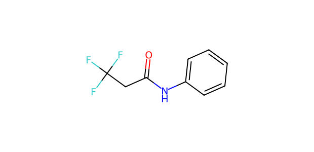
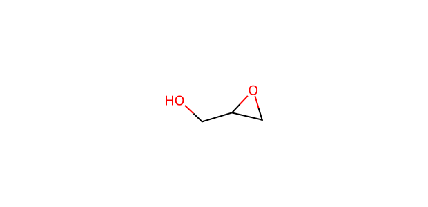

# AP105 · SH substrate–partner input

[All 108 inputs](../README.md) · [100 molecules](../../README.md)

**Electrophile:** `O=C(CC(F)(F)F)Nc1ccccc1`

**Donor:** `OCC1CO1`

**Donor family:** recorded SH label but no matching S-H site. **Primary relation:** Unmatched. **NP:** not applicable; **NR:** not applicable.

## Candidate associations

No route-compatible candidate relation was assigned. Recorded SH-route partner is glycidol, which has O–H but no sulfur; an OH analogy cannot validate this SH-route record.

## Experimental record context

**Reported execution:** executed. **Source appearances:** 2; **distinct recorded condition recipes:** 1. Repeated workbook appearances are not independent replicates.

**Input-identity status:** structure transcribed from workbook; not independently verified. **Product-identity status:** not independently confirmed. **Quantitative-result status:** not independently calibrated or verified.

| Workbook | Worksheet | Row | Sample | Condition |
| --- | --- | --- | --- | --- |
| Reaction screening and scope workbook | PL43-SH-substrate scope | 18 | CFC124009-19-3-PL43-W17 | AP105-C001 |
| Reaction screening and scope workbook | SHsubstrate scope | 18 | CFC124009-19-3-PL43-W17 | AP105-C001 |

The candidate relation is a structural comparison. Contemporaneous inventory, cost, safety, procurement and candidate-replacement decisions are not recorded. A family relation does not establish that the corresponding proposed product was observed.

The [full input table](../mapping_108.json) retains sample IDs, alternatives, unresolved labels and all route-compatible candidate links.
