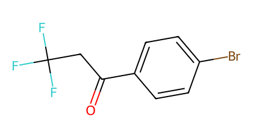
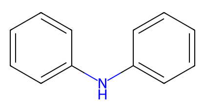

# AP109 · NH substrate-partner input

[All 112 inputs](../README.md) · [100 recommendations](../../README.md)

**Electrophile:** `O=C(CC(F)(F)F)c1ccc(Br)cc1`

**Donor:** `c1ccc(Nc2ccccc2)cc1`

**Donor family:** acyclic arylamine. **Primary relationship:** Exact identity. **NP:** 2; **NR:** 2.

## Recommendation relationships

| Recommendation | Relationship | Structural basis |
| --- | --- | --- |
| [C023](../../C023.md) | Exact identity | The recommended and experimental donor structures are identical. |

## Experimental record context

Reported execution: **executed**. Product identifier: **3j**. The [source register](../../../experiments/raw/product_structure_register.xlsx) records the electrophile, donor and product structures in Sheet1, row 17 (cells B17:D17).

The register does not encode sample identifiers, condition recipes or numerical responses. These fields remain empty in the ledger. Product identifiers are kept separately from sample identifiers.

**Recorded product structure:** `O=C(/C=C(\F)N(c1ccccc1)c1ccccc1)c1ccc(Br)cc1`

[Pair-specific novelty assessment](../../../code/data/novelty/reviewed/novelty_actual_pairs_112.json) · [Source manifest](../../../experiments/raw/product_structure_register_manifest.json)
