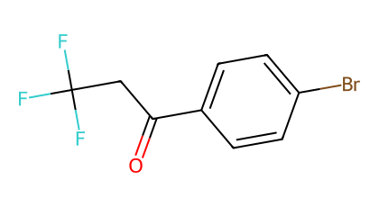
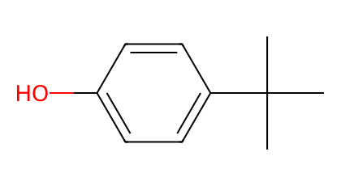

# AP111 · OH substrate-partner input

[All 112 inputs](../README.md) · [100 recommendations](../../README.md)

**Electrophile:** `O=C(CC(F)(F)F)c1ccc(Br)cc1`

**Donor:** `CC(C)(C)c1ccc(O)cc1`

**Donor family:** phenol/heteroaryl hydroxyl donor with possible competing sites. **Primary relationship:** Same scaffold, substituent or positional variation. **NP:** 2; **NR:** 2.

## Recommendation relationships

| Recommendation | Relationship | Structural basis |
| --- | --- | --- |
| [C076](../../C076.md) | Same scaffold, substituent or positional variation | The reacting-atom type and core scaffold are retained, while substitution or position differs. |
| [C072](../../C072.md) | Same scaffold, substituent or positional variation | The reacting-atom type and core scaffold are retained, while substitution or position differs. |
| [C073](../../C073.md) | Same scaffold, substituent or positional variation | The reacting-atom type and core scaffold are retained, while substitution or position differs. |

## Experimental record context

Reported execution: **executed**. Product identifier: **3aj**. The [source register](../../../experiments/raw/product_structure_register.xlsx) records the electrophile, donor and product structures in Sheet1, row 43 (cells B43:D43).

The register does not encode sample identifiers, condition recipes or numerical responses. These fields remain empty in the ledger. Product identifiers are kept separately from sample identifiers.

**Recorded product structure:** `CC(C)(C)c1ccc(O/C(F)=C/C(=O)c2ccc(Br)cc2)cc1`

[Pair-specific novelty assessment](../../../code/data/novelty/reviewed/novelty_actual_pairs_112.json) · [Source manifest](../../../experiments/raw/product_structure_register_manifest.json)
