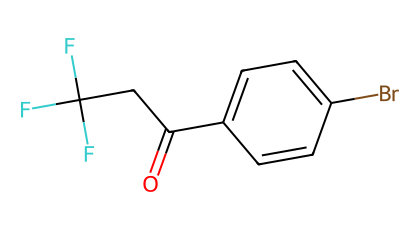
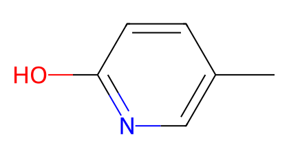

# AP112 · OH substrate-partner input

[All 112 inputs](../README.md) · [100 recommendations](../../README.md)

**Electrophile:** `O=C(CC(F)(F)F)c1ccc(Br)cc1`

**Donor:** `Cc1ccc(O)nc1`

**Donor family:** phenol/heteroaryl hydroxyl donor with possible competing sites. **Primary relationship:** Same donor family, different scaffold. **NP:** 2; **NR:** 2.

## Recommendation relationships

| Recommendation | Relationship | Structural basis |
| --- | --- | --- |
| [C072](../../C072.md) | Same donor family, different scaffold | The local donor type is retained, but the molecular scaffold differs. |
| [C099](../../C099.md) | Same donor family, different scaffold | The local donor type is retained, but the molecular scaffold differs. |
| [C098](../../C098.md) | Same donor family, different scaffold | The local donor type is retained, but the molecular scaffold differs. |

## Experimental record context

Reported execution: **executed**. Product identifier: **3an**. The [source register](../../../experiments/raw/product_structure_register.xlsx) records the electrophile, donor and product structures in Sheet1, row 3 (cells B3:D3).

The register does not encode sample identifiers, condition recipes or numerical responses. These fields remain empty in the ledger. Product identifiers are kept separately from sample identifiers.

**Recorded product structure:** `Cc1ccc(O/C(F)=C/C(=O)c2ccc(Br)cc2)nc1`

[Pair-specific novelty assessment](../../../code/data/novelty/reviewed/novelty_actual_pairs_112.json) · [Source manifest](../../../experiments/raw/product_structure_register_manifest.json)
