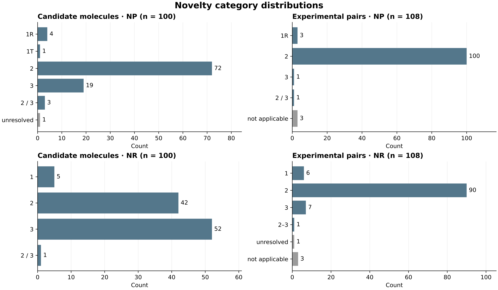

# Product and reaction novelty assessments

NP classifies proposed-product connectivity within a bounded identity and literature comparison. NR classifies the proposed reaction relative to its nearest precedent. These ordinal categories are kept separate; they are not added, averaged or converted into probabilities of success. They do not classify novelty of the purchased reagent or stereochemical priority.

## Definitions

| Assessment | Label | Meaning |
| --- | --- | --- |
| NP | 1R | Exact product connectivity registered or directly reported; R specifically identifies a database connectivity registration. |
| NP | 1T | Only a registered standardized tautomeric relationship; not identical bond-order graph. |
| NP | 2 | Exact match not found in the bounded search, but key connectivity and nearby scaffold have primary precedents. |
| NP | 3 | No matching key connectivity/charge endpoint precedent in the searched scope. |
| NP | unresolved | Evidence insufficient to assign a level; retained, never imputed as zero. |
| NP | not applicable | Recorded input lacks the route-required site; not a novelty score or failure. |
| NR | 1 | Same starting-substrate class, donor form and net transformation reported; original rubric allows an HRMS-supported proposed intermediate, which must be distinguished from an isolated product. |
| NR | 2 | Extension of a known reaction in substrate framework, donor or activation method. |
| NR | 3 | No matching target substrate–partner sequence established in the bounded search. |
| NR | unresolved | Endpoint-specific comparison unresolved. |
| NR | range | Alternative endpoints retain their separate labels, e.g. 2–3; no averaging. |

## Search scope

The assessment contains 202 saved PubChem PUG REST same-connectivity responses dated 21 October 2026: six matches and 196 no matches. The structural review distinguished five exact bond-order-graph matches and one standardized tautomer relationship. Literature comparisons used the project collection and logged Crossref, Europe PMC and OpenAlex searches. Evidence was interpreted at the available access level, including primary text, SI and figures where available, and author or patent abstracts otherwise. The register contains 35 novelty-reference records. Complete SciFinder/Reaxys reaction searches and exhaustive patent structure searches were not performed. A database no-match establishes neither a new compound nor a global first report.

[202 registry responses](../code/data/novelty/baseline/pubchem_identity_results.json) · [Novelty-reference records](../code/data/novelty/reviewed/novelty_sources.json) · [Definitions and complete numerical summaries](../code/data/mapping/novelty_summary.json) · [Reapply explicit review decisions](../code/README.md)

## Repository Figure N1 · Supplementary Figure 5

**Repository Figure N1 / Supplementary Figure 5. Product-connectivity novelty (NP; upper row) and reaction-precedent novelty (NR; lower row) for candidate molecules and recorded experimental combinations.** Mixed, unresolved and not-applicable categories remain explicit. The candidate denominator is 100 molecules; the experimental denominator is 108 ordered electrophile–donor pairs. Candidate labels are sets of all endpoint labels. The bounded search and different populations preclude interpreting these marginal distributions as novelty retention or improvement caused by human evaluation.

| Unit | NP distribution | NR distribution |
| --- | --- | --- |
| 100 candidate molecules | 1R: 4; 2: 72; 3: 19; 1T: 1; 3/2: 3; unresolved: 1 | 2: 42; 3: 52; 1: 5; 2 \| 3: 1 |
| 115 site/pathway hypotheses | 1R: 4; 2: 86; 3: 20; 1T: 1; 3/2: 3; unresolved: 1 | 2: 51; 3: 58; 1: 6 |
| 124 product options | 1R: 4; 2: 93; 3: 23; 1T: 1; unresolved: 3 | 2: 51; 3: 67; 1: 6 |
| 108 experimental pairs | 2: 100; not applicable: 3; 1R: 3; 3: 1; 3/2: 1 | 2: 90; not applicable: 3; 3: 7; 1: 6; unresolved: 1; 2–3: 1 |

The 124 candidate product-option records contain 96 distinct deposited SMILES. The 108 experimental pairs contain 105 applicable target hypotheses and 107 proposed product structures. Molecule centre tags are nonexclusive. At hypothesis level, C, N, O, S, P and Se contribute 38, 19, 18, 21, 18 and one records, with NP3 counts of 0, 3, 4, 8, 5 and 0; phosphorus also contains three mixed-NP hypotheses and one unresolved hypothesis. Full centre-specific and route-specific distributions remain in the [numerical summary](../code/data/mapping/novelty_summary.json). These counts describe the proposal collection and available precedent.

[Complete NP/NR chart: PNG](figures/N1_novelty_distributions.png) · [SVG](figures/N1_novelty_distributions.svg) · [NP-only companion view](figures/N1.png). Both chart views use the same recorded numerical summary; the complete chart is Supplementary Figure 5.

## Endpoint-specific exceptions

[C086](C086.md) retains unresolved NP for all three phosphorus endpoints. [C035](C035.md) retains parent-connectivity NP2 for its charged and neutral N-linked alternatives. AP043 retains NP1R and unresolved NR after the closer trifluoropropanamide/indole precedent was considered. AP064 retains NP3/NR3 for carboxyl-O and NP2/NR2 for phenolic-O; one endpoint’s rationale cannot be assigned to the other. AP002, AP045 and AP105 are not applicable to the recorded route and are not assigned experimental failures.

No paired estimate of novelty retention is supported because contemporaneous molecule-by-molecule selection or replacement decisions were not recovered. Candidate and experimental-input products may differ in electrophile and endpoint, and the experimental inputs are dominated by N–H/O–H/S–H donors. A relationship between novelty and verified reaction success is also unresolved because product identity and calibrated quantitative measurements are not uniformly established.

[108 experimental-input records](experiment_mapping/README.md) · [124 proposed product options](product_options/README.md)
