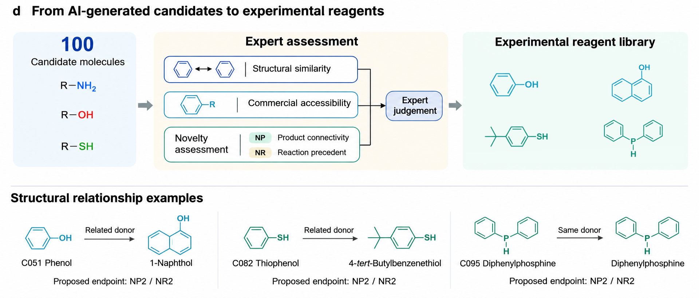

# From AI-generated candidates to experimental reagents

The **100 AI-generated candidates** provided a starting point for selecting experimental donors and proposed bond-forming pathways. Before the experimental reagent list was finalized, researchers considered structural relationships relevant to the intended bond-forming site and donor role, commercial accessibility, and the novelty classifications of proposed-product connectivity (NP) and reaction precedents (NR). Both recommended molecules and related analogues could enter this assessment. Researchers made the final choices through joint consideration of these factors, without a fixed cutoff or weighted total score.

## Selection criteria and counting units

Structural relationships retain differences in substitution, ring system and precursor form. Membership of the same donor family does not establish equivalent reactivity. Commercial accessibility was considered as a practical implementation factor. NP and NR remained separate classifications; neither was added to the other, averaged, or interpreted as a probability of reaction success.

| Population or record unit | Count | Interpretation |
| --- | --- | --- |
| AI-generated candidate molecules | 100 | Recommended inputs C001–C100, including alternative site/pathway hypotheses and endpoints |
| Final experimental donor collection | 100 | The author's final experimental donor count |
| Archived donor structures | 102 | Distinct donor structures in the recorded experimental-input dataset |
| Archived experimental combinations | 108 | Distinct ordered electrophile–donor pairs, involving five electrophiles |

The last two counts describe structure records and combinations; they do not redefine the final 100-donor collection. Repeated workbook appearances and multiple candidate associations are also distinct from independent experiments. The [record-interpretation guide](experiment_mapping/model_donors.md) explains these units and the source worksheets.

## Main Figure 4d

**Figure 4d | From AI-generated candidates to experimental reagents.** Researchers considered structural similarity, commercial accessibility and novelty classifications when selecting reagents for experimental testing. NP describes proposed-product connectivity and NR describes reaction precedent; they are shown as separate inputs to expert assessment. Structures in the right-hand panel are illustrative recorded experimental donors. The lower examples illustrate recorded structural associations between recommended and experimental donors, including related donors and an identical donor. Their arrows indicate structural relationships, not chemical transformations or independently documented replacement decisions. NP2/NR2 labels refer to the corresponding proposed products and reactions for each electrophile–donor combination; identical donor identity does not imply the same electrophile, reaction or product.

The three lower examples can be followed to their full records:

| Recommended donor | Recorded experimental donor | Structural association | Pair-specific NP / NR |
| --- | --- | --- | --- |
| [C051: phenol](C051.md) | [AP048: 1-naphthol](experiment_mapping/pairs/AP048.md) | Structural Analogue | 2 / 2 |
| [C082: benzenethiol](C082.md) | [AP090: 4-tert-butylbenzenethiol](experiment_mapping/pairs/AP090.md) | Structural Analogue | 2 / 2 |
| [C095: diphenylphosphine](C095.md) | [AP087: diphenylphosphine](experiment_mapping/pairs/AP087.md) | Exact Molecular Match | 2 / 2 |

The illustrated phenol in the experimental-library panel corresponds to [AP083](experiment_mapping/pairs/AP083.md). The full [association table, Repository Table R1](experiment_mapping/README.md), distinguishes exact molecular matches, reactive-form relationships, donor-family relationships and unmatched inputs. A structural relationship alone does not document a particular human substitution decision. The overall selection criteria are established, while item-specific procurement records, alternative lists and reasons for individual choices are not supplied.

[Complete Figure 4: PNG](../figures/main/Figure_4.png) · [JPEG](../figures/main/Figure_4.jpeg) · [Artwork sources and reproduction](../figures/README.md)

## NP/NR for the actual experimental inputs

When a candidate and an experimental input differ, the reported NP/NR classifications evaluate the **actual donor, electrophile and corresponding proposed product endpoint**. They are not inherited from a candidate through structural similarity. Alternative sites and endpoints retain their separate classifications, and mixed or unresolved labels are not replaced by the highest category.

Of the 100 candidate molecules, 72 carry only NP2 labels and 19 only NP3 labels. Of the 108 recorded experimental pairs, 100 (92.6%) are NP2 and 90 are NR2. These distributions describe the category composition of their respective populations. Different counting units and potentially different proposed endpoints prevent interpreting the marginal distributions as novelty retention or improvement. The complete NP and NR distributions remain [Repository Figure N1 / Supplementary Figure 5](novelty_assessment.md), with endpoint-specific evidence and exceptions.

[Candidate catalog](README.md) · [Novelty definitions and evidence](novelty_assessment.md) · [Computational methods](../code/METHODS.md#candidate-to-reagent-selection) · [Reading the article and SI](../docs/reading_guide.md)
