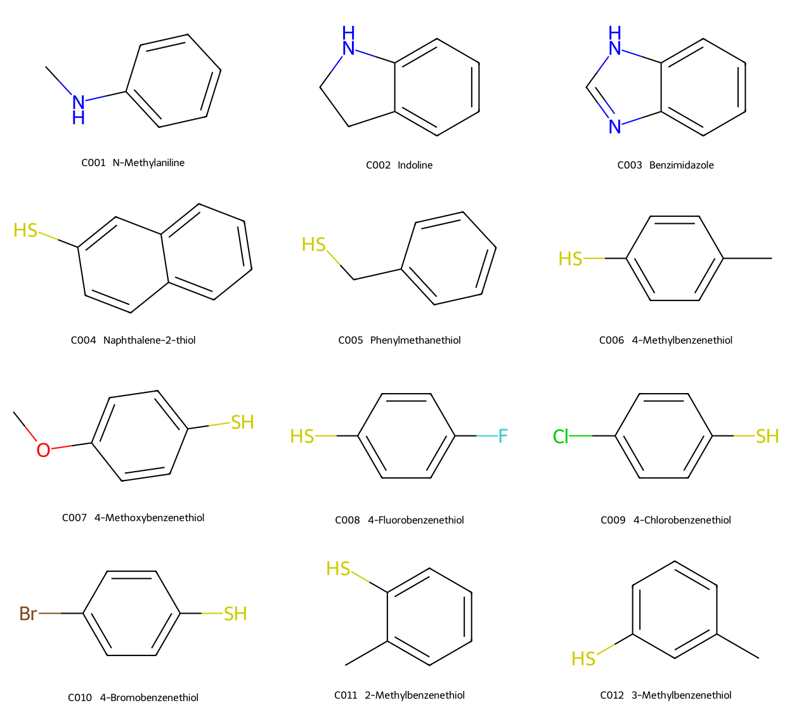
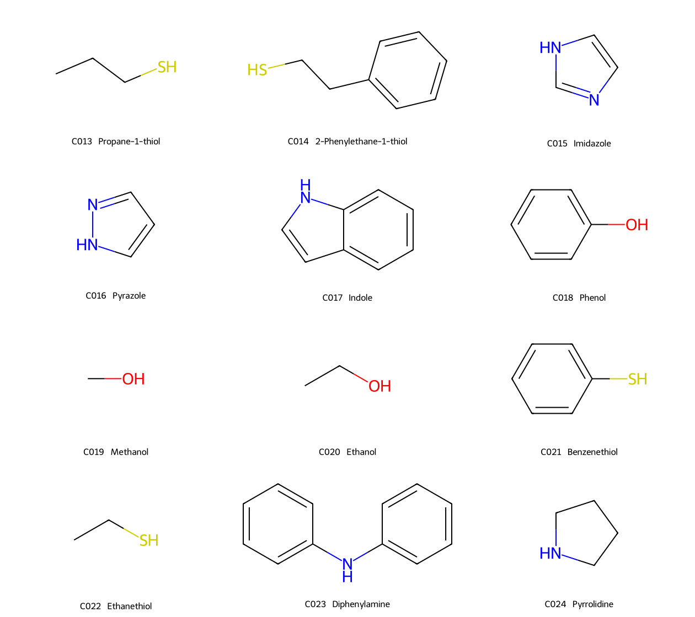
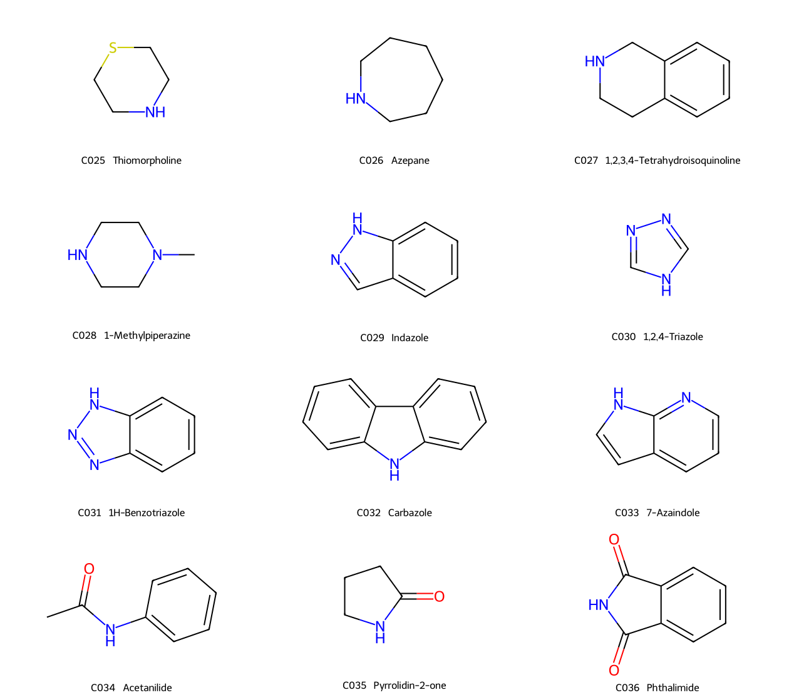
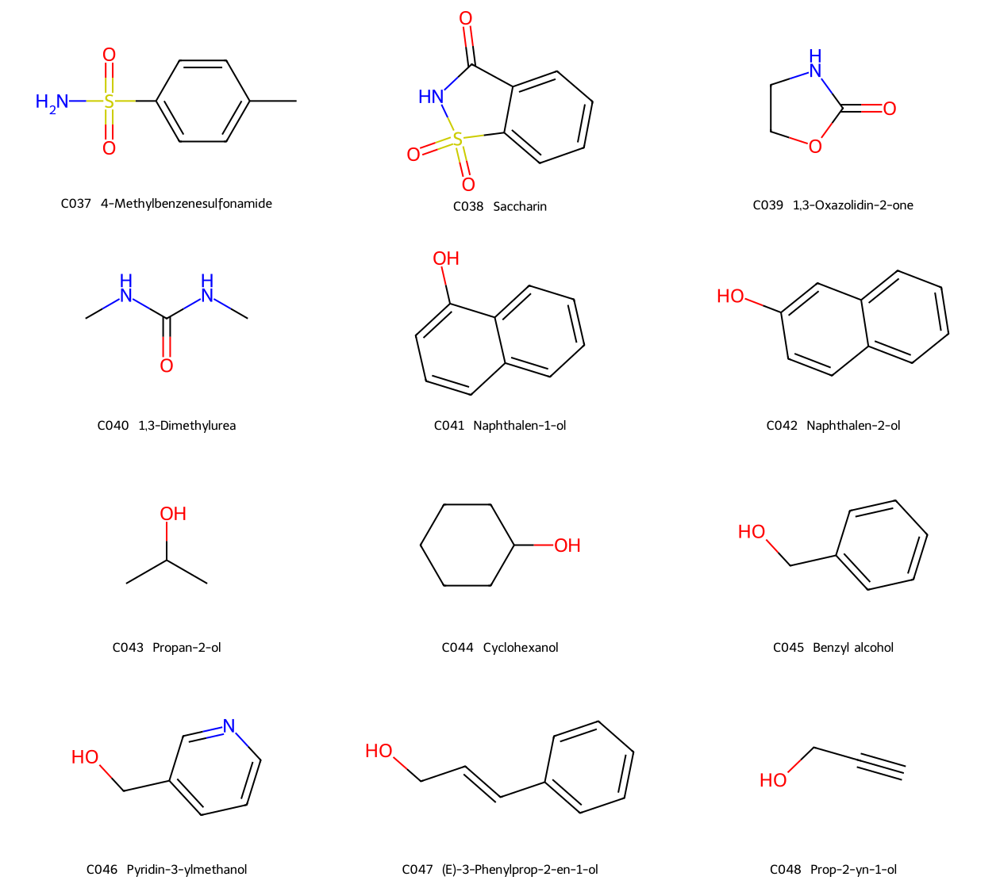
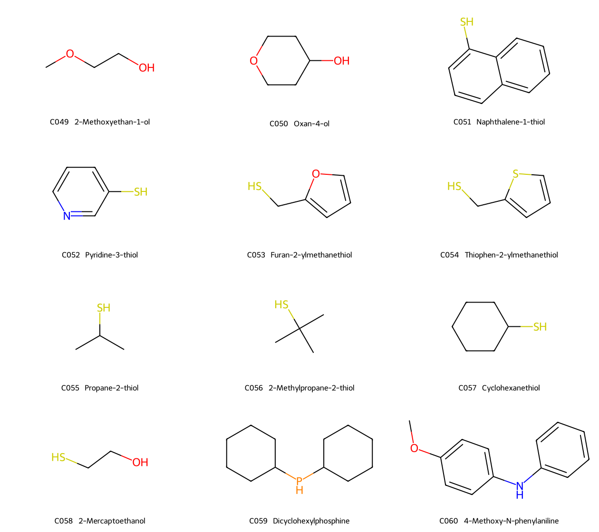
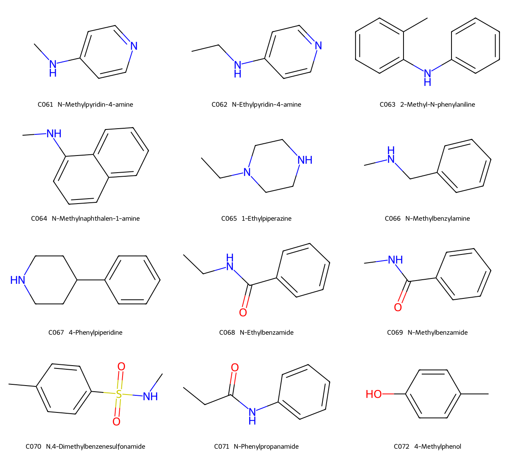
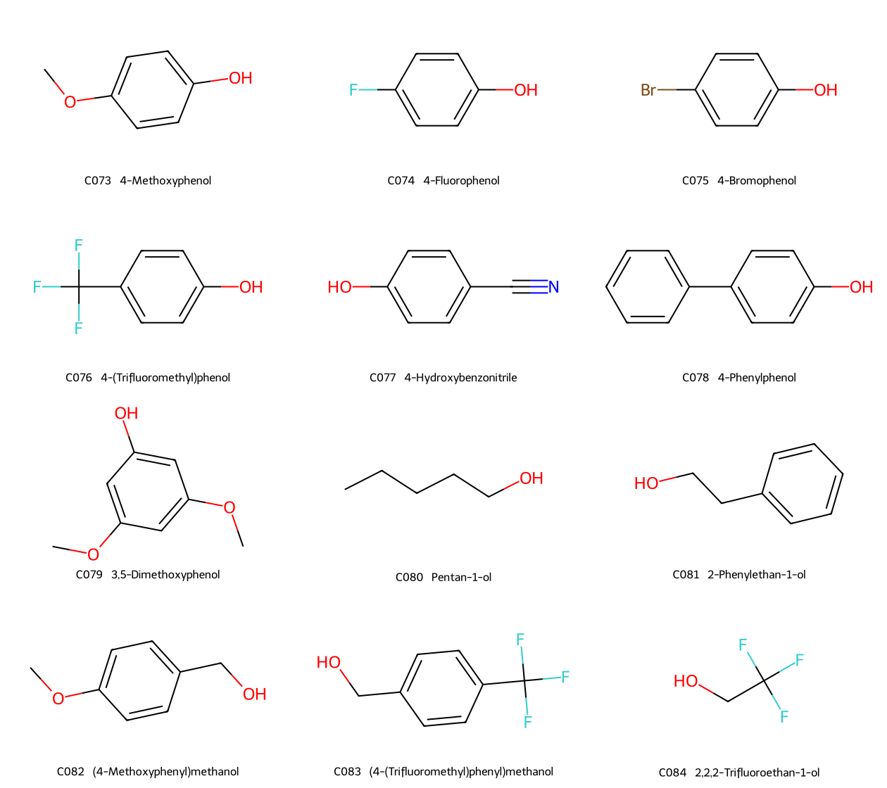
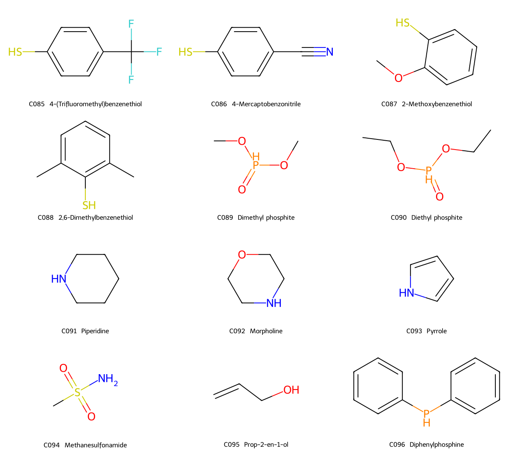
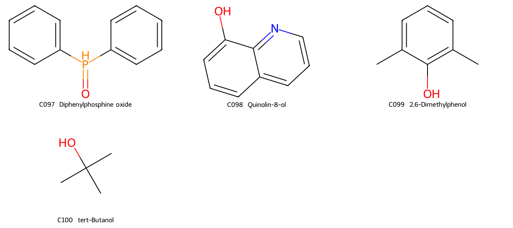

# Recommended-nucleophile structure atlas

The nine sheets show the 100 recommended molecular inputs in review-rank order. Candidate pages provide reacting-atom indices, RP provenance, proposed endpoints and experimental correspondence.

## C1: C001-C012

## C2: C013-C024

## C3: C025-C036

## C4: C037-C048

## C5: C049-C060

## C6: C061-C072

## C7: C073-C084

## C8: C085-C096

## C9: C097-C100

