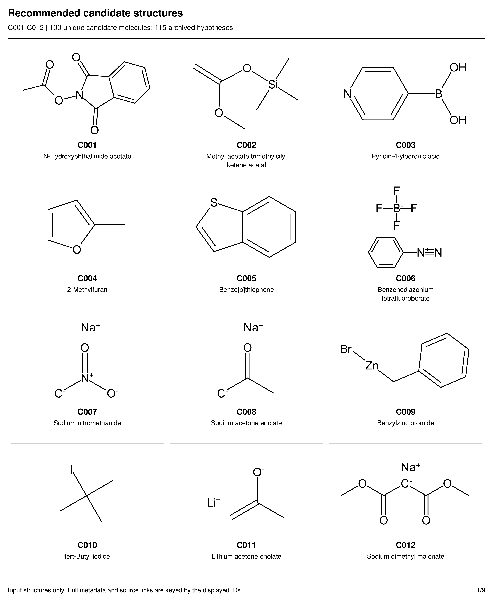
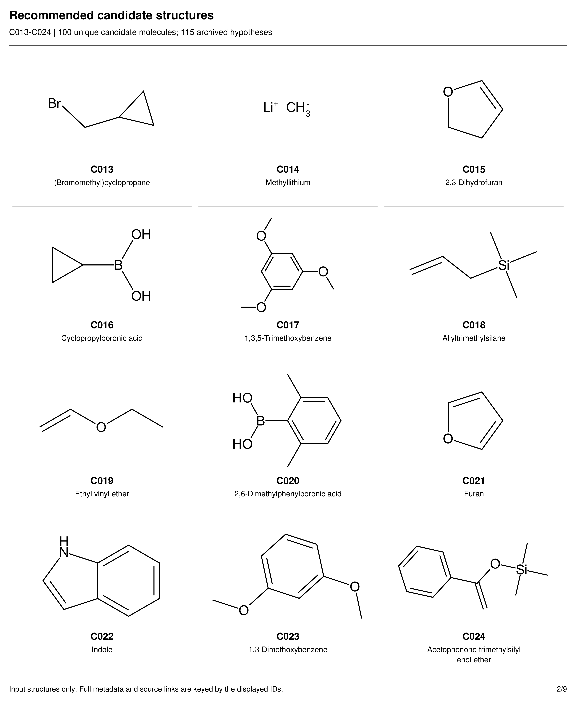
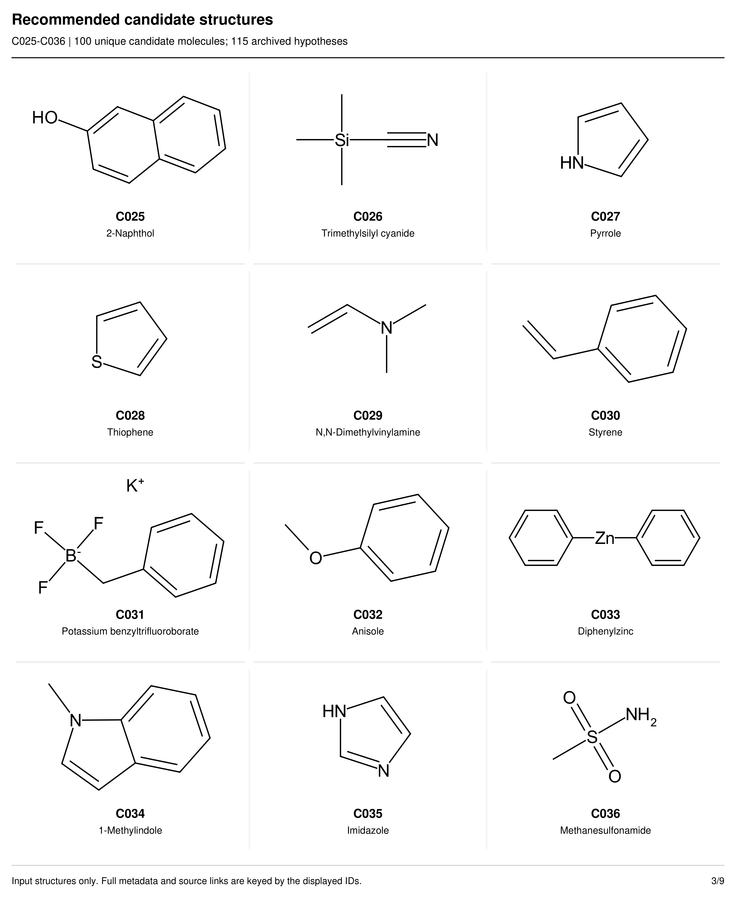
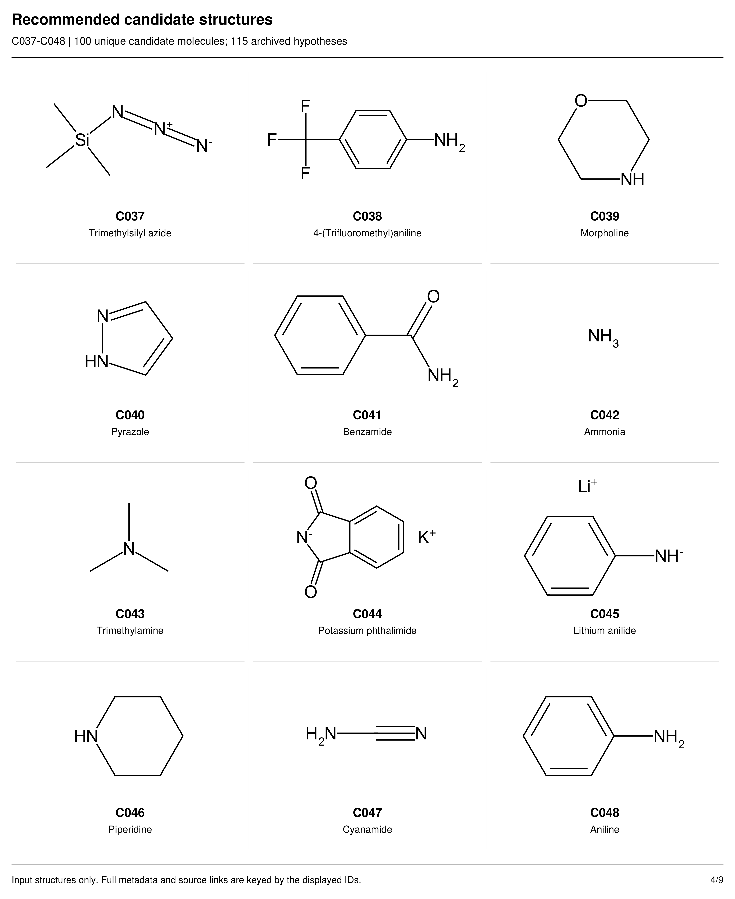
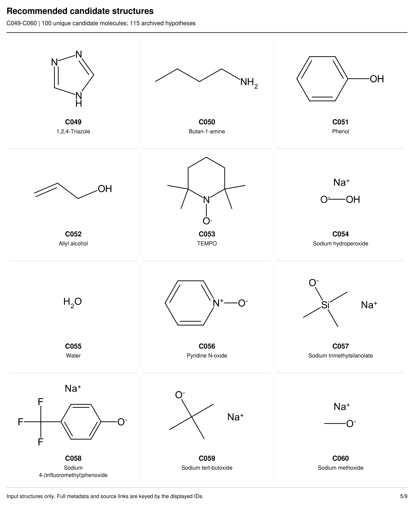
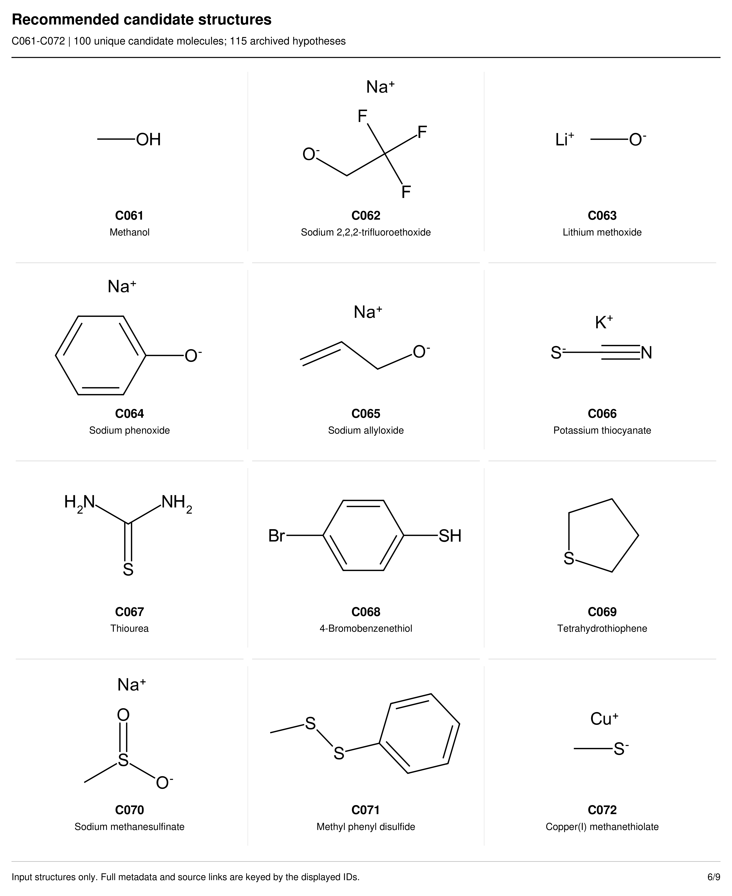
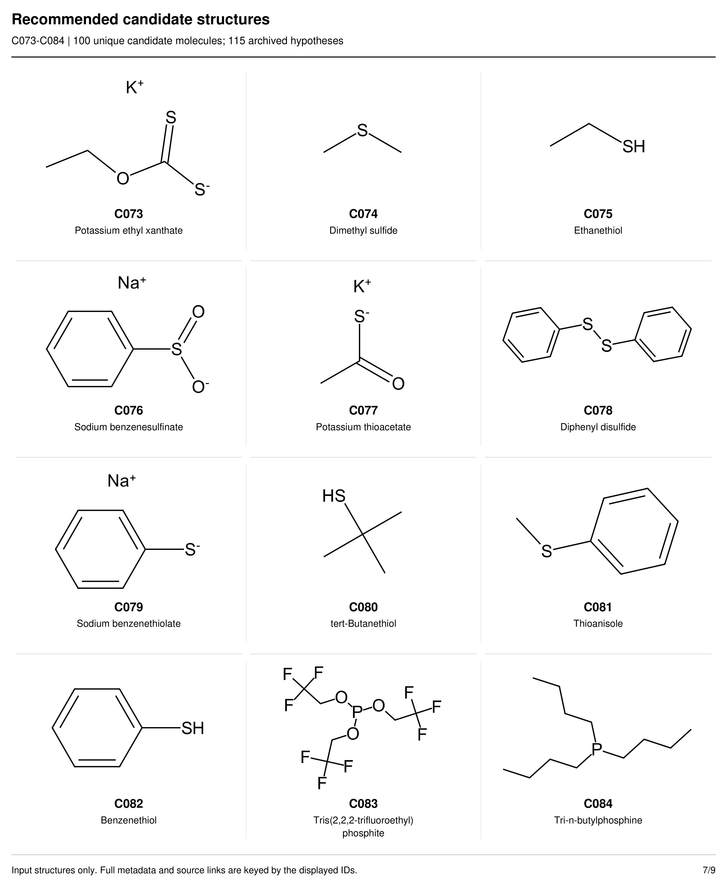
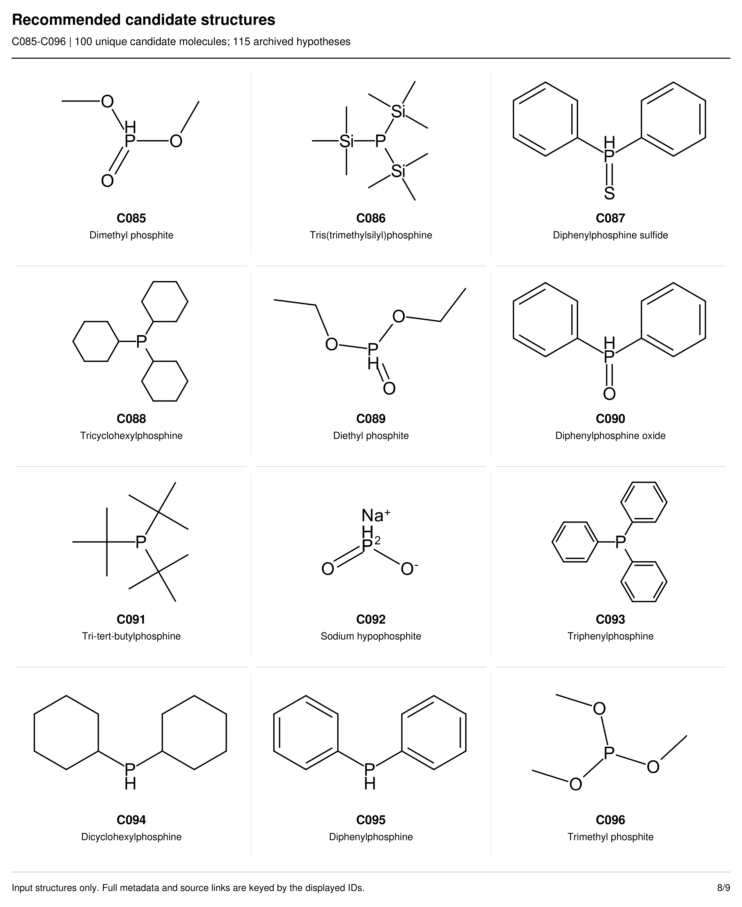
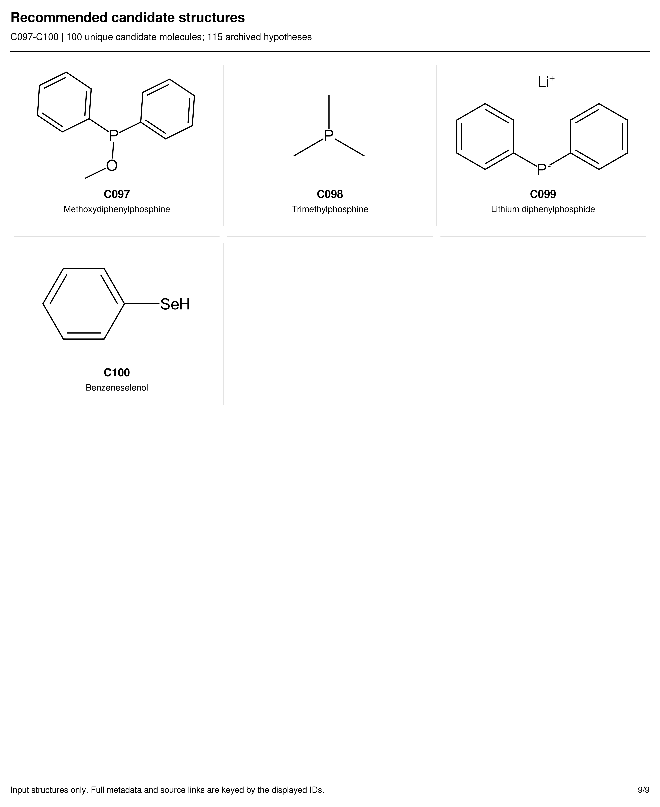

# Candidate input structure atlas

The atlas contains the same 100 recommended molecules listed in the [molecule catalog](README.md#molecule-index). Input structures preserve precursor forms, formal charges and disconnected counterions. They depict reagents rather than products. Each molecule page also contains reacting-site hypotheses, proposed products, rationale, citations and NP/NR assessments.

| Repository figure | Molecules | Input structures and chemical descriptions |
| --- | --- | --- |
| C1 | C001–C012 | [C001: N-Hydroxyphthalimide acetate](C001.md), [C002: Methyl acetate trimethylsilyl ketene acetal](C002.md), [C003: Pyridin-4-ylboronic acid](C003.md), [C004: 2-Methylfuran](C004.md), [C005: Benzo[b]thiophene](C005.md), [C006: Benzenediazonium tetrafluoroborate](C006.md), [C007: Sodium nitromethanide](C007.md), [C008: Sodium acetone enolate](C008.md), [C009: Benzylzinc bromide](C009.md), [C010: tert-Butyl iodide](C010.md), [C011: Lithium acetone enolate](C011.md), [C012: Sodium dimethyl malonate](C012.md) |
| C2 | C013–C024 | [C013: (Bromomethyl)cyclopropane](C013.md), [C014: Methyllithium](C014.md), [C015: 2,3-Dihydrofuran](C015.md), [C016: Cyclopropylboronic acid](C016.md), [C017: 1,3,5-Trimethoxybenzene](C017.md), [C018: Allyltrimethylsilane](C018.md), [C019: Ethyl vinyl ether](C019.md), [C020: 2,6-Dimethylphenylboronic acid](C020.md), [C021: Furan](C021.md), [C022: Indole](C022.md), [C023: 1,3-Dimethoxybenzene](C023.md), [C024: Acetophenone trimethylsilyl enol ether](C024.md) |
| C3 | C025–C036 | [C025: 2-Naphthol](C025.md), [C026: Trimethylsilyl cyanide](C026.md), [C027: Pyrrole](C027.md), [C028: Thiophene](C028.md), [C029: N,N-Dimethylvinylamine](C029.md), [C030: Styrene](C030.md), [C031: Potassium benzyltrifluoroborate](C031.md), [C032: Anisole](C032.md), [C033: Diphenylzinc](C033.md), [C034: 1-Methylindole](C034.md), [C035: Imidazole](C035.md), [C036: Methanesulfonamide](C036.md) |
| C4 | C037–C048 | [C037: Trimethylsilyl azide](C037.md), [C038: 4-(Trifluoromethyl)aniline](C038.md), [C039: Morpholine](C039.md), [C040: Pyrazole](C040.md), [C041: Benzamide](C041.md), [C042: Ammonia](C042.md), [C043: Trimethylamine](C043.md), [C044: Potassium phthalimide](C044.md), [C045: Lithium anilide](C045.md), [C046: Piperidine](C046.md), [C047: Cyanamide](C047.md), [C048: Aniline](C048.md) |
| C5 | C049–C060 | [C049: 1,2,4-Triazole](C049.md), [C050: Butan-1-amine](C050.md), [C051: Phenol](C051.md), [C052: Allyl alcohol](C052.md), [C053: TEMPO](C053.md), [C054: Sodium hydroperoxide](C054.md), [C055: Water](C055.md), [C056: Pyridine N-oxide](C056.md), [C057: Sodium trimethylsilanolate](C057.md), [C058: Sodium 4-(trifluoromethyl)phenoxide](C058.md), [C059: Sodium tert-butoxide](C059.md), [C060: Sodium methoxide](C060.md) |
| C6 | C061–C072 | [C061: Methanol](C061.md), [C062: Sodium 2,2,2-trifluoroethoxide](C062.md), [C063: Lithium methoxide](C063.md), [C064: Sodium phenoxide](C064.md), [C065: Sodium allyloxide](C065.md), [C066: Potassium thiocyanate](C066.md), [C067: Thiourea](C067.md), [C068: 4-Bromobenzenethiol](C068.md), [C069: Tetrahydrothiophene](C069.md), [C070: Sodium methanesulfinate](C070.md), [C071: Methyl phenyl disulfide](C071.md), [C072: Copper(I) methanethiolate](C072.md) |
| C7 | C073–C084 | [C073: Potassium ethyl xanthate](C073.md), [C074: Dimethyl sulfide](C074.md), [C075: Ethanethiol](C075.md), [C076: Sodium benzenesulfinate](C076.md), [C077: Potassium thioacetate](C077.md), [C078: Diphenyl disulfide](C078.md), [C079: Sodium benzenethiolate](C079.md), [C080: tert-Butanethiol](C080.md), [C081: Thioanisole](C081.md), [C082: Benzenethiol](C082.md), [C083: Tris(2,2,2-trifluoroethyl) phosphite](C083.md), [C084: Tri-n-butylphosphine](C084.md) |
| C8 | C085–C096 | [C085: Dimethyl phosphite](C085.md), [C086: Tris(trimethylsilyl)phosphine](C086.md), [C087: Diphenylphosphine sulfide](C087.md), [C088: Tricyclohexylphosphine](C088.md), [C089: Diethyl phosphite](C089.md), [C090: Diphenylphosphine oxide](C090.md), [C091: Tri-tert-butylphosphine](C091.md), [C092: Sodium hypophosphite](C092.md), [C093: Triphenylphosphine](C093.md), [C094: Dicyclohexylphosphine](C094.md), [C095: Diphenylphosphine](C095.md), [C096: Trimethyl phosphite](C096.md) |
| C9 | C097–C100 | [C097: Methoxydiphenylphosphine](C097.md), [C098: Trimethylphosphine](C098.md), [C099: Lithium diphenylphosphide](C099.md), [C100: Benzeneselenol](C100.md) |

**Repository Figures C1–C9. Recommended candidate input structures.** The ranges above retain C001–C100 and their input SMILES. The [catalog](README.md#molecule-index) displays all 100 structures together; the linked molecule pages provide larger structure depictions. Zero-based reacting-atom indices on hypothesis drawings refer to each hypothesis’s original SMILES order, which can differ from the input drawing order.

A historical exploration allocation contains 48 working and 52 reserve entries. The complete recommended collection remains 100 molecules. Structural sanitization, graph uniqueness and reacting-atom checks establish representation integrity; they do not establish reactivity or success. Coverage selection prioritizes reactive-centre and perspective coverage, then structural dissimilarity and citation availability, with a stable-identifier tie-break. Morgan fingerprints encode structural similarity; see [Rogers and Hahn, 2010](https://doi.org/10.1021/ci100050t).

[All input and hypothesis records](data/candidates_100.json) · [115 hypotheses](data/hypotheses_115.json) · [124 product options](product_options/README.md) · [Saved coverage selection and checks](../code/candidate_workflow/artifacts/released/coverage_audit.json) · [Selection implementation](../code/candidate_workflow/engine/pipeline/exploration_panel.py)

## Repository Figure C1

**Repository Figure C1. Recommended candidate input structures C001–C012.** Precursor forms, formal charges and counterions follow the specified input SMILES. Molecule numbers link to the chemical descriptions in the index above.

## Repository Figure C2

**Repository Figure C2. Recommended candidate input structures C013–C024.** Precursor forms, formal charges and counterions follow the specified input SMILES. Molecule numbers link to the chemical descriptions in the index above.

## Repository Figure C3

**Repository Figure C3. Recommended candidate input structures C025–C036.** Precursor forms, formal charges and counterions follow the specified input SMILES. Molecule numbers link to the chemical descriptions in the index above.

## Repository Figure C4

**Repository Figure C4. Recommended candidate input structures C037–C048.** Precursor forms, formal charges and counterions follow the specified input SMILES. Molecule numbers link to the chemical descriptions in the index above.

## Repository Figure C5

**Repository Figure C5. Recommended candidate input structures C049–C060.** Precursor forms, formal charges and counterions follow the specified input SMILES. Molecule numbers link to the chemical descriptions in the index above.

## Repository Figure C6

**Repository Figure C6. Recommended candidate input structures C061–C072.** Precursor forms, formal charges and counterions follow the specified input SMILES. Molecule numbers link to the chemical descriptions in the index above.

## Repository Figure C7

**Repository Figure C7. Recommended candidate input structures C073–C084.** Precursor forms, formal charges and counterions follow the specified input SMILES. Molecule numbers link to the chemical descriptions in the index above.

## Repository Figure C8

**Repository Figure C8. Recommended candidate input structures C085–C096.** Precursor forms, formal charges and counterions follow the specified input SMILES. Molecule numbers link to the chemical descriptions in the index above.

## Repository Figure C9

**Repository Figure C9. Recommended candidate input structures C097–C100.** Precursor forms, formal charges and counterions follow the specified input SMILES. Molecule numbers link to the chemical descriptions in the index above.
