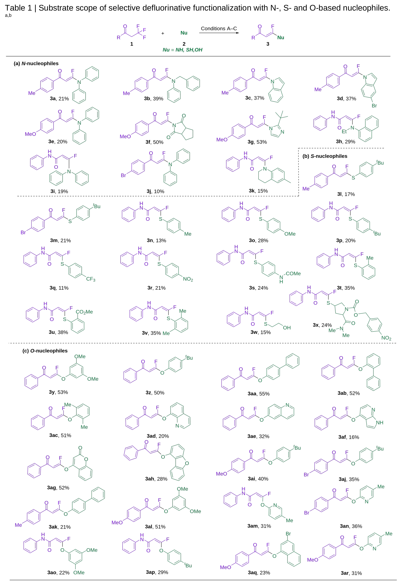

# Main Table 1: product scope

Table 1 contains 44 product assignments, numbered 3a–3ar: 11 N-functionalized
products (3a–3k), 13 S-functionalized products (3l–3x) and 20 O-functionalized
products (3y–3ar). Yields are quantitative 1H NMR yields measured with an
internal standard.

Selected products from the high-throughput screen were isolated and
characterized by NMR spectroscopy (SI Sections S7.5 and S7.6).

The author-provided Table 1 is preserved as an [EMF drawing](table1.emf)
and an [embedded editable OLE object](table1_editable_ole.bin). The
[source manifest](source_manifest.json) records their original document
members and SHA-256 hashes. It also records the 300-dpi PNG preview and its
crop from the rendered manuscript. Only the Table 1 assets are deposited here.

## Product records

| Table 1 product | Donor substituent | Yield | Experimental pair |
|---|---|---:|---|
| 3n | para-methyl | 13% | [AP097](../../candidates/experiment_mapping/pairs/AP097.md) |
| 3q | para-trifluoromethyl | 11% | [AP100](../../candidates/experiment_mapping/pairs/AP100.md) |

The [structured product records](table1_product_records.json) encode these
two assignments and their links to existing experimental pairs. The complete
44-product scope is shown in the deposited artwork. These records use the
author-provided Table 1 for product identity and NMR yield; the raw screening
workbooks and product–reagent register retain their recorded contents.

Both assignments belong to the existing 112-pair collection. The pair total,
donor total and NP/NR classifications are unchanged. The
[counting-unit guide](../../docs/product_scope.md) explains the distinction
between displayed products, experimental pairs and positive donors.

Run `python3 code/scripts/validate_product_scope.py` from the repository root
to check source hashes, read all 44 labels and yields from the EMF, and verify
the two curated records against the artwork and existing pair records.
