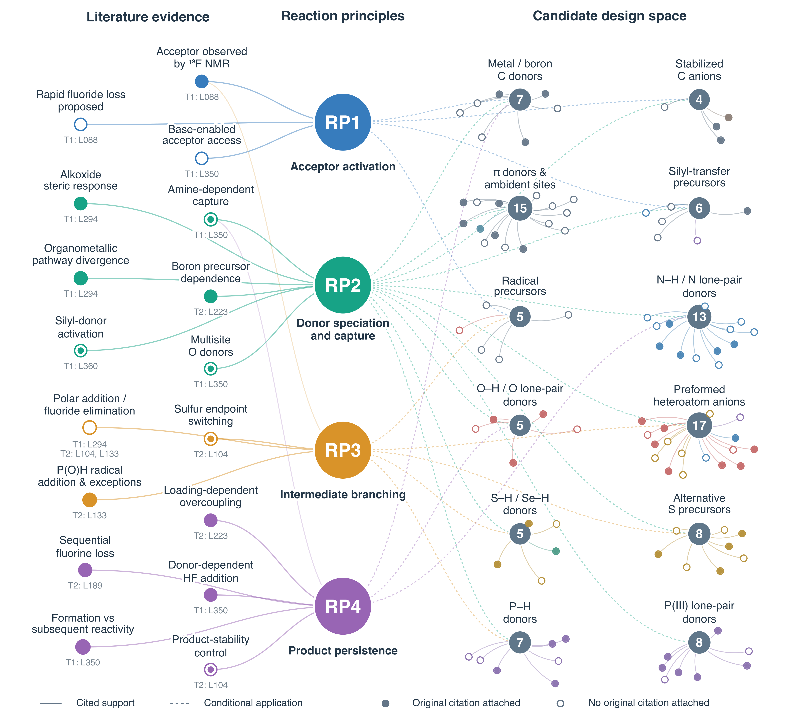
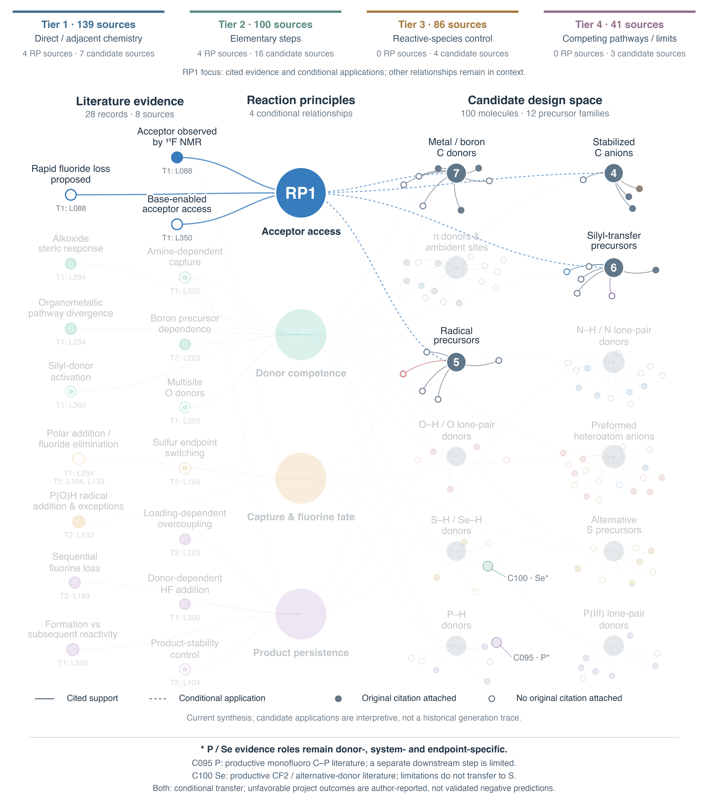
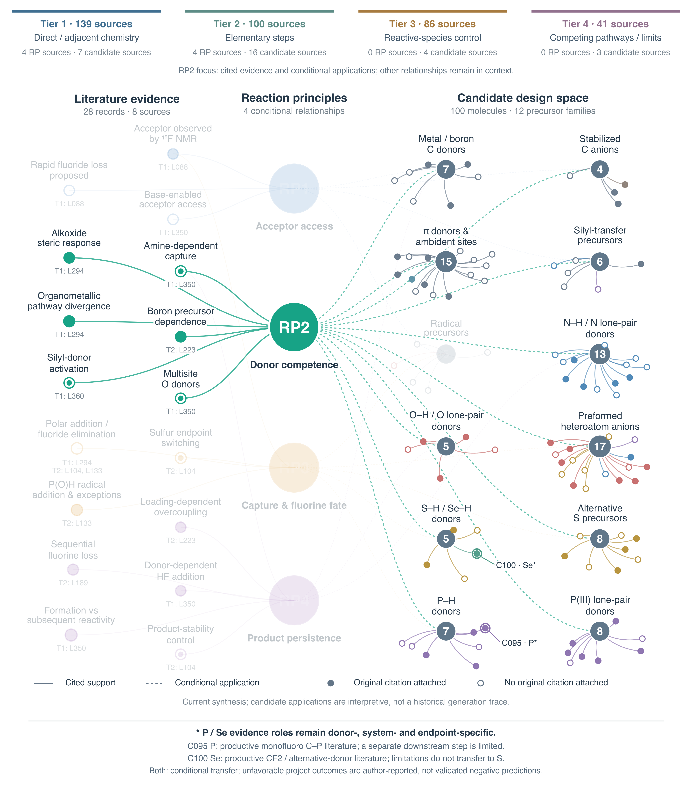
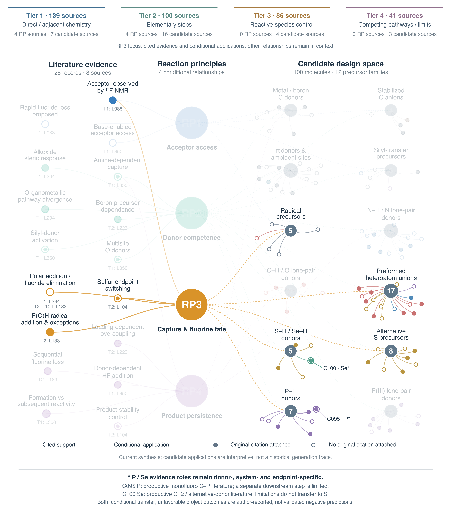
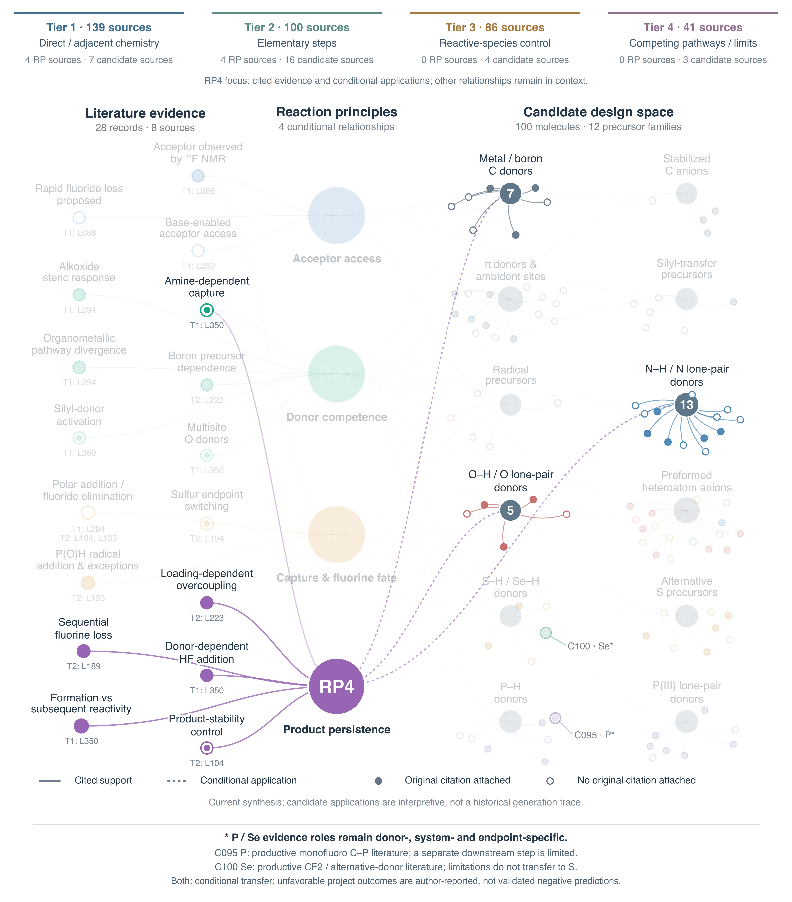
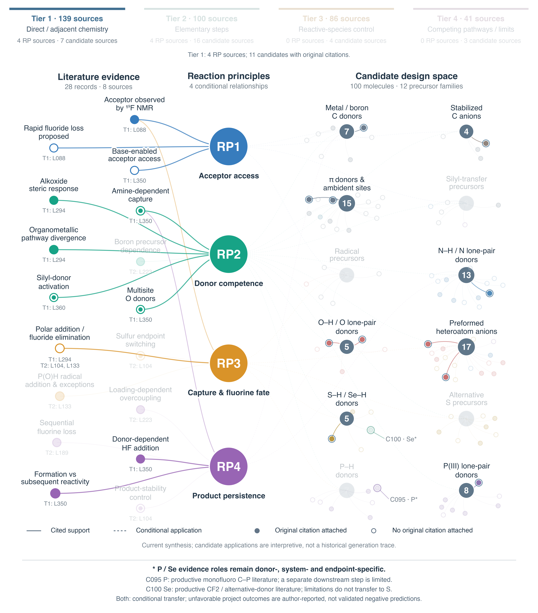
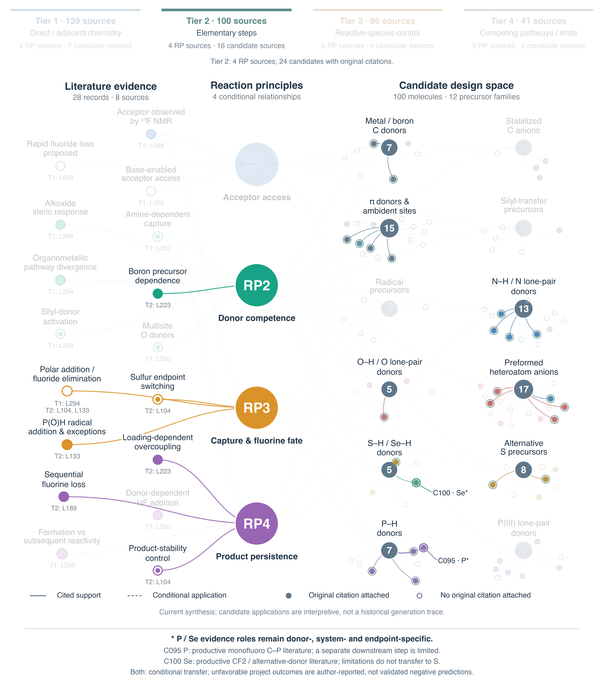
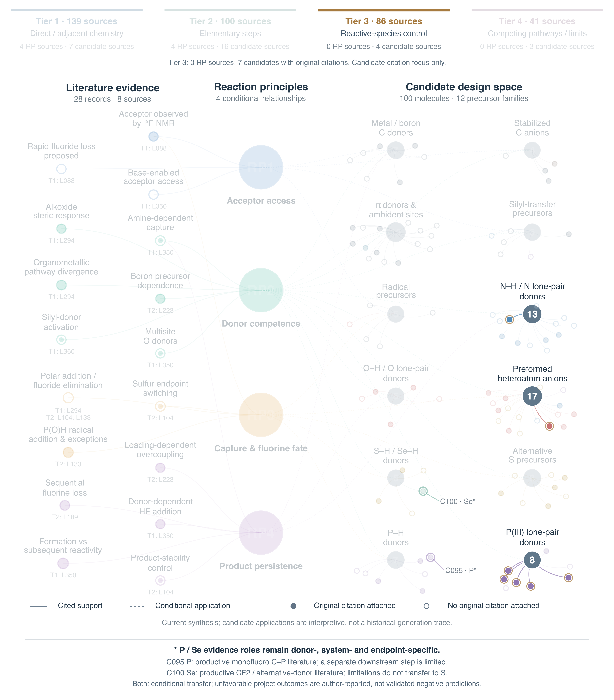
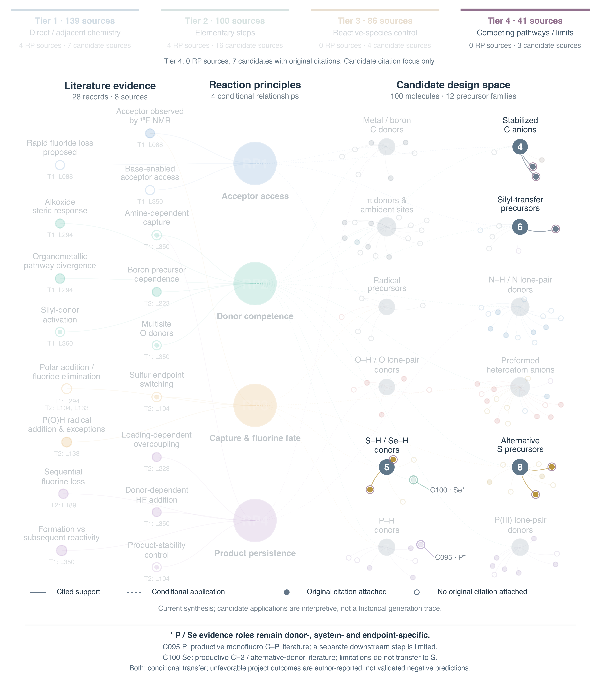

# Knowledge graph: evidence, reaction principles and candidate molecules

The network connects source observations to four conditional reaction principles and then to 100 recommended molecules. Evidence-to-principle edges carry cited support; principle-to-family edges state transfer questions; family-to-molecule edges record membership. These relations do not assign a yield or confirm formation of a target product. The four current principles and later applicability review remain separate from the original candidate-generation citations.

## Start with a chemical question

This folder brings together all knowledge-graph views, graph records and vector artwork supplied with the study. No programming is needed to read the figures or follow their links to individual evidence and molecule pages.

| What would you like to understand? | Read or inspect |
| --- | --- |
| How do literature observations connect to the candidate collection? | [Overall network · G1](#overall-network) |
| Which evidence and chemical families relate to one reaction principle? | [Principle views · G2–G5](#principle-focus-views) |
| How do the four literature tiers enter the graph? | [Source-tier views · G6–G9](#source-tier-focus-views) |
| What does each evidence node report? | [Evidence summaries and exact source passages](#evidence-summary-nodes) |
| Why is a principle connected to a precursor family? | [Conditional applications to the twelve families](#conditional-applications-to-precursor-families) |
| Which molecules had citations in the original recommendation? | [Original candidate citations](#original-candidate-citations) |
| What can I download or reproduce? | [Files and figure reconstruction](#files-and-figure-reconstruction) |

Read the graph from left to right: source evidence → reaction principle → precursor family → candidate molecule. **Solid evidence–principle edges indicate cited support; dashed principle–family edges indicate a conditional application; family–molecule edges indicate display membership.** A family groups precursor forms for reading the figure; it is not a predicted reactivity class. Filled candidate circles have an original item-level citation, whereas open circles do not. Node spacing and line length do not measure chemical similarity, confidence or reaction yield.

The identifiers connect the graph to the rest of the repository: **E01–E17** are evidence-summary nodes, **RP1–RP4** are reaction principles, **F01–F12** are display families and **C001–C100** are molecules. The linked **L** records identify publications and **Q** records give attributed source passages. [The repository reading guide](../docs/reading_guide.md) explains how these identifiers relate to the article and SI.

## Overall network



**Repository Figure G1. Evidence–principle–candidate network.** Seventeen evidence summaries represent 28 records from eight sources. Four principles connect to twelve display families and 100 candidate molecules through 19 source-to-principle edges, 23 conditional applications and 100 family memberships. Filled candidate nodes have an original item-level citation (46 molecules); open nodes lack one (54). Layout distances are non-quantitative. The separate phosphorus/selenium review has 23 substantive records and two metadata-only records; its scope is described in the [applicability guide](../evidence/applicability/README.md).

[Main Figure 3 vector artwork](figures/Figure_3.svg) · [Network records](data/network.json) · [Full network artwork](figures/network_full.svg) · [Figure reconstruction](../code/README.md#run-without-a-model-service)

The source-tier headings inside Figures G2–G9 refer to the 366-record source set represented in those drawings: 139, 100, 86 and 41 records in Tiers 1–4. The current 370-record catalog contains 139, 101, 88 and 42 records. These catalog totals are distinguished from the eight RP-supporting sources and from the original candidate citation links; the source-tier table below gives the current register.

## Principle focus views

Repository Figures G2–G5 show each principle in focus. The graph and coordinates remain unchanged; the other nodes and edges provide pale context. Focus does not change the original citation status of a candidate.

| Original repository view | Focus | SI artwork | Read the chemical evidence |
| --- | --- | --- | --- |
| [G2](figures/G2.png) | RP1 | [Supplementary Figure 1](figures/RP1_focus.png) | [RP1 source evidence and scope](../evidence/principles/RP1.md) |
| [G3](figures/G3.png) | RP2 | [Supplementary Figure 2](figures/RP2_focus.png) | [RP2 source evidence and scope](../evidence/principles/RP2.md) |
| [G4](figures/G4.png) | RP3 | [Supplementary Figure 3](figures/RP3_focus.png) | [RP3 source evidence and scope](../evidence/principles/RP3.md) |
| [G5](figures/G5.png) | RP4 | [Supplementary Figure 4](figures/RP4_focus.png) | [RP4 source evidence and scope](../evidence/principles/RP4.md) |

**Supplementary Figures 1–4** show the RP1–RP4 focus views, preserving all scientific nodes, edges and original candidate-citation states. The current 370-source tier totals are given in the [source-tier table](#source-tier-focus-views). The complete original G2–G5 views remain available below, with their 366-source headings distinguished from the current catalog.

### Repository Figure G2



**Repository Figure G2.** RP1 focus. This view emphasizes RP1, its currently cited supporting summaries and its selected conditional applications; the other nodes and edges are retained in pale context. The graph and coordinates are unchanged; pale elements supply context. No focus view changes candidate evidence status.

### Repository Figure G3



**Repository Figure G3.** RP2 focus. This view emphasizes RP2, its currently cited supporting summaries and its selected conditional applications; the other nodes and edges are retained in pale context. The graph and coordinates are unchanged; pale elements supply context. No focus view changes candidate evidence status.

### Repository Figure G4



**Repository Figure G4.** RP3 focus. This view emphasizes RP3, its currently cited supporting summaries and its selected conditional applications; the other nodes and edges are retained in pale context. The graph and coordinates are unchanged; pale elements supply context. No focus view changes candidate evidence status.

### Repository Figure G5



**Repository Figure G5.** RP4 focus. This view emphasizes RP4, its currently cited supporting summaries and its selected conditional applications; the other nodes and edges are retained in pale context. The graph and coordinates are unchanged; pale elements supply context. No focus view changes candidate evidence status.

## Source tier focus views

Repository Figures G6–G9 show each source tier in focus. A source tier describes chemical contribution, separately from access level and evidential strength. Candidate counts overlap across tiers. For tiers 3 and 4, there are no supporting sources in the core principle graph: only original candidate citations and family membership are highlighted. Contextual principle edges do not become tier-specific support.

| Figure | Tier | Registered sources | Core RP sources | Cited candidates | Original candidate sources |
| --- | --- | --- | --- | --- | --- |
| G6 | 1 · Direct and adjacent chemistry | 139 | 4 | 11 | 7 |
| G7 | 2 · Elementary steps | 101 | 4 | 24 | 16 |
| G8 | 3 · Reactive-species control | 88 | 0 | 7 | 4 |
| G9 | 4 · Competing pathways and limits | 42 | 0 | 7 | 3 |

[Complete tier membership and source identities](data/tier_summary.json) · [Literature catalog](../literature/README.md)

### Repository Figure G6



**Repository Figure G6.** This Tier 1 view highlights 4 registered RP-supporting sources and 11 candidates carrying original citations to 7 source records in this tier. Candidate citation counts overlap across tiers. Evidence-summary highlighting can involve a subset of its records; original candidate citation rings are tracked separately from RP support. Conditional RP-to-family edges remain contextual to avoid implying that tier membership independently supports every candidate.

### Repository Figure G7



**Repository Figure G7.** This Tier 2 view highlights 4 registered RP-supporting sources and 24 candidates carrying original citations to 16 source records in this tier. Candidate citation counts overlap across tiers. Evidence-summary highlighting can involve a subset of its records; original candidate citation rings are tracked separately from RP support. Conditional RP-to-family edges remain contextual to avoid implying that tier membership independently supports every candidate.

### Repository Figure G8



**Repository Figure G8.** This Tier 3 view highlights 0 registered RP-supporting sources and 7 candidates carrying original citations to 4 source records in this tier. Candidate citation counts overlap across tiers. There are no RP-supporting sources from this tier in the current graph; only original candidate citation nodes and their family-membership lines are emphasized. Pale RP edges are contextual, and no Tier-to-RP support edge has been added.

### Repository Figure G9



**Repository Figure G9.** This Tier 4 view highlights 0 registered RP-supporting sources and 7 candidates carrying original citations to 3 source records in this tier. Candidate citation counts overlap across tiers. There are no RP-supporting sources from this tier in the current graph; only original candidate citation nodes and their family-membership lines are emphasized. Pale RP edges are contextual, and no Tier-to-RP support edge has been added.

## Evidence summary nodes

| Node | Evidence type | Sources | Exact source passages |
| --- | --- | --- | --- |
| E01  Acceptor observed by ¹⁹F NMR | observation | [L088](../literature/sources/L088.md) | [Q01](../evidence/quotations/Q01.md) |
| E02  Rapid fluoride loss proposed | interpretation | [L088](../literature/sources/L088.md) | [Q02](../evidence/quotations/Q02.md) |
| E03  Base-enabled acceptor access | interpretation | [L350](../literature/sources/L350.md) | [Q39](../evidence/quotations/Q39.md) |
| E04  Amine-dependent capture | mixed | [L350](../literature/sources/L350.md) | [Q40](../evidence/quotations/Q40.md), [Q32](../evidence/quotations/Q32.md) |
| E05  Alkoxide steric response | observation | [L294](../literature/sources/L294.md) | [Q06](../evidence/quotations/Q06.md) |
| E06  Organometallic pathway divergence | observation | [L294](../literature/sources/L294.md) | [Q08](../evidence/quotations/Q08.md), [Q09](../evidence/quotations/Q09.md) |
| E07  Boron precursor dependence | observation | [L223](../literature/sources/L223.md) | [Q16](../evidence/quotations/Q16.md) |
| E08  Silyl-donor activation | mixed | [L360](../literature/sources/L360.md) | [Q43](../evidence/quotations/Q43.md) |
| E09  Multisite O donors | mixed | [L350](../literature/sources/L350.md) | [Q42](../evidence/quotations/Q42.md) |
| E10  Polar addition / fluoride elimination | interpretation | [L294](../literature/sources/L294.md), [L104](../literature/sources/L104.md), [L133](../literature/sources/L133.md) | [Q05](../evidence/quotations/Q05.md), [Q11](../evidence/quotations/Q11.md), [Q23](../evidence/quotations/Q23.md) |
| E11  Sulfur endpoint switching | mixed | [L104](../literature/sources/L104.md) | [Q12](../evidence/quotations/Q12.md), [Q13](../evidence/quotations/Q13.md) |
| E12  P(O)H radical addition & exceptions | observation | [L133](../literature/sources/L133.md) | [Q25](../evidence/quotations/Q25.md), [Q26](../evidence/quotations/Q26.md), [Q27](../evidence/quotations/Q27.md) |
| E13  Loading-dependent overcoupling | observation | [L223](../literature/sources/L223.md) | [Q17](../evidence/quotations/Q17.md) |
| E14  Sequential fluorine loss | observation | [L189](../literature/sources/L189.md) | [Q20](../evidence/quotations/Q20.md), [Q21](../evidence/quotations/Q21.md) |
| E15  Donor-dependent HF addition | observation | [L350](../literature/sources/L350.md) | [Q29](../evidence/quotations/Q29.md) |
| E16  Formation vs subsequent reactivity | observation | [L350](../literature/sources/L350.md) | [Q30](../evidence/quotations/Q30.md), [Q31](../evidence/quotations/Q31.md), [Q32](../evidence/quotations/Q32.md), [Q33](../evidence/quotations/Q33.md), [Q41](../evidence/quotations/Q41.md) |
| E17  Product-stability control | mixed | [L104](../literature/sources/L104.md) | [Q14](../evidence/quotations/Q14.md) |

## Conditional applications to precursor families

The twelve families partition the display by precursor form. They are not inferred chemical clusters, confidence categories or mutually exclusive types of chemical behaviour. Each application below states an activation, donor-form, endpoint or persistence question. A missing displayed edge does not establish irrelevance of a principle.

### F01 · Metal / boron C donors

Members (7): [C003](../candidates/C003.md), [C009](../candidates/C009.md), [C014](../candidates/C014.md), [C016](../candidates/C016.md), [C020](../candidates/C020.md), [C031](../candidates/C031.md), [C033](../candidates/C033.md).

- **RP1:** Require a compatible acceptor-access step while checking competing carbonyl attack by organometallic reagents; boron transfer need not share the Grignard pathway.

- **RP2:** Compare boronic acids, a boron salt, organolithium and organozinc forms; precursor identity changes active-donor availability and competing chemistry.

- **RP4:** Include aryl electronic and steric contrasts while monitoring further coupling; source-specific boronic-acid loading effects motivate endpoint accounting.

### F02 · Stabilized C anions

Members (4): [C007](../candidates/C007.md), [C008](../candidates/C008.md), [C011](../candidates/C011.md), [C012](../candidates/C012.md).

- **RP1:** A preformed carbon anion does not establish access to the fluorinated acceptor from the saturated precursor.

- **RP2:** Contrast counterions and resonance-stabilized carbon anions; retain the C/O alternatives of the lithium enolate.

### F03 · π donors & ambident sites

Members (15): [C004](../candidates/C004.md), [C005](../candidates/C005.md), [C015](../candidates/C015.md), [C017](../candidates/C017.md), [C019](../candidates/C019.md), [C021](../candidates/C021.md), [C022](../candidates/C022.md), [C023](../candidates/C023.md), [C025](../candidates/C025.md), [C027](../candidates/C027.md), [C028](../candidates/C028.md), [C029](../candidates/C029.md), [C030](../candidates/C030.md), [C032](../candidates/C032.md), [C034](../candidates/C034.md).

- **RP2:** Vary pi-donor electronics and the available bonding site; heteroatom content alone does not identify the intended transferred atom.

### F04 · Silyl-transfer precursors

Members (6): [C002](../candidates/C002.md), [C018](../candidates/C018.md), [C024](../candidates/C024.md), [C026](../candidates/C026.md), [C037](../candidates/C037.md), [C086](../candidates/C086.md).

- **RP1:** Require donor-unmasking conditions compatible with generating or engaging the fluorinated acceptor.

- **RP2:** Treat silyl precursors as latent donors with explicit activation hypotheses. The TMSCN/TMSCF3 precedent does not validate every listed silyl compound.

### F05 · Radical precursors

Members (5): [C001](../candidates/C001.md), [C006](../candidates/C006.md), [C010](../candidates/C010.md), [C013](../candidates/C013.md), [C053](../candidates/C053.md).

- **RP1:** Radical generation must be compatible with the target substrate and its activation; acceptor access is still unresolved.

- **RP3:** State a fluorine-count endpoint and discriminate hydrogen/proton termination from reduction followed by fluoride elimination.

### F06 · N–H / N lone-pair donors

Members (13): [C035](../candidates/C035.md), [C036](../candidates/C036.md), [C038](../candidates/C038.md), [C039](../candidates/C039.md), [C040](../candidates/C040.md), [C041](../candidates/C041.md), [C042](../candidates/C042.md), [C043](../candidates/C043.md), [C046](../candidates/C046.md), [C047](../candidates/C047.md), [C048](../candidates/C048.md), [C049](../candidates/C049.md), [C050](../candidates/C050.md).

- **RP2:** Span localized, aromatic, aryl-delocalized and carbonyl/sulfonyl-delocalized nitrogen donors, including neutral lone-pair cases; compare availability with capture competence.

- **RP4:** Separate formation of an N-linked fluorovinyl species from its downstream reactivity; the literature amine example distinguishes these endpoints.

### F07 · O–H / O lone-pair donors

Members (5): [C051](../candidates/C051.md), [C052](../candidates/C052.md), [C055](../candidates/C055.md), [C056](../candidates/C056.md), [C061](../candidates/C061.md).

- **RP2:** Contrast neutral alcohol, phenol, water and N-oxide donor forms; a common oxygen atom does not imply a common active species.

- **RP4:** Track donor-dependent fluorovinyl-product persistence independently of initial O-capture.

### F08 · Preformed heteroatom anions

Members (17): [C044](../candidates/C044.md), [C045](../candidates/C045.md), [C054](../candidates/C054.md), [C057](../candidates/C057.md), [C058](../candidates/C058.md), [C059](../candidates/C059.md), [C060](../candidates/C060.md), [C062](../candidates/C062.md), [C063](../candidates/C063.md), [C064](../candidates/C064.md), [C065](../candidates/C065.md), [C066](../candidates/C066.md), [C072](../candidates/C072.md), [C073](../candidates/C073.md), [C077](../candidates/C077.md), [C079](../candidates/C079.md), [C099](../candidates/C099.md).

- **RP2:** Compare preformed heteroatom salts with neutral donor counterparts and counterion/steric/electronic variants.

- **RP3:** An anionic donor makes addition/elimination plausible only conditionally; distinguish protonation, alternative bonding sites and fluorine-count outcomes.

### F09 · S–H / Se–H donors

Members (5): [C068](../candidates/C068.md), [C075](../candidates/C075.md), [C080](../candidates/C080.md), [C082](../candidates/C082.md), [C100](../candidates/C100.md).

- **RP2:** Contrast aryl/alkyl and hindered S–H donors; retain the separately scoped Se–H entry without inferring an element-wide activity ranking.

- **RP3:** S–H donors illustrate the need to distinguish polar and radical capture. Applying this question to Se–H remains an extrapolation, not direct source support.

### F10 · Alternative S precursors

Members (8): [C067](../candidates/C067.md), [C069](../candidates/C069.md), [C070](../candidates/C070.md), [C071](../candidates/C071.md), [C074](../candidates/C074.md), [C076](../candidates/C076.md), [C078](../candidates/C078.md), [C081](../candidates/C081.md).

- **RP2:** Thioethers, disulfides, sulfinates and thiourea require different active-donor generation and transfer hypotheses.

- **RP3:** Different sulfur precursor forms may enter different capture and termination routes; target connectivity and fluorine count must remain explicit.

### F11 · P–H donors

Members (7): [C085](../candidates/C085.md), [C087](../candidates/C087.md), [C089](../candidates/C089.md), [C090](../candidates/C090.md), [C092](../candidates/C092.md), [C094](../candidates/C094.md), [C095](../candidates/C095.md).

- **RP2:** P–H, P(O)–H, P(S)–H and an ionic P–H precursor are distinct donor forms; the reported phosphite failure is condition-specific.

- **RP3:** P(O)H literature separates polar fluoride elimination from peroxide-mediated CF2 retention, with explicit substrate and donor exceptions.

### F12 · P(III) lone-pair donors

Members (8): [C083](../candidates/C083.md), [C084](../candidates/C084.md), [C088](../candidates/C088.md), [C091](../candidates/C091.md), [C093](../candidates/C093.md), [C096](../candidates/C096.md), [C097](../candidates/C097.md), [C098](../candidates/C098.md).

- **RP2:** Vary P(III) steric and electronic environments and distinguish lone-pair donation from P–H deprotonation; no universal productive C–P transfer is asserted.

## Original candidate citations

There are 53 original citation links attached to 46 molecules. The other 54 molecules have no original item-level citation. Current principle support, original candidate citations and later novelty comparisons remain distinct. Each original evidence identifier below resolves through its molecule’s evidence section; the source page supplies the citation and tier context.

| Molecule | Original source | Tier | Evidence identifier |
| --- | --- | --- | --- |
| [C002](../candidates/C002.md) | [L242](../literature/sources/L242.md) | 4 | EV-042e7656e39b0b731f85 |
| [C005](../candidates/C005.md) | [L180](../literature/sources/L180.md) | 2 | EV-10948532de92a99f70bf |
| [C008](../candidates/C008.md) | [L242](../literature/sources/L242.md) | 4 | EV-042e7656e39b0b731f85 |
| [C011](../candidates/C011.md) | [L294](../literature/sources/L294.md) | 1 | EV-0147381122c8de5e5910 |
| [C012](../candidates/C012.md) | [L242](../literature/sources/L242.md) | 4 | EV-042e7656e39b0b731f85 |
| [C014](../candidates/C014.md) | [L294](../literature/sources/L294.md) | 1 | EV-0748fe7f1f6b8426a523 |
| [C022](../candidates/C022.md) | [L008](../literature/sources/L008.md) | 2 | EV-03d67effee574e6eac65 |
| [C022](../candidates/C022.md) | [L263](../literature/sources/L263.md) | 2 | EV-11522bb891d9dcc8568c |
| [C023](../candidates/C023.md) | [L240](../literature/sources/L240.md) | 1 | EV-48eb37d5fb134eb87354 |
| [C025](../candidates/C025.md) | [L008](../literature/sources/L008.md) | 2 | EV-03d67effee574e6eac65 |
| [C027](../candidates/C027.md) | [L042](../literature/sources/L042.md) | 2 | EV-01ab08e007d538959aa8 |
| [C031](../candidates/C031.md) | [L250](../literature/sources/L250.md) | 2 | EV-008e6a67f6d4aeeda23a |
| [C032](../candidates/C032.md) | [L240](../literature/sources/L240.md) | 1 | EV-48eb37d5fb134eb87354 |
| [C033](../candidates/C033.md) | [L280](../literature/sources/L280.md) | 2 | EV-3f742eacde1a2390370d |
| [C035](../candidates/C035.md) | [L149](../literature/sources/L149.md) | 2 | EV-1e43ef45fbcf734b7265 |
| [C039](../candidates/C039.md) | [L042](../literature/sources/L042.md) | 2 | EV-01ab08e007d538959aa8 |
| [C039](../candidates/C039.md) | [L291](../literature/sources/L291.md) | 2 | EV-1b3e449817b7a8af6763 |
| [C045](../candidates/C045.md) | [L149](../literature/sources/L149.md) | 2 | EV-0aeaccfbf471fb53b8f9 |
| [C046](../candidates/C046.md) | [L149](../literature/sources/L149.md) | 2 | EV-0aeaccfbf471fb53b8f9 |
| [C048](../candidates/C048.md) | [L149](../literature/sources/L149.md) | 2 | EV-0aeaccfbf471fb53b8f9 |
| [C048](../candidates/C048.md) | [L188](../literature/sources/L188.md) | 3 | EV-1703d0ec42f65b206996 |
| [C050](../candidates/C050.md) | [L164](../literature/sources/L164.md) | 1 | EV-074d492dbd8a30e03023 |
| [C051](../candidates/C051.md) | [L339](../literature/sources/L339.md) | 2 | EV-04055776926d615e33b8 |
| [C051](../candidates/C051.md) | [L143](../literature/sources/L143.md) | 2 | EV-0dfdbeb1b62f2091d0ae |
| [C052](../candidates/C052.md) | [L328](../literature/sources/L328.md) | 1 | EV-f127936b9e1695cc9eb4 |
| [C058](../candidates/C058.md) | [L143](../literature/sources/L143.md) | 2 | EV-7da5e9669723a5b61f27 |
| [C059](../candidates/C059.md) | [L320](../literature/sources/L320.md) | 2 | EV-2dc64a76aad27b044a9c |
| [C060](../candidates/C060.md) | [L294](../literature/sources/L294.md) | 1 | EV-96934ea0dd931848bee3 |
| [C061](../candidates/C061.md) | [L171](../literature/sources/L171.md) | 1 | EV-0ab81afddd146d0f0e2a |
| [C062](../candidates/C062.md) | [L030](../literature/sources/L030.md) | 2 | EV-42b5ae4dd5da4a11d07b |
| [C063](../candidates/C063.md) | [L075](../literature/sources/L075.md) | 3 | EV-da015cbe2893e2c9bd0a |
| [C064](../candidates/C064.md) | [L339](../literature/sources/L339.md) | 2 | EV-04055776926d615e33b8 |
| [C064](../candidates/C064.md) | [L143](../literature/sources/L143.md) | 2 | EV-7da5e9669723a5b61f27 |
| [C065](../candidates/C065.md) | [L294](../literature/sources/L294.md) | 1 | EV-96934ea0dd931848bee3 |
| [C068](../candidates/C068.md) | [L140](../literature/sources/L140.md) | 1 | EV-004adb2e200203ecfdf2 |
| [C068](../candidates/C068.md) | [L010](../literature/sources/L010.md) | 4 | EV-0147fcfd57979092286d |
| [C070](../candidates/C070.md) | [L250](../literature/sources/L250.md) | 2 | EV-3624092cf4a449b4ab75 |
| [C071](../candidates/C071.md) | [L039](../literature/sources/L039.md) | 4 | EV-0253e4f35bdf034af28e |
| [C074](../candidates/C074.md) | [L179](../literature/sources/L179.md) | 2 | EV-00dea1ae22867f2f1015 |
| [C078](../candidates/C078.md) | [L039](../literature/sources/L039.md) | 4 | EV-0253e4f35bdf034af28e |
| [C082](../candidates/C082.md) | [L010](../literature/sources/L010.md) | 4 | EV-0147fcfd57979092286d |
| [C082](../candidates/C082.md) | [L339](../literature/sources/L339.md) | 2 | EV-04055776926d615e33b8 |
| [C083](../candidates/C083.md) | [L128](../literature/sources/L128.md) | 3 | EV-4d92eba46fd9ebc390ce |
| [C084](../candidates/C084.md) | [L205](../literature/sources/L205.md) | 3 | EV-4158ec0d9401ca35bf8b |
| [C087](../candidates/C087.md) | [L085](../literature/sources/L085.md) | 2 | EV-052ef9a9800401396c8b |
| [C088](../candidates/C088.md) | [L342](../literature/sources/L342.md) | 1 | EV-4fab030258a88044b80e |
| [C089](../candidates/C089.md) | [L085](../literature/sources/L085.md) | 2 | EV-052ef9a9800401396c8b |
| [C090](../candidates/C090.md) | [L133](../literature/sources/L133.md) | 2 | EV-02d0fdb64e035df834f5 |
| [C093](../candidates/C093.md) | [L205](../literature/sources/L205.md) | 3 | EV-4158ec0d9401ca35bf8b |
| [C095](../candidates/C095.md) | [L274](../literature/sources/L274.md) | 2 | EV-307199e244a61dbf5ab4 |
| [C096](../candidates/C096.md) | [L128](../literature/sources/L128.md) | 3 | EV-4d92eba46fd9ebc390ce |
| [C097](../candidates/C097.md) | [L128](../literature/sources/L128.md) | 3 | EV-4d92eba46fd9ebc390ce |
| [C100](../candidates/C100.md) | [L339](../literature/sources/L339.md) | 2 | EV-04055776926d615e33b8 |

## Phosphorus and selenium evidence states

P–H, P(III) lone-pair and Se–H donors retain their individual identities. Favorable literature outcomes, source-specific limits and project control reports are separate attributes. [C095](../candidates/C095.md) and [C100](../candidates/C100.md) have positive original local analogies and explicit risks, without a recovered adverse prediction specific to those donors before experiment. C095 is linked to AP087/AP088; the target assignment and reliable quantitative negative result are unresolved. C100 has an author-reported trial without a linked Se sample. An S–H/Se–H family label describes an X–H motif and does not transfer a sulfur outcome to selenium. No validated negative-outcome edge is assigned.

[Source-specific applicability records](../evidence/applicability/README.md) · [Candidate and project annotations in the network records](data/network.json)


## Files and figure reconstruction

| Location | Contents and use |
| --- | --- |
| [figures/G1.png](figures/G1.png) to [figures/G9.png](figures/G9.png) | The nine supplied network views shown above. Their G labels are stable repository figure identifiers. |
| [RP1](figures/RP1_focus.png), [RP2](figures/RP2_focus.png), [RP3](figures/RP3_focus.png), [RP4](figures/RP4_focus.png) | RP1–RP4 focus views used as Supplementary Figures 1–4; their correspondence to the original G views is given above. |
| [figures/network_full.svg](figures/network_full.svg) | Full editable vector artwork for the overall network. |
| [figures/Figure_3.svg](figures/Figure_3.svg) | The cropped network projection supplied as main Figure 3. |
| [data/network.json](data/network.json) | Nodes, edges, source evidence, chemical family membership and candidate annotations. |
| [data/tier_summary.json](data/tier_summary.json) | Current tier membership, source identities and citation coverage. |
| [data/figure_captions.json](data/figure_captions.json) | Preserved overall caption metadata, including historical export locations. Use the figure links in this guide to access the supplied artwork. |
| [Figure 3 reconstruction script](../code/scripts/reproduce_figure3.py) | Reconstructs the supplied main-figure projection from the full SVG and checks the resulting SVG tree. |

To verify the Figure 3 reconstruction using only the Python standard library, run this command from the repository root:

```bash
python code/scripts/reproduce_figure3.py --output-dir /tmp/reaction-figure3
```

Optional PDF and PNG export requires the figure dependencies and librsvg's `rsvg-convert`, as described in [code/README.md](../code/README.md#run-without-a-model-service); add `--render` to the command above. The PDF export retains the dashed conditional-application edges and edge transparency. The reconstruction preserves the frozen graph geometry and does not infer new relations. G1–G9 are the supplied views; the script reconstructs main Figure 3, not those nine PNGs.

The original G1–G9 figures and structured records retain their supplied contents. The 366-record source-tier headings in G2–G9 are therefore retained and explicitly distinguished above from the current 370-record catalog. Original candidate citations, current principle support and the separate P/Se applicability review remain distinct evidence layers.

[Repository overview](../README.md) · [Chemical evidence](../evidence/) · [Recommended molecules](../candidates/) · [Literature catalog](../literature/)
